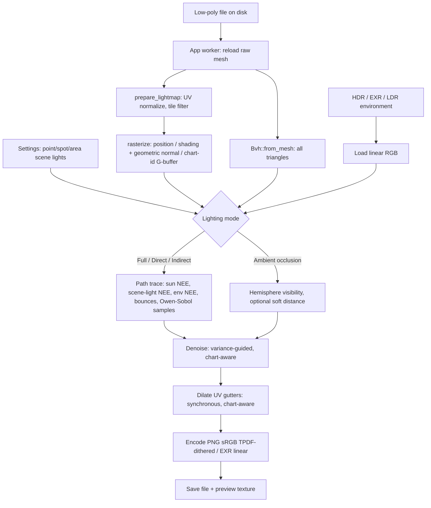

# Lightmap Baking — Technical Reference (v2)

This document describes how N-shade turns an imported low-poly mesh and a lighting
setup into a baked lightmap. It covers the data flow, the path-tracing math, the
CPU and GPU backends, denoising, output encoding, editor/CLI integration, and the
known limits of the implementation.

The source of truth is the code, not this document. Each section names the file
that implements it so the two can be kept in sync.

---

## 0. What is new in v2 (read this first)

v1 of this document described a working baker. v2 keeps every v1 behavior
available and adds a set of **artifact and banding fixes**. Sections 1–19 are the
v1 reference, updated in place; changes are marked **[v2]**. Part II (§20–§26) is
the implementation guide: diagnosis, Rust code, WGSL parity, tests, rollout.

> **Read this caveat.** The v2 edits were written from this document, not from
> the source tree. Function names, signatures and the `Vec3` type (assumed to be
> `glam::Vec3`) follow the descriptions in §1–§19. The Rust and WGSL in Part II
> have **not been compiled** against N-shade. Treat each snippet as a reviewed
> template that you adapt to the real signatures, land phase by phase (§24), and
> run through the test plan (§23). §26 lists every assumption.

### 0.1 Summary of changes

| # | Symptom | Root cause in v1 | v2 fix | Section | Default |
|---|---|---|---|---|---|
| 1 | Faint 4×4 crosshatch in smooth gradients | Ordered Bayer dither has a visible period and a small negative bias | TPDF dither from interleaved gradient noise | §21.10 | on |
| 2 | Posterized steps in dark falloff, worse after engine compression | 8-bit sRGB quantization | Optional 16-bit PNG, EXR guidance | §21.10 | 8-bit |
| 3 | Flat white plateaus around bright lights | Hard clip at 1.0 after exposure | Optional highlight rolloff | §21.10 | off |
| 4 | AO terraces (at most `samples + 1` grey levels) | Binary visibility per ray | Distance-weighted soft occlusion, stratified rays | §21.7 | off (infinite ray, v1) |
| 5 | Low-frequency blotches that barely improve with samples | White-noise sampling, denoiser with no luminance guide | Owen-scrambled Sobol sampling, variance-guided à-trous | §21.2, §21.6 | on |
| 6 | Light bleeding between neighbouring islands | Edge-stopping by position/normal only; position sigma grows each pass | Chart-ID stop, plane-distance weight with fixed sigma | §21.4, §21.6 | on |
| 7 | Triangle-shaped facets, dark wedges, speckle on smooth-shaded low-poly | Rays and offsets use the interpolated normal; shadow-terminator self-occlusion | Geometric normal for offsets, scale-aware epsilon, terminator offset | §21.3 | on |
| 8 | Dark halos and lines at island edges, pinholes | Pixel-centre-only coverage, strict barycentric test, 4-neighbour copy dilation | Edge extension, tolerance, chart-aware averaged dilation | §21.4, §21.9 | on |
| 9 | Fireflies from an HDR sun disk | Nearest-texel environment lookup on escaped rays | Bilinear environment lookup | §21.8 | on |
| 10 | CPU and GPU bakes differ visibly | Different RNG and offsets | Same sampler, offsets and weights in WGSL | §21.11 | on |

### 0.2 Safety contract ("do not mess up the software")

1. **Legacy is one switch away.** `LightmapPipeline::Legacy` reproduces v1 in
   every code path touched by v2. Every v2 branch is gated by a `Features` flag
   derived from that enum (§21.1), so one feature can be disabled on its own.
2. **Old projects do not change.** Saved settings that lack the new fields
   deserialize as `Legacy`. Newly created settings default to `V2` once phase 6
   of §24 lands; until then the default is `Legacy`.
3. **Additive API.** No public function signature changes. New functions sit
   next to the old ones; internal structs (`GBuffer`, `Params`) only gain fields
   at the end.
4. **Struct-literal call sites.** Adding fields to `LightmapSettings` breaks any
   `LightmapSettings { .. }` literal that does not end in
   `..Default::default()`. Run `rg "LightmapSettings \{"` before starting and fix
   those first.
5. **GPU layout is append-only.** `Params` gains two trailing `vec4`s. No new
   storage binding is added: the geometric normal is packed into the unused
   `normals[i].w` and the variance into the unused `acc.w` (§21.11, assumption 5
   in §26). A layout test (§23.6) fails the build if Rust and WGSL disagree.
6. **EXR stays linear and un-encoded.** Output encoding changes affect PNG only.
   EXR changes only through better radiance.
7. **One phase per pull request.** §24 orders the phases from lowest to highest
   risk. Each phase has its own tests and can be reverted alone.

### 0.3 Evidence

These numbers come from small **Python re-implementations of the algorithms**
run on synthetic data. They are not measurements of N-shade, your assets or the
Rust code. Use them to judge direction and rough size, then measure on your own
meshes with the harness in §23.

| Check | v1 behavior | v2 behavior |
|---|---|---|
| Shallow dark gradient (0.010 → 0.016 linear), 8-bit, blurred 8×8 error | Bayer ±0.5 LSB: RMSE 0.037 LSB, mean bias −0.030 LSB, period-4 pattern | TPDF + interleaved gradient noise: RMSE 0.019 LSB, bias −0.0004 LSB, no period |
| AO-style visibility integral, RMSE at 16 / 64 / 128 / 256 samples | White noise: 0.116 / 0.060 / 0.041 / 0.029 | Owen-scrambled Sobol: 0.054 / 0.020 / 0.013 / 0.007 (2.1× to 4.1× lower) |
| Two adjacent islands in the same plane, noisy input RMSE 0.248, error beside the seam 0.172 | Position/normal-only à-trous: RMSE 0.109, seam error **0.220** (worse than input) | Chart-ID + variance-guided: RMSE 0.023, seam error 0.027 |
| Closest point on a triangle in UV space (edge extension) | not present | 0 mismatches against brute force on 568 random cases |

Note on row 1: the v1 Bayer dither already removes most tonal banding. If your
banding is visible **in the viewer** rather than only in the saved PNG, the
cause is more likely items 4–8 in §0.1 or texture compression in the engine
(§20.2).

---

## 1. Scope and vocabulary

| Term | Meaning in this codebase |
|---|---|
| **Lightmap** | A white-diffuse irradiance/radiance texture in the mesh's UV layout. It is lighting, not albedo. |
| **Low-poly** | The mesh that supplies both the bake UVs and the shadow-casting geometry. |
| **Texel** | One pixel of the lightmap and one shading point with a position, normal and UV. |
| **Lighting mode** | Which contributions are written: full (direct + indirect), direct lights, indirect/sky, or ambient occlusion. |
| **Direct light** | The directional sun plus editable point/spot/area scene lights, including their shadow tests. |
| **Scene light** | An editable point, spot or rectangular area emitter stored in `LightmapSettings::lights`. |
| **Indirect light** | Light arriving after one or more diffuse bounces between surfaces. |
| **Environment** | An equirectangular HDR/EXR or LDR image used as sky/IBL radiance. |
| **AO** | Ambient occlusion: cosine-weighted sky visibility in grayscale. |
| **Padding** | Dilating covered texels outward into the UV gutters. |

The baker is intentionally separate from the normal-map baker:
`crates/ns_bake/src/lightmap/` is the whole lightmap implementation, and
`crates/ns_bake/src/bake.rs` handles high-to-low/bevel normal bakes.

---

## 2. Pipeline at a glance



Key invariant: **the UV rasterizer decides which triangles are shaded**, but the
**BVH contains every triangle in the mesh**. Geometry from other UDIM tiles, the
back side of the mesh, or parts outside the current UV island therefore still
casts shadows and occludes AO.

---

## 3. Inputs and coordinate spaces

### 3.1 Mesh

`BakeMesh` (`crates/ns_bake/src/lib.rs`) is the only mesh representation the
lightmap code sees:

```rust
pub struct BakeMesh {
    pub positions: Vec<[f32; 3]>,
    pub normals: Vec<[f32; 3]>,
    pub uvs: Vec<[f32; 2]>,
    pub indices: Vec<u32>,
}
```

- `positions`, `indices` and per-vertex `uvs` are required.
- `uvs.len()` must equal `positions.len()`; otherwise
  `prepare_lightmap` returns "no per-vertex UV coordinates".
- If `normals.len()` does not equal `positions.len()`, `ensure_normals`
  generates area-weighted vertex normals from the triangle cross products.
- Degenerate triangles (zero-area cross product) and out-of-range indices are
  skipped.

The editor reloads the **raw file** through `crate::bake::load_bake_mesh`, so
the bake uses the file-space mesh, not the transformed in-memory preview scene.

### 3.2 UV origin

The imported format determines the UV origin:

| Format | UV origin | `uv_bottom_left` |
|---|---|---|
| glTF / GLB | top-left | `false` |
| OBJ, FBX, COLLADA, USD | bottom-left | `true` |

`rasterize` flips V when `uv_bottom_left` is set. The saved PNG/EXR keeps the
native convention; no material or tangent-space conversion happens here.

### 3.3 Environment

`crates/ns_app/src/lightmap.rs::load_environment` loads the image with the
`image` crate:

- `.hdr` and `.exr` are treated as **linear**.
- PNG/JPEG and other LDR formats are converted from sRGB to linear per channel
  using the standard piecewise transfer function.
- The result is normalized into `EnvironmentMap` (`lightmap/env.rs`), with
  invalid/negative values sanitized to zero.

---

## 4. UV preparation and UDIM handling

Implemented in `crates/ns_bake/src/lightmap/prepare.rs`.

1. **Offset-style UDIM normalization.** If the minimum UV component is
   `>= 1000`, the floor of that component is subtracted from all UVs. This
   supports exporters that encode the tile number directly in U/V.
2. **Per-triangle tile selection.** After normalization, each triangle's UV
   centroid is computed:
   ```text
   cell = floor(centroid)
   tile = 1001 + cell.x + 10 * cell.y
   ```
   Only triangles whose centroid is in `LightmapSettings::tile` are rasterized.
   A mesh may contain several UDIM tiles; the current run bakes one tile.
3. **Local UV space.** The triangle's cell is subtracted so the target tile
   spans `0..1`:
   ```text
   local_uv = uv - cell
   ```
4. **Tile-edge wrapping.** A triangle can overlap the 0–1 bounds of the target
   tile under one of nine translations (`WRAP_SHIFTS`: `(0,0)`, `±1` in U/V,
   and the diagonals). A 9-bit `wrap_mask` records which shifted copies
   intersect the tile. The rasterizer iterates those shifts, which keeps
   triangles that cross the tile border from leaving a seam.
5. **Degenerate/target checks.** Triangles without a valid wrap, zero area, or
   non-finite UVs are dropped. An empty result is an error naming the target
   tile.
6. **Group filter.** `LightmapSettings::group` restricts rasterization to
   triangles whose `BakeMesh::triangle_group` matches. It is `None` for an
   ordinary bake. Separated UDIM runs set it per job, so each map contains only
   one material's or object's UV islands while the BVH still holds the whole
   mesh.

The BVH is built from the full `BakeMesh` after preparation, so it includes
triangles that were filtered out of the raster pass.

---

## 5. Rasterization into the G-buffer

`rasterize` (`prepare.rs`) fills a square G-buffer at
`settings.output_size()` (clamped to 64–4096):

```rust
struct GBuffer {
    positions: Vec<Vec3>, // one per texel
    normals: Vec<Vec3>,   // shading normal, normalized
    covered: Vec<bool>,   // UV coverage mask
}
```

For every triangle and every wrap shift:

1. Compute the conservative pixel bounding box.
2. For each pixel center, compute barycentric UV weights.
3. Reject pixels outside the triangle or with negative weights.
4. Interpolate world position and shading normal with the barycentric weights.
5. Write the texel only if no earlier triangle already claimed it
   (`first triangle wins` for overlapping UVs).
6. Normalize the interpolated normal, falling back to the triangle face normal
   when the interpolation is degenerate.

The result is a top-down image (row 0 is the top of the saved texture). If the
UV layout covers no texels, the bake stops with "No UV texels were covered".

> **[v2]** Under `V2` the rasterizer runs in two passes (§21.4). Pass 1 keeps the
> rules above but accepts weights down to `-1e-5`, which closes pinholes on shared
> edges. Pass 2 covers texels whose centre is within 0.75 texel of a triangle and
> shades them at the closest point on it, which removes dark halos at island
> borders. The G-buffer gains `geo_normals`, `chart_ids` and an `edge` flag, and
> `positions` are shifted by the shadow-terminator offset (§21.3). "First triangle
> wins" is unchanged.

---

## 6. Lighting modes

`LightmapLightingMode` (`lightmap/mod.rs`) selects which terms reach the output.

| Component | Full | Direct | Indirect | AO |
|---|---|---|---|---|
| Directional sun + shadows | yes | yes | no | no |
| Scene lights (point/spot/area) | yes | yes | yes | no |
| HDR environment / sky | yes | no | yes | no |
| Solid ambient (no HDR) | yes | no | yes | no |
| Automatic environment fill | yes | no | yes | no |
| Inter-surface bounces | configured | forced to 0 | configured | n/a |
| Output | RGB radiance | RGB radiance | RGB radiance | grayscale visibility |

Notes:

- **Full** is the physically based default and the historical behavior.
- **Direct** bakes the sun and scene lights with shadows, and is the mode to
  use when the engine applies direct light at runtime but the baked map should
  still carry practical fill lights.
- **Indirect** is for engines that already apply direct sunlight at runtime.
  This is the mode to use for Second Life Advanced Lighting when the baked
  texture should carry sky/indirect light only. The sun is excluded, but scene
  lights are still baked: they are static, user-authored fill rather than the
  engine-supplied sun, so a dark corner can be lit without baking a second sun.
- **AO** writes `1 - occlusion` per texel: white where the cosine hemisphere is
  fully open, black in fully enclosed cavities. It is grayscale and can be
  multiplied over a diffuse texture.
- The live 3D lighting preview (`lightmap_preview.rs`) is a separate rasterized
  PBR approximation and always shows sun, environment and the visible scene
  lights. The selected mode only changes the baked output.

---

## 7. Path-tracing math

Implemented in `crates/ns_bake/src/lightmap/trace.rs`.

The surface is a **white Lambertian diffuse** surface (`albedo = 1`). The
radiance estimate is accumulated over `samples` independent paths per texel.
At each path vertex:

> **[v2]** Every 2D random draw in §7.1–§7.4 comes from the `Sampler` of §21.2 for
> the first four dimension pairs (continuation direction, sun cone, environment,
> area light) and from the fallback stream afterwards. The formulas do not change;
> only how the random numbers are produced. Ray origins use the geometric normal
> and a scale-aware epsilon (§21.3).

### 7.1 Sun (next-event estimation)

The sun is a directional light with a cone-shaped angular size:

```text
direction = (cos(elevation)·cos(azimuth),
             sin(elevation),
             cos(elevation)·sin(azimuth))
cos_max   = cos(clamp(sun_size_deg, 0, 30))
```

For each path vertex:

1. Sample a direction uniformly inside the sun cone.
2. If `n · l > 0`, cast a shadow ray limited to
   `shadow_distance = max(mesh_extent · 8, 1)`.
3. If unoccluded:
   ```text
   L_sun += sun_color · sun_intensity · (n · l)
   ```

The sun is sampled at every bounce vertex, so secondary surfaces also receive
direct sunlight. There is no separate sun PDF/MIS weight; `sun_intensity` is the
artistic scale and `sun_size_deg` only controls shadow softness.

### 7.2 Scene lights (next-event estimation)

`LightmapSettings::lights` holds editable `LightmapSceneLight` values. Their
positions, `target`, `area_size` and `range` are stored in **normalized mesh
space** — the space the live preview uses, where the mesh bounding box is
centered on the origin and its longest axis is one unit long. `prepare_lightmap`
returns the raw bounds centre and extent, and `prepare_scene_lights`
(`trace.rs`) maps them into raw mesh coordinates once per bake:

```text
P_raw     = P_normalized · extent + center
range_raw = range_normalized · extent
size_raw  = area_size_normalized · extent
```

The mapping makes a light rig independent of whether the source file is
authored in millimetres or metres, and it is the reason the 3D preview can draw
the same positions without any extra conversion.

For each enabled light with `intensity > 0`, every path vertex runs one
next-event estimation sample before the diffuse continuation ray:

**Point light**

```text
l      = normalize(P_light - P)
L     += color · intensity · max(n · l, 0) · window(d, range) / d²
```

**Spot light** — the same point term multiplied by the cone falloff. The light
axis is `normalize(target - position)`:

```text
cos_light = dot(axis, normalize(P - P_light))
cos_outer = cos(spot_angle_deg / 2)
cos_inner = cos((spot_angle_deg / 2) · (1 - spot_blend))
cone      = smoothstep(cos_outer, cos_inner, cos_light)
L        += point_term · cone
```

`spot_blend = 0` gives a hard cone edge; `1` fades from the axis to the outer
edge. Points outside `cos_outer` are rejected before a shadow ray is cast.

**Area light** — a rectangle perpendicular to the aim axis. One point `Q` is
sampled uniformly on the rectangle, so the estimator is unbiased with
`pdf = 1 / (width · height)`:

```text
L += color · intensity · max(n · l, 0) · max(cos_light, 0)
     · window(d, range) / d² · (width · height)
```

`cos_light = dot(axis, normalize(P - Q))`. One-sided area lights reject points
behind the rectangle; `two_sided` takes the absolute cosine instead.

All three cast a shadow ray toward the emitter, limited to `d - 2ε` so it
cannot hit geometry behind the light:

```text
window(d, r) = 1                        if r = 0
             = (1 - (d/r)⁴)²            if 0 < d < r
             = 0                        if d ≥ r
```

The `(1 - t⁴)²` window reaches exactly zero at `range` while staying close to
physical inverse-square falloff inside it. `range = 0` means no cutoff.

Scene lights are user-authored static fill, so `Full`, `Direct` and `Indirect`
bake them and AO ignores them. This keeps a Second Life Indirect bake useful
for dark interiors: the sun stays out of the texture while deliberate fill
lights remain in it. Each light has two independent switches: `enabled`
controls the bake, `visible_in_view` controls whether the live 3D preview
spawns it. Hiding a light in the viewport therefore does not remove it from the
bake. Area lights use a single rectangle sample per path vertex, so a large
area emitter converges more slowly than a delta light; raise `samples` for very
large or very bright rectangles.

### 7.3 Environment (next-event estimation + MIS)

The environment is an equirectangular map with a solid-angle-weighted CDF
(`lightmap/env.rs`):

- Downsampled to at most **2048 px** wide using solid-angle-weighted box
  filtering. This preserves small bright features such as an HDR sun disk
  better than point sampling.
- Per-row and per-row-column CDFs are built from
  `luminance(radiance) · solid_angle`.
- `EnvSampler::sample` picks a CDF texel, jitters inside it, and returns
  `(direction, radiance, pdf)`.

At each vertex:

```text
pdf_cos = max(n · l, 0) / π
weight  = balance(pdf_env, pdf_cos)             // balance(a,b) = a² / (a² + b² + ε)
L_env  += env_radiance · environment_strength
          · (n · l / π) / pdf_env · weight
```

only when `n · l > 0`, the sampled PDF is positive, and the shadow ray is
unoccluded. `balance` is the power heuristic used for multiple-importance
sampling between the environment CDF and the cosine-weighted diffuse lobe.

### 7.4 Diffuse bounce

After the two NEE terms, one continuation ray is sampled from a cosine-weighted
hemisphere:

```text
pdf = cos θ / π
```

Because the white Lambertian BRDF is `1/π`, the contribution of a hit is
`L_in · (1/π) · cos θ / pdf = L_in`. The tracer therefore simply continues the
path at the hit point without an explicit BRDF weight.

- If the ray escapes, the environment is evaluated at that direction and
  weighted with MIS against the cosine PDF; without an environment, the solid
  ambient term is added.
- If the ray hits a surface and `depth < bounces`, the path continues from the
  hit with the surface's outward normal and an epsilon offset.
- If `depth >= bounces`, the path stops.

`depth` starts at 0, so `bounces = 0` bakes direct light plus environment/ambient
but no inter-surface indirect light. The UI exposes 0–6; the implementation caps
the setting at 8.

> **[v2]** At a hit, the continuation origin is `hit + face_normal · ε` where the
> face normal is oriented toward the incoming ray, and the interpolated shading
> normal is flipped to agree with it. Open meshes hit from behind therefore
> receive bounce light on the back face (§21.3).

### 7.5 Solid ambient and environment fill

**Solid ambient** is used when no HDR is loaded:

```text
ambient = ambient_color · ambient_intensity
```

It is added when a continuation ray escapes to the sky.

**Environment fill** is an unshadowed artistic lift added once per completed
path, after the loop:

```text
average = solid-angle-weighted average luminance of the HDR
fill    = ambient_color · ambient_intensity
          · max(average · environment_strength, 1)
          · environment_fill
L      += fill
```

`environment_fill` defaults to **0** so an HDR bake matches the environment
alone. Raising it lifts surfaces facing away from bright HDR regions.

### 7.6 Final estimate

For `N = effective_samples()` paths:

```text
L(texel) = (1 / N) · Σ path_radiance
```

The raw HDR value is kept (no fixed clamp). Isolated fireflies are handled by
the denoiser, not by clipping legitimate bright sources.

> **[v2]** The tracer also keeps a running variance of the path luminance per
> texel (Welford, 4 bytes per texel). It does not change the estimate; the
> denoiser uses it (§21.5).

### 7.7 Random numbers

`trace.rs::Rng` uses a splitmix64-mixed seed per texel:

```text
state = splitmix64(seed ^ splitmix64(texel_index))
```

Each subsequent sample uses a PCG-style stream. Mixing the texel index is
important: seeding with `seed * constant + index` would make neighbouring texels
use the same stream shifted by one step, which shows up as structured noise and
banding that barely improves with more samples.

> **[v2]** The splitmix64 per-texel seeding remains the `Legacy` generator and the
> deep-bounce fallback. Under `V2` the first four dimension pairs use
> Owen-scrambled Sobol points with a per-texel, per-pair scramble and a shuffled
> sample index (§21.2). Same seed, same texel and same sample index give the same
> point on CPU and GPU.

---

## 8. Ambient occlusion

`trace_ao` (`trace.rs`) is the entire AO path:

```text
for each sample:
    ω = cosine-weighted hemisphere direction around the shading normal
    visible = not bvh.occluded(position + normal·eps, ω, ∞)
    sum += visible ? 1 : 0

AO(texel) = sum / samples
```

- One ray per sample; no sun, environment, fill or inter-surface bounces.
- The ray limit is infinite, so the whole local scene occludes the hemisphere.
- The output is grayscale (R = G = B) and remains in `0..1`; exposure and the
  clipping warning do not normally affect it.
- The GPU shader uses the same test in its `mode == 1` branch
  (`lightmap_gpu.wgsl`), and a CPU/GPU parity test covers it.
- **[v2]** Rays are stratified (§21.2). With `ao_max_distance > 0` a hit at
  distance `t < max_t` contributes `(t / max_t)²` instead of 0, so AO is no longer
  limited to `samples + 1` grey levels. `ao_max_distance = 0` keeps the definition
  above (§21.7).

For Second Life, AO (or **Indirect only**) is normally multiplied over the
diffuse texture, because the viewer supplies direct sunlight at runtime.

---

## 9. CPU backend

`bake_lightmap` (`lightmap/mod.rs`).

### 9.1 Scheduling

- A cached rayon pool is created once with
  `available_parallelism() - 1` threads (minimum 1), leaving one core for the
  editor.
- The output is split into bands of `resolution * 4` texels; each band is
  processed in parallel and updates a progress counter.
- Cancel is checked between bands and every 16 samples inside a texel. A
  cancelled bake returns `BakeError::Cancelled` and saves nothing.

### 9.2 Progress

| Stage | Progress |
|---|---|
| UV preparation | 100 |
| Rasterization | 180 |
| Tracing | 180 → 830 |
| Denoising | 850 → 930 |
| Output assembly | 980 → 1000 |

### 9.3 Memory

The dominant allocations are:

- `Vec<Vec3>` radiance: 12 bytes per texel.
- G-buffer position: 12 bytes per texel.
- G-buffer normal: 12 bytes per texel.
- G-buffer coverage: 1 byte per texel.
- Denoiser copies: at least one radiance copy and one normal copy for the
  padded inputs; the built-in denoiser also keeps a source and target buffer.

At 4096 × 4096 this is already hundreds of MiB for the raw buffers, before
denoising copies. Prefer 1024–2048 for production unless the machine has the
memory to spare.

> **[v2]** The G-buffer adds 17 bytes per texel (geometric normal, chart ID, edge
> flag) and the tracer adds 4 bytes per texel of luminance variance. The built-in
> v2 denoiser needs no padded input copies (§21.6), which returns two full-size
> buffers.

### 9.4 Statistics

The CPU path reports:

- `rays`: shadow/NEE and continuation rays.
- `hits`: shadow-ray occlusions plus surface hits on continuation rays.
- `triangles`: triangles accepted by `prepare_lightmap`.
- `texels`: covered texels in the UV layout.
- `clipped`: covered texels whose exposed value exceeds 1.0.
- `denoiser` and `backend`.
- `elapsed_ms`.

---

## 10. GPU backend

`crates/ns_bake/src/lightmap_gpu.rs` and `lightmap_gpu.wgsl`, compiled behind the
`gpu` feature.

### 10.1 Device selection

- `wgpu::Instance::default()`, high-performance adapter, no surface.
- Software adapters are rejected with `GpuUnavailable`.
- Works on DirectX 12, Vulkan and Metal adapters from NVIDIA, AMD and Intel.
- The output buffers are checked against the adapter's storage-buffer and
  buffer-size limits before dispatch; an oversized lightmap falls back to the
  CPU (when the backend is `Auto`) or fails with a clear message.

### 10.2 GPU data layout

| Buffer | Contents |
|---|---|
| Uniform | `Params`: resolution, samples, bounces, seed, sun, environment, fill, eps, shadow distance, mode |
| Storage | Flattened BVH triangles (`p0..p2`, `n0..n2`) |
| Storage | Flattened BVH nodes (bounds + child/leaf links) |
| Storage | G-buffer positions (`vec4`, `w = covered`) |
| Storage | G-buffer normals (`vec4`) |
| Storage | Accumulation buffer (`vec4` per texel) |
| Texture | Environment, `Rgba32Float`, one texel per sampled environment entry |
| Storage | Environment row and column CDFs |
| Storage | Scene lights (`GpuLight`: position/kind, axis/cosines, color, size/area, range) |

The shader uses `@workgroup_size(8, 8, 1)`, one invocation per texel. `Params.light_info.x`
holds the light count; the light buffer always contains at least one element
because wgpu rejects zero-sized storage bindings, and the loop runs zero times
when no lights are enabled.

> **[v2]** `Params` gains two trailing `vec4`s (flags, sample base/total, mesh
> extent, AO distance). The geometric normal is packed into the otherwise unused
> `normals[i].w` as a 24-bit octahedral code, and `acc.w` accumulates the squared
> luminance for the variance estimate. No new storage buffer is added, so the
> 8-storage-buffer default limit is not at risk (§21.11).

### 10.3 Samples and TDR safety

Samples are dispatched in batches; the dispatch loop repeats until all samples
are accumulated:

| Resolution | Samples per dispatch |
|---|---|
| < 1024 | 4 |
| 1024–2047 | 2 |
| ≥ 2048 | 1 |

This keeps a slow GPU from hitting the Windows TDR watchdog. Progress is updated
after each dispatch, and cancellation is checked between dispatches.

### 10.4 Readback and statistics

- The accumulation buffer is copied to a mapped readback buffer.
- Each texel is divided by the total sample count.
- The same `denoise`, `finish_lightmap` and output code as the CPU path is used,
  so PNG/EXR encoding and padding are identical.
- `backend_name` is set to the adapter/backend string, for example
  `RTX 3070 Ti · Vulkan`.
- GPU bakes report `rays = 0`, `hits = 0`; the GPU does not count individual
  rays. The UI hides the ray line when it is zero.

### 10.5 Lighting modes on the GPU

The mode is passed as a `u32` in `Params`:

- `Full`, `Direct`, `Indirect`: the same shader loop as the CPU path. Direct
  zeroes the environment total, fill and bounces; Indirect zeroes the sun and
  the scene-light count.
- `Ambient occlusion`: a dedicated branch in the shader samples one cosine
  hemisphere direction, tests `occluded(..., FAR)`, and accumulates `1` for a
  visible sample. It skips the sun/environment/light/loop code entirely.

Scene lights are packed by `prepare_scene_lights` into `GpuLight` structs that
mirror the CPU values exactly: normalized positions are converted with the same
centre/extent, and the spot cosines and area size are precomputed on the CPU.

With no HDR environment, the GPU synthesizes a **1 × 1 environment** from
`ambient_color · ambient_intensity`. The CPU instead treats the same value as the
solid ambient term when a ray escapes. Both converge to the same constant-sky
result.

---

## 11. Denoising

`crates/ns_bake/src/lightmap/denoise.rs`.

### 11.1 Selection

| Setting | Behavior |
|---|---|
| `None` | No filtering. |
| `Builtin` | Built-in edge-aware à-trous filter. |
| `Auto` | OptiX → OIDN (CUDA, SYCL, CPU) → built-in. |
| `Optix` | OptiX; falls back to built-in if unavailable. |
| `Oidn` | OIDN; falls back to built-in if unavailable. |

The settings default is `Builtin`. The `Auto` enum default is only used when a
caller explicitly selects it.

### 11.2 Padded inputs

Screen-space denoisers assume a continuous image. Before filtering, the
denoiser builds padded copies of the radiance and normals using the same
`dilate` BFS as the output stage (`settings.padding` passes). Only covered
texels are copied back after denoising; the final padding is done again by
`finish_lightmap`.

### 11.3 Built-in filter

1. **Firefly suppression.** A texel is clamped only when at least five
   neighbours on the same surface (normal dot ≥ 0.9, within 2 texels) all have
   luminance at least four times lower. The clamp factor is
   `max(neighbour_max · 4, 0.5)`. A genuine highlight keeps a similarly bright
   neighbour and survives.
2. **Edge-aware à-trous passes.** Up to 6 passes; default 4.
   - 5 × 5 B3-spline kernel: `[1, 4, 6, 4, 1] / 256` in each axis.
   - `sigma = texel_world · step · 2`.
   - Normal weight: `(n · n_neighbour)^8`.
   - Position weight: `1 / (1 + d² / (2σ²))`.
   - Spatial × normal × position weights are normalized per texel.
   - The step doubles after each pass, widening the filter footprint.

> **[v2]** Under `V2` the à-trous passes use the variance-guided, chart-aware
> filter of §21.6: a chart-ID stop, a plane-distance weight with a fixed sigma, a
> sharper normal weight (power 32), and a luminance weight scaled by the per-texel
> variance. The firefly suppression above runs first and is unchanged. The padded
> inputs of §11.2 are only built for OIDN and OptiX.

### 11.4 OpenImageDenoise

- Loaded at runtime through `libloading`; no build-time dependency.
- Tries the lightmap-specific `RTLightmap` filter first (no guides). Older OIDN
  builds fall back to `RT` with normal + albedo guides and `cleanAux`.
- Albedo is neutral white inside covered/padded texels and black outside;
  normals are the G-buffer normals.
- Device preference follows `OidnDevice`: Auto tries CUDA → SYCL → CPU;
  explicit CUDA/SYCL still fall back to CPU.
- The device that actually ran is reported in the result panel.

### 11.5 NVIDIA OptiX

- Loaded at runtime from the installed NVIDIA driver (`nvoptix` + CUDA); the
  OptiX SDK is not required.
- HDR denoiser with normal and albedo guides.
- Color and guide buffers use the OptiX `FLOAT4` pixel format (verified against
  the SDK header; `FLOAT3` is not accepted for guides).
- The padded lightmap is denoised as a contiguous image; intensity is computed
  with `optixDenoiserComputeIntensity` before invocation.
- Any failure falls back to the built-in filter and reports it.

---

## 12. Output and padding

`crates/ns_bake/src/lightmap/output.rs`.

### 12.1 UV gutter dilation

`dilate` performs a BFS outward from covered texels for up to `padding` steps.
Each newly reached texel copies the nearest source radiance and is marked
covered. Dilation runs:

1. On the padded denoiser inputs, so screen-space filters do not see black
   gutters.
2. On the final radiance, so bilinear sampling at UV seams does not pick up the
   transparent background.

`padding` defaults to 8.

> **[v2]** `dilate_v2` fills uncovered texels in synchronous rings from the
> weighted average of their covered 8-neighbours that share one chart, so the
> result is order-independent and does not blend unrelated islands (§21.9).

### 12.2 PNG

- The radiance is multiplied by `2^exposure` (exposure clamped to −8..8;
  the UI exposes −4..4).
- Each channel is clamped to `0..1` and encoded with the sRGB transfer function.
- A 4 × 4 Bayer dither of ±0.5 LSB is added before rounding to 8-bit, which
  avoids banding in low-contrast falloff.
- Alpha is 255 for covered and dilated texels, 0 outside.
- PNG is written as RGBA8.
- **[v2]** Under `V2` the Bayer matrix is replaced by TPDF dither from interleaved
  gradient noise (no repeating pattern, no bias), black and white stay exact, and
  two options are added: `highlight_rolloff` (soft shoulder instead of the hard
  clip) and `png_bit_depth = Sixteen` (RGBA16, no dither needed). See §21.10.

### 12.3 EXR

- Linear RGB float values are written without exposure or clamping.
- Alpha is the coverage mask (0 or 1) as float.
- EXR is the format to use for compositing or further processing.

### 12.4 Clipping report

Before padding, the output stage counts covered texels whose exposed value has
any channel above 1.0. The result panel uses this to warn that the PNG preview
is clipping; it does not affect the EXR.

---

## 13. Editor integration

### 13.1 Runtime and jobs

`crates/ns_app/src/lightmap.rs` owns `LightmapRuntime`. A bake:

1. Captures `LightmapSettings`, the low-poly path, the optional environment
   path, the output path and the format.
2. Spawns `run_bake` on Bevy's `AsyncComputeTaskPool`.
3. Reloads the low-poly and environment **on the worker** so the UI does not
   block.
4. Chooses the backend.

`LightmapBackend::Auto` tries the GPU first; any non-cancelled error is logged
and the CPU path is used. `Cpu` and `Gpu` force a backend.

### 13.2 Results and preview

The CPU/GPU output returns:

- `LightmapOutput.pixels`: top-down RGBA8 sRGB preview.
- `LightmapOutput.hdr`: top-down linear RGB floats.
- `LightmapStats`.
- `backend_name` for GPU runs.
- The saved path or save error.

The editor creates a Bevy `Image` with `Rgba8UnormSrgb` and a clamp sampler for
the panel preview. The preview is **not** applied to the 3D material; the
document normal-map material is unchanged. The optional **3D lighting preview**
is a separate rasterized PBR view of the sun, the visible scene lights and the
environment, and is not the bake. Scene lights are spawned as real Bevy
`PointLight`/`SpotLight`/`RectLight` entities with a small emissive marker;
`visible_in_view = false` parks them in `Visibility::Hidden`, while the bake
still reads them from `LightmapSettings`.

### 13.3 UDIM batches

`start_batch` captures the settings and environment once, then runs one job per
tile, sequentially:

- Each tile reloads the mesh from disk.
- `settings.tile` is set per job.
- The preview follows the last finished tile.
- The result panel reports the batch summary and any per-tile save errors.

With `BakeSeparation` set to `Material` or `Object`, the app first calls
`bake_groups` (in `crates/ns_app/src/bake.rs`). That reloads the raw file,
assigns a group index to each triangle in first-seen order, and lists the tiles
each group actually occupies. Jobs become `(tile, group)` pairs, and empty
combinations are skipped. `settings.group` then limits the raster pass while the
BVH still contains every triangle, so other groups keep casting shadows.

Group names come from the file readers (`RawMesh::object` and `RawMesh::material`).
Material separation falls back to the object name when a format has no material
information; USD resolves the nearest `material:binding` on the prim or an
ancestor. Names are sanitized for filenames and made unique per batch.

Output naming:

| Situation | Default name |
|---|---|
| Single bake, non-UDIM | `output/lightmaps/<mesh>_lightmap.png` |
| Single bake, UDIM tile | `output/lightmaps/<mesh>_lightmap_<tile>.png` |
| Batch, default path | same per-tile naming |
| Batch, custom path | `<stem>_<tile>.<ext>` (an existing tile suffix is replaced) |
| Separated map | group inserted before the tile: `<mesh>_lightmap_<group>_<tile>.<ext>` |

EXR uses the same naming with `.exr`.

### 13.4 Automatic start

`--lightmap` sets `LightmapRuntime::auto_start`. Once the imported mesh is
ready, `auto_start_lightmap` fills in the mesh path, UV origin and default
output, then starts a bake. `--lightmap-preview` is a different flag: it enables
the live raster preview, not a bake.

---

## 14. Settings reference

`LightmapSettings` in `crates/ns_bake/src/lightmap/mod.rs`.

| Setting | Default | Range / notes |
|---|---|---|
| `resolution` | 1024 | 64–4096 (UI 256–4096) |
| `backend` | Auto | Auto / CPU / GPU |
| `lighting` | Full | Full / Direct / Indirect / AO |
| `samples` | 128 | 1–4096 internally; UI 16–1024 |
| `bounces` | 2 | 0–8 internally; UI 0–6; ignored by Direct/AO |
| `tile` | 1001 | UDIM tile to rasterize |
| `group` | None | optional material/object group for separated UDIM maps |
| `padding` | 8 | 0–64 |
| `uv_bottom_left` | false | set from the imported mesh |
| `denoiser` | Builtin | None / Auto / Builtin / OptiX / OIDN |
| `oidn_device` | Auto | Auto / CPU / CUDA / SYCL |
| `denoise_passes` | 4 | 1–6 |
| `exposure` | 0.0 | stops; PNG only |
| `sun_enabled` | true | |
| `sun_azimuth_deg` | 35 | 0–360; 0° = +X, 90° = +Z |
| `sun_elevation_deg` | 55 | 0–90 in the UI |
| `sun_size_deg` | 1.5 | 0.1–15; clamps at 30 in the tracer |
| `sun_color` | white | RGB |
| `sun_intensity` | 1.0 | 0–10 in the UI |
| `lights` | empty | editable point/spot/area lights, see §7.2 |
| `ambient_color` | (0.55, 0.62, 0.75) | solid sky/fill color |
| `ambient_intensity` | 0.25 | |
| `environment_strength` | 1.0 | HDR multiplier |
| `environment_fill` | 0.0 | artistic unshadowed lift |
| `seed` | 1 | changes the per-texel RNG sequence |
| `pipeline` | V2 for new settings after phase 6 of §24 (Legacy before); Legacy when loaded from v1 data | **[v2]** Legacy / V2, §21.1 |
| `png_bit_depth` | Eight | **[v2]** Eight / Sixteen, PNG only |
| `highlight_rolloff` | 0.0 | **[v2]** 0–0.95, PNG only; 0 = hard clip |
| `ao_max_distance` | 0.0 | **[v2]** normalized units; 0 = infinite and binary |

### 14.1 Quality presets

| Preset | Resolution | Samples | Bounces |
|---|---|---|---|
| Quick | 512 | 32 | 1 |
| Balanced | 1024 | 128 | 2 |
| Final | 2048 | 512 | 3 |

The presets only change resolution/samples/bounces; the lighting mode is
independent.

---

## 15. Command line

| Flag | Meaning |
|---|---|
| `--lightmap` | Start a bake automatically when the mesh is ready. |
| `--lightmap-preview` | Enable the live rasterized lighting preview. |
| `--lightmap-env PATH` | Equirectangular HDR/EXR or LDR environment. |
| `--lightmap-out PATH` | Output file. |
| `--lightmap-resolution N` | Output size. |
| `--lightmap-samples N` | Paths per texel. |
| `--lightmap-bounces N` | Indirect bounces. |
| `--lightmap-fill F` | `environment_fill`. |
| `--lightmap-lighting MODE` | `full`, `direct`, `indirect` or `ao`. |
| `--lightmap-format png\|exr` | Output format. |
| `--lightmap-denoiser auto\|builtin\|oidn\|optix\|none` | Denoiser selection. |
| `--lightmap-backend auto\|cpu\|gpu` | Path tracer backend. |
| `--lightmap-oidn-device auto\|cpu\|cuda\|sycl` | OIDN device preference. |
| `--lightmap-pipeline legacy\|v2` | **[v2]** Select the v1 or v2 pipeline. |
| `--lightmap-png-depth 8\|16` | **[v2]** PNG bit depth. |
| `--lightmap-rolloff F` | **[v2]** `highlight_rolloff`. |
| `--lightmap-ao-distance F` | **[v2]** `ao_max_distance`. |

Example:

```bash
cargo run -p ns_app -- \
  --mesh props.glb \
  --lightmap \
  --lightmap-lighting indirect \
  --lightmap-env studio.hdr \
  --lightmap-resolution 2048 \
  --lightmap-samples 256 \
  --lightmap-out output/lightmaps/props_indirect.exr
```

Capture-script wrappers expose the same options as `-Lightmap`,
`-LightmapLighting`, `-LightmapEnv`, and so on; see `tools/capture_window.ps1`.

---

## 16. Performance notes

Indicative numbers from the development machine (RTX 3070 Ti Laptop), measured
for the test asset documented in the README:

| Bake | CPU | GPU |
|---|---|---|
| 512², 64 spp, 2 bounces | ~3 s | ~0.9 s |
| 2048², 64 spp, 2 bounces | — | ~4.7 s |

These are order-of-magnitude guides, not guarantees. Work scales roughly with
`resolution² × samples` and, for indirect light, with the average path length.
The GPU batches samples to stay below the Windows TDR watchdog; the CPU leaves
one core free for the editor.

Practical guidance:

- **Quick** for previews and iteration.
- **Balanced** for most assets.
- **Final** or higher samples for final bakes; denoising cannot recover a
  severely undersampled image.
- Use **EXR** when the result will be composited or multiplied; PNG is for
  direct engine ingestion and previews.
- For Second Life Advanced Lighting, bake **Indirect only** or **Ambient
  occlusion** and multiply the result over the diffuse texture.

---

## 17. Validation

Run the lightmap suite:

```bash
cargo test -p ns_bake --all-features
```

Covered behavior includes:

- `lightmap/tests.rs`
  - Sun lights a white surface.
  - An occluder casts a shadow while open corners stay lit.
  - A uniform HDR environment converges to unit energy.
  - Direct mode ignores the environment and ambient fill.
  - Indirect mode ignores the sun.
  - Ambient occlusion darkens under an occluder, stays grayscale, and leaves
    open sky bright.
  - Clipping is counted and padding fills texels beyond the island.
- `lightmap_gpu.rs` tests
  - GPU environment, fill and sun bakes match the CPU within tolerance.
  - GPU ambient occlusion matches the CPU and stays grayscale.
- `lightmap/denoise.rs` tests
  - Isolated fireflies are suppressed.
  - Smooth gradients are preserved.
- `optix.rs` tests
  - Driver struct layouts and pixel formats match the SDK expectations.
- `ns_app/src/lightmap.rs` tests
  - Batch output paths end with the tile number.

**[v2]** The additional tests (legacy golden hashes, sampler, geometry,
rasterizer, denoiser, output, dilation, soft AO, GPU layout and shader/CPU sampler
probe) and the artifact-metrics harness are specified in §23. The legacy golden
test must stay green in every phase.

A manual check that exercises the whole path on a real asset:

```bash
cargo run -p ns_app -- \
  --mesh model.dae \
  --lightmap \
  --lightmap-lighting ao \
  --lightmap-resolution 512 \
  --lightmap-samples 64 \
  --lightmap-out output/lightmaps/model_ao.png
```

The AO image should be grayscale, white in open areas, and dark in crevices and
under overhangs.

---

## 18. Limitations and gotchas

- **White albedo only.** The baker evaluates lighting for a white Lambertian
  surface. It does not transport base color, metallic, roughness, emissive or
  transmission. Multiply the result over an albedo texture if needed.
- **Diffuse only.** There are no specular reflections, refractions or caustics.
- **Sun is directional.** `sun_size_deg` softens shadows by sampling a cone, but
  the sun is not a physical disk with solid-angle-normalized radiance and no
  sun MIS is used.
- **Scene lights are static fill.** They are baked by `Full`, `Direct` and
  `Indirect` and ignored by AO. Point and spot lights are delta emitters; area
  lights use one uniform rectangle sample per path vertex, so large or very
  bright rectangles need more samples than a point light to clean up.
- **Scene lights are mesh-relative.** Positions and sizes are normalized to the
  mesh bounds. Re-importing a mesh with a different shape keeps the rig
  relative to the new bounds, which is usually desired but moves the lights in
  absolute terms.
- **Fixed sampling.** Every texel gets the same sample count; there is no
  adaptive sampling or progressive preview of a partial bake.
- **Bounces are capped.** The setting is clamped to 8; the UI exposes 0–6.
- **AO is visibility only.** It produces no bent normals and no color bleeding.
- **Overlapping UVs.** The rasterizer keeps the first triangle that claims a
  texel; overlapping islands do not blend.
- **Padding smears at large values.** Under `Legacy` it is a nearest-neighbour BFS
  that can copy radiance between unrelated islands. **[v2]** `dilate_v2` averages
  within one chart, which removes the cross-island copy, but very large padding
  values still extend lighting far beyond the island.
- **GPU ray statistics are zero.** Only the CPU backend counts rays and hits.
- **GPU memory limits.** The GPU path checks storage-buffer limits and falls
  back (Auto) or errors (Gpu) when the lightmap buffers are too large.
- **Denoisers are optional.** OIDN and OptiX are loaded at runtime; when they
  are absent the built-in filter runs.
- **Live preview is not the bake.** The 3D lighting preview is a rasterized PBR
  approximation and is not applied to the document material. Its point, spot and
  area lights approximate the bake settings (including the per-light Preview
  toggle), but intensity, shadow filtering and area-light shadowing differ.
- **The preview renders in SDR.** Bevy 0.19 renders a black viewport when `Hdr`
  is added to the preview camera, so the live preview keeps an SDR target and
  compensates with a +2.5 EV exposure offset and a scaled environment
  (`ENVIRONMENT_NITS`). Bright HDRI highlights clip in the preview; the bake
  still uses the raw HDR radiance.
- **The bake reloads from disk.** Changes made only to the in-memory preview
  scene are not used; the source file is re-parsed for each job/tile.
- **Missing UVs fail the bake.** Every vertex needs a UV; there is no automatic
  unwrap.
- **No lightmap compositing into the document.** The result is a file plus a
  panel preview.
- **[v2] Limits of the artifact fixes.** Best stratification needs power-of-two
  sample counts; charts follow shared vertex indices; the terminator shift applies
  at the texel's shading point only; `ao_max_distance > 0` changes what AO
  measures; texture compression in the engine can still band a clean file. The
  full list is in §26.

---

## 19. File map

| Path | Responsibility |
|---|---|
| `crates/ns_bake/src/lightmap/mod.rs` | Public types, settings, modes, CPU orchestration, progress |
| `crates/ns_bake/src/lightmap/prepare.rs` | Mesh validation, UDIM normalization, triangle filter, G-buffer rasterization |
| `crates/ns_bake/src/lightmap/trace.rs` | RNG, sun cone sampling, scene-light NEE, path loop, AO visibility |
| `crates/ns_bake/src/lightmap/env.rs` | Environment map, solid-angle downsampling, CDF, MIS evaluation |
| `crates/ns_bake/src/lightmap/denoise.rs` | Denoiser selection, padded inputs, built-in filter |
| `crates/ns_bake/src/lightmap/output.rs` | Gutter dilation, sRGB/EXR encoding, stats |
| `crates/ns_bake/src/lightmap_gpu.rs` | wgpu device, buffers, dispatch batches, readback |
| `crates/ns_bake/src/lightmap_gpu.wgsl` | GPU path-tracing and AO shader |
| `crates/ns_bake/src/oidn.rs` | Runtime OIDN loading and lightmap/RT filter invocation |
| `crates/ns_bake/src/optix.rs` | Runtime OptiX loading and HDR denoiser invocation |
| `crates/ns_app/src/lightmap.rs` | Background jobs, UDIM batches, environment loading, saving, preview |
| `crates/ns_app/src/lightmap_preview.rs` | Live rasterized 3D lighting preview, including scene-light entities |
| `crates/ns_app/src/ui/lightmap.rs` | Lightmap panel, modes, presets, scene lights, quality and output controls |
| `crates/ns_app/src/main.rs` | CLI flags and automatic bake start |
| `tools/capture_window.ps1` | Documentation capture wrappers for the same flags |
| `crates/ns_bake/src/lightmap/sampling.rs` | **[v2]** Owen-scrambled Sobol sampler, direction mappings |
| `crates/ns_bake/src/lightmap/geometry.rs` | **[v2]** Ray epsilon, origin offsets, face normals, terminator shift |
| `tools/lightmap_metrics.py` | **[v2]** Banding, noise and halo metrics for saved PNGs |

---

# Part II — v2 implementation guide

## 20. Diagnosing artifacts and banding

"Banding" and "artifacts" cover several unrelated defects. Each has a different
cause and a different fix, so identify which one you have before changing code.

### 20.1 Five-minute triage

Run these on a small bake (512², 128 spp) of the asset that shows the problem.

| Experiment | What it tells you |
|---|---|
| Save **EXR** and open it with an exposure ramp | Clean EXR but banded PNG means the output stage (§21.10) or the engine's texture compression (§20.2). Banded EXR means the tracer, geometry or denoiser. |
| Set the denoiser to **None** | If the pattern disappears, the denoiser creates it (§21.6). If it remains, it is in the radiance (sampling or geometry). |
| Quadruple `samples` | A pattern that fades is variance. A pattern that stays identical is structural: geometry (§21.3), rasterization (§21.4) or sampler correlation (§21.2). |
| Bake **AO** with 64 spp and count distinct grey levels | At most 65 levels before denoising means binary-visibility quantization (§21.7). |
| Bake with `--lightmap-bounces 0` and sun only | Facets or wedges that remain are shadow-terminator or self-intersection problems (§21.3). |
| Re-import the mesh with **flat** normals | Facets that vanish confirm the smooth-normal terminator problem. |
| Compare where the pattern lives | Aligned to the **texel grid**: dither or sampler. Aligned to **triangles**: geometry. Aligned to **island borders**: coverage, dilation or denoiser leak (§21.4, §21.6, §21.9). |

### 20.2 Texture compression is not a baker bug

Many engines compress lightmaps to BC1/BC7 or ETC2 at import. Block compression
quantizes each 4×4 block to a few endpoints and produces banding on gradients
that was **not** in the file. If the saved PNG looks clean and the engine looks
banded, export the 16-bit PNG or EXR (§21.10), compress with the engine's
highest-quality setting, and avoid BC1 for lightmaps. Second Life uploads are
8-bit, so there the dither (§21.10) is the available defence.

---

## 21. Implementation

All new code is additive. Create the new files first, wire them in one phase at a
time (§24), and keep the v1 code path alive behind `Legacy`.

### 21.1 Pipeline switch and feature flags

`crates/ns_bake/src/lightmap/mod.rs`

```rust
/// Selects between the v1 behaviour and the v2 artifact fixes.
#[derive(Clone, Copy, Debug, PartialEq, Eq)]
#[cfg_attr(feature = "serde", derive(serde::Serialize, serde::Deserialize))]
pub enum LightmapPipeline {
    /// Exact v1 behaviour in every code path touched by v2.
    Legacy,
    /// v2 artifact fixes. Default for newly created settings.
    V2,
}

impl Default for LightmapPipeline {
    fn default() -> Self { LightmapPipeline::V2 }
}

/// What a deserialized settings blob without a `pipeline` field means:
/// it was saved by v1, so it must keep v1 behaviour.
pub fn legacy_pipeline() -> LightmapPipeline { LightmapPipeline::Legacy }

#[derive(Clone, Copy, Debug, PartialEq, Eq, Default)]
#[cfg_attr(feature = "serde", derive(serde::Serialize, serde::Deserialize))]
pub enum PngBitDepth { #[default] Eight, Sixteen }

pub struct LightmapSettings {
    // ... every existing field stays exactly as it is ...

    /// [v2] Legacy keeps v1 behaviour; V2 enables the fixes in Part II.
    #[cfg_attr(feature = "serde", serde(default = "legacy_pipeline"))]
    pub pipeline: LightmapPipeline,
    /// [v2] 8-bit (default) or 16-bit PNG. EXR ignores this.
    #[cfg_attr(feature = "serde", serde(default))]
    pub png_bit_depth: PngBitDepth,
    /// [v2] 0 = hard clip at 1.0 (v1). 0.0..0.95 starts a soft shoulder
    /// at `1 - highlight_rolloff`.
    #[cfg_attr(feature = "serde", serde(default))]
    pub highlight_rolloff: f32,
    /// [v2] AO ray length in normalized mesh units. 0 = infinite, binary (v1).
    #[cfg_attr(feature = "serde", serde(default))]
    pub ao_max_distance: f32,
}

// In `impl Default for LightmapSettings`, add:
//     pipeline: LightmapPipeline::V2,
//     png_bit_depth: PngBitDepth::Eight,
//     highlight_rolloff: 0.0,
//     ao_max_distance: 0.0,

/// Derived, read-only switches. Every v2 branch tests one of these, never the
/// enum directly, so a single feature can be turned off while debugging.
#[derive(Clone, Copy, Debug)]
pub struct Features {
    pub low_discrepancy: bool,   // §21.2
    pub geometric_offsets: bool, // §21.3
    pub terminator_fix: bool,    // §21.3
    pub edge_extension: bool,    // §21.4
    pub variance_denoise: bool,  // §21.5, §21.6
    pub soft_ao: bool,           // §21.7
    pub env_bilinear: bool,      // §21.8
    pub smooth_dilate: bool,     // §21.9
    pub tpdf_dither: bool,       // §21.10
}

impl LightmapSettings {
    pub fn features(&self) -> Features {
        let v2 = self.pipeline == LightmapPipeline::V2;
        Features {
            low_discrepancy: v2,
            geometric_offsets: v2,
            terminator_fix: v2,
            edge_extension: v2,
            variance_denoise: v2,
            soft_ao: v2 && self.ao_max_distance > 0.0,
            env_bilinear: v2,
            smooth_dilate: v2,
            tpdf_dither: v2,
        }
    }
}
```

**Staging the default.** Phases 0–5 of §24 ship with `Default for LightmapPipeline`
returning `Legacy`, so nothing changes for anyone until V2 is opt-in tested. Phase 6
flips it to `V2` (the code above shows the final state).

Why derive flags instead of branching on the enum: the AO flag depends on a
second setting, and during a regression hunt you want to disable exactly one
feature without recompiling the others.

### 21.2 Low-discrepancy sampling

**Problem.** v1 draws every random number from an independent PRNG stream. That
is unbiased, but the error of the first bounce direction, the sun cone and the
environment sample falls only as `1/√N`, and the residual noise is white. A
denoiser turns white noise into blotches. A stratified sequence reaches the same
error with several times fewer samples (§0.3).

**Method.** Owen-scrambled Sobol points (Burley 2020, "Practical Hash-based
Owen Scrambling"). Each texel gets an independent scramble, so neighbouring
texels are decorrelated and the residual error is blue-ish instead of
structured. Each dimension pair also gets an independent scramble and a shuffled
sample index, which prevents correlation between pairs (for example between the
sun sample and the bounce direction).

New file: `crates/ns_bake/src/lightmap/sampling.rs`

```rust
//! Low-discrepancy sampling for the lightmap tracer (v2).
//!
//! The first `SOBOL_PAIRS` 2D requests of a path use Owen-scrambled Sobol
//! points. Later requests (deep bounces) fall back to a splitmix64 stream,
//! where stratification no longer pays for itself.

use glam::Vec3;
use std::f32::consts::PI;

/// Dimension pairs that use Sobol points. Order of importance:
///   pair 0: diffuse continuation direction at the first vertex
///   pair 1: sun cone sample
///   pair 2: environment NEE sample
///   pair 3: area-light rectangle sample (rotated per light)
pub const SOBOL_PAIRS: u32 = 4;

#[inline]
pub fn hash_u32(mut x: u32) -> u32 {
    // lowbias32
    x ^= x >> 16;
    x = x.wrapping_mul(0x7feb_352d);
    x ^= x >> 15;
    x = x.wrapping_mul(0x846c_a68b);
    x ^= x >> 16;
    x
}

#[inline]
fn laine_karras(mut x: u32, seed: u32) -> u32 {
    x = x.wrapping_add(seed);
    x ^= x.wrapping_mul(0x6c50_b47c);
    x ^= x.wrapping_mul(0xb82f_1e52);
    x ^= x.wrapping_mul(0xc7af_e638);
    x ^= x.wrapping_mul(0x8d22_f6e6);
    x
}

/// Nested uniform (Owen) scramble of a 32-bit fixed-point value.
#[inline]
pub fn owen_scramble(x: u32, seed: u32) -> u32 {
    laine_karras(x.reverse_bits(), seed).reverse_bits()
}

/// Second Sobol dimension (the first is the bit-reversed index).
#[inline]
fn sobol_dim1(mut i: u32) -> u32 {
    let mut v: u32 = 1 << 31;
    let mut r: u32 = 0;
    while i != 0 {
        if i & 1 != 0 { r ^= v; }
        i >>= 1;
        v ^= v >> 1;
    }
    r
}

#[inline]
fn to_unit(x: u32) -> f32 {
    // 24 high bits -> [0, 1), exactly representable in f32
    (x >> 8) as f32 * (1.0 / 16_777_216.0)
}

/// Per-texel, per-sample sampler. Create one per path.
pub struct Sampler {
    seed: u32,
    texel: u32,
    index: u32,
    mask: u32, // next_pow2(total_samples) - 1, for the index shuffle
    pair: u32,
    fallback: u64,
}

impl Sampler {
    /// `sample_index` is the global index 0..total_samples (the GPU passes the
    /// batch base plus the in-batch index, so CPU and GPU agree).
    pub fn new(seed: u32, texel: u32, sample_index: u32, total_samples: u32) -> Self {
        let mask = total_samples.max(1).next_power_of_two() - 1;
        let hi = hash_u32(seed ^ hash_u32(texel)) as u64;
        let lo = hash_u32(sample_index ^ hash_u32(texel ^ 0x5bd1_e995)) as u64;
        Self { seed, texel, index: sample_index, mask, pair: 0, fallback: (hi << 32) | lo }
    }

    #[inline]
    fn fb(&mut self) -> f32 {
        self.fallback = self.fallback.wrapping_add(0x9E37_79B9_7F4A_7C15);
        let mut z = self.fallback;
        z = (z ^ (z >> 30)).wrapping_mul(0xBF58_476D_1CE4_E5B9);
        z = (z ^ (z >> 27)).wrapping_mul(0x94D0_49BB_1331_11EB);
        z ^= z >> 31;
        ((z >> 40) as f32) * (1.0 / 16_777_216.0)
    }

    /// Next uniform 1D value (always the fallback stream).
    #[inline]
    pub fn next_1d(&mut self) -> f32 { self.fb() }

    /// Next 2D point in [0,1)².
    pub fn next_2d(&mut self) -> [f32; 2] {
        let p = self.pair;
        self.pair += 1;
        if p >= SOBOL_PAIRS {
            return [self.fb(), self.fb()];
        }
        let s = hash_u32(self.seed ^ hash_u32(self.texel) ^ p.wrapping_mul(0x9e37_79b9));
        // Shuffle the index per pair so pairs are not correlated. Distinct
        // inputs map to distinct outputs after masking, so no sample repeats.
        let i = owen_scramble(self.index, s ^ 0x68bc_21eb) & self.mask;
        let a = owen_scramble(i.reverse_bits(), hash_u32(s ^ 0x02e5_be93));
        let b = owen_scramble(sobol_dim1(i), hash_u32(s ^ 0x967a_889b));
        [to_unit(a), to_unit(b)]
    }
}

// ---------- direction mappings ----------

/// Cosine-weighted hemisphere, local frame with +Z as the normal.
/// pdf = cos(theta) / pi.
#[inline]
pub fn cosine_hemisphere(u: f32, v: f32) -> Vec3 {
    let r = u.sqrt();
    let phi = 2.0 * PI * v;
    Vec3::new(r * phi.cos(), r * phi.sin(), (1.0 - u).max(0.0).sqrt())
}

/// Uniform direction inside a cone around +Z with `cos_max = cos(half_angle)`.
#[inline]
pub fn uniform_cone(u: f32, v: f32, cos_max: f32) -> Vec3 {
    let cos_t = 1.0 - u * (1.0 - cos_max);
    let sin_t = (1.0 - cos_t * cos_t).max(0.0).sqrt();
    let phi = 2.0 * PI * v;
    Vec3::new(sin_t * phi.cos(), sin_t * phi.sin(), cos_t)
}

/// Branchless orthonormal basis (Duff et al. 2017).
#[inline]
pub fn orthonormal_basis(n: Vec3) -> (Vec3, Vec3) {
    let s = 1.0f32.copysign(n.z);
    let a = -1.0 / (s + n.z);
    let b = n.x * n.y * a;
    (
        Vec3::new(1.0 + s * n.x * n.x * a, s * b, -s * n.x),
        Vec3::new(b, s + n.y * n.y * a, -n.y),
    )
}

/// Rotate a local-frame vector (+Z = n) into world space.
#[inline]
pub fn to_world(local: Vec3, n: Vec3) -> Vec3 {
    let (t, b) = orthonormal_basis(n);
    t * local.x + b * local.y + n * local.z
}
```

**Sample-count guidance.** The index shuffle gives its best stratification when
the total sample count is a power of two. The presets (32, 128, 512) already
are. Other counts work and still beat white noise, with a smaller margin. The
UI should show a hint when `samples` is not a power of two.

**Dimension allocation.** Keep the order above stable. Pair 0 matters most for
AO and indirect light, pair 1 for soft sun shadows. Never reuse a pair at a
later bounce; deeper vertices use `next_1d`/`next_2d` calls past
`SOBOL_PAIRS`, which fall back automatically.

**Wiring (template).** Replace the per-sample `Rng` construction with a
`Sampler` when `features.low_discrepancy` is set. The loop keeps its
cancellation check every 16 samples.

```rust
// trace.rs, inside the per-texel loop (names follow §7; adapt to the real code)
for s in 0..samples {
    if s % 16 == 0 && cancel.load(Ordering::Relaxed) { return Err(BakeError::Cancelled); }

    let mut smp = Sampler::new(settings.seed, texel as u32, s, samples);
    let l = trace_path_v2(&mut smp, &ctx, texel); // uses smp.next_2d() as below
    sum += l.radiance;
    welford.push(luminance(l.radiance)); // §21.5
}
```

Inside `trace_path_v2`, the first vertex requests its samples in the fixed
order, then every later vertex continues to draw from the same sampler:

```rust
let u_dir  = smp.next_2d(); // pair 0: continuation direction (cosine)
let u_sun  = smp.next_2d(); // pair 1: sun cone
let u_env  = smp.next_2d(); // pair 2: environment NEE
let u_area = smp.next_2d(); // pair 3: area lights; per light use
                            //   frac(u_area + light_index * golden_ratio_2d)
```

The Cranley–Patterson rotation by `light_index · (0.7548776662, 0.5698402910)`
gives each area light a different point set from the one shared pair.

### 21.3 Geometric robustness: offsets, normals, shadow terminator

**Problem.** A low-poly mesh with smooth normals has two normals per shading
point: the interpolated *shading* normal (curved) and the *geometric* normal of
the flat triangle. v1 stores only the shading normal and offsets rays with a
fixed epsilon. Three artifacts follow:

- **Shadow acne.** Near grazing angles the offset along a tilted normal is too
  small in world units for large meshes, so the ray re-hits its own triangle.
  This shows as speckle or stripes that do not improve with samples.
- **Shadow terminator facets.** On a smooth-shaded sphere, a texel whose shading
  normal faces the light can sit under the *flat* triangle plane, so its ray hits
  the neighbouring triangle. The lit/shadow border becomes polygonal.
- **Wrong side at bounce vertices.** Continuing from a hit with the "outward"
  normal puts the origin behind the surface when an open (single-sided) mesh is
  hit from behind.

**Fixes (all in new file `crates/ns_bake/src/lightmap/geometry.rs`).**

```rust
use glam::Vec3;

/// Scale-aware ray epsilon. `extent` is the raw mesh extent from
/// `prepare_lightmap`. The second term covers float error far from the origin.
#[inline]
pub fn ray_eps(extent: f32, p: Vec3) -> f32 {
    extent * 1.0e-5 + p.abs().max_element() * 4.0e-6
}

/// Offset along the GEOMETRIC normal (never the interpolated one).
#[inline]
pub fn offset_origin(p: Vec3, ng: Vec3, eps: f32) -> Vec3 {
    p + ng * eps
}

/// Face normal of a triangle, oriented toward `toward` (use `-ray_dir` at a
/// bounce hit so the vertex is always on the side the path arrived from).
#[inline]
pub fn face_normal_toward(p0: Vec3, p1: Vec3, p2: Vec3, toward: Vec3) -> Vec3 {
    let n = (p1 - p0).cross(p2 - p0).normalize_or_zero();
    if n.dot(toward) < 0.0 { -n } else { n }
}

/// Shadow-terminator offset (Hanika 2021, "Hacking the Shadow Terminator").
/// Moves `p` toward the curved surface implied by the vertex normals.
/// For a flat-shaded triangle every `dot(v_i - p, n_i)` is 0, so the shift is 0.
#[inline]
pub fn terminator_shift(p: Vec3, bary: [f32; 3], v: [Vec3; 3], n: [Vec3; 3]) -> Vec3 {
    let mut off = Vec3::ZERO;
    for i in 0..3 {
        let d = (v[i] - p).dot(n[i]).max(0.0);
        off += bary[i] * d * n[i];
    }
    p + off
}
```

**Where each helper is used.**

| Place | v1 | v2 |
|---|---|---|
| Texel shading point | `position` | `terminator_shift(position, …)` stored once in the G-buffer (§21.4); no extra memory |
| Origin of every NEE and continuation ray at the texel | position + eps · shading normal | `offset_origin(position, geo_normal, ray_eps(extent, position))` |
| Origin at a bounce hit | hit + eps · outward normal | `hit + face_normal_toward(tri, -ray_dir) · ray_eps(…)` |
| Shading normal at a bounce hit | interpolated, outward | interpolated, flipped to agree with the face normal |
| Shadow-ray length toward a point/area light | `d - 2ε` | `d - 2 · ray_eps(…)` |

`n · l` weighting keeps using the **shading** normal, because the engine shades
with it at runtime and the lightmap should agree with that look.

**Optional, most robust variant.** If `Bvh::occluded` can take an
"ignore this triangle" index, pass the source triangle for rays that start on a
surface. A flat triangle can never occlude itself from above, so this removes
self-hit acne entirely. Keep the epsilon anyway for neighbouring triangles.

**Behavior change to be aware of.** Treating bounce hits as two-sided changes
the look of *open* meshes (planes, thin walls) lit from behind: the back face
now receives bounce light instead of staying dark. Closed meshes are unaffected.
This is the correct behavior for a lightmap, but it is a visible difference, so
it is listed in the release notes and disabled under `Legacy`.

### 21.4 Rasterization v2: coverage, pinholes, edge texels, chart IDs

**Problems in v1 (§5).**

1. Coverage tests the **texel centre** only. A texel whose centre is just outside
   an island but whose area overlaps it is left uncovered and later filled by
   dilation with the *nearest interior texel's* lighting. Bilinear sampling at the
   island border then blends in lighting from a different position, which shows
   as dark or bright halos along borders.
2. The test rejects negative barycentric weights strictly. A texel centre that
   lies exactly on an edge shared by two triangles can fail in both through
   rounding, leaving a **pinhole**.
3. Nothing records which surface patch a texel belongs to, so later stages cannot
   tell neighbouring islands apart.

**G-buffer additions.**

```rust
struct GBuffer {
    positions: Vec<Vec3>,   // [v2] terminator-shifted when the fix is on
    normals: Vec<Vec3>,     // shading normal
    covered: Vec<bool>,
    // [v2]
    geo_normals: Vec<Vec3>, // flat-triangle normal, oriented to agree with `normals`
    chart_ids: Vec<u32>,    // u32::MAX when uncovered
    edge: Vec<bool>,        // texel centre outside the triangle; shaded at the closest point
}
```

Memory cost: 12 + 4 + 1 bytes per texel, about 17 MiB at 1024² and 285 MiB at
4096² on top of §9.3. Prefer 1024–2048 for production, as before.

**Chart IDs.** A chart is a connected set of triangles that share vertex indices.
Importers split vertices at UV seams and hard edges, so a chart is a smooth
surface patch.

```rust
/// Root vertex of each vertex's connected component. Use `roots[tri[0]]` as the
/// chart ID of a triangle. Triangles with out-of-range indices are skipped.
pub fn vertex_charts(indices: &[u32], vertex_count: usize) -> Vec<u32> {
    fn find(p: &mut [u32], mut x: u32) -> u32 {
        while p[x as usize] != x {
            p[x as usize] = p[p[x as usize] as usize]; // path halving
            x = p[x as usize];
        }
        x
    }
    let mut parent: Vec<u32> = (0..vertex_count as u32).collect();
    for tri in indices.chunks_exact(3) {
        if tri.iter().any(|&i| i as usize >= vertex_count) { continue; }
        for k in 1..3 {
            let a = find(&mut parent, tri[0]);
            let b = find(&mut parent, tri[k]);
            if a != b { parent[b as usize] = a; }
        }
    }
    (0..vertex_count as u32).map(|v| find(&mut parent, v)).collect()
}
```

**Closest point on a triangle (UV space), returned as barycentrics.** Verified
against brute force on 568 random triangles (§0.3).

```rust
use glam::{Vec2, Vec3};

pub fn closest_bary(p: Vec2, a: Vec2, b: Vec2, c: Vec2) -> [f32; 3] {
    let ab = b - a; let ac = c - a; let ap = p - a;
    let d1 = ab.dot(ap); let d2 = ac.dot(ap);
    if d1 <= 0.0 && d2 <= 0.0 { return [1.0, 0.0, 0.0]; }
    let bp = p - b; let d3 = ab.dot(bp); let d4 = ac.dot(bp);
    if d3 >= 0.0 && d4 <= d3 { return [0.0, 1.0, 0.0]; }
    let vc = d1 * d4 - d3 * d2;
    if vc <= 0.0 && d1 >= 0.0 && d3 <= 0.0 {
        let v = d1 / (d1 - d3);
        return [1.0 - v, v, 0.0];
    }
    let cp = p - c; let d5 = ab.dot(cp); let d6 = ac.dot(cp);
    if d6 >= 0.0 && d5 <= d6 { return [0.0, 0.0, 1.0]; }
    let vb = d5 * d2 - d1 * d6;
    if vb <= 0.0 && d2 >= 0.0 && d6 <= 0.0 {
        let w = d2 / (d2 - d6);
        return [1.0 - w, 0.0, w];
    }
    let va = d3 * d6 - d5 * d4;
    if va <= 0.0 && (d4 - d3) >= 0.0 && (d5 - d6) >= 0.0 {
        let w = (d4 - d3) / ((d4 - d3) + (d5 - d6));
        return [0.0, 1.0 - w, w];
    }
    let inv = 1.0 / (va + vb + vc);
    let v = vb * inv; let w = vc * inv;
    [1.0 - v - w, v, w]
}
```

**Two-pass rasterizer.** Same inputs and the same wrap-shift iteration as v1.
Pass 1 covers texels whose centre is inside (with a small tolerance). Pass 2
covers the remaining texels whose centre is within 0.75 texel of a triangle and
shades them at the **closest point on that triangle**. 0.75 > √2/2, so every
texel whose square overlaps the triangle is reached.

```rust
const BARY_EPS: f32 = -1.0e-5; // tolerance against pinholes on shared edges
const EDGE_REACH: f32 = 0.75;  // texels

pub fn rasterize_v2(
    tris: &[PreparedTri],   // existing type: local UV, wrap_mask, vertex indices
    mesh: &BakeMesh,
    res: usize,
    f: &Features,
) -> Result<GBuffer, BakeError> {
    let n = res * res;
    let charts = vertex_charts(&mesh.indices, mesh.positions.len());
    let mut gb = GBuffer::new(n); // zeros, chart_ids = u32::MAX, flags false
    let mut edge_dist = vec![f32::INFINITY; n];
    let r = res as f32;

    // Pass 1: texel centre inside the triangle.
    for t in tris {
        for shift in wrap_shifts(t.wrap_mask) {           // existing helper
            let uv = t.uv.map(|u| (u + shift) * r);       // texel space (apply v1's V flip first)
            let (x0, x1, y0, y1) = bbox(&uv, res, 0);
            for y in y0..=y1 {
                for x in x0..=x1 {
                    let i = y * res + x;
                    if gb.covered[i] { continue; }        // first triangle wins (v1 rule)
                    let p = Vec2::new(x as f32 + 0.5, y as f32 + 0.5);
                    let b = barycentric(p, uv[0], uv[1], uv[2]);
                    if b[0] >= BARY_EPS && b[1] >= BARY_EPS && b[2] >= BARY_EPS {
                        shade_texel(&mut gb, i, t, mesh, &charts, b, false, f);
                    }
                }
            }
        }
    }

    // Pass 2: edge extension.
    if f.edge_extension {
        for t in tris {
            for shift in wrap_shifts(t.wrap_mask) {
                let uv = t.uv.map(|u| (u + shift) * r);
                let (x0, x1, y0, y1) = bbox(&uv, res, 1);  // grown by one texel
                for y in y0..=y1 {
                    for x in x0..=x1 {
                        let i = y * res + x;
                        if gb.covered[i] && !gb.edge[i] { continue; } // interior texels are final
                        let p = Vec2::new(x as f32 + 0.5, y as f32 + 0.5);
                        let b = closest_bary(p, uv[0], uv[1], uv[2]);
                        let q = uv[0] * b[0] + uv[1] * b[1] + uv[2] * b[2];
                        let d = (p - q).length();
                        if d <= EDGE_REACH && d < edge_dist[i] {
                            edge_dist[i] = d;
                            shade_texel(&mut gb, i, t, mesh, &charts, b, true, f);
                        }
                    }
                }
            }
        }
    }

    if !gb.covered.iter().any(|&c| c) {
        return Err(BakeError::Message("No UV texels were covered".into())); // keep v1 text
    }
    Ok(gb)
}

fn shade_texel(
    gb: &mut GBuffer, i: usize, t: &PreparedTri, mesh: &BakeMesh,
    charts: &[u32], b: [f32; 3], is_edge: bool, f: &Features,
) {
    let v = t.idx.map(|k| Vec3::from(mesh.positions[k as usize]));
    let n = t.idx.map(|k| Vec3::from(mesh.normals[k as usize]));
    let mut ng = (v[1] - v[0]).cross(v[2] - v[0]).normalize_or_zero();
    let p = v[0] * b[0] + v[1] * b[1] + v[2] * b[2];
    let mut ns = (n[0] * b[0] + n[1] * b[1] + n[2] * b[2]).normalize_or_zero();
    if ns == Vec3::ZERO { ns = ng; }             // v1 fallback
    if ng.dot(ns) < 0.0 { ng = -ng; }            // geometric normal agrees with shading side
    gb.positions[i] = if f.terminator_fix { terminator_shift(p, b, v, n) } else { p };
    gb.normals[i] = ns;
    gb.geo_normals[i] = ng;
    gb.chart_ids[i] = charts[t.idx[0] as usize];
    gb.covered[i] = true;
    gb.edge[i] = is_edge;
}
```

`barycentric` and `bbox` are the helpers v1 already has; `bbox(&uv, res, grow)`
must clamp to `0..res-1` after growing. If an edge texel is later replaced by an
interior texel from a wrap-shifted copy, pass 1 has already run, so interior
always wins. Pass 2 never overwrites interior texels.

**Overlapping UVs** keep the v1 "first triangle wins" rule in both passes.

### 21.5 Variance output for the denoiser

The variance-guided filter (§21.6) needs the **variance of the mean** per texel.
The tracer already visits every sample, so it can be maintained online (Welford)
at 4 bytes per texel.

```rust
#[derive(Default, Clone, Copy)]
pub struct Welford { n: u32, mean: f32, m2: f32 }

impl Welford {
    #[inline]
    pub fn push(&mut self, x: f32) {
        self.n += 1;
        let d = x - self.mean;
        self.mean += d / self.n as f32;
        self.m2 += d * (x - self.mean);
    }
    /// Variance of the sample mean: s² / n.
    #[inline]
    pub fn var_of_mean(&self) -> f32 {
        if self.n < 2 { 0.0 } else { self.m2 / (self.n as f32 * (self.n - 1) as f32) }
    }
}

#[inline]
pub fn luminance(c: Vec3) -> f32 { 0.2126 * c.x + 0.7152 * c.y + 0.0722 * c.z }

pub struct TraceOutput {
    pub radiance: Vec<Vec3>,
    pub lum_var: Vec<f32>, // empty under Legacy
}
```

`bake_lightmap` keeps returning what it returns today under `Legacy`. Under
`V2` it builds a `TraceOutput` and passes `Some(&lum_var)` to the denoiser.

**GPU.** The accumulation buffer is `vec4<f32>` per texel and `w` is free.
Accumulate `acc.w += lum * lum` of each path radiance (luminance is linear, so
the sum of luminances is the luminance of the summed RGB). On readback:

```rust
let n = total_samples as f32;
let l_sum = luminance(Vec3::new(acc.x, acc.y, acc.z));
let l_sq = acc.w;
let var_of_mean = if n < 2.0 { 0.0 } else {
    ((l_sq - l_sum * l_sum / n) / (n * (n - 1.0))).max(0.0)
};
```

f32 cancellation in `l_sq - l_sum²/n` is acceptable here: the result only steers
filter weights. The `.max(0.0)` guards the rare negative value.

### 21.6 Built-in denoiser v2

Replaces the à-trous passes of §11.3 when `features.variance_denoise` is set.
OIDN and OptiX are untouched.

**Problems in v1.**

- Edge stopping uses normal and **Euclidean position** only, and
  `sigma = texel_world · step · 2` grows each pass. At step 8 the filter accepts
  anything within about 16 texel-widths, so neighbouring islands in a similar
  plane blend into each other (the seam error in §0.3 was *worse than the noisy
  input*).
- No luminance term: the filter cannot tell a real shadow edge from noise, so it
  either blurs shadow borders or leaves blotches.
- `(n·n')^8` accepts normals about 20° apart.

**v2 weights.** For centre texel `p` and tap `q` on pass `i` (`step = 2^i`):

```text
w(q) = kernel(q) · w_chart · w_normal · w_plane · w_lum

w_chart  = 1 if chart(q) == chart(p) else 0
w_normal = max(n_p · n_q, 0)^32
w_plane  = exp(-(n_p · (x_q - x_p))² / (2 σ_plane²)),  σ_plane = 2 · texel_world   (fixed, not × step)
w_lum    = exp(-|L_p - L_q| / (4 · sqrt(var_p_prefiltered) + 1e-4))
```

`var_p_prefiltered` is the per-texel variance after a 3×3 box filter over
covered texels, which stabilizes the estimate. After each pass the variance is
propagated with the exact rule for a weighted mean:

```text
var'(p) = Σ w(q)² · var(q) / (Σ w(q))²
```

The plane term measures the distance **off the surface plane**, so texels far
away on the same flat face still contribute, while texels on a different surface
do not. A fixed sigma keeps the footprint from silently widening.

```rust
const KERNEL: [f32; 5] = [1.0 / 16.0, 4.0 / 16.0, 6.0 / 16.0, 4.0 / 16.0, 1.0 / 16.0];
const PHI_LUM: f32 = 4.0;
const NORMAL_POWER: f32 = 32.0;

pub fn atrous_v2(
    rad: &mut Vec<Vec3>,
    var: &mut Vec<f32>,
    gb: &GBuffer,
    res: usize,
    texel_world: f32, // reuse the value v1 already computes
    passes: u32,      // settings.denoise_passes, 1..=6
) {
    use rayon::prelude::*;
    let sigma_plane = 2.0 * texel_world.max(1e-6);
    let mut out_r = rad.clone();
    let mut out_v = var.clone();

    for pass in 0..passes {
        let step = 1i32 << pass;
        let var_pre = prefilter_variance(var, &gb.covered, res); // 3×3 box, covered only

        out_r
            .par_chunks_mut(res)
            .zip(out_v.par_chunks_mut(res))
            .enumerate()
            .for_each(|(y, (row_r, row_v))| {
                for x in 0..res {
                    let i = y * res + x;
                    if !gb.covered[i] { row_r[x] = rad[i]; row_v[x] = var[i]; continue; }

                    let (pp, pn, pc) = (gb.positions[i], gb.normals[i], gb.chart_ids[i]);
                    let lp = luminance(rad[i]);
                    let sig_l = PHI_LUM * var_pre[i].max(0.0).sqrt() + 1.0e-4;

                    let (mut ws, mut rs, mut vs) = (0.0f32, Vec3::ZERO, 0.0f32);
                    for dy in -2i32..=2 {
                        for dx in -2i32..=2 {
                            let qx = x as i32 + dx * step;
                            let qy = y as i32 + dy * step;
                            if qx < 0 || qy < 0 || qx >= res as i32 || qy >= res as i32 { continue; }
                            let j = qy as usize * res + qx as usize;
                            if !gb.covered[j] || gb.chart_ids[j] != pc { continue; }

                            let k = KERNEL[(dy + 2) as usize] * KERNEL[(dx + 2) as usize];
                            let wn = pn.dot(gb.normals[j]).max(0.0).powf(NORMAL_POWER);
                            let dp = pn.dot(gb.positions[j] - pp);
                            let wp = (-(dp * dp) / (2.0 * sigma_plane * sigma_plane)).exp();
                            let wl = (-(lp - luminance(rad[j])).abs() / sig_l).exp();
                            let w = k * wn * wp * wl;

                            ws += w;
                            rs += rad[j] * w;
                            vs += w * w * var[j];
                        }
                    }
                    // The centre tap has kernel > 0 and every other weight = 1, so ws > 0.
                    row_r[x] = rs / ws;
                    row_v[x] = vs / (ws * ws);
                }
            });

        std::mem::swap(rad, &mut out_r);
        std::mem::swap(var, &mut out_v);
    }
}
```

Notes:

- **No padded inputs for the built-in filter.** Chart-aware weights skip
  uncovered texels and renormalize, so the dilated copies of §11.2 are not
  needed. That saves two full-size buffers. OIDN/OptiX still need them.
- Keep the v1 firefly suppression **before** this filter. It removes isolated
  spikes; the luminance term handles the rest.
- If `lum_var` is empty (a denoiser fallback path with no variance), build a
  flat variance of `0.0625 · luminance²` per texel so the luminance term degrades
  to a relative threshold instead of dividing by zero.
- `denoise_passes` keeps its 1–6 range and default of 4.
- Cost per pass is 25 taps per covered texel, the same as v1; the extra terms are
  a few multiplies and one `exp` each.

### 21.7 Ambient occlusion v2

**Problem.** v1 AO accumulates `1` or `0` per ray, so a texel can only take
`samples + 1` values (65 grey levels at 64 spp). Smooth AO gradients become
terraces that the denoiser only partly hides. White-noise rays add blotches on
top.

**Fix.** Two independent changes:

1. **Stratified rays** from the sampler of §21.2 (pair 0). Active under `V2`
   always.
2. **Soft, distance-weighted occlusion**, active when `ao_max_distance > 0`. A
   ray that hits at distance `t < max_t` contributes `(t / max_t)²` instead of
   `0`. Nearby blockers darken strongly, far blockers barely, and values are
   continuous rather than quantized. Rays that travel `max_t` without a hit
   contribute `1`.

`ao_max_distance = 0` keeps the v1 definition (infinite ray, binary), so the
default AO output keeps its meaning. A practical starting value for
object-scale AO is `0.25`–`0.5` (normalized mesh units, longest axis = 1).
Finite distance is a **look change**: geometry farther than the limit no longer
darkens the texel.

```rust
pub fn trace_ao_v2(
    smp: &mut Sampler,
    gb: &GBuffer,
    i: usize,
    bvh: &Bvh,
    extent: f32,
    ao_max_distance: f32, // settings value, normalized units
) -> f32 {
    let u = smp.next_2d();
    let dir = to_world(cosine_hemisphere(u[0], u[1]), gb.normals[i]);
    let eps = ray_eps(extent, gb.positions[i]);
    let origin = offset_origin(gb.positions[i], gb.geo_normals[i], eps);

    if ao_max_distance <= 0.0 {
        return if bvh.occluded(origin, dir, f32::INFINITY) { 0.0 } else { 1.0 };
    }
    let max_t = ao_max_distance * extent;
    match bvh.closest_hit(origin, dir, max_t) {      // existing nearest-hit query
        None => 1.0,
        Some(hit) => {
            let r = (hit.t / max_t).clamp(0.0, 1.0);
            r * r
        }
    }
}
```

The output stays grayscale and in `0..1`. Everything else in §8 is unchanged.
The GPU `mode == 1` branch gets the same change (§21.11).

### 21.8 Environment lookup: bilinear on escape

**Problem.** An escaped ray reads the environment with a nearest-texel lookup. A
small, very bright HDR feature (a sun disk) then flips between "hit" and "miss"
from sample to sample, producing fireflies and shimmer that survive denoising.

**Fix.** Evaluate radiance with bilinear filtering (wrap in U, clamp in V).
**Both MIS strategies must evaluate the same radiance function.** If the escape
ray uses bilinear radiance while `EnvSampler::sample` returns the nearest
texel's radiance, the MIS weights no longer match the two estimators and the
result is slightly biased. Change both.

```rust
impl EnvironmentMap {
    pub fn radiance_bilinear(&self, dir: Vec3) -> Vec3 {
        let (u, v) = self.dir_to_uv(dir); // existing mapping, u and v in [0, 1)
        let (w, h) = (self.width as i32, self.height as i32);
        let fx = u * w as f32 - 0.5;
        let fy = v * h as f32 - 0.5;
        let (x0, y0) = (fx.floor(), fy.floor());
        let (tx, ty) = (fx - x0, fy - y0);
        let (x0, y0) = (x0 as i32, y0 as i32);
        let at = |x: i32, y: i32| self.pixels[(y.clamp(0, h - 1) * w + x.rem_euclid(w)) as usize];
        let top = at(x0, y0).lerp(at(x0 + 1, y0), tx);
        let bot = at(x0, y0 + 1).lerp(at(x0 + 1, y0 + 1), tx);
        top.lerp(bot, ty)
    }
}
// EnvSampler::sample(): after choosing the direction, return
//   (direction, env.radiance_bilinear(direction), pdf)
// instead of the picked texel's radiance. The pdf (CDF texel) is unchanged.
```

Under `Legacy` both paths keep the nearest lookup. The GPU shader samples the
`Rgba32Float` texture with `textureLoad` (nearest) today; the bilinear version
does four loads (§21.11).

### 21.9 Gutter dilation v2

**Problems in v1 (§12.1).**

- A 4-neighbour breadth-first copy produces diamond-shaped, directional streaks
  because each new texel takes one source.
- The result depends on traversal order.
- Radiance can be copied from an unrelated island that happens to be adjacent.

**v2.** Synchronous rings: in each pass every uncovered texel with a covered
8-neighbour is filled from the **weighted average of its covered neighbours that
belong to one chart**. All fills of a pass are applied together, so the result is
order-independent and deterministic. Gutter texels inherit that chart.

```rust
pub fn dilate_v2(
    rad: &mut [Vec3],
    covered: &mut [bool],
    chart: &mut [u32],
    res: usize,
    passes: u32,
) {
    const N8: [(i32, i32, f32); 8] = [
        (-1, 0, 1.0), (1, 0, 1.0), (0, -1, 1.0), (0, 1, 1.0),
        (-1, -1, 0.7071), (1, -1, 0.7071), (-1, 1, 0.7071), (1, 1, 0.7071),
    ];
    let idx = |x: i32, y: i32| -> Option<usize> {
        (x >= 0 && y >= 0 && (x as usize) < res && (y as usize) < res)
            .then(|| y as usize * res + x as usize)
    };

    for _ in 0..passes {
        let mut fills: Vec<(usize, Vec3, u32)> = Vec::new();
        for y in 0..res as i32 {
            for x in 0..res as i32 {
                let i = y as usize * res + x as usize;
                if covered[i] { continue; }

                // Deterministic chart choice: the lowest chart ID among neighbours.
                let mut best = u32::MAX;
                for &(dx, dy, _) in &N8 {
                    if let Some(j) = idx(x + dx, y + dy) {
                        if covered[j] { best = best.min(chart[j]); }
                    }
                }
                if best == u32::MAX { continue; }

                let (mut s, mut w) = (Vec3::ZERO, 0.0f32);
                for &(dx, dy, wt) in &N8 {
                    if let Some(j) = idx(x + dx, y + dy) {
                        if covered[j] && chart[j] == best { s += rad[j] * wt; w += wt; }
                    }
                }
                fills.push((i, s / w, best));
            }
        }
        if fills.is_empty() { break; }
        for (i, c, ch) in fills { rad[i] = c; covered[i] = true; chart[i] = ch; }
    }
}
```

The full scan costs `res² × passes` cheap iterations (about 134 million at
4096² with 8 passes). If it shows up in a profile, keep the list of texels
filled in the previous pass and scan only their neighbours.

Use it in both places v1 uses `dilate`: the padded inputs for OIDN/OptiX and the
final output. The built-in v2 denoiser does not need padded inputs (§21.6).
`padding` keeps its default of 8 and range 0–64.

### 21.10 Output encoding v2 (PNG)

`crates/ns_bake/src/lightmap/output.rs`. EXR is not touched.

**Dither.** v1 adds a 4×4 Bayer matrix of ±0.5 LSB. It removes most banding but
repeats every 4 texels and has a small negative bias (§0.3). v2 uses
**triangular-PDF (TPDF) dither** built from two decorrelated *interleaved
gradient noise* values (Jimenez 2014). The sum of two uniform values is
triangular on (−1, 1) LSB, which makes the quantization error independent of the
signal. The pattern has no 4-texel period.

Trade-off: TPDF noise has more power (about 0.41 LSB RMS) than the Bayer matrix
(about 0.29 LSB RMS). In perfectly flat dark areas the grain is marginally more
visible, in exchange for no bias and no repeating pattern. The same noise value
is used for R, G and B so no colour noise is added. Exact 0 and exact 1 inputs
skip the dither so pure black stays pure black.

**Highlight rolloff.** Optional, `highlight_rolloff = r` in `0.0..0.95`. A soft
shoulder starts at `knee = 1 - r` and approaches 1 smoothly (C¹ at the knee)
instead of clipping. It scales RGB by the shaped/original ratio of the maximum
channel, so hue is preserved. `r = 0` is the v1 hard clip.

**16-bit PNG.** `png_bit_depth = Sixteen` writes RGBA16 with no dither (the step
is 1/65535). Use it when the engine accepts 16-bit input or when you compress
the texture yourself.

```rust
use glam::Vec3;

#[inline]
pub fn srgb_encode(x: f32) -> f32 {
    if x <= 0.003_130_8 { 12.92 * x } else { 1.055 * x.powf(1.0 / 2.4) - 0.055 }
}

#[inline]
fn ign(x: f32, y: f32) -> f32 {
    let t = 0.067_110_56 * x + 0.005_837_15 * y;
    (52.982_918_9 * t.fract()).fract()
}

/// Triangular noise on (-1, 1), no repeating pattern.
#[inline]
pub fn tpdf(x: u32, y: u32) -> f32 {
    let (x, y) = (x as f32, y as f32);
    ign(x, y) + ign(x + 5.588_238, y + 5.588_238) - 1.0
}

/// Soft shoulder; `r == 0` returns the input (hard clip happens later, as in v1).
pub fn rolloff(rgb: Vec3, r: f32) -> Vec3 {
    if r <= 0.0 { return rgb; }
    let knee = 1.0 - r.clamp(0.0, 0.95);
    let m = rgb.max_element();
    if m <= knee { return rgb; }
    let span = 1.0 - knee;
    let shaped = knee + span * (1.0 - (-(m - knee) / span).exp());
    rgb * (shaped / m)
}

/// `lin` is radiance already multiplied by 2^exposure.
pub fn encode_rgb8(lin: Vec3, x: u32, y: u32, f: &Features, rolloff_amt: f32) -> [u8; 3] {
    let lin = if f.tpdf_dither { rolloff(lin, rolloff_amt) } else { lin };
    let noise = if f.tpdf_dither { tpdf(x, y) } else { 0.0 };
    let enc = |c: f32| -> u8 {
        let c = c.clamp(0.0, 1.0);
        let e = srgb_encode(c) * 255.0;
        let v = if f.tpdf_dither && c > 0.0 && c < 1.0 { e + noise } else { e };
        (v + 0.5).floor().clamp(0.0, 255.0) as u8
    };
    [enc(lin.x), enc(lin.y), enc(lin.z)]
}

pub fn encode_rgb16(lin: Vec3, rolloff_amt: f32) -> [u16; 3] {
    let lin = rolloff(lin, rolloff_amt);
    let enc = |c: f32| (srgb_encode(c.clamp(0.0, 1.0)) * 65535.0 + 0.5).floor() as u16;
    [enc(lin.x), enc(lin.y), enc(lin.z)]
}
```

Saving 16-bit with the `image` crate the project already uses:

```rust
let mut buf: image::ImageBuffer<image::Rgba<u16>, Vec<u16>> =
    image::ImageBuffer::new(res as u32, res as u32);
for (x, y, px) in buf.enumerate_pixels_mut() {
    let i = y as usize * res + x as usize;
    let [r, g, b] = encode_rgb16(radiance[i] * exposure_scale, settings.highlight_rolloff);
    *px = image::Rgba([r, g, b, if covered[i] { 65535 } else { 0 }]);
}
buf.save(path)?; // PNG, 16 bits per channel
```

`LightmapOutput.pixels` (the panel preview) stays 8-bit sRGB in both cases. The
clipping report of §12.4 is unchanged: it counts texels whose exposed value
exceeds 1.0 **before** rolloff, so it still warns when the result is bright.

AO is encoded by the same function. Its 8-bit grey ramp benefits most from the
dither.

### 21.11 GPU parity (WGSL)

CPU and GPU must run the same sampler, offsets and weights, or `Auto` produces
visibly different bakes depending on the machine. Three constraints shape the
design:

- **No new storage binding.** wgpu's default limit is 8 storage buffers per
  shader stage, and the layout in §10.2 can already be at or near that many
  (triangles, nodes, positions, normals, accumulation, the CDFs, lights). A ninth binding
  would fail on adapters that only offer the default limit. The geometric normal
  therefore rides in `normals[i].w` (below).
- **Append-only `Params`.** Add two trailing `vec4`s; nothing moves.
- **Bit-exact Sobol, statistical fallback.** The first four pairs use only `u32`
  integer ops and match the CPU exactly. The deep-bounce fallback is PCG on the
  GPU and splitmix64 on the CPU, so CPU and GPU agree statistically, not bit for
  bit.

**Rust side, `Params`.** Put the new fields at the end and keep the struct a
multiple of 16 bytes (the layout test in §23.6 checks this):

```rust
#[repr(C)]
#[derive(Clone, Copy, bytemuck::Pod, bytemuck::Zeroable)]
struct Params {
    // ... existing fields, unchanged and in the same order ...
    // [v2]
    v2_flags: u32,     // bit0 low-discrepancy, bit1 geometric offsets,
                       // bit2 env bilinear, bit3 variance, bit4 soft AO
    sample_base: u32,  // global index of the first sample of this dispatch
    sample_total: u32, // settings.samples (effective)
    _pad0: u32,
    extent: f32,       // raw mesh extent
    ao_max_t: f32,     // ao_max_distance * extent, 0 = infinite
    _pad1: [f32; 2],
}
```

Update `sample_base` with `queue.write_buffer` in the dispatch loop of §10.3,
before each batch, to the number of samples already accumulated. Within a batch,
the in-batch sample number `k` makes the global sample index
`sample_base + k`.

**Rust side, geometric normal packing.** A 24-bit octahedral code is exactly
representable in an `f32` (integers below 2²⁴), so no `bitcast` is involved and
there is no NaN risk. Measured on 200,000 random normals: mean error 0.021°,
maximum 0.058°.

```rust
#[inline]
fn sign_nz(v: f32) -> f32 { if v >= 0.0 { 1.0 } else { -1.0 } }

pub fn pack_geo_normal(n: Vec3) -> f32 {
    let l1 = n.x.abs() + n.y.abs() + n.z.abs();
    let (mut x, mut y) = (n.x / l1, n.y / l1);
    if n.z < 0.0 {
        let (ox, oy) = ((1.0 - y.abs()) * sign_nz(x), (1.0 - x.abs()) * sign_nz(y));
        x = ox; y = oy;
    }
    let qx = ((x * 0.5 + 0.5) * 4095.0).round() as u32;
    let qy = ((y * 0.5 + 0.5) * 4095.0).round() as u32;
    (qx * 4096 + qy) as f32
}
// When flattening the G-buffer: normals_vec4[i] = [n.x, n.y, n.z, pack_geo_normal(ng)]
```

Verify that `normals[i].w` is unused in v1 before relying on it (§26). Under
`Legacy` write `0.0` there.

**WGSL: sampler.** Integer arithmetic on `u32` wraps in WGSL, matching Rust's
`wrapping_*`.

```wgsl
// Append these two fields to the END of the existing `Params` struct:
//     v2_flags: vec4<u32>,  // x = flags, y = sample_base, z = sample_total, w = unused
//     v2_misc:  vec4<f32>,  // x = extent, y = ao_max_t, zw = unused

fn hash_u32(x_in: u32) -> u32 {
    var x = x_in;
    x ^= x >> 16u; x *= 0x7feb352du;
    x ^= x >> 15u; x *= 0x846ca68bu;
    x ^= x >> 16u;
    return x;
}
fn laine_karras(x_in: u32, seed: u32) -> u32 {
    var x = x_in + seed;
    x ^= x * 0x6c50b47cu;
    x ^= x * 0xb82f1e52u;
    x ^= x * 0xc7afe638u;
    x ^= x * 0x8d22f6e6u;
    return x;
}
fn owen_scramble(x: u32, seed: u32) -> u32 {
    return reverseBits(laine_karras(reverseBits(x), seed));
}
fn sobol_dim1(i_in: u32) -> u32 {
    var i = i_in; var v = 0x80000000u; var r = 0u;
    loop {
        if (i == 0u) { break; }
        if ((i & 1u) != 0u) { r ^= v; }
        i >>= 1u;
        v ^= v >> 1u;
    }
    return r;
}
fn to_unit(x: u32) -> f32 { return f32(x >> 8u) * (1.0 / 16777216.0); }

var<private> smp_seed: u32;
var<private> smp_texel: u32;
var<private> smp_index: u32;
var<private> smp_mask: u32;
var<private> smp_pair: u32;
var<private> fb_state: u32;

fn smp_init(seed: u32, texel: u32, index: u32, total: u32) {
    smp_seed = seed; smp_texel = texel; smp_index = index;
    smp_mask = (1u << firstLeadingBit(max(total, 1u) * 2u - 1u)) - 1u; // next_pow2(total) - 1
    smp_pair = 0u;
    fb_state = hash_u32(seed ^ hash_u32(texel)) ^ hash_u32(index ^ 0x5bd1e995u);
}
fn fb() -> f32 {
    fb_state = fb_state * 747796405u + 2891336453u;
    var w = ((fb_state >> ((fb_state >> 28u) + 4u)) ^ fb_state) * 277803737u;
    w = (w >> 22u) ^ w;
    return to_unit(w);
}
fn next_2d() -> vec2<f32> {
    let p = smp_pair; smp_pair += 1u;
    if (p >= 4u) { return vec2<f32>(fb(), fb()); }
    let s = hash_u32(smp_seed ^ hash_u32(smp_texel) ^ (p * 0x9e3779b9u));
    let i = owen_scramble(smp_index, s ^ 0x68bc21ebu) & smp_mask;
    let a = owen_scramble(reverseBits(i), hash_u32(s ^ 0x02e5be93u));
    let b = owen_scramble(sobol_dim1(i), hash_u32(s ^ 0x967a889bu));
    return vec2<f32>(to_unit(a), to_unit(b));
}
```

Check `smp_mask`: for `total = 128`, `128*2-1 = 255`, `firstLeadingBit(255) = 7`,
`1 << 7 = 128`, mask = 127. For `total = 100`, `199 → 7`, mask = 127, which
equals `next_power_of_two(100) - 1`. For `total = 1`, `1 → 0`, mask = 0. This
equals the CPU's `total.max(1).next_power_of_two() - 1`.

**WGSL: geometry helpers.**

```wgsl
fn ray_eps(extent: f32, p: vec3<f32>) -> f32 {
    return extent * 1.0e-5 + max(abs(p.x), max(abs(p.y), abs(p.z))) * 4.0e-6;
}
fn sign_nz(v: f32) -> f32 { return select(-1.0, 1.0, v >= 0.0); }
fn unpack_geo_normal(w: f32) -> vec3<f32> {
    let q = u32(w);
    let e = vec2<f32>(f32(q / 4096u), f32(q % 4096u)) / 4095.0 * 2.0 - 1.0;
    var n = vec3<f32>(e.x, e.y, 1.0 - abs(e.x) - abs(e.y));
    if (n.z < 0.0) {
        n = vec3<f32>((1.0 - abs(e.y)) * sign_nz(e.x), (1.0 - abs(e.x)) * sign_nz(e.y), n.z);
    }
    return normalize(n);
}
fn face_normal_toward(p0: vec3<f32>, p1: vec3<f32>, p2: vec3<f32>, toward: vec3<f32>) -> vec3<f32> {
    var n = normalize(cross(p1 - p0, p2 - p0));
    if (dot(n, toward) < 0.0) { n = -n; }
    return n;
}
```

**WGSL: using them in the existing entry point (sketch).** Keep the v1 code
under the flag test so one shader serves both pipelines:

```wgsl
let v2_ld   = (params.v2_flags.x & 1u) != 0u;
let v2_geo  = (params.v2_flags.x & 2u) != 0u;
let v2_env  = (params.v2_flags.x & 4u) != 0u;
let v2_var  = (params.v2_flags.x & 8u) != 0u;
let v2_sao  = (params.v2_flags.x & 16u) != 0u;

// per sample (k = in-batch sample number)
let gidx = params.v2_flags.y + k;
if (v2_ld) { smp_init(params.seed, texel_index, gidx, params.v2_flags.z); }

// first vertex origin
var origin = pos;
if (v2_geo) {
    let ng = unpack_geo_normal(nrm4.w);
    origin = pos + ng * ray_eps(params.v2_misc.x, pos);
}

// every place v1 calls its random function for a 2D sample:
//   v2_ld ? next_2d() : vec2<f32>(rand(), rand())

// at a bounce hit (triangle vertices p0..p2 already loaded for the hit):
if (v2_geo) {
    let ngh = face_normal_toward(p0, p1, p2, -ray_dir);
    hit_origin = hit_pos + ngh * ray_eps(params.v2_misc.x, hit_pos);
    if (dot(hit_normal, ngh) < 0.0) { hit_normal = -hit_normal; }
}

// end of the per-sample loop: accumulate variance in the free w channel
let lum = dot(path_radiance, vec3<f32>(0.2126, 0.7152, 0.0722));
acc.x += path_radiance.x; acc.y += path_radiance.y; acc.z += path_radiance.z;
if (v2_var) { acc.w += lum * lum; }
```

**WGSL: AO branch (`mode == 1`).**

```wgsl
let u = select(vec2<f32>(rand(), rand()), next_2d(), v2_ld);
let dir = to_world(cosine_hemisphere(u.x, u.y), nrm);
if (v2_sao && params.v2_misc.y > 0.0) {
    let t = closest_hit_t(origin, dir, params.v2_misc.y);  // existing nearest-hit routine; < 0 if none
    var vis = 1.0;
    if (t >= 0.0) { let r = clamp(t / params.v2_misc.y, 0.0, 1.0); vis = r * r; }
    acc.x += vis; acc.y += vis; acc.z += vis;
} else {
    // v1 binary visibility, unchanged
}
```

**Bilinear environment (GPU).** Four `textureLoad`s with wrap in X and clamp in
Y, the same formula as §21.8, behind `v2_env`. The environment sampler's returned
radiance must use the same function.

**Parity target.** The CPU/GPU tests keep their tolerance. With `V2`, expect the
GPU to land closer to the CPU than in v1 because both use identical first-vertex
samples and identical offsets.

### 21.12 Putting the baker together (order of operations under `V2`)

```text
prepare_lightmap
  -> rasterize_v2        (two-pass coverage, chart IDs, geometric normals, terminator shift)
  -> trace               (Sampler, geometric offsets, Welford variance, soft AO)
  -> firefly clamp       (v1 rule, unchanged)
  -> atrous_v2           (built-in)   |  padded inputs + OIDN/OptiX (dilate_v2)
  -> dilate_v2           (final gutters)
  -> encode              (TPDF dither / rolloff / 16-bit) or EXR (linear, untouched)
```

Under `Legacy` every arrow takes the v1 function. The orchestration in
`bake_lightmap` is the only place that chooses; the stages themselves do not
read `pipeline`, only the derived `Features`.

---

## 22. New settings, CLI flags and UI

### 22.1 Settings (additions to §14)

| Setting | Default (new) | Default (loaded from v1 data) | Range / notes |
|---|---|---|---|
| `pipeline` | `V2` after phase 6 of §24 (`Legacy` before) | `Legacy` | `Legacy` / `V2` |
| `png_bit_depth` | `Eight` | `Eight` | `Eight` / `Sixteen`, PNG only |
| `highlight_rolloff` | 0.0 | 0.0 | 0.0–0.95, PNG only; 0 = hard clip |
| `ao_max_distance` | 0.0 | 0.0 | normalized units, 0 = infinite and binary |

Internal constants (not user settings): `NORMAL_POWER = 32`, `PHI_LUM = 4`,
`BARY_EPS = -1e-5`, `EDGE_REACH = 0.75`, ray epsilon `1e-5 · extent + 4e-6 · |p|∞`.
Promote one to a setting only if a real asset needs it.

Quality presets (§14.1) are unchanged. The sample counts 32, 128 and 512 are all
powers of two, which suits the sampler.

### 22.2 Command line (additions to §15)

| Flag | Meaning |
|---|---|
| `--lightmap-pipeline legacy\|v2` | Select the v1 or v2 pipeline. |
| `--lightmap-png-depth 8\|16` | PNG bit depth. |
| `--lightmap-rolloff F` | `highlight_rolloff`. |
| `--lightmap-ao-distance F` | `ao_max_distance`. |

Existing flags keep their meaning. A script that never passes the new flags now
gets `V2` for new bakes; add `--lightmap-pipeline legacy` to a script that must
reproduce old output.

```rust
fn parse_pipeline(s: &str) -> Result<LightmapPipeline, String> {
    match s.to_ascii_lowercase().as_str() {
        "legacy" | "v1" => Ok(LightmapPipeline::Legacy),
        "v2" => Ok(LightmapPipeline::V2),
        other => Err(format!("unknown pipeline '{other}', expected legacy or v2")),
    }
}
```

### 22.3 UI (`crates/ns_app/src/ui/lightmap.rs`)

- A **Pipeline** combo box (`Legacy (v1)` / `V2`) at the top of the quality
  section. Tooltip: "V2 reduces banding and seam artifacts. Legacy reproduces
  older bakes."
- An **Advanced** foldout with PNG bit depth, highlight rolloff and AO distance.
  The AO distance row is enabled only in AO mode.
- A hint under the samples field when the value is not a power of two.
- The result panel shows the pipeline next to the denoiser and backend. Two
  optional additive `LightmapStats` fields help support: `edge_texels` and
  `charts`.
- A **Compare with Legacy** button can reuse the last job's settings with
  `pipeline` flipped; it is the quickest regression check for artists.

---

## 23. Test plan

The v1 suite (§17) must keep passing **unchanged** under `Legacy` and, where it
asserts physical quantities (energy, shadows, occlusion), under `V2` too. The
tests below are additions. Names are suggestions; adapt the mesh builders to the
helpers already in `lightmap/tests.rs`. The tests use small helpers you add under
`#[cfg(test)]`: `Features::all_v2()` (every flag true), `quad_mesh()`/`quad_tris()`,
`tri_mesh()`/`tri_tris()`, `two_chart_plane`, `ramp_plane`, `noisy_plane`,
`step_edge_plane`, `bake_ao_ramp` and `unpack_geo_normal_cpu` (the CPU mirror of the
WGSL decoder).

### 23.0 Golden capture (do this before changing any code)

On the v1 commit, bake three assets (a flat quad with an occluder, a smooth
sphere, a mesh with several UDIM tiles) on the CPU backend with a fixed seed.
Store a hash of the RGBA8 buffer and of the linear float buffer for each. Per-texel
seeding makes the CPU path deterministic regardless of thread count, so these are
stable golden values.

```rust
#[test]
fn legacy_pipeline_matches_v1_golden() {
    for (asset, expected_u8_hash, expected_f32_hash) in GOLDENS {
        let mut s = settings_for(asset);
        s.pipeline = LightmapPipeline::Legacy;
        let out = bake_lightmap(&load(asset), &s, &ctl()).unwrap();
        assert_eq!(hash(&out.pixels), *expected_u8_hash, "{asset}");
        assert_eq!(hash_f32(&out.hdr), *expected_f32_hash, "{asset}");
    }
}
```

This single test is the contract that v2 did not change v1. It must stay green in
every phase of §24.

### 23.1 Sampling (`sampling.rs`)

```rust
#[cfg(test)]
mod tests {
    use super::*;

    #[test]
    fn deterministic_and_texel_dependent() {
        let a = Sampler::new(1, 42, 7, 128).next_2d();
        let b = Sampler::new(1, 42, 7, 128).next_2d();
        let c = Sampler::new(1, 43, 7, 128).next_2d();
        assert_eq!(a, b);
        assert_ne!(a, c);
        assert!(a.iter().all(|v| (0.0..1.0).contains(v)));
    }

    #[test]
    fn shuffled_indices_do_not_repeat() {
        for total in [1u32, 3, 32, 100, 128, 129, 512] {
            let mask = total.next_power_of_two() - 1;
            let seed = hash_u32(total ^ 0xabcd);
            let mut seen = std::collections::HashSet::new();
            for i in 0..total {
                assert!(seen.insert(owen_scramble(i, seed) & mask), "total {total}");
            }
        }
    }

    /// The point of the sampler: lower error than white noise on a visibility-like integrand.
    #[test]
    fn beats_white_noise_on_visibility_integral() {
        let vis = |d: glam::Vec3| {
            let axis = glam::Vec3::new(0.6, 0.0, 0.8).normalize();
            (d.dot(axis) < 40f32.to_radians().cos()) as u32 as f32
        };
        let truth = {
            let mut s = 0.0;
            let n = 400_000u32;
            for i in 0..n {
                let u = to_unit(hash_u32(i * 2)); let v = to_unit(hash_u32(i * 2 + 1));
                s += vis(cosine_hemisphere(u, v));
            }
            s / n as f32
        };
        let (n, trials) = (64u32, 300u32);
        let (mut e_white, mut e_sobol) = (0.0f32, 0.0f32);
        for t in 0..trials {
            let (mut sw, mut ss) = (0.0, 0.0);
            for i in 0..n {
                let h = hash_u32(t * 7919 + i * 104_729);
                sw += vis(cosine_hemisphere(to_unit(h), to_unit(hash_u32(h ^ 0x9e37))));
                let p = Sampler::new(1, t, i, n).next_2d();
                ss += vis(cosine_hemisphere(p[0], p[1]));
            }
            e_white += (sw / n as f32 - truth).powi(2);
            e_sobol += (ss / n as f32 - truth).powi(2);
        }
        assert!(e_sobol < 0.5 * e_white, "sobol {e_sobol} vs white {e_white}");
    }
}
```

The threshold (half the squared error) is conservative; the Python
re-implementation measured 2.9× lower RMSE at 64 samples, i.e. about 8× lower
squared error.

### 23.2 Geometry (`geometry.rs`)

```rust
#[test]
fn terminator_shift_is_zero_for_flat_triangles() {
    let v = [Vec3::ZERO, Vec3::X, Vec3::Y];
    let n = [Vec3::Z; 3];
    let p = Vec3::new(0.25, 0.25, 0.0);
    assert!(terminator_shift(p, [0.5, 0.25, 0.25], v, n).distance(p) < 1e-7);
}

#[test]
fn terminator_shift_moves_up_for_curved_normals() {
    // Vertex normals tilted away from the face centre (a convex bulge).
    let v = [Vec3::ZERO, Vec3::X, Vec3::Y];
    let n = [Vec3::new(-0.3, -0.3, 0.9).normalize(),
             Vec3::new( 0.3, -0.3, 0.9).normalize(),
             Vec3::new(-0.3,  0.3, 0.9).normalize()];
    let p = Vec3::new(0.3, 0.3, 0.0);
    let q = terminator_shift(p, [0.4, 0.3, 0.3], v, n);
    assert!(q.z >= 0.0);
}

#[test]
fn ray_eps_scales_with_mesh_extent() {
    let p = Vec3::splat(1.0);
    assert!(ray_eps(1000.0, p) > 100.0 * ray_eps(1.0, p) * 0.9);
}

#[test]
fn face_normal_points_toward_the_ray() {
    let n = face_normal_toward(Vec3::ZERO, Vec3::X, Vec3::Y, -Vec3::Z);
    assert!(n.z < 0.0);
}
```

Scene test: a smooth-shaded low-poly sphere lit by the sun at 5° elevation. Under
`V2` the lit/shadow border must be monotonic along a latitude line, with no
isolated dark texels (assert that the luminance second difference stays below a
small bound on the lit side).

### 23.3 Rasterizer (`prepare.rs`)

```rust
#[test]
fn no_pinholes_between_shared_edges() {
    // Two triangles forming a full-UV quad; the diagonal passes exactly through
    // texel centres at res 64.
    let gb = rasterize_v2(&quad_tris(), &quad_mesh(), 64, &Features::all_v2()).unwrap();
    assert!(gb.covered.iter().all(|&c| c));
    assert!(gb.edge.iter().all(|&e| !e)); // everything is interior
}

#[test]
fn edge_extension_covers_overlapped_texels_only() {
    // One triangle whose hypotenuse cuts through texels.
    let gb = rasterize_v2(&tri_tris(), &tri_mesh(), 16, &Features::all_v2()).unwrap();
    let edge_count = gb.edge.iter().filter(|&&e| e).count();
    assert!(edge_count > 0);
    for i in 0..gb.covered.len() {
        if gb.edge[i] {
            // shaded position lies on the triangle, not at the texel centre
            assert!(gb.geo_normals[i].length() > 0.99);
        }
    }
    // texels far from the triangle stay uncovered
    assert!(!gb.covered[0 * 16 + 15]); // opposite corner
}

#[test]
fn legacy_features_leave_edge_texels_uncovered() {
    let mut f = Features::all_v2();
    f.edge_extension = false;
    let gb = rasterize_v2(&tri_tris(), &tri_mesh(), 16, &f).unwrap();
    assert!(gb.edge.iter().all(|&e| !e));
}

#[test]
fn closest_bary_matches_known_points() {
    let (a, b, c) = (Vec2::ZERO, Vec2::X, Vec2::Y);
    assert_eq!(closest_bary(Vec2::new(-1.0, -1.0), a, b, c), [1.0, 0.0, 0.0]);
    let q = closest_bary(Vec2::new(0.5, 0.5), a, b, c);       // inside
    assert!((q[0] - 0.0).abs() < 1e-6 && (q[1] - 0.5).abs() < 1e-6 && (q[2] - 0.5).abs() < 1e-6);
    let e = closest_bary(Vec2::new(1.0, 1.0), a, b, c);        // beyond hypotenuse
    assert!((e[1] - 0.5).abs() < 1e-6 && (e[2] - 0.5).abs() < 1e-6);
}

#[test]
fn charts_split_where_vertices_are_not_shared() {
    // two triangles sharing no vertex index -> two charts
    let roots = vertex_charts(&[0, 1, 2, 3, 4, 5], 6);
    assert_ne!(roots[0], roots[3]);
    // two triangles sharing an edge -> one chart
    let roots = vertex_charts(&[0, 1, 2, 2, 1, 3], 4);
    assert_eq!(roots[0], roots[3]);
}
```

### 23.4 Denoiser (`denoise.rs`)

```rust
#[test]
fn v2_does_not_leak_across_charts() {
    // Two charts in the same plane, side by side, values 0.0 and 10.0, no noise.
    let (mut rad, mut var, gb) = two_chart_plane(32, 0.0, 10.0);
    atrous_v2(&mut rad, &mut var, &gb, 32, 1.0, 4);
    for y in 0..32 {
        for x in 0..32 {
            let want = if x < 16 { 0.0 } else { 10.0 };
            assert!((luminance(rad[y * 32 + x]) - want).abs() < 1e-4);
        }
    }
}

#[test]
fn v2_preserves_a_smooth_gradient() {
    let (mut rad, mut var, gb) = ramp_plane(64, 0.2, 0.8); // noise-free, small variance
    let before = rad.clone();
    atrous_v2(&mut rad, &mut var, &gb, 64, 1.0, 4);
    for i in 0..rad.len() {
        assert!((luminance(rad[i]) - luminance(before[i])).abs() < 0.01);
    }
}

#[test]
fn v2_reduces_noise_variance() {
    let (mut rad, mut var, gb) = noisy_plane(64, 0.5, 0.2, 42);
    let before = rms_error(&rad, 0.5);
    atrous_v2(&mut rad, &mut var, &gb, 64, 1.0, 4);
    assert!(rms_error(&rad, 0.5) < 0.5 * before);
}

#[test]
fn v2_keeps_a_hard_shadow_edge() {
    let (mut rad, mut var, gb) = step_edge_plane(64, 0.1, 1.0, 0.02); // low noise
    atrous_v2(&mut rad, &mut var, &gb, 64, 1.0, 4);
    let left = luminance(rad[32 * 64 + 28]);
    let right = luminance(rad[32 * 64 + 36]);
    assert!(right - left > 0.7); // edge not smeared away
}
```

The existing v1 tests (fireflies suppressed, smooth gradients preserved) keep
running against the legacy filter.

### 23.5 Output, dilation, AO

```rust
#[test]
fn dither_preserves_the_mean_and_stays_within_one_lsb() {
    let f = Features::all_v2();
    let (w, h) = (256u32, 64u32);
    let (mut err_sum, mut n) = (0.0f64, 0u64);
    for y in 0..h {
        for x in 0..w {
            let lin = 0.010 + 0.006 * x as f32 / w as f32;
            let ideal = srgb_encode(lin) * 255.0;
            let got = encode_rgb8(Vec3::splat(lin), x, y, &f, 0.0)[0] as f32;
            assert!((got - ideal).abs() <= 1.0 + 1e-3);
            err_sum += (got - ideal) as f64;
            n += 1;
        }
    }
    assert!((err_sum / n as f64).abs() < 0.01); // v1 Bayer measured about -0.03 LSB
}

#[test]
fn dither_keeps_black_and_white_exact() {
    let f = Features::all_v2();
    for y in 0..32 { for x in 0..32 {
        assert_eq!(encode_rgb8(Vec3::ZERO, x, y, &f, 0.0), [0, 0, 0]);
        assert_eq!(encode_rgb8(Vec3::ONE * 4.0, x, y, &f, 0.0), [255, 255, 255]);
    }}
}

#[test]
fn rolloff_is_monotonic_continuous_and_hue_preserving() {
    let r = 0.3;
    assert_eq!(rolloff(Vec3::splat(0.5), r), Vec3::splat(0.5));          // below the knee
    let mut prev = 0.0;
    for k in 0..400 {
        let m = k as f32 * 0.025;
        let o = rolloff(Vec3::new(m, m * 0.5, m * 0.25), r);
        assert!(o.x >= prev - 1e-6 && o.x <= 1.0);
        assert!((o.y / o.x - 0.5).abs() < 1e-4);                         // hue kept
        prev = o.x;
    }
    // continuity at the knee
    let knee = 1.0 - r;
    assert!((rolloff(Vec3::splat(knee + 1e-4), r).x - (knee + 1e-4)).abs() < 1e-3);
}

#[test]
fn dilate_v2_is_symmetric_and_chart_aware() {
    let res = 9;
    let mut rad = vec![Vec3::ZERO; res * res];
    let mut cov = vec![false; res * res];
    let mut chart = vec![u32::MAX; res * res];
    rad[4 * res + 4] = Vec3::splat(2.0); cov[4 * res + 4] = true; chart[4 * res + 4] = 7;
    dilate_v2(&mut rad, &mut cov, &mut chart, res, 2);
    assert_eq!(rad[4 * res + 3], rad[4 * res + 5]);                      // left == right
    assert_eq!(rad[3 * res + 4], rad[5 * res + 4]);                      // up == down
    assert!(rad[2 * res + 4].x > 0.0 && chart[2 * res + 4] == 7);

    // two charts: a gutter texel never averages across them
    let mut rad = vec![Vec3::ZERO; 5];
    let mut cov = vec![true, false, true, false, false];
    let mut chart = vec![1, u32::MAX, 2, u32::MAX, u32::MAX];
    rad[0] = Vec3::splat(1.0); rad[2] = Vec3::splat(9.0);
    dilate_v2(&mut rad, &mut cov, &mut chart, 5, 1);
    assert!(rad[1].x == 1.0 || rad[1].x == 9.0);                         // one chart, not 5.0
}

#[test]
fn soft_ao_is_not_quantized_to_sample_count_levels() {
    // Ramp under a tilted slab; 16 spp. Binary AO yields at most 17 distinct values.
    let levels = distinct_values(&bake_ao_ramp(16, /*ao_max_distance=*/0.4));
    assert!(levels > 17);
}

#[test]
fn ao_default_keeps_v1_definition() {
    let out = bake_ao_ramp(16, 0.0);
    assert!(out.iter().all(|&v| ((v * 16.0).round() - v * 16.0).abs() < 1e-4)); // k / 16
}
```

### 23.6 GPU

```rust
#[test]
fn params_layout_is_append_only_and_16_byte_aligned() {
    assert_eq!(std::mem::size_of::<Params>() % 16, 0);
    assert_eq!(std::mem::offset_of!(Params, v2_flags) % 16, 0);
    assert_eq!(std::mem::offset_of!(Params, extent) % 16, 0);
    // golden: the offset of the last v1 field must not have moved
    assert_eq!(std::mem::offset_of!(Params, LAST_V1_FIELD), V1_LAST_FIELD_OFFSET);
}

#[test]
fn geo_normal_pack_roundtrip() {
    for n in [Vec3::X, -Vec3::X, Vec3::Y, -Vec3::Y, Vec3::Z, -Vec3::Z,
              Vec3::new(1.0, 2.0, -3.0).normalize(), Vec3::new(-0.2, 0.9, 0.4).normalize()] {
        let w = pack_geo_normal(n);
        assert_eq!(w, w.round());              // exact integer in f32
        assert!(w < 16_777_216.0);
        let d = unpack_geo_normal_cpu(w);      // CPU mirror of the WGSL decoder
        assert!(n.dot(d) > 0.99999);           // < 0.26 degrees; measured max 0.058 degrees
    }
}

#[test]
fn shader_sampler_matches_cpu_bit_for_bit() {
    // Dispatch a tiny compute shader that calls smp_init + next_2d for a few
    // (seed, texel, index, total) tuples and writes the results to a buffer.
    for (seed, texel, index, total) in [(1u32, 42u32, 7u32, 128u32), (9, 0, 0, 1), (3, 1000, 99, 100)] {
        let cpu = Sampler::new(seed, texel, index, total).next_2d();
        let gpu = run_sampler_probe(seed, texel, index, total);
        assert_eq!(cpu, gpu);
    }
}

#[test]
fn v2_gpu_matches_cpu_within_tolerance() {
    // Same structure as the existing parity tests: sun + environment + fill on a
    // quad with an occluder. Compare mean luminance of lit and shadowed regions
    // within 3 %. Add the same check for soft AO.
}
```

The shader module must also pass validation. If the existing GPU tests already
create the shader module, a compile failure fails them; add one test that
creates it with every `v2_flags` bit set and unset.

### 23.7 Artifact metrics harness

`tools/lightmap_metrics.py` measures the three defects of this document on any
saved PNG (8- or 16-bit). It needs `numpy` and `Pillow` and runs without the
Rust toolchain, so artists can use it too. It was tested on synthetic images:
the banding score fell from 33 (plain rounding) to 12 (v1 Bayer) to 7 (v2
TPDF) on a shallow gradient, and the halo ratio read 1.000 for a clean island and
0.611 for an island with a dark border ring. It is a **comparison tool**: only
compare numbers measured on the same asset and region. The banding score is
meaningful only on gradients, since a perfectly flat patch is one long run.

```python
#!/usr/bin/env python3
"""Artifact metrics for baked lightmaps (PNG 8/16-bit). Needs numpy + Pillow.

  python lightmap_metrics.py a.png [b.png ...]

banding_run_p95  95th percentile length (texels) of horizontal runs of one 8-bit
                 grey value inside smooth, covered regions. Posterized gradients
                 have long runs; a well-dithered gradient has short ones.
hf_noise         std-dev of (luminance - 5x5 box blur) over smooth covered regions.
halo_ratio       mean luminance of the 1-texel ring just inside the uncovered
                 border divided by the ring 4 texels in. Needs real transparency
                 (alpha 0 outside the island gutters); ~1.0 is clean.
"""
import sys
import numpy as np
from PIL import Image

def load(path):
    im = Image.open(path)
    a = np.asarray(im).astype(np.float64)
    scale = 65535.0 if a.max() > 255 else 255.0
    if a.ndim == 2:
        rgb, alpha = np.repeat(a[..., None], 3, -1) / scale, np.ones(a.shape)
    else:
        rgb = a[..., :3] / scale
        alpha = a[..., 3] / scale if a.shape[2] == 4 else np.ones(a.shape[:2])
    return rgb, alpha > 0.5

def box(a, k):
    p = k // 2
    pad = np.pad(a, p, mode="edge")
    out = np.zeros_like(a)
    for dy in range(k):
        for dx in range(k):
            out += pad[dy:dy + a.shape[0], dx:dx + a.shape[1]]
    return out / (k * k)

def metrics(path):
    rgb, cov = load(path)
    lum = 0.2126 * rgb[..., 0] + 0.7152 * rgb[..., 1] + 0.0722 * rgb[..., 2]
    blur = box(lum, 5)
    smooth = cov & (np.abs(lum - blur) < 0.02)
    smooth &= (box(cov.astype(float), 7) > 0.999)           # stay away from borders
    # banding: run lengths of identical 8-bit grey inside smooth areas
    g8 = np.round(lum * 255).astype(np.int32)
    runs = []
    for y in range(g8.shape[0]):
        row, m = g8[y], smooth[y]
        x = 0
        while x < len(row):
            if not m[x]: x += 1; continue
            x0 = x
            while x < len(row) and m[x] and row[x] == row[x0]: x += 1
            runs.append(x - x0)
    p95 = float(np.percentile(runs, 95)) if runs else float("nan")
    hf = float(np.std((lum - blur)[smooth])) if smooth.any() else float("nan")
    # halo ratio
    inner = cov & ~(box(cov.astype(float), 3) > 0.999)       # 1-texel ring inside
    deep = cov & (box(cov.astype(float), 9) > 0.999)
    halo = float(lum[inner].mean() / max(lum[deep].mean(), 1e-9)) if inner.any() and deep.any() else float("nan")
    return p95, hf, halo

if __name__ == "__main__":
    print(f"{'file':32s} {'banding_run_p95':>16s} {'hf_noise':>10s} {'halo_ratio':>11s}")
    for p in sys.argv[1:]:
        b, n, h = metrics(p)
        print(f"{p[-32:]:32s} {b:16.1f} {n:10.5f} {h:11.3f}")
```

Usage: bake the same asset with `--lightmap-pipeline legacy` and `--lightmap-pipeline v2`
using the same samples, then

```bash
python tools/lightmap_metrics.py out_legacy.png out_v2.png
```

Expected direction on a typical asset: `banding_run_p95` and `hf_noise` lower with
v2 at equal samples, `halo_ratio` closer to 1.0. If a number moves the wrong way,
bisect with the feature flags of §21.1.

### 23.8 Visual checklist (before each phase merges)

- A/B the legacy and v2 PNGs at 400 % zoom on island borders, on the sun
  terminator of a smooth sphere, and on a soft shadow penumbra.
- Open both EXRs with an exposure ramp of ±4 EV; look for terraces in dark
  falloff.
- Tile the texture 3×3 and look for seams at island borders.
- Bake the same asset on CPU and GPU with `V2` and flip between them.

---

## 24. Rollout plan

Each phase is one pull request. Order is by risk: output-only changes first,
shared tracer changes last. After every phase run §23.0 (legacy golden), the
v1 suite, and the new tests of that phase. Revert a phase by reverting its PR; no
later phase depends on an earlier one's *behavior*, only on the new fields.

| Phase | Contents | Touches | Risk | Revert impact |
|---|---|---|---|---|
| 0 | Golden capture (§23.0), `rg "LightmapSettings \{"` fix-ups, new settings fields with defaults, `Features`, `pipeline` plumbing, no behavior change | settings, UI stub | none | none |
| 1 | Output v2: TPDF dither, rolloff, 16-bit PNG, `dilate_v2` | `output.rs` only | low: PNG encoding and gutters | PNG output returns to v1 |
| 2 | Rasterizer v2: tolerance, edge extension, chart IDs, geometric normals in the G-buffer | `prepare.rs`, `GBuffer` | low–medium: coverage mask grows by up to one texel at borders | coverage returns to v1 |
| 3 | `sampling.rs` and geometric offsets, terminator shift; CPU tracer only | `trace.rs`, `geometry.rs` | medium: changes radiance at equal samples (lower noise); open meshes look different (§21.3) | tracer returns to v1 |
| 4 | Variance output and `atrous_v2`; AO v2 and bilinear environment | `denoise.rs`, `env.rs`, `trace.rs` | medium | denoiser/AO return to v1 |
| 5 | GPU parity: `Params`, `normals.w` packing, WGSL sampler/offsets/AO/variance, layout and probe tests | `lightmap_gpu.rs/.wgsl` | highest: shader and buffer layout | GPU returns to v1 shader paths (flags off) |
| 6 | CLI flags, UI controls, docs, `Compare with Legacy` | `ns_app` | low | UI only |

Guardrails:

- Land phase 5 only after phases 1–4 pass on the CPU backend. A CPU-only v2 is
  already a shippable improvement; `Auto` can keep using v1 on the GPU
  (`Features` off) until the parity tests pass.
- Do not change the default `pipeline` for newly created settings until phase 5
  is merged and §23.8 has been run on at least three real assets. Before that,
  ship with `Legacy` as the `Default` value and `V2` opt-in.
- Keep the Legacy code for at least one release. Removing it is a separate,
  later change.
- Never let a v2 branch read `settings.pipeline` directly; read `Features`.

Backward-compatibility notes for users:

| Situation | Result |
|---|---|
| Open a project saved with v1 | `pipeline = Legacy`, bakes exactly as before |
| New project | `V2` (after the guardrail above) |
| Script without new flags | `V2`; add `--lightmap-pipeline legacy` to reproduce old output |
| EXR consumers | Radiance is cleaner; encoding is unchanged |
| PNG consumers | Dither pattern differs (TPDF), 8-bit by default |

---

## 25. Troubleshooting matrix

| What you see | Most likely cause | Try |
|---|---|---|
| Fine repeating grid in smooth gradients | v1 Bayer dither | `V2` (§21.10) |
| Terraces in dark gradients in the PNG, clean EXR | 8-bit quantization | `V2` dither, or 16-bit PNG, or EXR |
| Clean PNG, banded in the engine | Block texture compression (§20.2) | 16-bit/EXR source, highest-quality compression, avoid BC1 |
| Flat white patches near bright lights | Clipping at 1.0 | Lower `exposure`, or `highlight_rolloff` 0.2–0.4 |
| AO shows steps | Binary visibility | `V2`, plus `ao_max_distance` 0.25–0.5 (changes the look) |
| Cloudy blotches that persist with more samples | White-noise sampling + denoiser | `V2` (§21.2, §21.6) |
| Cloudy blotches only at low samples | Variance | More samples, power of two |
| Light leaks between adjacent islands | Denoiser crossing islands | `V2` chart-aware filter; lower `padding` |
| Polygonal sun terminator on a smooth mesh | Shading vs geometric normal | `V2` terminator shift (§21.3) |
| Speckle or stripes near grazing angles | Self-intersection | `V2` scale-aware epsilon |
| Dark outline around islands | Centre-only coverage | `V2` edge extension (§21.4) |
| Single dark texels inside an island | Pinholes on shared edges | `V2` tolerance (§21.4) |
| Fireflies from a small HDR sun | Nearest environment lookup | `V2` bilinear (§21.8) |
| Open plane lit from behind is dark on the back | v1 outward-normal offset | `V2` two-sided bounce (§21.3); expected change |
| CPU and GPU bakes differ | Different sampler or offsets | Same pipeline on both; check §23.6 parity |
| GPU falls back to CPU more often | Larger G-buffer (§21.4) | Lower resolution, or accept the CPU path |

---

## 26. Assumptions and open items

The v2 code was written from this document without access to the source tree.
Confirm each item before merging the phase that depends on it.

| # | Assumption | Phase | If wrong |
|---|---|---|---|
| 1 | `Vec3` is `glam::Vec3` (with `Vec2`, `lerp`, `max_element`, `normalize_or_zero`) | all | Adapt the math calls; the algorithms do not change |
| 2 | `PreparedTri` exposes local UVs, the wrap mask and vertex indices; `wrap_shifts`, `barycentric` and `bbox` exist or are trivial to extract | 2 | Add the missing helpers beside `rasterize_v2` |
| 3 | `Bvh` offers `occluded(origin, dir, max_t)` and a nearest-hit query that returns the hit distance | 3, 4 | Add a thin wrapper over the traversal |
| 4 | `BakeError` has a message variant that carries v1's "No UV texels were covered" text | 2 | Use the existing error constructor |
| 5 | `normals[i].w` in the GPU G-buffer and `acc.w` in the accumulation buffer are unused | 5 | If either is used, widen that buffer to `vec4` pairs or move the use; do not add a ninth storage binding without raising the adapter limit |
| 6 | The v1 `Params` struct is `#[repr(C)]` with `bytemuck` and its size is a multiple of 16 | 5 | Insert explicit padding before `v2_flags` |
| 7 | The dispatch loop already re-uploads per-batch data | 5 | Add one `queue.write_buffer` of the `Params` per batch |
| 8 | A `texel_world` value is already computed for the built-in denoiser | 4 | Use the average distance between adjacent covered texels of one chart |
| 9 | `EnvironmentMap` has width, height, pixels and a direction-to-UV function matching `EnvSampler` | 4 | Reuse `EnvSampler`'s mapping so both strategies agree |
| 10 | Rayon band scheduling keeps per-texel seeding independent of thread count | 0 | The golden test (§23.0) will show nondeterminism; fix before proceeding |

Known limits of v2:

- The sampler is best for power-of-two sample counts; other counts are valid but
  stratify less well.
- Chart IDs follow shared vertex indices, so an importer that welds vertices
  across UV seams merges what the artist sees as two islands. The normal and
  plane terms still protect those edges.
- The terminator shift is exact only at the texel's own shading point. Bounce
  hits use the face-normal offset, not a shifted point.
- `ao_max_distance > 0` changes what AO measures. Keep 0 for output that must
  match older AO bakes.
- Variance is estimated from the same samples that produce the mean; at very low
  sample counts (below about 16) it is noisy, and the filter falls back toward
  the spatial terms.
- Bit-exact CPU/GPU equality holds for the first four sample pairs only.
- Nothing here transports albedo, specular or emissive light; §18 still applies.
- All measured numbers in §0.3 and §23.7 come from Python re-implementations on
  synthetic data. The Rust implementation and your assets need their own
  measurements.

### 26.1 File map additions (see also §19)

| Path | Responsibility |
|---|---|
| `crates/ns_bake/src/lightmap/sampling.rs` | Owen-scrambled Sobol sampler, direction mappings |
| `crates/ns_bake/src/lightmap/geometry.rs` | Ray epsilon, origin offsets, face normals, terminator shift |
| `tools/lightmap_metrics.py` | Banding, noise and halo metrics for saved PNGs |
