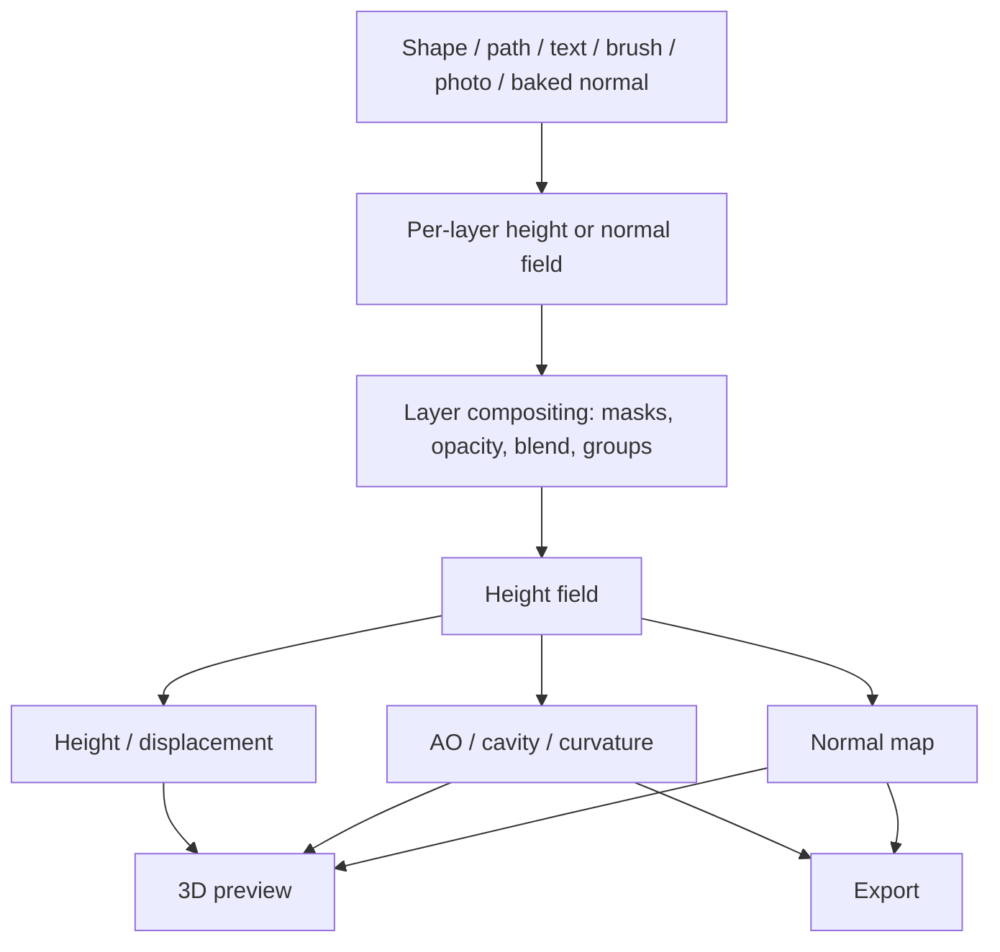

# N-shade

> A modern, standalone reimagining of the classic Quixel nDo2 normal-map authoring workflow.

**Status:** Alpha — Windows builds available on [Gumroad](https://mazakit.gumroad.com/l/nshade)  
**Version:** 0.6.8  
**Document version:** 1.0  
**Last updated:** 2026-11-10  
**Platform:** Windows first; macOS/Linux later  
**License:** MIT (see [LICENSE](LICENSE))

> How-to guide for the latest additions — layer booleans, the knife cut, the ruler and edge smoothing — is in **[Manual.md](Manual.md)**.

> Release notes are in **[CHANGELOG.md](CHANGELOG.md)**; the vulnerability-reporting policy is in **[SECURITY.md](SECURITY.md)**.

<p align="center">
  
</p>

## Download

[**Download N-shade on Gumroad →**](https://mazakit.gumroad.com/l/nshade)

Prebuilt Windows builds are distributed through Gumroad. The source in this repository is MIT-licensed, so you can also build it yourself with the instructions in [Development setup](#11-development-setup).

The workspace is split into `ns_core` (engine-agnostic math, layer stack, and CPU reference), `ns_bake` (hierarchical layers/groups, clipping masks, boolean normal blending, vector outline booleans baked into the bevel, paths, FFT integration), `ns_pbr` (classical single-image PBR generation), `ns_cli` (bevel/convert/derived/demo/stress), and `ns_app` (Bevy + egui editor with a Substance Painter-style dock layout, a split 3D/2D viewport, direct canvas shape editing with fill/outline stroke styles, a vector pen and node editor with SVG import, a GPU compute evaluator for shape stacks, partial cut / partial slash / clip divide boolean operations, a sweep-along-path array with tangent rotation driven by vector path guides and on-model surface-snapped path handles, FBX/OBJ/DAE/GLB/USD preview-mesh import with UDIM detection, a docked optional single-image PBR panel, toggleable UV-island/tile overlays with adjustable opacity in both the 3D preview and 2D canvas, background high-to-low and low-poly bevel normal baking, an optional CPU/GPU lightmap baker with full/direct/indirect/ambient-occlusion modes, sun/HDR environment shadows, editable point/spot/area scene lights and a live PBR lighting preview, vendor-neutral wgpu tracing with built-in, OIDN or NVIDIA OptiX denoising, material/lighting/environment preview presets, and a live 3D normal-mapped viewport).

---

## Table of contents

- [Download](#download)
1. [Why this project](#1-why-this-project)
2. [Research summary](#2-research-summary)
3. [Product definition](#3-product-definition)
4. [Technical design](#4-technical-design)
5. [Architecture](#5-architecture)
6. [UX plan](#6-ux-plan)
7. [Roadmap](#7-roadmap)
8. [Testing and validation](#8-testing-and-validation)
9. [Risks and mitigations](#9-risks-and-mitigations)
10. [Open questions](#10-open-questions)
11. [Development setup](#11-development-setup)
12. [Glossary](#12-glossary)
13. [References](#13-references)

---

## 1. Why this project

Quixel nDo was a layer-based normal-map authoring tool used widely by game artists for hard-surface props and environments. It was discontinued, and Quixel Suite license servers were shut down on **March 1, 2023**. There is no official way to install or activate it today.

Artists still need what nDo provided:

- Fast creation of hard-surface normal details without high-poly bakes.
- Parametric shapes with controllable bevels.
- Layer-based, non-destructive iteration.
- Correct normal-map compositing and transforms.
- Instant 3D preview of the result.

Existing tools do not fully fill the gap:

**Goal:** build a focused, fast, standalone tool for parametric normal-map authoring, with a live 3D preview. It should feel closer to a mini 3D modelling tool than to a node graph.

---

## 2. Research summary

### 2.1 What nDo was

| Version | Year | Significance |
|---|---|---|
| nDo (script) | c. 2010 | Free layer-based action/script by Teddy Bergsman; popularized by Philip Klevestav's tutorial |
| nDo2 | 2011 | Commercial layer-based panel; the classic product most users mean by "nDo" |
| Quixel Suite | 2014 | Bundled NDO, DDO (material painting), and 3DO (PBR viewer) |
| Quixel Suite 2.0 | 2015 | Added NDO Painter: 3D painting, 8K textures, ~500 brushes, GPU baker |
| Quixel Mixer | 2018–2019 | Positioned as the Suite successor; NDO/DDO wound down |
| Quixel Suite shutdown | 2023 | License servers disabled; no official install/activation |

This project targets the **classic nDo2 2D authoring workflow**, not the later NDO Painter 3D painting engine. NDO Painter is a much larger product comparable to Substance Painter.

### 2.2 The key research finding

The available manual and product documentation strongly indicate that nDo was:

> **A live height-field compositor built around a layer-based authoring UI. The normal map was a derived output.**

nDo2 did not primarily ask artists to paint RGB normal vectors. It let them author height/volume using shapes, text, brushes, photos, layer effects, and filters, then converted the composited height field into a normal map.

This explains:

- Why "sculpting" worked with ordinary paint brushes.
- Why "Multisculpting" could combine vectors, layer effects, filters, and blend modes.
- Why "Height Hard-Surface" computed height per element from bevel/curve/slant settings.
- Why the tool was so tightly coupled to the host editor's layer stack.
- Why it became fragile as the host editor's APIs and plugin model changed.

### 2.3 nDo's core capabilities

- **Height-first authoring:** shapes, text, brushes, photos, and layer effects as height sources.
- **Parametric hard-surface shapes:** inner/outer/emboss/groove/stroke bevels, slant, curve, softness, falloff, z-factor.
- **Live normal conversion:** real-time height → normal updates.
- **Correct normal mixing:** "Overlay Normal" without destroying the Z channel.
- **Correct normal transforms:** rotate/scale without biasing lighting.
- **Derived maps:** AO, height, hard-surface height, cavity, diffuse, specular.
- **Photo → normal:** material presets and multi-scale detail control.
- **3D preview:** primitives, custom FBX, lighting presets, map slots, tiling.
- **Tiling and edge handling:** seamless output and "no edge bevel" behavior.
- **Presets:** save/apply full normal-layer parameter sets.

### 2.4 Why it disappeared

- Tight coupling to the host editor's canvas, layers, paths, selections, and OpenGL drawing.
- Host editor API and plugin-model churn.
- Performance limitations at high resolution.
- A very small development team.
- Quixel's strategic pivot to Megascans and Mixer.
- License-server shutdown after the Suite was retired.

**Lesson:** own the document model and rendering pipeline. Keep the runtime independent of any host editor.

### 2.5 Research caveat

Quixel never published nDo's source code or a technical paper. The algorithm descriptions in this document are a **clean-room reconstruction** based on the archived manual, product claims, and standard computer-graphics techniques. They are a design specification, not a claim about nDo's exact internal implementation.

---

## 3. Product definition

### 3.1 Target users

- Environment and prop artists creating hard-surface details.
- Indie game developers who need engine-ready normal maps.
- Modders and hobbyists without a Substance subscription.
- 2D/UI artists who need normal maps for stylized assets.
- Technical artists who miss nDo's shape/bevel workflow.

### 3.2 Jobs to be done

1. "I need a sci-fi panel with clean bevels and rivets, and I don't want to model and bake it."
2. "I have a baked normal map and want to add details non-destructively."
3. "I have a photo or height map and need a controllable normal map."
4. "I need to see the result on a 3D surface while I work."
5. "I need engine-ready maps with the correct normal convention and padding."

### 3.3 Differentiators

- **Height-first, layer-based workflow** rather than node graphs.
- **Parametric shape bevels** with precise, editable controls.
- **Correct normal math** for blending and transforms.
- **Live 3D preview** with PBR and displacement.
- **Standalone** with no host-editor dependency.
- **PNG/TGA/EXR output** with explicit OpenGL/DirectX conventions.
- **One-time license** rather than a subscription.

### 3.4 Non-goals for v1

- Full 3D texture painting on arbitrary meshes.
- High-poly-to-low-poly baking (use xNormal, Substance, or Blender).
- A general-purpose raster image editor.
- Full external layer-file compatibility.
- A material library or scan marketplace.
- Multi-user collaboration.

### 3.5 MVP scope

- 4K canvas; 8-bit and 16-bit export.
- Shape layers: rectangle, rounded rectangle, circle, polygon, path.
- Bevels: smooth, chisel, groove; size, depth, softness, slant, curve, z-factor.
- Import height and photo layers.
- Normal import and overlay.
- Layer tree with groups, opacity, blend modes, and masks.
- Normal, height, AO, and cavity export.
- DirectX and OpenGL normal conventions.
- 3D preview with primitives and HDRI lighting.
- Project save/load.
- PNG/TGA/EXR import/export only; no external layered document formats.

### 3.6 Success criteria

- Create a 2K hard-surface panel with 20 shape layers in under 10 minutes.
- Export an engine-ready normal map without manual channel fixes.
- Live preview at 60 fps on a mid-range GPU.
- 4K conversion completes in under 150 ms on GPU.
- Five target artists complete a defined task without documentation.
- No crash or data loss during an 8-hour session.

### 3.7 Feature parity matrix

| Capability | nDo2 | MVP | v1 |
|---|---|---|---|
| Shape/vector authoring | Yes | Basic | Full |
| Bevel types | 7 | 3 | 7 |
| Slant/curve/falloff/z-factor | Yes | Partial | Full |
| Brush/paint height | Yes | Import only | Basic paint |
| Photo → normal | Yes | Yes | Yes + presets |
| Normal import/overlay | Yes | Yes | Yes |
| Correct normal transforms | Yes | Yes | Yes |
| Height hard-surface mode | Yes | No | Yes |
| AO / cavity / curvature | Yes | AO + cavity | Full |
| Diffuse/spec generation | Yes | No | Yes |
| 3D preview primitives | Yes | Yes | Yes |
| Custom mesh preview | FBX | No | glTF + FBX |

| 16-bit | Yes | Export | Full |
| Tiling | Yes | Yes | Yes |
| Presets | Yes | Basic | Full browser |

---

## 4. Technical design

### 4.1 Pipeline



The document is evaluated bottom-up. Shape and height layers produce height; normal layers produce normal data. Groups composite their children. The final height field can be converted to normals, or normal layers can be blended directly for high-frequency details.

### 4.2 Coordinate spaces and conventions

- **Image space:** X right, Y down.
- **Tangent space:** +X right, +Y up, +Z out of the surface.
- **Height:** scalar, normalized to `[0, 1]` for storage; internal processing in `f16` or `f32`.
- **Normal encoding:** `rgb = n * 0.5 + 0.5`.
- **Color space:** normal maps and height maps are linear; albedo is sRGB. Never apply sRGB gamma to normal data.
- **OpenGL convention:** +Y up (green points up).
- **DirectX convention:** +Y down (green points down).
- Expose a project-level `NormalConvention { OpenGL, DirectX }` and apply the green inversion only at encode/decode time.

### 4.3 Height → normal

Use a Sobel or central-difference gradient:

```text
gx = (h[x+1,y] - h[x-1,y]) * 0.5 * slopeStrength
gy = (h[x,y+1] - h[x,y-1]) * 0.5 * slopeStrength

n = normalize(vec3(-gx, -gy, 1))
rgb = n * 0.5 + 0.5
```

Implementation notes:

- Sobel gives better rotation invariance than a simple 2×2 difference.
- Wrap sampling at the borders for tileable documents.
- Use 16-bit or float buffers to avoid banding in soft bevels.
- Expose a slope response curve for fine-vs-broad detail control.
- For DirectX output, invert the green channel after encoding.

### 4.4 Normal → height

Given a normal `(nx, ny, nz)`:

```text
p = -nx / max(nz, eps)
q = -ny / max(nz, eps)
```

Recover height by solving the Poisson equation:

```text
∇²h = ∂p/∂x + ∂q/∂y
```

Implementation options:

| Case | Method |
|---|---|
| Tileable | FFT-based Poisson solve with periodic boundaries |
| Non-tileable | DCT-based Poisson solve with Neumann boundaries |
| Interactive preview | Lower-resolution solve + upsample, or multigrid |
| Fast approximation | Normal → cavity → height integration |

Add a small regularization term to suppress low-frequency drift, and remove the mean height after solving. Clamp or reject `nz <= 0` samples.

### 4.5 Normal compositing

Do not use linear Overlay blending for normal maps.

**Whiteout blend:**

```text
whiteout(a, b) = normalize(vec3(a.xy + b.xy, a.z * b.z))
```

**Reoriented Normal Mapping (RNM):**

- Rotate the detail normal into the base normal's tangent frame.
- Renormalize.
- Blend with opacity by scaling the layer's slope, so a half-opacity layer behaves
  like a half-height layer.

**Height-first compositing:**

- For shape and height layers, composite height with max/add/blend modes.
- Convert once at the end.
- This avoids seams between adjacent shapes and preserves consistent occlusion.

Recommended rule:

- Shape/height layers → composite height, then convert.
- Baked/detail normal layers → whiteout or RNM blend.
- Mixed groups → convert normal layers to height when stable; otherwise keep a separate normal compositing path.

### 4.6 Normal transforms

For a 2D affine transform `M` applied to layer positions:

```text
n_xy' = normalize( (M^-1)^T * n_xy )
n_z'  = n_z
n'    = normalize(n_xy', n_z')
```

Notes:

- Uniform rotation: rotate XY and renormalize.
- Non-uniform scale: inverse-transpose is required.
- Mirrored/flipped transforms: flip the green channel or handedness.
- Transform vectors, not encoded RGB values.
- Store the transform in the layer; regenerate on demand rather than destructively resampling.

### 4.7 Parametric shapes and bevels

Rasterize each shape to a signed distance field (SDF):

```text
d = signedDistance(pixel, shape)
t = clamp(d / bevelWidth, 0, 1)
h = depth * bevelProfile(t)
```

Bevel variants:

| Bevel | Height rule |
|---|---|
| Inner | Positive distance inside the shape |
| Outer | Negative distance outside the shape |
| Emboss | Combine inner and outer profiles |
| Groove | Invert the profile |
| Stroke inner | `abs(d) - strokeWidth/2`, inside |
| Stroke outer | `abs(d) - strokeWidth/2`, outside |
| Stroke emboss | Combine both stroke sides |

Controls:

- **Style:** **Fill** the interior or render an **Outline stroke** band centred on the shape boundary, with an adjustable stroke width. Both styles share the same radius, height, profile, softness and inversion controls.
- **Slant:** bias the profile toward one side.
- **Curve:** power or S-curve response.
- **Softness:** blur the transition.
- **Falloff:** widen the effect.
- **Z-factor:** per-layer height bias.
- **Plane fill:** fill height for flat areas.
- **Anti-alias:** coverage-based edge smoothing.

For text and complex paths:

1. Rasterize coverage.
2. Compute a distance field (or use an SDF-capable vector rasterizer).
3. Apply the same bevel profile.
4. Composite into the group height field.

### 4.8 AO, cavity, and curvature

**Ambient occlusion:**

- Multi-scale horizon-based AO from the height field.
- Sample along N directions (8 or 16), at several radii.
- Compute the maximum horizon angle and accumulate visibility.
- Fine/medium/large controls map to three radius bands.
- For interactive use, compute at half or quarter resolution and upsample.

**Cavity:**

```text
cavity  = clamp((blur(height) - height) * gain, 0, 1)
convex  = clamp((height - blur(height)) * gain, 0, 1)
```

Use multiple blur radii for fine and broad cavity.

**Curvature:**

- Divergence of the normal field, or
- Hessian eigenvalues of the height field.

These maps are useful for wear masks, edge highlights, and material generation.

### 4.9 Photo → normal

Pipeline:

1. Convert to linear luminance.
2. Optional pre-process: levels, black-and-white, contrast.
3. Extract multi-scale detail:
   ```text
   detail = luminance - blur(luminance, radius)
   height = luminance + detail * detailGain
   ```
4. Optional edge-aware filtering (bilateral/guided) to reduce halos.
5. Compute gradients and encode normals.
6. Apply material presets (metal, wood, stone, fabric) that adjust blur radii, detail gain, slope strength, and contrast.
7. Wrap or mirror for tileable output.

### 4.10 3D preview

- PBR metallic/roughness shading.
- Image-based lighting with HDRI.
- Directional/spot lights and tone mapping.
- Normal, height, AO, cavity, albedo, roughness, and metalness map slots.
- Parallax occlusion mapping for displacement without tessellation.
- Optional tessellation for silhouette.
- Primitives: cube, rounded/beveled cube, plane, cylinder.
- Custom mesh: glTF/GLB, FBX, OBJ, COLLADA, USD.
- Tiling controls and normal-only mode.
- Debounced live texture updates during editing.
- Layer gizmo: **Move** and **Stretch** buttons in the 3D header edit the selected shape/vector layer by dragging on the model (right-drag still orbits). Layers are UV-mapped 2D content, so the drag is converted through the camera and preview-mesh UV scale into a document-space move or stretch, and the 2D canvas reflects it live. Undo works through the normal gesture snapshot.
- Box (triplanar) projection: the cube icon immediately after **Split** enables a projection cage on the model. Drag its centre, axis arrows, corner square and twist ring (or use the exact Move/Size/Rotate fields), then **Apply to 2D** re-projects at document resolution, hides the source and inserts the projected normal layer above it. Esc or Cancel leaves the document untouched; one undo reverts an Apply.

### 4.11 Tiling and dilation

- Wrap sampling for all filters on tileable documents.
- Remove edge bevels when the layer touches the document border.
- Use jump-flood or push-pull dilation for UV padding.
- Export 4–16 pixels of padding depending on the target engine.
- Add seam tests to the automated test suite.

---

## 5. Architecture

### 5.1 Decision summary

| Decision | Choice | Rationale |
|---|---|---|
| Product form | Standalone desktop app | Own the runtime and document model |
| Core language | Rust | Performance, memory safety, portable to WASM |
| UI | Tauri 2 + React/Svelte + TypeScript | Small binaries, native file access, fast UI iteration |
| GPU | `wgpu` compute + WebGL2/WebGPU viewport | Cross-platform compute and rendering |
| 3D preview | three.js initially; custom `wgpu` renderer later if needed | Fast path to PBR/IBL/POM |
| Document format | JSON manifest + binary tile store in a zip container | Human-inspectable metadata, efficient large images |
| Export formats | PNG/TGA/EXR | Engine-ready texture and height output |

### 5.2 Standalone application

N-shade owns its document model, rendering, and file handling. It does not depend on a host image editor, plugin runtime, or external application model. This keeps performance predictable and avoids coupling the product to third-party plugin APIs.

### 5.3 Module layout

```text
crates/
  core-image/      buffers, tiles, color management, blur, morphology, resampling
  core-height/     SDF shapes, bevel profiles, height compositing
  core-normal/     height↔normal, whiteout/RNM, transforms, conventions
  core-maps/       AO, cavity, curvature, diffuse/specular generation
  core-doc/        layer tree, groups, masks, undo/redo, project format
  core-gpu/        wgpu compute kernels
  io/              PNG/TGA/EXR, engine presets, batch conversion
  cli/             headless conversion and benchmarking

apps/
  desktop/
    src/           React/Svelte UI
    src-tauri/     Tauri shell and native commands
    preview/       three.js/WebGPU viewport

docs/
  research/        archived references and notes
  specs/           algorithm and file-format specifications
```

### 5.4 Data model

```rust
struct Project {
    canvas: Canvas,
    root: Group,
    convention: NormalConvention,
    presets: PresetLibrary,
}

struct Canvas {
    width: u32,
    height: u32,
    bit_depth: BitDepth,
    tile_size: u32,
}

enum Layer {
    Group(Group),
    Shape(ShapeLayer),
    Height(HeightLayer),
    Normal(NormalLayer),
    Photo(PhotoLayer),
    Fill(FillLayer),
}

struct Group {
    name: String,
    children: Vec<Layer>,
    opacity: f32,
    blend: BlendMode,
    mask: Option<Mask>,
    visible: bool,
}

struct ShapeLayer {
    path: Path,
    bevel: BevelSpec,
    slant: f32,
    curve: Curve,
    z_factor: f32,
    opacity: f32,
    blend: BlendMode,
    mask: Option<Mask>,
    transform: Transform2D,
}

struct BevelSpec {
    kind: BevelKind,
    width: f32,
    depth: f32,
    softness: f32,
    falloff: f32,
    profile: Profile,
    anti_alias: bool,
}

struct HeightLayer {
    tiles: TileStore,
    mask: Option<Mask>,
    opacity: f32,
    blend: BlendMode,
}

struct NormalLayer {
    tiles: TileStore,
    transform: Transform2D,
    convention: NormalConvention,
    opacity: f32,
    blend: NormalBlendMode,
    mask: Option<Mask>,
}
```

Large images are stored as **512×512 tiles**, not contiguous full-resolution buffers. Tiles are cached with an LRU policy and evicted when memory pressure rises.

### 5.5 Evaluation pipeline

1. Traverse the layer tree bottom-up.
2. Rasterize shapes into coverage/SDF tiles.
3. Apply bevel profiles to produce height tiles.
4. Composite height tiles with masks, opacity, and blend mode.
5. For normal layers, apply the layer transform and blend with whiteout/RNM.
6. Cache intermediate group results.
7. On dirty rectangles, re-evaluate only affected tiles.
8. Convert the final height field to a normal map on demand.
9. Derive AO/cavity/curvature as separate cached outputs.
10. Upload changed tiles to the preview renderer.

### 5.6 Performance and memory

- **Tile size:** 512×512.
- **Internal format:** `f16` per channel; `f32` for Poisson and intermediate math.
- **Dirty rectangles:** update only affected tiles during painting or transforms.
- **GPU compute:** gradient, blur, Poisson, AO, morphology.
- **CPU fallback:** `rayon` parallel tile processing.
- **Preview:** mipmapped textures; full resolution only for export.
- **Memory:** an 8K RGBA16F buffer is ~512 MB. Never keep many full-resolution buffers alive; use tile caches and streaming export.

Target performance:

| Operation | Target |
|---|---|
| 2K height → normal | < 30 ms GPU |
| 4K height → normal | < 150 ms GPU |
| 8K height → normal | < 600 ms GPU |
| 4K normal → height (Poisson) | < 500 ms GPU |
| Interactive paint update at 2K | 60 fps |
| Preview | 60 fps at 1M triangles, 1080p |

Measured prototype results (Windows, RTX 3070 Ti Laptop, debug build, 1024² canvas, 101 visible layers including the flat base):

| Workload | Result |
|---|---|
| CPU streaming normal evaluation | 70–82 ms |
| CPU streaming height evaluation | 49–55 ms |
| First naive CPU implementation | 4800 ms / 3260 ms (about 50× slower) |
| GPU shape-stack evaluation | Single dispatch, no CPU readback; 25 ms edit cadence |
| 3D preview | Cube, rounded cube, plane and cylinder meshes, tangent-generated; stable under the 100-layer stack |
| Imported GLB | 524,288-triangle mesh loaded, tangent-generated, UV-layout built, and displayed in ~1.3 s (debug build) |

Region-limited shape evaluation only visits each shape's expanded AABB, which produced the large CPU speedup. A full per-layer normal cache for this stack would need roughly **1.6 GiB**; because that exceeds the 256 MiB budget, evaluation streams with constant working memory instead. GPU scenes are capped at 256 visible layers and 1,048,576 polygon vertices. Layers the shader cannot evaluate analytically (raster and text shapes, smoothed outlines, holes, custom or per-edge profiles, photo/imported-normal/paint layers, painted/static masks) are evaluated **once** on the CPU, cached, and uploaded as precomputed normal/height or mask textures for the GPU to composite. Only boolean/vector-op groups, smart masks that read the surface below, non-identity group opacity/blend, and stacks beyond the caps still fall back to the CPU reference path.

### 5.7 File formats and interoperability

**Project format (`.qnd`):**

- Zip container.
- `project.json` with layer tree and parameters.
- `tiles/` with binary height/normal tiles.
- `masks/` with binary mask tiles.
- `preview/` with thumbnails and metadata.

**Export:**

- PNG 8-bit and 16-bit.
- TGA for legacy pipelines.
- EXR for height/displacement.
- Engine presets: Unreal, Unity, Godot, generic DirectX/OpenGL.

**Import:**

- PNG/TGA/EXR height and normal maps.
- Photo sources for photo-to-normal.

---

## 6. UX plan

### 6.1 Main window

```text
┌─────────────────────────────────────────────────────────────────────────────────────────┐
│ N-shade   File  Edit  View            Undo/Redo   Docks   Settings                      │
├────────┬────────────────────────┬──────────────────────────────┬────────────────────────┤
│ Tool   │ Layers                 │ 3D View │ 2D Canvas          │ Properties Mesh Bake   │
│ rail   │ Blend · Opacity        │ ──────────────────────────   │ Lightmap  PBR          │
│ Select │ eye  thumb  mask  blend│ viewport header              │ Contextual panel       │
│ Rect   │ layer rows …           │ shape · UV · camera          │ selection, mesh, bake, │
│ Ellipse│ footer actions         │                              │ lightmap or PBR        │
│ Star   │ ───────────────────────│ viewport                     │                        │
│ Pen    │ Export                 │                              │                        │
│ Brush  │ Normal  Height  Project│                              │                        │
│ Pan    │ Edge Wear · Curvature  │                              │                        │
│ 3D/2D  │ [ Export maps ]        │                              │                        │
├────────┴────────────────────────┴──────────────────────────────┴────────────────────────┤
│ 3D View · 1024 × 1024 · 100% · status message · RAM / GPU / CPU                         │
└─────────────────────────────────────────────────────────────────────────────────────────┘
```

The editor uses a four-column shell:

- **Top bar:** brand, **File/Edit/View** menus, undo/redo, dock toggles, lightmap/bake/PBR shortcuts and settings. The document size lives in the status bar.
- **Tool rail:** labelled navigation-rail items for Select, Rectangle (Rect), Ellipse, Star, Pen/vector tools (right-click the pen for Node/Add/Delete/Convert Anchor), Lasso, Paint, Ruler and Pan, with the 3D/2D view switch at the bottom. The selected tool gets a tonal pill; tooltips carry the shortcut: V, R, O, S, P, L, B, H.
- **Layers dock:** blend mode and opacity for the selection, the layer tree with visibility, content/mask thumbnails, a quiet per-row blend badge (click to change) and drag grip, plus footer actions for move/duplicate/delete/reset. Delete and Reset confirm through an Undo toast instead of a modal. The **Export** card below it groups **Maps**, **Format** (8/16-bit), **Normal Y**, **Height source**, **Size** and **Save to**, reports what will be written, and labels the primary action **Export N maps**.
- **Viewport:** **3D View**, **2D Canvas** and **Split** tabs with a viewport header for preview shape, UV overlay and camera controls. Split shows both views at once with a draggable divider; clicking a pane focuses it and swaps the header controls, so the toolbar stays single-row. The 3D view shows the live normal-mapped model and lighting; the 2D canvas is the layer-authoring and mask-painting surface.
- **Right dock:** **Properties**, **Mesh**, **Bake**, **Lightmap** and **PBR** tabs. Properties is contextual to the selected layer; the other tabs host mesh import, normal baking, lightmap baking and single-image PBR generation.
- **Status bar:** active view, document size, zoom, the latest action (or **Ready**), and live app-RAM/GPU/CPU statistics. The RAM figure is this process's working set; its tooltip shows the share of installed memory. Memory readouts turn amber at 85% and red at 95%, with an icon and advice. Toasts appear above it for export completion and undoable deletes.

Both side docks are resizable and can be toggled from the top bar or the View menu. Below 860 px wide the editor keeps one dock open at a time so the viewport remains usable.

### 6.2 Modes

- **Author:** create shapes, paths, text, height layers.
- **Sculpt:** paint into a height layer with brushes.
- **Preview:** inspect on a 3D model with PBR/IBL.

### 6.3 Interaction principles

- Context-sensitive properties based on the selected layer.
- Every destructive action is undoable.
- Changing a bevel parameter updates the normal map live.
- Preview updates are debounced but feel immediate.
- Normal-map convention is visible and changeable at any time.
- Tiling and padding are first-class export settings.
- Presets store the full layer parameter set, not just a single value.

### 6.4 Onboarding

- Ship three sample projects: sci-fi panel, metal crate, ornate trim.
- Include a 5-minute "first normal map" tutorial.
- Provide tooltips for all bevel/height parameters.
- Include an engine export checklist for Unreal/Unity/Godot.

---

## 7. Roadmap

| Phase | Duration | Deliverables | Exit criteria |
|---|---|---|---|
| 0. Research and spec | 1–2 weeks | Reference corpus, product spec, stack decision, CLI prototype | Convincing hard-surface normal from a height map |
| 1. Core engine | 4–6 weeks | Height↔normal, blending, transforms, AO/cavity, tiling, golden tests | CLI converts and composites maps with verified math |
| 2. Document + 2D editor | 5–7 weeks | Layer tree, groups, masks, shapes, bevels, undo, save/load | 2K panel with 20 layers exports a clean normal map |
| 3. Height authoring | 4–6 weeks | Photo import, presets, basic paint, normal overlay, live updates | Import photo + paint + overlay in under 100 ms at 2K |
| 4. 3D preview | 4–6 weeks | PBR/IBL, primitives, map slots, tiling, POM | 60 fps preview with live updates |
| 5. I/O and export | 3–5 weeks | PNG/TGA/EXR, engine presets, batch CLI | Engine-ready export |
| 6. Performance and polish | 4–6 weeks | GPU hot paths, 8K support, autosave, installer, presets | 8K project under 2 GB memory, stable all day |
| 7. Beta | 4 weeks | 20–50 artists, docs, tutorials, fixes | Public beta with task-based validation |

**Estimated schedule:**

- MVP: 3–4 months full-time solo.
- v1: 8–12 months solo, or 4–6 months with a small team.
- Part-time: roughly double.

### MVP cut line

Ship this first:

- 4K canvas, 8/16-bit export.
- Rectangle, rounded rectangle, circle, polygon, path shapes.
- Smooth, chisel, groove bevels.
- Height/photo import, normal overlay.
- Groups, opacity, blend modes, masks.
- Normal/height/AO/cavity export.
- DirectX/OpenGL conventions.
- 3D preview primitives + HDRI.
- Save/load.

Defer:

- Full brush engine.
- Custom FBX.
- Height hard-surface mode.
- Diffuse/spec generation.
- Scripting.

---

## 8. Testing and validation

### 8.1 Math tests

- Flat height → exactly `(128, 128, 255)` in 8-bit OpenGL convention.
- 45° linear ramp → expected constant normal.
- Height → normal → height round-trip: RMSE under 1/255 on smooth surfaces.
- Normal → height → normal round-trip: angular error under 1° for valid normals.
- Transform invariance: rotate a detail 90°; normals rotate correctly.
- Mirror: green channel/handedness handled correctly.
- DirectX vs OpenGL: green inversion only at encode/decode.
- Tiling: seam error under 1/255.
- Dilation: no black seams after export padding.

### 8.2 Golden-image tests

- Compare outputs against hand-authored expected images.
- Use perceptual and per-channel tolerances.
- Include bevel profiles, AO, cavity, and photo-to-normal cases.
- Store small fixtures in the repository; large fixtures in CI artifacts.

### 8.3 Performance tests

- Benchmark 2K/4K/8K height→normal on CPU and GPU.
- Benchmark Poisson solves.
- Benchmark AO at multiple radii.
- Track memory high-water mark for 8K projects.
- Fail CI if performance regresses by more than 20%.

### 8.4 Usability tests

Five target artists perform:

1. Create a sci-fi panel with 10 bevels.
2. Import a photo and add surface detail.
3. Overlay a baked normal map.
4. Export for Unreal and Unity.
5. Save, close, reopen, and continue editing.

Measure time, errors, and subjective confidence.

---

## 9. Risks and mitigations

| Risk | Impact | Mitigation |
|---|---|---|
| Scope creep into a full painting suite | Schedule blowout | Keep MVP to parametric authoring; defer painting/baking |

| Normal-map math errors | Unusable output | Golden tests, explicit conventions, 16-bit buffers |
| GPU driver issues | Crashes on some machines | CPU fallback; test Intel/NVIDIA/AMD |
| 8K/16K memory pressure | Out-of-memory | Tile cache, f16, streaming export |
| Algorithm quality | Seams, banding, artifacts | Poisson solvers, wrap sampling, dilation, high-precision buffers |
| Market size | Slow adoption | Focus on a clear niche; free beta; artist case studies |
| Trademark/legal | Rebranding cost | Avoid nDo/Quixel names and copied assets; clean-room implementation |
| Overengineering | Never ships | Ship the MVP cut line first; measure against success criteria |

---

## 10. Open questions

1. **How deep should the brush engine go?** MVP: import height and simple paint. v1: soft brush, erase, mask, pressure.
2. **Custom mesh support:** glTF first or FBX first? Recommendation: glTF for modern pipelines; FBX if the target audience demands it.
3. **Target maximum resolution:** 8K at v1, 16K later? Recommendation: 8K, with tiled architecture ready for 16K.
4. **Pricing and distribution:** the source is MIT-licensed and prebuilt Windows binaries are sold through Gumroad. Indie/studio pricing and the upgrade policy still need validation with beta users.
5. **Name:** "N-shade" is the project name; verify trademark similarity before public release.
6. **Diffuse/spec generation:** include in v1 or defer? Recommendation: defer; focus on normal/height/AO/cavity quality first.

---

## 11. Development setup

### 11.1 Toolchain

- Rust 1.95 or newer (the workspace `rust-version`; tested with cargo 1.99.1 on Windows).
- A Vulkan, DX12, or Metal GPU for the Bevy preview.
- Windows is the primary development platform; Bevy and `ns_core` are cross-platform.

Crate layout:

| Crate | Role |
|---|---|
| `crates/ns_core` | Engine-agnostic math, layer stack, path rasterizer, EDT/bevel, FFT integration, CPU reference |
| `crates/ns_pbr` | Classical single-image PBR pipeline: map/stage graph, cache, AO, curvature, wear, roughness, metallic, export |
| `crates/ns_cli` | Headless batch tool: conversions, bevels, derived maps, demo scene |
| `crates/ns_app` | Bevy 0.19 + egui 0.36 editor shell (`n-shade` binary) |

The workspace pins `glam` 0.32 because Bevy 0.19 depends on that version; sharing it avoids conversions at the API boundary. `bevy` 0.19.1 / `bevy_egui` 0.42.0 (egui 0.36.2) are the current pinned versions; `wgpu` is 29.0.4. `egui_extras` must stay on the same egui minor as `bevy_egui` (0.36.x), otherwise Cargo links two incompatible egui types.

Mesh import uses `ufbx` 0.11 (FBX; compiles its bundled C loader with `cc`), `tobj` 4 (OBJ), `dae-parser` 0.11 (COLLADA) and `openusd` 0.6 (USD/USDA/USDC/USDZ). SVG import uses `roxmltree` 0.21 for XML and `svgtypes` 0.16 for path/transform parsing; both are pure Rust. The USD crate is pinned to 0.6 because 0.7+ requires Rust 1.96; none of these require Assimp or a system OpenUSD SDK. The optional PBR pipeline uses `blake3` content hashes and keeps all intermediates in linear f32; no model weights are bundled.

### 11.2 Build and run

```bash
# Run the editor
cargo run -p ns_app

# Run the test suite (math, EDT, FFT round-trip, layers, cache)
cargo test --workspace

# Lint everything
cargo clippy --workspace --all-targets -- -D warnings

# Format
cargo fmt --all
```

The editor opens the parametric demo scene at 1024×1024. The left panel edits layers and bevel parameters; the center shows the normal/height canvas; the right panel is a live 3D preview (drag to orbit, scroll to zoom). Use the **Export** button to write `output/normal.png`, `output/height.png`, and `output/project.nsproj`.

### 11.3 CLI

```bash
# Bevel an anti-aliased mask
cargo run -p ns_cli -- bevel mask.png normal.png --radius=24 --height=12 --profile=round

# Convert height -> normal (16-bit OpenGL by default)
cargo run -p ns_cli -- height-to-normal height.png normal.png --strength=2 --wrap

# Integrate a normal map back to height (Frankot-Chellappa FFT)
cargo run -p ns_cli -- normal-to-height normal.png height.png --high-pass=0.002

# AO / cavity / curvature / convexity maps
cargo run -p ns_cli -- derived height.png out --radius=24 --height-scale=64

# Evaluate a project and optionally export derived maps
cargo run -p ns_cli -- project demo.nsproj normal.png --height=height.png --ao=ao.png

# Generate a complete demo project and images
cargo run -p ns_cli -- demo demo_out

# 100-layer stress scene (also exercises region-limited CPU evaluation)
cargo run -p ns_cli -- stress --size=1024 --layers=100 --out=output/stress_cli

# Fixed T0.1 corpus plus cold/warm/edit timings
cargo run --profile profiling -p ns_cli -- bench --repeats=3
```

The `stress` command prints normal/height evaluation times and the full-cache estimate. With 100 layers at 1024² the normal pass is roughly 70–82 ms and the height pass 49–55 ms in a debug build; it also warns when the stack must stream instead of fitting the cache budget.

### 11.4 Automation

`cargo run -p ns_app -- --screenshot output/n-shade.png` captures the Bevy render target once the editor has warmed up and exits. Note that Bevy's screenshot API may run before the egui overlay, so UI panels can be missing from that image. On Windows, `tools/capture_window.ps1` performs a full window capture instead:

```powershell
powershell -ExecutionPolicy Bypass -File tools/capture_window.ps1
```

The script restores the N-shade window and pins it topmost for the capture, because Windows can refuse a background process's `SetForegroundWindow` request. To capture the stress scene:

```powershell
powershell -ExecutionPolicy Bypass -File tools/capture_window.ps1 -Out output/stress.png -Stress -WarmupSeconds 12
```

`--stress` loads the 100-shape document; add `--stress-layers N` to test a larger stack (the GPU path caps at 256 visible layers). The 3D preview uses the standard cube. For a headless smoke test:

```bash
cargo run -p ns_app -- --stress --screenshot output/stress-bevy.png
cargo run -p ns_app -- --stress --stress-layers 200 --screenshot output/stress-200.png
```

A mesh can also be imported from the command line, which is useful for automation:

```bash
cargo run -p ns_app -- --mesh path/to/model.glb --screenshot output/mesh.png
cargo run -p ns_app -- --mesh path/to/model.fbx --uv-overlay --screenshot output/mesh-uv.png
cargo run -p ns_app -- --mesh path/to/model.glb --uv-overlay-2d --view 2d --uv-opacity 0.5
```

Normal maps can be baked from the command line. `--bake` waits for the imported mesh and starts a bake with the current settings; `--bake-mode bevel` uses the low-poly bevel baker, otherwise a high-poly file is required:

```bash
cargo run -p ns_app -- --mesh low.glb --bake --bake-high high.obj --bake-out output/bakes/low_normal.png
cargo run -p ns_app -- --mesh low.glb --bake --bake-mode bevel --bake-radius 2 --bake-out output/bakes/low_bevel.png
cargo run -p ns_app -- --mesh low.glb --bake --bake-high high.fbx --bake-preview
cargo run -p ns_app -- --mesh low.glb --bake --bake-mode bevel --bake-to-canvas
```

Optional lightmap bakes use the same imported low-poly mesh. `--lightmap` starts the white diffuse bake; `--lightmap-env` loads an equirectangular HDR/EXR (or LDR PNG/JPEG) environment, and the output can be a display PNG or a linear EXR:

```bash
cargo run -p ns_app -- --mesh props.glb --lightmap --lightmap-resolution 1024 --lightmap-samples 64 --lightmap-out output/lightmaps/props.png
cargo run -p ns_app -- --mesh props.glb --lightmap --lightmap-backend gpu --lightmap-out output/lightmaps/props_gpu.png
cargo run -p ns_app -- --mesh props.glb --lightmap-preview --lightmap-env studio.hdr
cargo run -p ns_app -- --mesh props.glb --lightmap --lightmap-env studio.hdr --lightmap-format exr --lightmap-out output/lightmaps/props.exr
cargo run -p ns_app -- --mesh props.glb --lightmap --lightmap-lighting indirect --lightmap-env studio.hdr --lightmap-out output/lightmaps/props_indirect.png
cargo run -p ns_app -- --mesh props.glb --lightmap --lightmap-lighting ao --lightmap-resolution 2048 --lightmap-out output/lightmaps/props_ao.png
```

The main document can be exported from the command line at a chosen resolution and texture selection:

```bash
cargo run -p ns_app -- --export
cargo run -p ns_app -- --export --export-resolution 4096 --export-textures normal,height
cargo run -p ns_app -- --export --export-textures height --export-height=direct
cargo run -p ns_app -- --export --export-textures normal --normal-directx
cargo run -p ns_app -- --export --export-textures edge-wear,curvature,edge-detect
cargo run -p ns_app -- --export --export-resolution 512 --export-textures project --export-dir output/my_export
cargo run -p ns_app -- --mesh chloe.dae --export --export-textures normal,height --export-tiles all
cargo run -p ns_app -- --export --export-textures normal --export-tiles 1001,1002
```

`--export-textures` accepts `normal`, `height`, `project`, `edge-wear`, `curvature`, `edge-detect`, `id-map`, or `all` (comma-separated). Derived maps are computed from the final composited normal field at the export resolution and written as `edge_wear.png`, `curvature.png` and `edge_detect.png`; curvature is 0.5-centred, while the two edge masks are 0–1. `id-map` writes `id.png`, an 8-bit material-ID map built from the colors assigned in **Properties → Material ID**.

`--export-tiles` splits the export per UDIM tile. Pass a comma-separated list (`1001,1002`) or `all` together with `--mesh`, which detects the tiles from the mesh file. Each map gets the tile number before the extension (`normal_1001.png`, `height_1001.png`, …); the project file is written once.

### UDIM tiles in the layer stack

With a UDIM mesh imported, the tile selector above the viewport chooses which tile the document authors. It is a runtime view of `Document::active_tile`, not a saved file setting, so the project itself is independent of the tile you were looking at.

- **New layers follow the selected tile.** Paint, shape, import and projection layers created while tile 1002 is selected are tagged `1002` and only contribute to that tile. Groups stay shared so they can organise layers from several tiles.
- **Per-layer override.** **Properties → UDIM tile** changes the selected layer between **All tiles** and a specific tile. Shared layers (the default for old projects) contribute to every tile.
- **Rows show the tile.** A tagged layer's type line ends with its tile number, and layers tagged for another tile are dimmed rather than hidden from the dock.
- **Evaluation follows the tile.** The CPU and GPU evaluators skip layers tagged for another tile, and their caches include the tile so switching back and forth cannot reuse the wrong composite.
- **Export follows the tile.** The export card gains a **UDIM tiles → Current / All** switch when more than one tile is detected. *All* writes one map set per tile; *Current* writes only the tile on the canvas. Both append the tile number (`normal_1001.png`). Per-tile layers are included even when no mesh is loaded, because the tagged tiles are read from the stack as well.
- **Bakes follow the tile.** **Add baked normals to canvas** creates or refreshes a base layer for the tile that was baked and switches the canvas to it, so a batch bake can be inspected one tile at a time.
- **3D preview.** The preview material still repeats the evaluated active-tile map across the mesh's UV range; the 2D canvas is the per-tile authoring surface, and exports are always per tile.

### Height source (direct vs integrated)

With **Height** selected, the export card shows a **Height** source row:

- **Integrated (normals)** — the default and former behavior. Rebuilds height from the final normal field. It matches the normal map, but integration can drift across flat areas, ring at corners and shift plateau levels.
- **Direct (layers)** — composites the layer stack's height fields. Plateaus stay flat and equal-depth slots stay equal; overlapping layers may disagree with the normal map until the additive-height pass lands.
- **Auto** — direct unless a visible imported-normal layer is present, because imported normals have no analytic height. (Until per-layer integration lands, such documents still integrate the final field.)

The setting is per session and defaults to Integrated, so existing behavior is unchanged. `--export-height=auto|direct|integrated` selects it from the app CLI; `--integrate-height` remains the 2D Height-view toggle and does not affect the exported PNG. The `ns_cli project` command defaults to direct height and uses `--integrate` for the old behavior.

### Normal map convention (OpenGL / DirectX)

With **Normal** selected, the export card shows a **Normal Y** row with **OpenGL (Y+)** and **DirectX (Y−)**. The editor always stores canonical OpenGL data; the choice only selects the green channel written to `normal.png` (and the convention used to decode an imported normal map). The 3D preview always shows the surface, so it does not flip. The setting is saved with the project and is mirrored on the command line by `--normal-directx` / `--normal-opengl`.

### Material ID maps

Every layer or group can carry one ID color (Properties → Material ID → *Assign color*). The export bakes the topmost colored layer per texel into `id.png`:

- **Hard edges, no bleed.** Coverage is tested at 50 % and the map is only area-majority resized, so two IDs meet exactly at the bevel silhouette and never blend into an intermediate color. Unlike plain nearest sampling, a thin feature that covers most of an output pixel survives a downscale. Painted normal and height layers only claim the texels that were actually painted, so assigning them an ID cannot flood the texture. Import it into Substance Painter (or any tool) as a color ID map.
- **Masks and clipping are followed.** Painted masks, clipping masks and boolean results shape each ID exactly like the normal map; opacity and smart masks are ignored because an ID names a material rather than a blend strength.
- **Groups and compounds.** A plain group's color fills its children unless a child has its own color; a live vector compound is one surface, so only the group's color applies.

The *Edge wear* and *Edge detect* chips in the export card have a collapsible parameter row (threshold, softness, strength). The defaults reproduce the previous maps; raising the threshold removes wear from soft creases and softness widens or narrows the transition.

The optional PBR panel can be loaded and generated from the command line too:

```bash
cargo run -p ns_app -- --pbr path/to/texture.png --pbr-auto --pbr-channel normal
cargo run -p ns_pbr --example pbr_preview -- path/to/texture.png output/pbr_maps
```

Vector content can be loaded for automation or documentation captures:

```bash
cargo run -p ns_app -- --demo-vector --view 2d
cargo run -p ns_app -- --demo-boolean --view 2d
cargo run -p ns_app -- --empty --svg path/to/icon.svg --view 2d
cargo run -p ns_app -- --photo path/to/texture.png --view 2d
cargo run -p ns_app -- --alpha path/to/mask.png --view 2d
cargo run -p ns_app -- --paint --view 2d
cargo run -p ns_app -- --demo-groups --paint-mask --view 2d
cargo run -p ns_app -- --demo-shape --curve-editor --view 2d
```

The window capture script accepts the same options plus viewport layout switches:

```powershell
powershell -ExecutionPolicy Bypass -File tools/capture_window.ps1 -Out output/mesh-uv.png -Mesh path/to/model.glb -UvOverlay -WarmupSeconds 10
powershell -ExecutionPolicy Bypass -File tools/capture_window.ps1 -Out output/uv-2d.png -Mesh path/to/model.glb -UvOverlay2d -UvOpacity 0.6 -View 2d -WarmupSeconds 10
powershell -ExecutionPolicy Bypass -File tools/capture_window.ps1 -Out output/bake.png -Mesh low.glb -Bake -BakeHigh high.obj -BakeMode high -BakePreview -Tab bake -WarmupSeconds 14
powershell -ExecutionPolicy Bypass -File tools/capture_window.ps1 -Out output/bake-bevel.png -Mesh low.glb -Bake -BakeMode bevel -BakeRadius 2 -View 2d -Tab bake -WarmupSeconds 12
powershell -ExecutionPolicy Bypass -File tools/capture_window.ps1 -Out output/export.png -Export -ExportResolution 4096 -ExportTextures normal,height -WarmupSeconds 8
powershell -ExecutionPolicy Bypass -File tools/capture_window.ps1 -Out output/ui-1024.png -Width 1024 -Height 600 -View 2d
powershell -ExecutionPolicy Bypass -File tools/capture_window.ps1 -Out output/ui-pbr.png -Pbr texture.png -PbrAuto -Tab pbr
powershell -ExecutionPolicy Bypass -File tools/capture_window.ps1 -Out output/vector.png -DemoVector -Svg output/test_vector.svg -View 2d
powershell -ExecutionPolicy Bypass -File tools/capture_window.ps1 -Out output/boolean.png -DemoBoolean -View 2d
powershell -ExecutionPolicy Bypass -File tools/capture_window.ps1 -Out output/photo.png -Photo output/pbr_input.png -View 2d
powershell -ExecutionPolicy Bypass -File tools/capture_window.ps1 -Out output/paint.png -Paint -View 2d
powershell -ExecutionPolicy Bypass -File tools/capture_window.ps1 -Out output/compound.png -DemoCompound -Width 1500 -Height 950
powershell -ExecutionPolicy Bypass -File tools/capture_window.ps1 -Out output/combine.png -DemoCombine -Width 1440 -Height 900
powershell -ExecutionPolicy Bypass -File tools/capture_window.ps1 -Out output/split.png -DemoShape -Split -View 3d
powershell -ExecutionPolicy Bypass -File tools/capture_window.ps1 -Out output/split-stacked.png -DemoShape -Split -SplitStacked -View 2d
```

`-View 2d|3d`, `-PreviewShape cube|rounded|plane|cylinder|imported`, `-Split`, `-SplitStacked`, `-Tab properties|mesh|bake|lightmap|pbr`, `-HeightView`, `-IntegrateHeight`, `-UvOverlay`, `-UvOverlay2d`, `-UvOpacity`, `-Bake`, `-BakeHigh`, `-BakeMode`, `-BakeOut`, `-BakeResolution`, `-BakeRadius`, `-BakeIntensity`, `-BakePreview`, `-ShowCage`, `-BakeToCanvas`, `-Lightmap`, `-LightmapPreview`, `-LightmapEnv`, `-LightmapOut`, `-LightmapResolution`, `-LightmapSamples`, `-LightmapBounces`, `-LightmapFill`, `-LightmapFormat`, `-LightmapLighting`, `-LightmapDenoiser`, `-LightmapBackend`, `-LightmapOidnDevice`, `-Export`, `-ExportResolution`, `-ExportTextures`, `-ExportTiles`, `-ExportDir`, `-DemoShape`, `-DemoGroups`, `-DemoVector`, `-DemoBoolean`, `-DemoCompound`, `-DemoCombine`, `-Svg`, `-Photo`, `-Alpha`, `-NormalMap`, `-Paint`, `-PaintMask`, `-CurveEditor` and `-Empty` make the UI state deterministic for documentation captures. `-Width`/`-Height` resize the window before capture so the responsive layout can be exercised at 640, 800, 1024, 1440 and larger sizes. The underlying app flags are `--empty`, `--view`, `--preview-shape`, `--split`, `--split-stacked`, `--tab`, `--height`, `--integrate-height`, `--uv-overlay`, `--uv-overlay-2d`, `--uv-opacity`, `--bake`, `--bake-high`, `--bake-mode`, `--bake-out`, `--bake-resolution`, `--bake-radius`, `--bake-intensity`, `--bake-preview`, `--show-cage`, `--bake-to-canvas`, `--lightmap`, `--lightmap-preview`, `--lightmap-env`, `--lightmap-out`, `--lightmap-resolution`, `--lightmap-samples`, `--lightmap-bounces`, `--lightmap-fill`, `--lightmap-format`, `--lightmap-lighting`, `--lightmap-denoiser`, `--lightmap-backend`, `--lightmap-oidn-device`, `--export`, `--export-resolution`, `--export-textures`, `--export-tiles`, `--export-dir`, `--demo-shape`, `--demo-groups`, `--demo-vector`, `--demo-boolean`, `--demo-compound`, `--demo-combine`, `--svg`, `--photo`, `--alpha`, `--normal`, `--paint`, `--paint-mask` and `--curve-editor`.

### 11.5 Implemented vs planned

| Area | Status |
|---|---|
| Height → normal (Scharr), OpenGL/DirectX | Done |
| Exact EDT, round/chamfer/custom bevels, AA edges | Done |
| RNM + derivative blending, opacity/masks | Done |
| Shape sources: rect, ellipse, polygon, star, imported raster, Bézier path rasterization | Done |
| Normal → height (FFT, mirror padding, high-pass) | Done |
| AO, cavity, convexity, curvature | Done |
| Layer stack, evaluation cache, RON projects, PNG import/export | Done |
| Bevy editor: layer list, bevel sliders, 2D canvas, 3D preview | Done (alpha) |
| Direct canvas editing: select, drag-move, 8-handle resize and rotation for shapes, groups and multi-selections, drag-to-create rect/ellipse/star, Bézier pen tool | Done |
| Layer clipboard and grouping: Ctrl/Cmd+C / Ctrl/Cmd+V with fresh ids and reference remapping, Ctrl/Cmd+G groups the selection, 1–10 px layer bevel radius | Done |
| Vector node editing: anchor/handle drag, Shift multi-select, Alt-drag to pull handles, segment double-click insert, corner/smooth/symmetric conversion, reset handles, node delete; click an edge for a per-edge bevel profile in Advanced properties | Done |
| SVG import: paths, rects, circles/ellipses, polygons, groups/transforms, fill rules, viewBox fit; drag-and-drop | Done |
| GPU compute evaluator: polygon SDF bevels, analytic rect/ellipse, AABB culling, derivative/RNM/replace blending, normal + height textures | Done (shape/fill/flat stacks; 256 layers / 1M vertices) |
| Region-limited CPU evaluation, 256 MiB cache budget, streaming fallback | Done |
| GPU SDF clipping masks and softness | Done (shape masks and painted static masks) |
| Painted-mask 2D canvas with brush modes, shape/pen stamping, invert and fill | Done |
| Bevel profiles: Round, Chamfer, Linear, Convex, Concave, S-Curve, and a smooth monotone-cubic custom curve editor | Done |
| CPU fallback for custom profiles, photo/imported-normal/paint layers | Done |
| 100-layer stress document (`ns_cli stress`, app `--stress`) | Done |
| glTF/GLB/FBX/OBJ/DAE/USD preview-mesh import, drag-and-drop, tangent generation, automatic centering/fit | Done |
| UV-island overlays: 3D preview inset and 2D canvas guide, shared opacity, UDIM tile selection that drives per-tile layer authoring | Done |
| Export controls: document Normal/Height/Project selection, Document/512/1024/2048/4096 resolution, 16-bit toggle; PBR per-texture export selection at Native/512/1024/2048/4096 with high-quality resampling | Done |
| Height export source: Direct layer heights, legacy integration from normals, and Auto for documents with imported normals; app CLI `--export-height` parity | Done |
| Derived normal-map export: edge wear, curvature and edge detect generated from the final composited normal field, with collapsible threshold/softness/strength tuning | Done |
| Normal-map convention: OpenGL (Y+) or DirectX (Y−) chosen in the export card and CLI, saved with the project, internal data stays canonical | Done |
| Material ID export: one color per layer or group, hard-edged `id.png` that follows masks, clipping and booleans without color bleed | Done |
| Normal baking: high-to-low BVH projection with two-sided cage rays, low-poly bevel synthesis, tangent/object space, supersampling, padding, UDIM tiles with single-tile or batch baking, background tasks, PNG export and 3D preview override | Done |
| UDIM detection: normalized 0–N tiles and offset UVs (1001+), automatic normalization, per-tile layer tagging and evaluation, labeled tile-grid overlay, per-tile export and baking | Done |
| Single-image PBR (classical): toggle/stage graph, content-addressed bounded cache, background tasks with cancel/progress, delit, height/normal, displacement, two-radius horizon AO, multi-scale curvature/cavity, edge wear, roughness presets, metallic modes, 2D/3D preview, separate/packed export | Done |
| Substance Painter-style dock UI: compact top bar, vertical tool rail, resizable Layers/Properties docks, central 3D/2D viewport, split 3D/2D view with a draggable divider and adaptive orientation, pinned export, adaptive widths, status bar | Done |
| Material 3 presentation: role-based colours, tonal rounded panels with 8 px gaps, 8/10/16% state layers, filled/tonal/text buttons, filter chips, segmented controls, M3 switch/checkbox/slider, labelled navigation rail, primary tabs, inverse-surface snackbars | Done |
| Status-bar system monitor: this app's RAM working set plus NVIDIA GPU utilization and VRAM, sampled off the UI thread | Done |
| Layer groups: nested groups, disclosure/collapse, group opacity/blend/mask, group/ungroup, GPU flattening for identity groups | Done |
| Clipping masks: any unrelated layer or group can mask a layer/group by coverage; hidden mask sources still evaluate | Done |
| Boolean operations: Add, Subtract, Intersect, XOR and Divide resolved on the shapes' vector outlines by a boolean layer group, plus Partial cut, Partial slash and Clip divide height-surface operations; bake/split escapes; the legacy height-aware boolean blends still load but are no longer offered in the blend menu | Done |
| Preview appearance presets: Matte Gray/Clay/Steel material, Studio/Soft/Dramatic lighting, Neutral/Cool/Warm environment | Done |
| Path booleans: union, intersect and difference from selected sibling shapes | Done |
| Boolean ops on layers: Add, Subtract, Intersect, XOR and Divide combine the shapes' vector outlines before beveling while the shapes stay editable in the stack; Properties and the layer menus expose the operation, bake, split and release escapes | Done |
| Fill/outline stroke styles: per-shape/hierarchy stroke width evaluated on CPU and GPU; the separate outline-layer action remains for extracting a round-joined stroke path | Done |
| Edge smoothing: per-shape **Smooth (px)** blurs the outline and the bevel shading direction without changing the profile; **Anti-alias** fades the normal to flat over the last pixels of the silhouette; the group editor applies both across a group | Done |
| Primitive-to-path conversion; vector tool group with a Pen/Node/Add Anchor/Delete Anchor/Convert Point right-click flyout and an anchor options bar | Done |
| Ruler guide with draggable angle, numeric/quick-angle options bar, Shift snapping while drawing (45° steps by default, the ruler angle when placed), and **Lock dupes** so Alt-dragged copies follow the ruler angle exactly | Done |
| Smart alignment guides while drawing and moving/duplicating: automatic vertex, edge, center, horizontal/vertical, canvas, parallel and perpendicular snapping to visible shapes, drawn as labelled guides; Ctrl/Cmd disables snapping during a drag (Settings → Input → Smart guides) | Done |
| Delete/Backspace removes the selected layer(s) exactly like the row menu's Delete, and is left to node editing, pen drafts and mask edits when those own the key | Done |
| Arrow-key nudging: 1 document pixel per press, 10 px with Shift, anchors instead of layers while a node tool is active, one undo step per held burst | Done |
| Duplicate layers: **Alt-drag** on the canvas (whole selection), **Alt-drag** a layer row's grip, row menu → **Duplicate**, or **Edit → Duplicate array...** for precise X/Y spacing with one undo step; copies land above their originals with fresh ids and keep masks, bevel settings and internal clip/boolean references; with a ruler and **Lock dupes** on, Alt-drag copies follow the ruler angle, while holding **Shift** overrides it with an exact 45° axis lock | Done |
| Mirror operation: Blender-style reflection about the selection edge, selection centre or document centre with a numeric gap; **Clip at plane** bisects the original and the reflection at the pivot so the halves meet without overlapping, and **Merge seam** welds a connected pair into one shape within a pixel threshold; the live preview and Apply share the same clip/merge pass and one undo step | Done |
| Sweep operation: copies march along an editable vector path marked **Path guide**, spaced by arc length and turned to the path tangent; the guide never paints, stays editable, is excluded from copies and booleans, and the live preview and Apply share one undo step | Done |
| Lasso tools: one rail tile with a rectangular / elliptical / polygon / freehand / line flyout and two modes — **Trim shape** subtracts the region from shape outlines so the bevel is rebuilt and the remainder becomes editable pieces, **Erase pixels** hides it through painted masks; drag forward (right/down) to cut, backward (left/up) to divide, Alt = selected layers, Shift restores masks, one drag = one undo step | Done |
| Optional sci-fi texture generator (`Tools` menu): standalone window with an octagon-grid / trapezoid-row panel generator, greeble vocabulary, compositional balancing, wear/AO/normal shading, five view tabs and PNG export; never touches the document | Done |
| Snapshot undo/redo: toolbar buttons, Ctrl/Cmd+Z, Ctrl/Cmd+Shift+Z, Ctrl/Cmd+Y; 24 steps, with oldest snapshots evicted early when undo+redo would exceed 512 MiB | Done |
| Height painting: raise/lower/smooth/flatten, radius/hardness/flow, lazy paint layer | Done |
| Photo import: luminance height, three-scale blur, Stone/Metal/Wood/Fabric/Concrete presets, drag-and-drop | Done |
| GPU normal → height integration (Frankot–Chellappa FFT) | Done (app toggle; CPU fallback for non-power-of-two sizes) |
| EXR, skinned animation playback, USD subdivision/tessellation | Planned |

### 11.6 Performance notes

The editor takes a **GPU-first** path for shape stacks:

1. The main world packs layer parameters into a storage buffer, using analytic parameters for rects/ellipses and a flattened polygon for other closed paths.
2. A compute node (`normal_studio.wgsl`) evaluates the polygon SDF, bevel profile and normal blend for every pixel, writing the normal and height textures directly.
3. The 3D material and the egui canvas sample those textures in place, with no CPU readback.

The compute pass is dispatched only when the document generation changes. Edits are throttled to roughly 40 Hz on the GPU path (about 10 Hz on the CPU fallback), so drags keep updating live while the canvas outline stays immediate. The CPU fallback runs on Bevy's compute pool, so a slow evaluation never blocks the UI. At 1024² the demo is effectively instant on a discrete GPU; cost scales with `pixels × visible shape layers × polygon edges`. Layer AABBs let the shader reject most layers before evaluating their SDF.

Scheduling and memory:

- The main world rebuilds the GPU scene only on the debounce tick and bumps a generation counter; the render world uploads buffers and dispatches once for that generation. There is no per-frame readback.
- `build_scene` accepts up to **256 visible layers** and **1,048,576 polygon vertices**. Rect/rounded-rect and ellipse layers are analytic; other closed paths are packed into the shared vertex buffer.
- The CPU path evaluates shapes only inside their expanded AABBs. `DEFAULT_EVAL_CACHE_BUDGET` is **256 MiB**; when a stack would exceed it (100 layers at 1024² is already ~1.6 GiB), evaluation streams and keeps only the accumulator plus one layer.

Shape clipping masks and softness are evaluated inside the SDF shader. Open pen paths and cut lines are packed as their stroke band (or as implicitly closed loops for fills), so pen work stays on the GPU. Layers the shader cannot evaluate analytically — painted/static masks, raster and text shapes, holes and nested even-odd loops, outline smoothing, custom or per-edge bevel profiles, photo/imported-normal/height-paint layers — are evaluated once on the CPU, cached by layer revision, and uploaded as precomputed normal+height or mask buffers that the shader composites with the rest of the stack. Only boolean/vector-op groups, smart masks, non-identity group opacity/blend and the size caps still use the CPU reference path. The status bar shows a green **GPU** state or an amber **CPU** state with the last evaluation time.

CPU evaluation is demand-driven and incremental:

- **Background tasks:** the CPU evaluator takes a shared copy-on-write document handle and runs on Bevy's `AsyncComputeTaskPool`. The worker immediately deep-copies the document and releases the shared handle, so the live document is never kept shared by a running job and a UI edit cannot trigger a document clone on the main thread. The UI keeps rendering while it works; results whose edit serial is stale are discarded.
- **Height on demand:** the height grid is only computed when the 2D **Height** view is active. Switching to it requests an immediate evaluation, so the normal view does not pay for an invisible height map.
- **Region-sized layer caches:** a shape's cached normal and height cover only its padded bounding box, not the whole canvas, and only layers whose `content_revision` changed are regenerated. A small shape in a 4K document therefore stores and recomputes a small grid; `Wrap::Repeat` documents and `Replace` blends keep full grids because their neighbours outside the box are part of the result.
- **Undo budget:** undo stays snapshot-based with 24 steps, but the stack is also capped at 512 MiB across undo *and* redo, evicting the oldest entries first. Snapshots are shared document handles: selection-only clicks and unchanged revisions cost one `Arc` clone, and the first edit in a gesture copies the document once. 4K documents with several painted masks no longer hold gigabytes of history; the most recent step is always kept.
- **Mask editing:** while the grayscale mask canvas is open, normal/height evaluation is deferred; it resumes when you return to Normal/Height. Painted-mask edits bump a separate `mask_revision`, so brush strokes refresh the mask preview without invalidating the layer's cached normal/height grids, and editing shape properties no longer re-converts and re-uploads the full-resolution mask texture.

Measured on the stress scene (`--stress`, 101 visible layers, 1024²) on an RTX 3070 Ti Laptop in a debug build: startup logs report the GPU path, and the canvas renders all 100 shapes. The app remained responsive with no shader validation errors or crashes. A headless run with `--stress-layers 200` also stayed on the GPU path, while 257 shapes correctly fell back to the CPU evaluator and still rendered, confirming the cap behavior. `ns_cli stress` reports CPU streaming times of about 70–82 ms for normals and 49–55 ms for height (down from 4800 ms / 3260 ms before region evaluation).

Imported meshes (glTF/GLB, FBX, OBJ, DAE or USD) are normalized to a 1.0-unit extent and centered after load, then use the same GPU-evaluated normal-map material as the built-in primitives. Tangents are generated when the source omits them. A 524,288-triangle test GLB went from import request to ready in about 1.3 s in a debug build, including tangent generation and UV-island extraction.

Normal baking runs on a worker thread with a dedicated `ns_bake` crate (compiled at `opt-level = 3` even in debug builds). High-to-low bakes build a binary BVH over the high-poly triangles and cast two-sided cage rays per supersampled texel; texels are rendered in parallel horizontal bands with Rayon. Bevel bakes group coplanar triangles into flat faces and blend boundary-edge normals toward adjacent faces, so triangulation diagonals do not create false bevels. A 1024² bevel bake of the 12-triangle test cube completes in about 0.2–0.3 s in a debug build; high-to-low time scales with the high-poly triangle count, cage range and supersampling factor. The supersampled buffer is capped at 16.7M texels, so 4× anti-aliasing is automatically reduced at 2048² and disabled at 4096².

For debug runs, the workspace sets `opt-level = 1` for the app and `opt-level = 3` for dependencies plus `ns_core`; this keeps `cargo run -p ns_app` interactive after the first build. The dev profile keeps line tables only for workspace crates and disables debug info for dependencies, so `target/debug` stays small; `cargo clean --profile dev` (or `tools/clean_dev.ps1`) removes just that profile while keeping `target/release`. Use `cargo run -p ns_app --release` for the fastest performance, and `cargo run -p ns_cli --release` for large CLI conversions.

For a portable Windows build, link the C runtime statically so the exe runs without the Visual C++ Redistributable, then replace the packaged binary:

```powershell
$env:RUSTFLAGS = "-C target-feature=+crt-static"
cargo build --release -p ns_app
powershell -ExecutionPolicy Bypass -File tools/package_release.ps1
```

The resulting `dist/N-shade/N-shade.exe` has no `VCRUNTIME`/`MSVCP` imports. The app creates `assets/` and `output/` next to the exe on first use.

`package_release.ps1` copies the release executable into a portable `N-shade.zip` together with the manual, `LICENSE` and third-party notices, then writes SHA-256 checksum files. Run `tools/fetch_oidn.ps1` first and pass `-ExtraFile oidn` to include the OpenImageDenoise runtime. Unsigned executables are routinely flagged by SmartScreen and VirusTotal, so sign the executable before packaging if you distribute it publicly.

The optional **Derive height from normals (GPU FFT)** mode replaces the analytic height texture after the normal pass. On a 1024² document the normal map is mirror-padded to 2048² and integrated with an out-of-place radix-2 FFT: 11 row passes, 11 column passes, a Frankot–Chellappa spectrum solve, and 22 inverse passes. The two complex ping-pong buffers are about 64 MiB total and are reused across edits. A GPU min/max reduction normalizes the result; there is no readback. Documents whose padded size is not a power of two, or exceeds 2048 px per side, automatically use the CPU `rustfft` implementation instead. The CLI `normal-to-height`/`project --integrate` commands still use the CPU implementation.

### 11.7 Editor layout and controls

The editor follows a Material 3 / Substance Painter-style dock layout: a 52 px tonal top bar, a labelled vertical tool rail, a resizable Layers dock on the left, a resizable tabbed Properties/Mesh/Bake/PBR dock on the right, and a central 3D/2D viewport. Panels are rounded surfaces separated by 8 px gaps rather than divider lines; selection uses tonal containers and hover/focus/press state layers, with primary cyan reserved for the export action, slider tracks, focus rings and indicators. Panel widths, labels and toolbar groups adapt to the available window size. Below 860 px only one side dock is shown at a time; the toolbar panel toggles swap them. The PBR panel remains optional; Undo/Redo are active.

The UI code lives in `crates/ns_app/src/ui/`. Shared drawing lives in `theme`, `icons`, `widgets` and `labels`; `top_bar`, `viewport`, `layers`, `properties`, `mesh`, `export` and `settings` implement panels; and `canvas` (`view`, `edit`, `pen`) owns 2D interaction. Rust has no class inheritance, so panels share the `Panel` trait and receive a common `UiFrame` context (composition) instead of duplicating resource plumbing.

Top bar:

- **File** imports a mesh, SVG, photo, alpha mask or an existing normal map, exports normal + height + project, resets the demo scene, or quits.
- **Edit** provides undo/redo and the Settings window.
- **View** switches the 3D/2D viewport, toggles **Split 3D / 2D**, fits/zooms/centers the 2D view, resets the 3D camera, toggles auto-rotation, the 3D and 2D UV overlays (and their opacity), the visible canvas cursor, and shows/hides the docks.
- The **Layers** and **Properties** icons show or hide their docks. The **PBR** icon opens the docked PBR tab. The **Bake** icon opens the Bake tab. **Settings** holds the persistent preferences that are not part of the current view: Input (touchpad panning, smart guides, pen pressure), Evaluator (height integration and timing), Recovery (autosave), and the Blender Bridge server. **Undo/Redo** step through document snapshots; shortcuts are Ctrl/Cmd+Z and Ctrl/Cmd+Shift+Z (or Ctrl/Cmd+Y).
- The brand collapses to the logo on narrow windows; Edit/File/View menus and panel toggles remain available. The document size is reported in the status bar.

Tool rail:

- **Select / Rectangle / Ellipse / Star / Vector group / Paint** choose the active 2D canvas tool. Each rail item draws a short label under its icon; the active tool gets a tonal rounded pill, and the flyout groups show a corner marker. The vector group button shows the last-used vector tool; **right-click it** for a flyout with **Pen, Cable, Node, Add Anchor, Delete Anchor** and **Convert Point**. Selecting a drawing or paint tool switches to the 2D canvas automatically; Paint also switches to the Height view.
- **Pen** creates custom Bézier outlines: click to place corner nodes, click-and-drag to pull out symmetric handles, click the first node (or press Enter/double-click) to close the path into a shape layer. **Esc** cancels the in-progress path.
- **Cable** (vector flyout, next to Pen) turns a **custom vector path** into a smooth normal-mapped tube. Draw the centreline with the **Pen** (corner or Bézier nodes), then click that path with the Cable tool or use **Create cable from selected path** in Properties. The layer keeps its name, mask, ID colour and place in the stack; its shape becomes a group whose tube band is baked into one closed fill with ordinary terminal shape layers, so the whole cable evaluates on the GPU SDF path instead of rasterizing a stroke on every edit. Select the cable group to edit **Width**, **Height**, **Ends** (Round, Square, Hexagon, Star or none) and **End size** under **Properties → Cable**; Width and terminal changes rebuild the tube from the stored centreline path, while Height only changes the bevel depth. A closed path becomes a looped tube without terminal caps.
- **Node** edits an existing vector path. Drag anchors to move them, drag the round handles to reshape curves, Shift-click to select multiple nodes, Alt-drag an anchor to pull new symmetric handles, and Delete/Backspace to remove nodes. **Add Anchor** inserts a node on the clicked segment, **Delete Anchor** removes the clicked anchor (each subpath keeps at least two), and **Convert Point** toggles a clicked anchor between corner and smooth. While any of these tools is active, an anchor options bar above the 2D canvas sets **Corner / Smooth / Symmetric**, resets handles, deletes the selected nodes, and shows the selection count. Node editing lives only in this bar and the canvas; Properties keeps ordinary shape parameters.
- **Pan** toggles canvas panning; it is a rail button instead of a top-bar mode. **3D / 2D** buttons at the bottom switch the central viewport.

Keyboard: **V** Select, **R** Rectangle, **O** Ellipse, **S** Star, **G** Polygon, **C** Cable, **P** Pen, **L** Lasso, **B** Paint, **H** Pan. **Ctrl/Cmd+1…5** switches the right-panel tab, **Ctrl/Cmd+E** exports, **Ctrl/Cmd+G** groups, **Ctrl/Cmd+C / V** copy and paste layers, **Delete** removes the selected layer, and **?** opens the in-app shortcut sheet (also under **View → Keyboard shortcuts...**).

Central viewport:

The **status bar** also shows the RAM used by N-shade itself (for example `RAM 1.2 GB · GPU 27% · VRAM 0.4/8.0 GB`). The RAM value is the process working set, not total system memory; hovering it reports the share of installed RAM. The metrics refresh once a second and switch to compact values on narrow windows. GPU data is sampled from `nvidia-smi` every other second; non-NVIDIA systems show `GPU n/a`.

- **3D View** renders the live normal-mapped mesh. Drag to orbit; scroll, pinch or Ctrl/Cmd+wheel to zoom. A two-finger horizontal touchpad swipe orbits and a vertical swipe dollies. The header holds the mesh picker, import, camera reset, auto-rotate, and the mode tabs. A corner chip reports the active mesh and tiling, and the UV inset appears when enabled.
- **2D Canvas** shows the normal or height map. The header provides the Normal/Height selector, Fit, zoom in/out with percentage, the Pan toggle, and a **UV** button that overlays the imported mesh's UV islands as authoring guidance. When a boolean group is selected, or two sibling shapes are multi-selected, the Layers panel and the layer context menu carry the Add, Subtract, Intersect, XOR and Divide operations; the canvas itself stays clean and only shows the selection outline, bounds and node overlay. When the overlay is active the header also shows an inline opacity slider; for UDIM meshes the tile selector is always available and chooses which tile the document evaluates, not just which tile the overlay draws. The guide is visual only and never blocks shape or node editing. **Select** clicks shapes; a single shape, group, or multi-selection gets one bounding box with eight resize handles and a round rotation handle above it. Groups and multi-selections scale and rotate around their shared bounds centre, and dragging any member of a multi-selection moves the whole set. **Rectangle / Ellipse / Star** drag-to-create; **Pen** places vector nodes; **Paint** paints height with a soft brush; **Node** edits existing path anchors and handles, while **Add Anchor / Delete Anchor / Convert Point** modify them directly. The anchor options bar appears below the viewport header for those tools. **Space + drag**, middle-drag or the Pan tool pans; scroll, pinch or Ctrl/Cmd+wheel zooms around the pointer; a two-finger touchpad scroll pans and **Shift+scroll** pans sideways (both can be tuned in **Settings → Input**); **Esc** cancels the current gesture. **View → Visible cursor on 2D canvas** (on by default) draws a high-contrast reticle in the canvas frame, so screen-sharing or streaming software that omits the OS cursor still shows the presenter's pointer.
- **Split** shows the 3D preview and 2D canvas together. The layout picks side-by-side columns on wide central areas and stacks the panes on narrow/tall ones when the tab is clicked; the header orientation button swaps them at any time. Drag the divider to resize the panes (double-click it to reset to 50/50); each pane keeps a usable minimum size. Clicking either pane focuses it, which is shown by the accent border and by the header switching to that view's controls. Double-clicking a layer or painting a mask in the 2D pane works exactly as in the full canvas, and the 3D pane keeps orbit/zoom and the layer gizmo. The **View** menu exposes the same split toggle, while choosing 3D View or 2D Canvas there exits split.

Left dock:

- **Layers** uses a Substance-style layout. The header has a labelled **+ Add** menu, a **Blend** dropdown and an **Opacity** percent field for the selection. Rows show a neutral eye / eye-off visibility toggle, a group disclosure arrow, a larger content thumbnail, a name plus a sentence-case type label (`Shape`, `Group · 3 layers`, `Add · 2 shapes`), a **mask thumbnail**, a quiet **blend badge** (click it for the mode popup), and a drag grip. Click a layer thumbnail or name to select it and return the 2D canvas to the normal map; click the **mask thumbnail** to open that layer's painted mask in the 2D canvas (a fully visible mask is created when none exists). Right-click the mask thumbnail to toggle a clipping mask from the layer below, remove the clipping mask, or clear the painted mask. At narrow dock widths each row wraps to two lines (name on top, mask/blend/grip below); widen the dock for the single-line layout. Drag a row to reorder it (hold **Alt** while dropping to duplicate instead); drop it on a group row to move it inside, or on the insertion lines / empty area below the stack to move it out to the root. Right-click a row for select/group/ungroup/move/delete; compound rows also expose a **Compound** submenu with **Flatten to editable path** and **Split islands into layers**. The `+` menu adds rectangles, ellipses, stars, imports SVG, photos, alpha masks or normal maps, creates new groups, groups the selected layer(s), ungroups the selected group, creates a **Live vector compound** from the selection, runs **Flatten path booleans** on the selection, or outlines a stroke. Ctrl/Cmd-click rows to multi-select siblings before grouping. The footer moves, paints/clips masks, deletes, or resets; Delete and Reset offer an **Undo** toast. The list scrolls for large stacks and shows a short empty-state hint when the document has no layers.
- **Export** stays pinned at the bottom in a compact card, grouped as **Maps** (Normal, Height, Curvature, Edge wear, Edge detect, ID map with a drawn check mark when on), **Format** (8-bit / 16-bit segment), **Normal Y** (OpenGL / DirectX with a helper line naming common apps), **Height source** (disabled and explained when Height is off), **Size**, **Save to** with **Choose folder...**, and **Also save the project file**. The primary action reads **Export N maps**, and a one-line summary under it confirms the maps, bit depth, resolution and convention. The three derived maps are generated from the final composited normal field (so masks, clipping and boolean layers are included): curvature is a 0.5-centred signed map, edge wear highlights convex ridges, and edge detect highlights both convex and concave creases. The default folder is `./output`. Only the selected textures are evaluated and written; the project file is saved unchanged. Export completion reports in a toast and the status bar.

Right dock:

- **Properties** edits name, visibility, opacity, blend mode, masks, group-wide shape properties, and shape style/bevel parameters. Every shape and vector has a **Style** menu: **Fill** colors the interior, **Outline stroke** renders a band centred on the shape boundary with its own **Stroke width**. Both styles share radius, depth, softness, inversion and profile controls. **Depth (px)** is signed and is the bevel's rise over **Radius**: positive raises the plate, negative carves it, and the normal slope now follows that ratio, so two plates with different Depth read at genuinely different heights instead of shading identically. **Recessed (carve)** is the same state as a negative Depth and flips the shading of the band while keeping its position. The profile menu offers **Round**, **Chamfer 45°/30°**, **Linear**, **Convex**, **Concave**, **S-Curve** and **Custom curve...**; when the profile is **Chamfer**, the **Angle** row appears directly under it. Clicking the curve thumbnail or **Custom curve...** opens a resizable floating curve window. It draws the smooth monotone-cubic curve used by the bevel: drag points to edit live, double-click to add a point, right-click a point to remove it, hold **Shift** to snap to 0.05, and hover/select a point to read its `t` and height. Reset restores the opening curve, Cancel restores the previous profiles, and Apply closes the window. Edits apply live to the selected shape, or to every shape in a group when opened from Group shape properties. Vector paths also expose the non-zero/even-odd fill rule and node count, plus primitive **Convert to editable path**. **Extract outline** can convert the current boundary into a separate round-joined outline layer. Height-paint layers expose brush mode/radius/hardness/flow and the **Pen pressure** controls. Photo layers expose strength, three blur radii/weights, and material presets. Rows stack vertically and omit the curve thumbnail in narrow docks.
- **Mesh** imports preview meshes, selects the cube/rounded cube/plane/cylinder/imported mesh, sets tiling, toggles the 3D and 2D UV overlays, adjusts their shared opacity, reports import/UDIM status, edits material/lighting/environment presets, and controls camera yaw/pitch/distance. A **Bake normals...** shortcut opens the Bake tab when a UV-mapped mesh is loaded.
- **Bake** is the normal baker (high-to-low projection and low-poly bevel synthesis), with background progress, baked-map preview, PNG output, an optional 3D preview override, and a one-click **Add baked normals to canvas** hand-off so new layers blend over the bake.
- **PBR** is the single-image PBR panel (source, maps, preview, export). The panel builds only its visible tab, so hidden tabs cost no UI work and the PBR runtime stays dormant until maps are enabled. Map toggles control which maps are generated; the export card lists those maps with independent export checkboxes, plus a Native/512/1024/2048/4096 resolution selector applied by resampling the working maps at export time.

#### Groups, masks and booleans

- **Groups:** Ctrl/Cmd-click layer rows to add or remove one from the selection, or Shift-click for a range of siblings; the primary row keeps the accent bar and the header shows the count; on the 2D canvas both Ctrl/Cmd-click and Shift-click add/remove a shape from the selection. Dragging any member of a multi-selection moves the whole set by the same offset and keeps the selection. Right-clicking a row that is part of the set keeps the whole set, so its menus can combine it. Choose **Group selected** to wrap them in one group. **New group** creates an empty group and subsequent layers are added inside it, **Ctrl/Cmd+G** groups the current selection, and **Ungroup selected** splices a group's children back into the parent. **Ctrl/Cmd+C** copies the selected layer subtrees to the internal clipboard and **Ctrl/Cmd+V** pastes them at the current insertion point with fresh ids, copied masks and remapped clipping/boolean references. Group children are indented under a disclosure arrow; group opacity, blend mode and masks apply to the composed group result.
- **Group shape editing:** select a group to expose **Group shape properties** in Properties. Style (Fill/Outline), stroke width, radius, height, softness, outset/invert, bevel profile, chamfer angle and path fill rule edit every shape descendant at once, including nested groups; differing values are tagged **mixed** and a change makes them uniform. **Convert primitives to editable paths** converts every primitive below the group. Select a child row (expand the group) or click it on the canvas to edit that object's own nodes, geometry and properties individually.
- **Canvas group moves:** a collapsed group behaves as one object in the 2D canvas. Dragging any of its visible content moves all descendant shape layers together and shows the group bounds; expand the group to select or move individual children.
- **Duplicating:** hold **Alt** and drag a shape or group on the 2D canvas to copy the selection and drag the copy — the originals stay exactly where they were, and the copy snaps to nearby edges, centers, vertices and canvas lines (hold **Ctrl/Cmd** to place it freely). Hold **Shift** to lock the copy to the nearest 45° ray; horizontal and vertical duplicates keep the original centre line exactly, smart guides pause while Shift is held so they cannot drift the copy off-axis, and Shift overrides a placed ruler's **Lock dupes** angle. With a ruler placed and **Lock dupes** on, the copy instead follows the ruler angle exactly, so repeated manual duplications stay on that line. Alt-dragging a layer row's six-dot grip duplicates that layer at the drop position, and the row menu's **Duplicate** copies the selection in place. **Edit → Duplicate array...** (or the row menu) repeats the selection at a precise X/Y offset: Count includes the original, each copy is one step further, all copies become the selection, and the whole array is one undo step. Copies land directly above their originals as `Name copy` with fresh ids for the whole subtree, carry their painted mask, mask settings, blend, opacity and bevel parameters, and remap a clipping-mask or boolean reference when its source was copied too; every kind of layer duplicates, though flat/photo/painted layers have no outline to drag or offset, so their copy simply stays in the stack.
- **Clipping masks:** in **Properties → Mask**, pick another layer or group as **Mask layer**. The masked layer/group is clipped by the source's coverage (shape fill plus its own masks). A hidden mask source still contributes coverage but does not render, which is the usual clipping-mask workflow. Ancestors and descendants are excluded from the picker to avoid recursive masks. Right-click a layer's **mask thumbnail** (or use the Layers footer mask button) to toggle a clipping mask from the layer immediately below. Painted masks render as a live grayscale preview, clipping masks as a white/dark cut-out, and unmasked rows show a dim mask glyph. The mask thumbnail gets an accent border while that mask is open.
- **Mask overlay:** toggle the mask icon in the 2D canvas header, the **Canvas overlay (M)** switch in Properties, or press **M** to tint the selected layer's mask red over the normal map. The slider beside the toggle (or **Overlay** in the mask toolbar) sets its opacity, and the opacity is a draw-time tint so dragging it never rebuilds the texture. The overlay shows the effective mask — painted adjustments (invert, levels, feather, density, noise) plus the clipping source with its invert/offset/feather — while smart masks are excluded because they depend on the surface below. It works both while mask editing (the **Overlay** view) and when just viewing, and toggles off so normal editing stays unobstructed.
- **Painted mask canvas:** click the **mask thumbnail** on a layer row (or choose **Mask** in the 2D canvas mode dropdown, **Paint mask** in Properties, **Paint mask...** in the mask-thumbnail menu, or the footer brush button). A fully visible painted mask is created when none exists. Mask editing opens in **Black** mode so the first strokes immediately cut into that white mask. The mask toolbar has **White / Black / Smooth / Flatten** buttons: click **White** or **Black** (or press **X** to swap) to choose the brush and shape-stamp colour, while **Smooth** and **Flatten** change the brush behaviour without losing the last colour. The 2D canvas switches to a grayscale alpha view with the same radius, hardness and flow controls as height painting, plus **Invert**, **Fill white**, **Fill black** and **Done**. A **Pen** menu beside the brush controls (also in the Paint properties card) toggles pressure-driven size and flow and shows live stylus pressure. Rectangle, ellipse, star and pen tools stamp their coverage into the mask in the active colour without creating layers, and the stamping tool stays active for repeated shapes. Click the layer thumbnail or name to return to the normal map, or use the canvas mode dropdown to switch between Normal and Height. Mask strokes and stamps share the normal undo stack.
- **Boolean operations:** blend menus offer **Derivative**, **RNM** and **Replace**; boolean work is done by a boolean layer group (**Layers → + → Boolean**, the layer context menu, or Properties), which combines the shapes' vector outlines before the bevel or, for the three cut operations, cuts the bottom shape's height surface. Documents created by older builds can still carry the legacy surface boolean blends (**Boolean Union / Intersect / Difference**) and their referenced operands; those settings keep evaluating and are marked **legacy** in Properties, but they are no longer selectable.
- **Performance:** groups with identity opacity, derivative blending and no masks are flattened into the GPU layer list, so grouping alone keeps the GPU path. Groups with opacity/masks and all boolean layers use the recursive CPU evaluator, which caches per-layer normals, heights, alpha and coverage and invalidates a group when any descendant changes.

#### Height integration (GPU FFT)

- **Derive preview height from normals (GPU FFT)** in **Settings → Evaluator** replaces the analytic height texture with a height field integrated from the evaluated normals. It is useful when the layer stack is normal-driven, or when the height should follow the composed bevels rather than each layer's stored height.
- The GPU path mirror-pads clamped documents, runs a 2D radix-2 FFT, solves the Frankot–Chellappa equation, and writes the normalized height back into the same texture used by the 2D canvas and preview. The complex ping-pong buffers are reused across edits, and there is no CPU readback.
- The status bar shows **GPU · FFT** while the GPU integrator is active. Documents whose padded size is not a power of two, or exceeds 2048 px per side, automatically use the CPU FFT; the status then shows the usual amber **CPU** state.

#### Vector booleans, strokes and existing-path editing

- **Boolean ops on layers:** select two or more sibling shapes (or shape groups), then use **Layers → + → Boolean → Add / Subtract / Intersect / XOR / Divide**, or right-click a layer row and pick the same submenu. The shapes move into a boolean group and are **not destroyed**: their sources, masks, bevel settings and node edits stay in the stack, and hidden shapes drop out of the operation. The boolean runs on the **vector outlines** before anything is rasterized: the outlines are flattened, intersected and re-stitched, and only the combined result is rasterized and beveled. Add therefore leaves no seam where shapes overlapped, Subtract cuts a real hole, Intersect keeps only the overlap, XOR keeps the outer regions, and Divide bevels each overlap region separately. The bottom-most visible shape supplies the bevel style and, for Subtract, is the shape the others cut out of.
  The boolean section sits directly under Blend mode in Properties: five operation buttons, **Off** to return the group to ordinary stacking, a **Bake to shape** button that commits the combined outline as one editable shape, **Split into shapes** for Divide regions, and **Release shapes** to ungroup. Deeper edits stay in the Layers panel: hide a shape to skip it, reorder children to change which one is the base, or drag a shape out to drop it from the group. Group opacity/blend/mask apply to the finished result; per-shape opacity, blend and painted masks do not change the boolean geometry. Boolean groups use the CPU tree evaluator (the GPU path does not implement vector booleans), Divide is meant for up to eight visible shapes, and a group can contain nested groups and boolean groups. The shapes only exist to generate the normal map: the 2D canvas keeps the usual selection outline and handles, but shows no operand list or extra vector overlay.
- **Cut with a line:** draw an open line with the Pen (click the first node to close a shape; **Enter** or a double-click ends the path open), set its **Style → Outline stroke** and **Stroke (px)** width, then run **Cut shapes below** from Properties or the layer context menu. Holding **Shift** while placing nodes keeps the line straight — 45° steps by default, or the ruler's custom angle once a ruler is placed — so a cut can follow an exact angle. The line's stroke band is subtracted from every visible shape or shape group below it, the cutter itself is consumed, and each resulting connected piece becomes its own editable layer that inherits the target's bevel style, opacity, blend, mask and clipping settings; a line that crosses a shape therefore leaves two separately beveled halves with a flat gap where the band was. Pieces are selected after the cut, and undo brings the cutter back. An open line rasterizes its expanded band (round joins and caps) rather than the outline of the implicitly closed polygon, so the drawn ridge is exactly the geometry the knife subtracts, and the band is built as one simple loop so a sharp corner in the line cannot stall the boolean.
- **Optional sci-fi texture generator:** **Tools → Sci-Fi texture generator...** opens a standalone window (no rail tile, no dock tab) that generates procedural panel textures: octagon-grid or trapezoid-row layout, rule-based greebles (vents, hex, circuit, strips, barcode, ribs, hazard, ports, bolts, recursive greeble stacks), mirror symmetry for tileable results, compositional balancing, wear/grime from domain-warped fBm, and a shared height field driving the normal, AO and emissive maps. Switch between **Final / Albedo / Normal / Height / Emissive** and save one view or all five as PNGs. It reads only its own parameters and never edits the document, so it can be wired into layers or exports later.
- **Lasso cleanup:** the lasso tile in the rail holds four region tools — **Rectangular**, **Elliptical**, **Polygon** and **Freehand** — picked from its right-click flyout, plus a **Trim shape / Erase pixels** mode pair in the options bar. **Trim shape** (default) subtracts the region from every targeted shape outline, so the bevel is regenerated along the cut and the remainder becomes separate editable pieces that inherit the original bevel, style, opacity, blend and masks; a backward drag (right→left or bottom→top) divides the shape instead, keeping both sides. Non-shape layers and mixed groups fall back to mask erasing. **Erase pixels** keeps the original whole-stack mask behavior. Alt limits either mode to the selection, Shift restores masks, and a drag that trims shapes and erases paint layers is still one undo step.
- **Edge smoothing:** **Smooth (px)** in Properties — and in the group shape editor for a whole group — averages the shape's outline and the bevel's shading direction before the bevel is built. Jagged vector edges, noisy mask borders, stepped traced rasters and the ribbed look diagonal bevels get from the distance transform all come out clean, while the profile, its width and the silhouette stay as authored. Use **Softness (px)** instead when you want a softer slope. It applies to fills, stroke bands, cut pieces and boolean results, and is saved with the layer.
- **Edge anti-alias:** **Anti-alias** (0–8 px) in the same place ramps the bevel normal back to flat over the last pixels of the silhouette. It does not touch the interior slope or the height, so it is the one to raise when a small shape or a 1 px radius stair-steps in the normal map; the same value applies in the GPU preview and in the exported maps.
- **Stroke outlining:** select a vector or primitive shape, set **Stroke outline → Width** in Properties, then click **Create outline layer** (or use the layer context menu). The original fill stays intact and a separate round-joined stroke band is inserted above it with the source bevel settings. The band is an ordinary editable path with even-odd fill, and it takes part in booleans as the expanded band.
- **Existing-path editing:** boolean and stroke results are real polygonal paths with anchor nodes, so they can be edited immediately. Rotation preserves Bézier handles when the source is already a path. Primitives expose **Convert to editable path**; this switches the layer to a path and enters the Node tool. Double-clicking a path with Select also enters node editing.

#### Vector pen and SVG import

- **Pen tool:** click to add corner nodes, or click-and-drag to add a node with symmetric Bézier handles. A live preview follows the pointer and shows the handles being edited. **Click the first node** (indicated by a ring) to close the path into a shape; **Enter** or a **double-click** ends the path **open**, which becomes a stroked **Cut line** ready for **Cut shapes below** — confirming a path never adds a closing segment you did not place. **Esc** discards the draft. Holding **Shift** while placing a node straightens the segment from the previous node: onto the ruler angle when a ruler is placed, otherwise onto the nearest 45° step, and the preview snaps with it so the node lands where the line already points. Shift-dragged handles snap the same way while keeping their length. Without Shift, **smart guides** take over: the pending node snaps to nearby **vertices**, to the **X/Y** of other vertices (both axes can combine into a corner) and to lines **parallel or perpendicular** to any visible edge or already-drawn segment; the constraint is drawn across the canvas with a marker on the reference vertex or edge, plus a live readout such as `Parallel 32.4° · 180 px`. Vertices win over axes, axes win over parallel/perpendicular, and **Settings → Input → Smart guides** turns the feature off.
- **Ruler:** pick the ruler in the tool rail and drag on the canvas to place an angle guide (hold **Shift** while dragging to land on 15° steps); a plain click moves the guide without changing its angle and a right-click clears it. The guide draws across the whole canvas with ticks, an anchor dot and an angle chip, and the options bar above the canvas exposes a numeric **Angle**, quick **0° / 45° / 90° / 135°** chips, **Center** and **Clear**. It is a guide only: it never becomes a layer, it stays while you switch tools, and drawing snaps to it with **Shift**. The tile toggles: clicking it again (or **Esc** while the Ruler tool is active) puts the tool and the guide away; switching to another tool keeps the guide.
- **Node editing:** select a vector layer and choose **Node** from the vector tool flyout (right-click the vector group in the rail), or double-click a vector shape with Select. Primitive shapes can be converted with **Convert to editable path** first. Anchors show their type: square = corner, circle = smooth, diamond = symmetric. Drag anchors to move them; drag handles to reshape; Shift-click to multi-select nodes; Alt-drag an anchor to pull fresh symmetric handles; double-click a segment to insert a node; Delete/Backspace removes selected nodes (each subpath keeps at least two). The anchor options bar above the 2D canvas exposes **Corner / Smooth / Symmetric** conversion, **Reset handles**, and **Delete nodes**. **Click a segment** to select that edge; the Properties dock then shows an **Advanced properties** card with a per-edge bevel profile (every built-in profile plus its own custom curve). The override lives on the edge's start node, only changes that edge, and blends with the neighbouring profile across corners so the normal map stays continuous. Edge profiles apply to the shape's own bevel; boolean results keep the shape profile.
- **Anchor tools:** right-click the vector group in the rail and choose **Add Anchor** to insert an anchor where you click a segment, **Delete Anchor** to remove the clicked anchor, or **Convert Point** to toggle a clicked anchor between corner and smooth. The rail button keeps the chosen sub-tool and shows its icon.
- **SVG import:** use **File → Import SVG...**, the Layers `+` menu, or drag an `.svg` file onto the window. The importer creates one shape layer per filled element, preserving `id` names, nested `<g>`/`<a>`/`<svg>` transforms, `viewBox` scaling, inherited fill/fill-rule/display styles, rounded rects, circles/ellipses, polygons/polylines and path arcs/quadratics. Hidden or unfilled elements (`defs`, `clipPath`, `mask`, `text`, `image`, `fill="none"`) are skipped.
- **Fill rules:** imported multi-subpath paths such as rings keep their `fill-rule`; switch between **Non-zero** and **Even-odd** in Properties to change hole interpretation.
- **Editing:** vector shape layers behave like primitives on the canvas (select, drag-move, 8-handle resize) and use the same bevel pipeline. Imported shapes are inserted into the selected group when one is active.

#### Painting and photo material presets

- **Paint tool:** select a height-paint layer and drag on the 2D canvas. If the selected layer is not a height-paint layer, the first stroke creates one above the selection. **Raise**, **Lower**, **Smooth** and **Flatten** modes, radius, hardness and flow live in Properties. The brush cursor shows the outer and hard-core radii. A stroke is one undo entry.
- **Rotation:** the round handle above the selection bounds rotates shapes, vector paths, groups and multi-selections around their shared bounds centre. The handle has a larger invisible hit area than its white circle, so grabbing it does not require pixel precision. Primitives are baked into editable vector paths when rotated so the result stays node-editable; existing paths rotate in place. Undo removes the whole rotation.
- **Photo import:** use **File → Import photo...**, the Layers `+` menu, or drop a PNG/JPEG/TGA/EXR/BMP/TIFF/WebP image on the window. The image is loaded as luminance height with the Stone preset. Photo layers evaluate on the CPU and expose strength plus three blur radii/weights.
- **Photo presets:** Stone, Metal, Wood, Fabric and Concrete adjust strength, blur scales and weights. Radii scale with the photo resolution. Presets are available from the Photo layer's Properties card and can be undone as one edit.
- **Alpha import:** use **File → Import alpha...**, the Layers `+` menu, or hold **Shift** while dropping an image. Load a PNG/JPEG/TGA/EXR/BMP/TIFF/WebP mask. The alpha channel is used when present; otherwise luminance is used. Alpha layers use zero blur, so hard mask edges become crisp normal detail, and expose Strength plus optional blur sliders in Properties. They are tagged **ALPHA** in the layer list.
- **Normal-map import:** use **File → Import normal map...**, the Layers `+` menu, or hold **Ctrl** while dropping an image. The image is loaded as a normal layer tagged **NORMAL**, using the project's green-channel convention (OpenGL by default). Height is not synthesized, so the imported normals are preserved exactly; add shape layers above it to composite extra detail, or place it in a group and use the shape, mask and boolean tools as usual.

#### Normal baking

- **Low poly** is the currently imported preview mesh; import it from the Mesh tab, the File menu or by dropping a file on the window. The Bake tab reports its triangle and UV-triangle counts and requires at least one UV-mapped submesh.
- **High → Low** projects a separate high-poly file onto the low-poly UVs. Choose the high file in the Bake tab; both files are re-parsed in raw file space, so they must share the same coordinates and scale. **Cage %** offsets the ray origins along the low-poly normal and **Ray dist %** controls how far beyond the cage the two-sided rays search. Tune these when the high-poly detail sits above or below the low-poly surface.
- **Bevel (low poly)** needs no high-poly file. It groups coplanar triangles into flat faces, finds each group's boundary edges and rounds the shading normal within **Radius %** of the edge. Radius is clamped to **0.01–2.0%** of the mesh extent and can be tuned in 0.01 steps with two decimals. The blend uses a smoothstep profile with zero slope at both ends, so the bevel does not leave a ring at its start or a crease at the edge; **Falloff** biases the profile (lower values spread it, higher values concentrate it). Near an edge the base normal moves to the flat face-group normal, so both sides of a hard edge converge on the same bisector normal even when the imported mesh has smooth or averaged vertex normals; away from edges the source shading normal is preserved. This produces baked rounded-edge normals for hard-surface low-poly meshes, similar to a bevel shader, without changing the source geometry.
- **Output space** is tangent-space OpenGL (default), tangent-space DirectX (green channel flipped) or object space. **Resolution** is 512–4096 px. **Anti-alias** uses 1×, 2× or 4× supersampling, automatically clamped so the working buffer stays below 16.7M texels. **Padding** fills empty texels around UV islands with the nearest baked normal.
- **UV origin:** bakes and the UV overlays use the mesh's native convention: OBJ, FBX, COLLADA and USD keep their bottom-left UVs, while glTF is top-left. The 3D preview flips texture V only for bottom-left imported meshes so it matches Bevy's top-left sampling; the bake and document maps keep the native convention. Tangent-space normal maps therefore follow the selected **OpenGL** (bottom-left targets such as Blender/Unity) or **DirectX** (top-left targets such as Unreal) convention. Object-space maps are independent of UVs. Re-import and re-bake assets from older builds that produced vertically mirrored maps.
- UDIM meshes bake **one selected tile per run**; the tile selector uses the tiles detected during import. Run the bake again for another tile. The saved file name includes the tile when UDIMs are enabled.
- Bakes run on a background worker with a progress bar and **Cancel**. The result appears in the Bake tab with hit/miss and timing statistics, is saved as an 8-bit PNG (default `output/bakes/`), and can be applied to the 3D preview with **Apply baked map to the 3D preview**. The override replaces the document normal map on the shared preview material until it is switched off.
- **Blend over a bake:** **Add baked normals to canvas** decodes the result into the project's green-channel convention and inserts a **Baked normals** layer at the bottom of the stack. Shapes, paint, masks and booleans authored above it then blend with the baked surface in both the 2D canvas and the 3D preview; the preview override is switched off so the evaluated document drives the material. Re-sending a bake updates that same layer instead of stacking duplicates. Object-space bakes cannot be used as tangent-space layers and are rejected with an explanation.
- The command-line automation flags are `--bake`, `--bake-high`, `--bake-mode high|bevel`, `--bake-out`, `--bake-resolution`, `--bake-radius`, `--bake-intensity`, `--bake-preview`, `--show-cage` and `--bake-to-canvas`.

#### Lightmap baking (optional)

- **Technical reference:** `docs/LIGHTMAP_BAKING.md` describes the whole pipeline — UV preparation, UDIM handling, G-buffer rasterization, the lighting-mode matrix, the path-tracing math, the CPU and GPU backends, denoising, output encoding, and editor/CLI integration — and maps each stage to its source file.
- **Pipelines:** **V2** (default) adds Owen-scrambled Sobol sampling, geometric-normal ray offsets with a terminator fix, one-texel edge extension, chart-aware variance-guided denoising and dilation, bilinear environment lookup, optional soft AO and TPDF dither. **Legacy** reproduces v1 byte for byte and remains selectable in **Advanced**. Both share the same lighting math, scene lights, optional denoisers and output format, and the result panel reports the pipeline, chart count and edge-texel count.
- The **Lightmap** tab is an optional, self-contained baker for a white diffuse lightmap. It does not modify normal-map layers or the existing normal baker. The currently imported low-poly mesh supplies both the UV layout and the shadow-casting geometry.
- **Backend:** `Auto` tries a vendor-neutral wgpu compute path tracer and falls back to the CPU when no suitable adapter or storage-buffer limit is available. `GPU (wgpu)` and `CPU` force a backend. The GPU path works on NVIDIA RTX/GTX, AMD and Intel GPUs through DirectX 12, Vulkan or Metal, not just RTX cards. The CPU path remains the correctness fallback and requires no GPU at all.
- **Lighting modes:** **Full (direct + indirect)** bakes direct sun, the environment/sky and inter-surface bounces; **Direct lights only** keeps the sun, editable scene lights and their shadows; **Indirect only** keeps the environment/sky, bounced light and scene lights without the sun; **Ambient occlusion** writes grayscale sky visibility. The mode applies to the saved map, while the live preview always shows sun + environment + visible scene lights. For **Second Life Advanced Lighting**, bake **Indirect only** or **Ambient occlusion** and multiply the result over the diffuse texture (Full is for engines that do not shade locally).
- **Lighting:** a directional sun with azimuth, elevation, angular size, color and intensity, plus either a solid ambient fill or an equirectangular HDR environment. HDR/EXR inputs are treated as linear; PNG/JPEG inputs are converted from sRGB. The CPU environment is importance-sampled and combined with cosine-weighted sampling using multiple-importance sampling; the GPU path uses the same importance-sampled environment and cosine sampling with MIS plus direct sun shadow rays, then shares the same denoise/padding/output pipeline. Environments are area-averaged to a solid-angle-preserving 2048 px working map, so small bright HDRI suns are not lost or aliased. The HDR is path-traced directly and **Env fill** defaults to 0 for physically accurate HDR lighting. Raising it adds an unshadowed artistic fill derived from the environment's solid-angle-weighted average radiance, useful when surfaces facing away from the HDRI's bright regions need to stay readable. **Fill color** and **Fill strength** set its base and **Env fill** scales it with the HDR brightness. The live preview mirrors the same fill.
- **Scene lights:** add **point**, **spot** and **area** lights in the Lightmap tab to fill dark corners that the sun and HDR cannot reach. They are path-traced with shadow rays in the CPU and GPU backends, use inverse-square falloff with a smooth range cutoff, and support color, intensity, cone angle/softness (spot) and width/height/two-sided emission (area). Positions and sizes are **mesh-relative** (the model is centered on the origin with its longest axis at 1 unit), so one rig works for meshes of any scale. Each light has independent **Bake** and **Preview** switches: unchecking Preview hides the light and its marker from the 3D viewport while it still contributes to the map, which is the usual way to light a dark area without cluttering the preview. Scene lights are baked in **Full**, **Direct** and **Indirect** modes and ignored by **AO**, so a Second Life Indirect bake can still carry deliberate fill lights. **Gizmos:** while the Lightmap tab is open (or the lighting preview is on), every light and the sun draw an icon over the 3D view. Click an icon or a light name in the panel to select it, drag the icon to move a scene light, drag its aim arrow (or the selected light's rotation ring) to rotate a spot or area light, and drag the sun icon or its ring to change azimuth and elevation. Range/cone/area outlines update live, off-screen handles clamp to the viewport edge, and the panel fields stay in sync with every drag. The **3D light gizmos** checkbox in the Lighting card hides the whole rig without changing the bake.
- **Live preview (optional):** off by default. Enable **3D lighting preview** in the Lightmap tab to show the imported low-poly mesh with the current sun, visible scene lights and HDR environment in the 3D viewport. It uses a neutral white material, real-time shadow maps and HDRI image-based lighting, updates as the sliders change, switches to the 3D view, and pauses auto-rotate and the document normal map while active. Point, spot and area lights are spawned as Bevy lights with a small emissive marker; the per-light **Preview** switch hides them from the viewport without removing them from the bake. This is a rasterized PBR approximation, not a real-time path trace; the bake remains the reference result. The HDR is converted to a skybox cubemap and diffuse/specular environment cubemaps on enable.
- **Quality:** 256–4096 px, 16–1024 samples per texel, 0–6 indirect bounces and padding. The **Quick** preset (512 px, 64 spp, 1 bounce) is for low-power previews; **Balanced** (1024 px, 128 spp) is the default; **Final** (2048 px, 512 spp) is for production. Work runs on a background task with progress and Cancel. Samples on the GPU are submitted in small batches so low-end GPUs do not hit the Windows TDR watchdog. Low sample counts are explicitly warned in the panel because denoising cannot recover heavily undersampled shadows.
- **Denoising:** the built-in edge-aware filter uses position and normal guides to smooth noise while preserving hard edges and UV-island boundaries. It uses a 5×5 B3-spline à-trous kernel and defaults to four multi-scale passes; the denser kernel fills the gaps between samples so repeated passes do not leave low-frequency grid blotches. Denoisers receive a padded copy of the lightmap: UV gutters and the black background outside the atlas are filled before filtering, so OIDN and OptiX do not bleed dark edges into contiguous islands. The built-in filter clamps isolated bright texels against their local neighbourhood before filtering so a single firefly does not survive as a blotch; raw HDR path radiance is not capped, so bright HDR sources keep their true energy. `Auto` tries OptiX first, then OpenImageDenoise (CUDA, SYCL, CPU), then the built-in filter. If a compatible OpenImageDenoise shared library is installed (`OpenImageDenoise.dll` on Windows, `libOpenImageDenoise.so*` on Linux, `libOpenImageDenoise.dylib` on macOS), the lightmap-specific `RTLightmap` filter runs with the padded lightmap; older OIDN builds fall back to the `RT` filter with normal and albedo guides and `cleanAux`. The device can be forced to `NVIDIA CUDA`, `Intel SYCL` or `CPU`; unavailable devices fall back to CPU and the panel reports what actually ran, including when Intel SYCL was requested but not available. No native OIDN library is required to build or run N-shade. The portable Windows archive bundles the OIDN 2.3.1 CPU/CUDA runtime next to the executable, so OpenImageDenoise works without a separate install; a system OIDN install or `OIDN_DIR` is still picked up when present.
- **NVIDIA OptiX:** when the NVIDIA driver runtime exposes `nvoptix.dll` (Windows) or `libnvoptix.so.1` (Linux) and the CUDA driver (`nvcuda.dll` / `libcuda.so.1`), `OptiX` runs the OptiX HDR denoiser on the RTX GPU with normal and albedo guides and computes the HDR intensity from the input. The guides and color buffers use the OptiX `FLOAT4` pixel format, the padded lightmap is denoised as a contiguous image, and the albedo guide is neutral white inside the UV islands and padding and black outside. OptiX is loaded through `libloading` at runtime; neither the OptiX SDK nor CUDA Toolkit is needed to build or run the app, and selecting OptiX on a machine without it falls back to the built-in filter with a panel warning. The SDK is only useful for headers/samples during development.
- **DLSS:** DLSS is a real-time upscaler/frame generator, not an offline lightmap denoiser, so it cannot improve bakes. The live 3D viewport renders at native resolution and uses TAA/MSAA-style anti-aliasing; DLSS/FSR would only make sense there as a render-resolution upscaler and would require the NVIDIA NGX runtime (`nvngx.dll`) plus an RTX GPU and a DLSS-capable rendering pipeline. It is not used anywhere in the bake path.
- **Output:** PNG is sRGB-encoded for preview/engine ingestion; EXR stores linear radiance. Exposure affects the PNG preview only. **Advanced** can save the PNG as **8-bit** (default) or **16-bit**, and **Highlight rolloff** compresses values above 1.0 with a monotonic, hue-preserving shoulder; the clipping report still measures before the shoulder. Ambient-occlusion output is grayscale, so it can multiply directly over a diffuse texture. When more than 2% of covered texels exceed 1.0 after exposure, the result panel warns that the PNG preview is clipping and suggests lowering Exposure/light intensity or saving EXR; a washed-out lightmap is usually clipped rather than noisy. Empty texels are dilated by **Padding** so bilinear sampling at UV seams does not pick up background. UDIM meshes can bake one selected tile or all detected tiles in sequence with **Bake all UDIM tiles**. **Separation** can split a UDIM run **per material** or **per object**: each map covers only that group's UV islands while every other group still casts shadows, and filenames gain the group before the tile number (`panel_lightmap_Body_1002.png`).
- On the development RTX 3070 Ti Laptop, a 512² / 64 spp / 2-bounce bake of the 524k-triangle test mesh took about **3 s on CPU** and **0.9 s on GPU**; 2048² / 64 spp / 2 bounces took **4.7 s on GPU**. The exact split depends on the mesh, GPU/CPU and driver.
- The command-line flags are `--lightmap`, `--lightmap-preview`, `--lightmap-env`, `--lightmap-out`, `--lightmap-resolution`, `--lightmap-samples`, `--lightmap-bounces`, `--lightmap-fill`, `--lightmap-lighting full|direct|indirect|ao`, `--lightmap-format png|exr`, `--lightmap-denoiser auto|builtin|oidn|optix|none`, `--lightmap-backend auto|cpu|gpu`, `--lightmap-pipeline legacy|v2`, `--lightmap-png-depth 8|16`, `--lightmap-rolloff`, `--lightmap-ao-distance` and `--lightmap-oidn-device auto|cpu|cuda|sycl`.

#### UDIM and mesh notes

- **UDIM UVs are detected automatically.** Both 0–N tile layouts (1001 at U 0–1, 1002 at U 1–2, …) and offset UVs (U around 1001+) are supported. Offset UVs are normalized to local tile coordinates so the repeat sampler and overlay stay precise. The preview repeats the evaluated normal map across every detected tile and reports the tile range, for example `UDIM 1001–1012 · 4 tiles`. The tile selector above the viewport switches which tile the document evaluates; layers can be tagged to one tile or shared across all of them (see **UDIM tiles in the layer stack** above).
- **UV overlay** becomes available once an imported mesh has UV coordinates. **UV overlay 3D** draws a borders-only UV island layout on a checkerboard inset; **UV overlay on 2D canvas** draws the full triangle wireframe over the normal/height map at the current zoom. Island borders use the accent colour and a wider stroke, while interior triangle edges use a lighter wire; both sit on a dark halo so the layout stays readable over bright normal maps instead of washing out. Both overlays toggle without reimporting and share one opacity slider. For UDIMs the 3D inset becomes a labeled tile grid (1001, 1002, 1011, …) while the 2D canvas crops the selected tile so the guide lines up with the authored map.
- Mesh import supports glTF/GLB (Bevy), FBX (`ufbx`), OBJ (`tobj`), COLLADA (`dae-parser`) and USD (`openusd`). Imported materials are replaced by the preview normal-map material, so base-color textures are not shown.

The **Rounded Cube** preview is a procedurally generated smooth superellipsoid with analytic normals and tangent data. Its broad bevel uses an implicit power of four, and its six face grids each receive a full 0–1 cube-face UV unwrap (duplicated at the rounded seams) instead of a pinched spherical projection. It reads as a beveled cube without a 500k background mesh.

Known alpha limitations:

- Height compositing uses `max()` across height-producing layers, so stacked raised/sunken details may not combine the way a full height-field compositor would. Normal compositing is correct. The GPU shader mirrors the CPU behavior.
- Undo keeps up to 24 document revisions. Snapshots share their document until an edit detaches it, but each edited revision owns its grids, so very large photo/paint grids still make the history memory-heavy; the stack is capped but not compressed.
- Dock widths adapt to the window, but content-heavy tabs scroll vertically. Below 860 px the right dock is swapped in by the Properties/PBR/Bake toolbar buttons while the Layers dock is open. The window defaults to 1440×780 and can be resized down to a single-dock layout.
- Groups with opacity or masks and all boolean blends use the recursive CPU evaluator. Identity groups are flattened into the GPU scene; shape clipping masks, softness, painted/static layer masks and ordinary derivative/RNM/replace blends stay on the GPU.
- The GPU path is analytic for vector shapes and uses cached precomputed textures for everything else. Painted/static masks, raster and text shapes, holes and nested even-odd loops, outline smoothing, custom LUT and per-edge bevel profiles, photo layers, imported normal layers and height paint are evaluated once on the CPU and uploaded as normal+height or mask buffers. Boolean/vector-op groups, smart masks that read the surface below, non-identity group opacity/blend and stacks over the layer/vertex caps still use the CPU fallback. The fallback is per stack: one such layer moves the whole preview to the CPU. Height painting and photo filtering can take noticeably longer to update the first time their layer changes.
- GPU height integration normalizes by the global min/max; the CPU CLI `normal-to-height` default keeps its 0.05–99.95 percentile clamp, so CLI and editor output can differ slightly.
- FBX/DAE skinning is loaded at bind pose and animations are not played; USD subdivision surfaces are previewed as their control cage. DAE skew/look-at transforms are ignored.
- The 3D UV overlay is a fixed overview inset and cannot be zoomed independently; the 2D UV overlay scales with the canvas zoom and pans with the canvas.
- Normal baking is CPU-based. High-to-low bakes rebuild the high-poly BVH each run; very large high-poly files therefore reload and build on every bake. There is no explicit cage mesh import, ray skew or per-vertex cage painting; use cage/ray percentages instead. Bevel baking is an edge-blend approximation for hard-surface meshes and uses a 1.8° coplanar threshold to group triangles. Baked output is 8-bit PNG; enable **Bake all UDIM tiles** to write one PNG per tile in a single run. High and low meshes must share coordinates; the editor does not align them automatically.
- Lightmap baking uses a CPU path tracer plus an optional wgpu compute backend. `Auto` uses the GPU when possible and falls back to the CPU. High resolutions, high sample counts and many bounces scale roughly linearly with the work; use the Quick preset or lower the sample count on low-end laptops. HDR environment maps are area-averaged and importance-sampled at up to 2048 px on both backends, and combined with cosine sampling using MIS. Both backends apply the same optional fill (default 0, HDR-only) so a fixed back side does not depend on which backend ran. OIDN and OptiX are optional denoisers: the portable build bundles OIDN (CPU/CUDA) next to the executable and also uses a system OIDN when installed, while OptiX loads only the NVIDIA driver runtime, not the SDK. DLSS is a real-time upscaler rather than an offline bake denoiser and is not used. The lightmap preview is not applied to the 3D preview material, because that material uses the document normal map and the lightmap would need a second UV set/lightmap slot.
- Export resolution is a resampling step, not a re-evaluation. The main document scales its 1024² normal/height grids to the chosen size (normals are renormalized), and PBR maps are resampled from the working Quality resolution; enabling **High** quality and using a large source image preserves the most detail. Vector documents exported above the document size are upscaled rather than re-rasterized at the target size.
- GPU utilization and VRAM in the status bar come from `nvidia-smi`; AMD/Intel-only systems show `GPU n/a`. App RAM is the process working set read through the native OS API (`GetProcessMemoryInfo` on Windows, `/proc/self/status` on Linux). Sampling starts a short-lived `nvidia-smi` process every other second and never blocks the UI.
- UDIM support evaluates **one tile at a time** on the canvas: the header selector drives the document, new layers are tagged to that tile, and **Properties → UDIM tile** can retag any layer to another tile or back to **All tiles**. Baking and the export card can write one file per tile, and export reads the tagged tiles from the stack even when no mesh is loaded. The 3D preview still repeats the active-tile map across the mesh rather than building a multi-tile atlas.
- The path tool rasterizes Bézier paths and the interactive pen/node editor is wired into the editor; imported SVG paths use the same editing pipeline. Rotating or converting a primitive bakes it into a path, so its primitive parameters are no longer editable.
- Boolean and stroke outlines commonly produce even-odd multi-subpath shapes; single-loop results stay on the analytic GPU SDF path, while multi-loop and holed results use a precomputed texture layer. Boolean groups themselves use the CPU tree evaluator by design. Booleans run on the flattened outlines (0.15 px curve tolerance), so curves become fine polylines before they are re-rasterized and beveled; the outlines are intersected at exact crossings, so overlapping boundaries collapse instead of leaving seams. Bake and Divide release reuse the same vector regions, so their results stay node-editable.
- The 3D viewport uses directional lights and a simple material, not an HDRI/IBL environment.
- The PBR panel ships the classical backend only. Roughness and metallic are estimates, and the ML/ONNX/sidecar backends, painted masks, disk cache, and GPU ports are planned but not wired in yet. Height/normal fusion currently uses the classical luminance-band path. EXR input works, but export is PNG 8/16-bit.
- `--screenshot` may omit egui; use the window capture script for documentation screenshots.

### 11.8 Single-image PBR (optional)

The PBR pipeline lives in its own `ns_pbr` crate and is dormant until the PBR panel is opened or `--pbr` is passed. Everything is off by default; enabling a map also pulls in only the stages it needs.

- **Source:** load a PNG/JPEG/TGA/EXR image. Prep converts it to linear f32, optionally denoises, and resizes to Draft (512), Standard (1024) or High (native).
- **Maps:** Normal, Height, Displacement, Ambient Occlusion, Cavity, Curvature, Edge Wear, Roughness, Metallic and Delit base colour. The geometry-derived maps are deterministic; roughness/metallic are explicitly labeled estimates.
- **Scheduling:** generation runs on Bevy's async compute pool with a generation counter, cancellation and progress. Stage outputs are cached by content-addressed keys (input hash + stage settings + dependency keys + quality + backend), so toggling maps off and on reuses results. Auto-update debounces slider changes by ~220 ms; Generate/Cancel work independently of auto-update.
- **Preview:** the panel shows any channel plus a 2D preview; **Use generated maps in the 3D preview** binds base colour, normal, packed metallic-roughness, AO and height/parallax to the same preview material used by imported meshes.
- **Export:** separate 8/16-bit PNGs, glTF metallic-roughness (G/B), Unreal ORM (R/G/B), Unity HDRP mask (metal/AO/wear/smoothness), plus a displacement JSON sidecar with midlevel and amount.

Performance measured on the 1024×1024 synthetic stone sample in a debug build with `ns_pbr` optimized: total **~1.5 s** for Prep+Delit+Geometry+AO+Curvature+Cavity+Roughness, with AO (~0.9–1.2 s at 16 directions, two radii) dominating and Delit/Geometry under ~250 ms. Cancellation is checked between stages and between AO rows. High quality increases AO directions/steps and keeps native resolution; Draft uses 512 px, 8 AO directions.

### 11.9 Repository conventions

- Rust formatting: `cargo fmt --all`.
- Rust linting: `cargo clippy --workspace --all-targets -- -D warnings`.
- Commits: imperative subject line, short body when useful.
- Keep `ns_core` free of Bevy types; the CPU path remains the correctness oracle.
- Normal maps are linear data; never route them through sRGB conversions.

### 11.10 Contributing

The repository is open source under the MIT license. Before opening a pull request, run `cargo fmt --all`, `cargo clippy --workspace --all-targets -- -D warnings`, and `cargo test --workspace`. Keep `ns_core` free of Bevy types, and keep normal maps in linear space. Report security issues through the private advisory flow described in [SECURITY.md](SECURITY.md).

### 11.11 License

**MIT**, declared in the workspace `Cargo.toml` and shipped as full text in [`LICENSE`](LICENSE). You may use, redistribute, modify, and sell the software provided the copyright notice and permission notice are retained. The notice carries `Copyright (c) 2026 N-shade contributors`, matching the `LegalCopyright` resource embedded in the executable. Third-party components keep their own licenses; see [THIRD_PARTY_NOTICES.md](THIRD_PARTY_NOTICES.md).

---

## 12. Glossary

| Term | Meaning |
|---|---|
| **Height map** | Grayscale scalar field where brightness represents elevation |
| **Normal map** | RGB texture encoding a surface normal vector |
| **Tangent space** | Coordinate space relative to the surface's UV tangents |
| **OpenGL convention** | Normal map with +Y up (green up) |
| **DirectX convention** | Normal map with +Y down (green down) |
| **SDF** | Signed distance field: distance to the nearest shape edge |
| **Bevel profile** | Function mapping distance-from-edge to height |
| **Whiteout blend** | Normal blend: `normalize(a.xy + b.xy, a.z * b.z)` |
| **RNM** | Reoriented Normal Mapping; detail blend that preserves base orientation |
| **Poisson solve** | Solving `∇²h = divergence` to reconstruct height from gradients |
| **AO** | Ambient occlusion: how much ambient light is blocked |
| **Cavity** | Local concavity/convexity measure derived from height |
| **Curvature** | Rate of change of surface orientation |
| **POM** | Parallax occlusion mapping; fake displacement in a shader |
| **Dilation** | Padding texture edges to avoid UV seam artifacts |
| **Z-factor** | Per-layer height bias in nDo-style hard-surface authoring |

---

## 13. References

- Archived nDo product page:  
  https://web.archive.org/web/2015/http://quixel.se/dev/ndo
- nDo2 user manual (start, layer editing, height, convert, previewer, file, presets):  
  https://web.archive.org/web/2016/http://quixel.se/usermanual/ndo/doku.php?id=start
- Polycount NDO page:  
  https://web.archive.org/web/2017/http://wiki.polycount.com/wiki/NDO
- CG Channel interview with Teddy Bergsman:  
  https://www.cgchannel.com/2015/12/tech-talk-quixel-founder-teddy-bergsman/
- CG Channel on Mixer superseding the Suite:  
  https://www.cgchannel.com/2019/01/quixel-releases-mixer-as-free-beta/
- Philip Klevestav's original nDo tutorial:  
  https://www.philipk.net/ndo.html
- Material Maker slope blur reference:  
  https://rodzill4.github.io/material-maker/doc/node_filter_blur_slope.html
