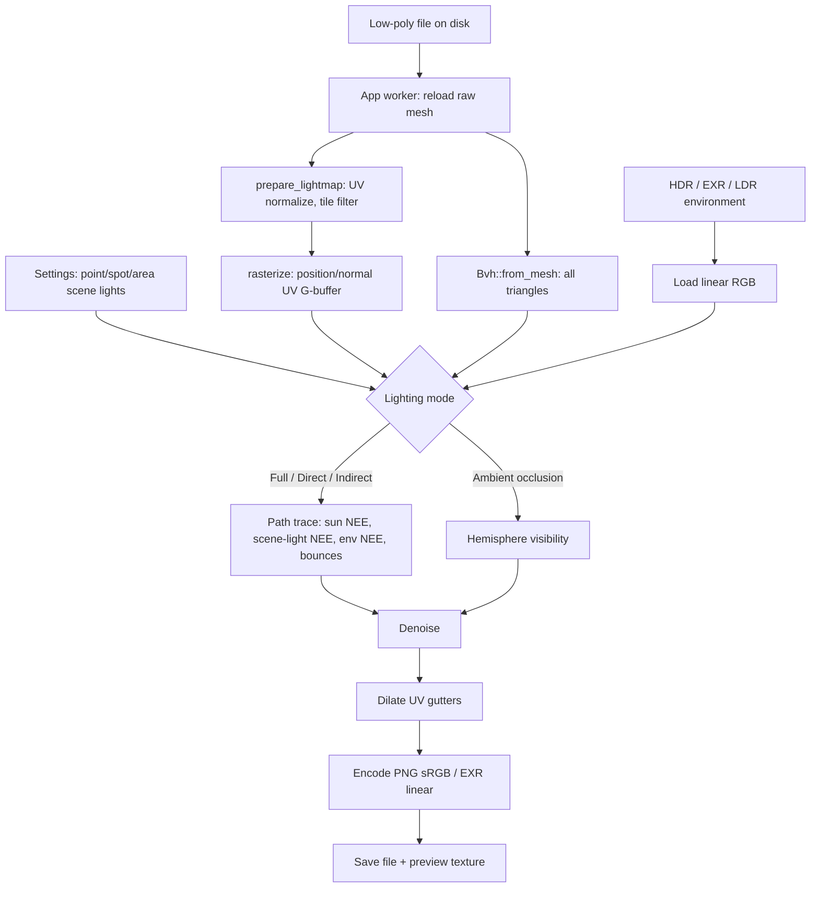

# Lightmap Baking — Technical Reference

This document describes how N-shade turns an imported low-poly mesh and a lighting
setup into a baked lightmap. It covers the data flow, the path-tracing math, the
CPU and GPU backends, denoising, output encoding, editor/CLI integration, and the
known limits of the implementation.

The source of truth is the code, not this document. Each section names the file
that implements it so the two can be kept in sync.

---

## 1. Scope and vocabulary

| Term | Meaning in this codebase |
|---|---|
| **Lightmap** | A white-diffuse irradiance/radiance texture in the mesh's UV layout. It is lighting, not albedo. |
| **Low-poly** | The mesh that supplies both the bake UVs and the shadow-casting geometry. |
| **Texel** | One pixel of the lightmap and one shading point with a position, normal and UV. |
| **Lighting mode** | Which contributions are written: full (direct + indirect), direct lights, indirect/sky, or ambient occlusion. |
| **Direct light** | The directional sun plus editable point/spot/area scene lights, including their shadow tests. |
| **Scene light** | An editable point, spot or rectangular area emitter stored in `LightmapSettings::lights`. |
| **Indirect light** | Light arriving after one or more diffuse bounces between surfaces. |
| **Environment** | An equirectangular HDR/EXR or LDR image used as sky/IBL radiance. |
| **AO** | Ambient occlusion: cosine-weighted sky visibility in grayscale. |
| **Padding** | Dilating covered texels outward into the UV gutters. |

The baker is intentionally separate from the normal-map baker:
`crates/ns_bake/src/lightmap/` is the whole lightmap implementation, and
`crates/ns_bake/src/bake.rs` handles high-to-low/bevel normal bakes.

---

## 2. Pipeline at a glance



Key invariant: **the UV rasterizer decides which triangles are shaded**, but the
**BVH contains every triangle in the mesh**. Geometry from other UDIM tiles, the
back side of the mesh, or parts outside the current UV island therefore still
casts shadows and occludes AO.

### 2.1 Pipelines: Legacy and V2

`LightmapSettings::pipeline` selects between two complete implementations of the
same output (`crates/ns_bake/src/lightmap/mod.rs`):

- **Legacy** reproduces v1 byte for byte: white-noise samples, neighbour-copy
dilation, the original à-trous denoiser, 8-bit PNG and no edge texels.
- **V2** is the default. It keeps the same lighting math and adds the fixes in
the table below. Every V2 branch reads a `Features` flag, so a bake can be
diagnosed feature by feature and **Legacy** remains a true escape hatch.

| V2 feature | Replaces | Effect |
|---|---|---|
| Owen-scrambled Sobol sampling (`sampling.rs`) | White noise | Low-frequency noise that actually falls with sample count |
| Geometric-normal offsets, scale-aware epsilon, terminator shift (`geometry.rs`) | Interpolated normal for rays | No self-shadow wedges on smooth-shaded low-poly surfaces |
| Edge extension (`prepare.rs`) | Centre-only coverage | Texels just outside an island are shaded at the closest surface instead of copied |
| Chart IDs + variance-guided à-trous (`denoise.rs`) | Position/normal-only denoise | No light bleeding between UV islands; preserves hard shadow edges |
| Chart-aware dilation (`output.rs`) | Nearest-copy BFS | Gutters never average two islands; interior texels seed padding before extrapolated edge texels |
| Bilinear environment lookup (`env.rs`) | Nearest environment texel | No fireflies from a small, very bright HDR sun disk |
| Soft AO (`trace.rs`) | Binary visibility | Smooth distance falloff instead of `samples + 1` grey levels |
| TPDF dither (`output.rs`) | Ordered Bayer dither | No crosshatch period; gradients keep their mean |
| 16-bit PNG and highlight rolloff | 8-bit hard clip | Optional headroom for bright bakes |

Extra settings in `LightmapSettings`:

- `pipeline`: `legacy` or `v2` (default `v2`).
- `png_bit_depth`: `eight` or `sixteen`; 16-bit keeps the extra precision of a
  gradient that 8-bit sRGB would posterize.
- `highlight_rolloff`: 0 disables it; 0.1–1.0 compresses values above 1.0 with a
  monotonic shoulder while preserving hue. The clipping report still counts
  pre-shoulder values, so it continues to warn about a hot bake.
- `ao_max_distance`: 0 keeps infinite rays and the v1 AO definition. A positive
  value (mesh-relative, like scene-light distances) produces soft AO.

A chart-aware bake preserves lighting differences that v1's denoiser used to
smear: a one-texel bevel that is genuinely brighter than the face beside it stays
brighter, and an 8-bit sRGB PNG can clip that plateau at 255. That is source
radiance, not banding; enable **Highlight rolloff** or save **EXR/16-bit** when
that detail matters. The artifact harness in `tools/lightmap_metrics.py`
(banding run length, high-frequency noise, border halo ratio) is intentionally a
screening aid, not a pass/fail gate: perfectly flat faces produce long runs of
one value.

---

## 3. Inputs and coordinate spaces

### 3.1 Mesh

`BakeMesh` (`crates/ns_bake/src/lib.rs`) is the only mesh representation the
lightmap code sees:

```rust
pub struct BakeMesh {
    pub positions: Vec<[f32; 3]>,
    pub normals: Vec<[f32; 3]>,
    pub uvs: Vec<[f32; 2]>,
    pub indices: Vec<u32>,
}
```

- `positions`, `indices` and per-vertex `uvs` are required.
- `uvs.len()` must equal `positions.len()`; otherwise
  `prepare_lightmap` returns "no per-vertex UV coordinates".
- If `normals.len()` does not equal `positions.len()`, `ensure_normals`
  generates area-weighted vertex normals from the triangle cross products.
- Degenerate triangles (zero-area cross product) and out-of-range indices are
  skipped.

The editor reloads the **raw file** through `crate::bake::load_bake_mesh`, so
the bake uses the file-space mesh, not the transformed in-memory preview scene.

### 3.2 UV origin

The imported format determines the UV origin:

| Format | UV origin | `uv_bottom_left` |
|---|---|---|
| glTF / GLB | top-left | `false` |
| OBJ, FBX, COLLADA, USD | bottom-left | `true` |

`rasterize` flips V when `uv_bottom_left` is set. The saved PNG/EXR keeps the
native convention; no material or tangent-space conversion happens here.

### 3.3 Environment

`crates/ns_app/src/lightmap.rs::load_environment` loads the image with the
`image` crate:

- `.hdr` and `.exr` are treated as **linear**.
- PNG/JPEG and other LDR formats are converted from sRGB to linear per channel
  using the standard piecewise transfer function.
- The result is normalized into `EnvironmentMap` (`lightmap/env.rs`), with
  invalid/negative values sanitized to zero.

---

## 4. UV preparation and UDIM handling

Implemented in `crates/ns_bake/src/lightmap/prepare.rs`.

1. **Offset-style UDIM normalization.** If the minimum UV component is
   `>= 1000`, the floor of that component is subtracted from all UVs. This
   supports exporters that encode the tile number directly in U/V.
2. **Per-triangle tile selection.** After normalization, each triangle's UV
   centroid is computed:
   ```text
   cell = floor(centroid)
   tile = 1001 + cell.x + 10 * cell.y
   ```
   Only triangles whose centroid is in `LightmapSettings::tile` are rasterized.
   A mesh may contain several UDIM tiles; the current run bakes one tile.
3. **Local UV space.** The triangle's cell is subtracted so the target tile
   spans `0..1`:
   ```text
   local_uv = uv - cell
   ```
4. **Tile-edge wrapping.** A triangle can overlap the 0–1 bounds of the target
   tile under one of nine translations (`WRAP_SHIFTS`: `(0,0)`, `±1` in U/V,
   and the diagonals). A 9-bit `wrap_mask` records which shifted copies
   intersect the tile. The rasterizer iterates those shifts, which keeps
   triangles that cross the tile border from leaving a seam.
5. **Degenerate/target checks.** Triangles without a valid wrap, zero area, or
   non-finite UVs are dropped. An empty result is an error naming the target
   tile.

The BVH is built from the full `BakeMesh` after preparation, so it includes
triangles that were filtered out of the raster pass.

---

## 5. Rasterization into the G-buffer

`rasterize` (`prepare.rs`) fills a square G-buffer at
`settings.output_size()` (clamped to 64–4096):

```rust
struct GBuffer {
    positions: Vec<Vec3>, // one per texel
    normals: Vec<Vec3>,   // shading normal, normalized
    covered: Vec<bool>,   // UV coverage mask
}
```

For every triangle and every wrap shift:

1. Compute the conservative pixel bounding box.
2. For each pixel center, compute barycentric UV weights.
3. Reject pixels outside the triangle or with negative weights.
4. Interpolate world position and shading normal with the barycentric weights.
5. Write the texel only if no earlier triangle already claimed it
   (`first triangle wins` for overlapping UVs).
6. Normalize the interpolated normal, falling back to the triangle face normal
   when the interpolation is degenerate.

The result is a top-down image (row 0 is the top of the saved texture). If the
UV layout covers no texels, the bake stops with "No UV texels were covered".

---

## 6. Lighting modes

`LightmapLightingMode` (`lightmap/mod.rs`) selects which terms reach the output.

| Component | Full | Direct | Indirect | AO |
|---|---|---|---|---|
| Directional sun + shadows | yes | yes | no | no |
| Scene lights (point/spot/area) | yes | yes | yes | no |
| HDR environment / sky | yes | no | yes | no |
| Solid ambient (no HDR) | yes | no | yes | no |
| Automatic environment fill | yes | no | yes | no |
| Inter-surface bounces | configured | forced to 0 | configured | n/a |
| Output | RGB radiance | RGB radiance | RGB radiance | grayscale visibility |

Notes:

- **Full** is the physically based default and the historical behavior.
- **Direct** bakes the sun and scene lights with shadows, and is the mode to
  use when the engine applies direct light at runtime but the baked map should
  still carry practical fill lights.
- **Indirect** is for engines that already apply direct sunlight at runtime.
  This is the mode to use for Second Life Advanced Lighting when the baked
  texture should carry sky/indirect light only. The sun is excluded, but scene
  lights are still baked: they are static, user-authored fill rather than the
  engine-supplied sun, so a dark corner can be lit without baking a second sun.
- **AO** writes `1 - occlusion` per texel: white where the cosine hemisphere is
  fully open, black in fully enclosed cavities. It is grayscale and can be
  multiplied over a diffuse texture.
- The live 3D lighting preview (`lightmap_preview.rs`) is a separate rasterized
  PBR approximation and always shows sun, environment and the visible scene
  lights. The selected mode only changes the baked output.

---

## 7. Path-tracing math

Implemented in `crates/ns_bake/src/lightmap/trace.rs`.

The surface is a **white Lambertian diffuse** surface (`albedo = 1`). The
radiance estimate is accumulated over `samples` independent paths per texel.
At each path vertex:

### 7.1 Sun (next-event estimation)

The sun is a directional light with a cone-shaped angular size:

```text
direction = (cos(elevation)·cos(azimuth),
             sin(elevation),
             cos(elevation)·sin(azimuth))
cos_max   = cos(clamp(sun_size_deg, 0, 30))
```

For each path vertex:

1. Sample a direction uniformly inside the sun cone.
2. If `n · l > 0`, cast a shadow ray limited to
   `shadow_distance = max(mesh_extent · 8, 1)`.
3. If unoccluded:
   ```text
   L_sun += sun_color · sun_intensity · (n · l)
   ```

The sun is sampled at every bounce vertex, so secondary surfaces also receive
direct sunlight. There is no separate sun PDF/MIS weight; `sun_intensity` is the
artistic scale and `sun_size_deg` only controls shadow softness.

### 7.2 Scene lights (next-event estimation)

`LightmapSettings::lights` holds editable `LightmapSceneLight` values. Their
positions, `target`, `area_size` and `range` are stored in **normalized mesh
space** — the space the live preview uses, where the mesh bounding box is
centered on the origin and its longest axis is one unit long. `prepare_lightmap`
returns the raw bounds centre and extent, and `prepare_scene_lights`
(`trace.rs`) maps them into raw mesh coordinates once per bake:

```text
P_raw     = P_normalized · extent + center
range_raw = range_normalized · extent
size_raw  = area_size_normalized · extent
```

The mapping makes a light rig independent of whether the source file is
authored in millimetres or metres, and it is the reason the 3D preview can draw
the same positions without any extra conversion.

For each enabled light with `intensity > 0`, every path vertex runs one
next-event estimation sample before the diffuse continuation ray:

**Point light**

```text
l      = normalize(P_light - P)
L     += color · intensity · max(n · l, 0) · window(d, range) / d²
```

**Spot light** — the same point term multiplied by the cone falloff. The light
axis is `normalize(target - position)`:

```text
cos_light = dot(axis, normalize(P - P_light))
cos_outer = cos(spot_angle_deg / 2)
cos_inner = cos((spot_angle_deg / 2) · (1 - spot_blend))
cone      = smoothstep(cos_outer, cos_inner, cos_light)
L        += point_term · cone
```

`spot_blend = 0` gives a hard cone edge; `1` fades from the axis to the outer
edge. Points outside `cos_outer` are rejected before a shadow ray is cast.

**Area light** — a rectangle perpendicular to the aim axis. One point `Q` is
sampled uniformly on the rectangle, so the estimator is unbiased with
`pdf = 1 / (width · height)`:

```text
L += color · intensity · max(n · l, 0) · max(cos_light, 0)
     · window(d, range) / d² · (width · height)
```

`cos_light = dot(axis, normalize(P - Q))`. One-sided area lights reject points
behind the rectangle; `two_sided` takes the absolute cosine instead.

All three cast a shadow ray toward the emitter, limited to `d - 2ε` so it
cannot hit geometry behind the light:

```text
window(d, r) = 1                        if r = 0
             = (1 - (d/r)⁴)²            if 0 < d < r
             = 0                        if d ≥ r
```

The `(1 - t⁴)²` window reaches exactly zero at `range` while staying close to
physical inverse-square falloff inside it. `range = 0` means no cutoff.

Scene lights are user-authored static fill, so `Full`, `Direct` and `Indirect`
bake them and AO ignores them. This keeps a Second Life Indirect bake useful
for dark interiors: the sun stays out of the texture while deliberate fill
lights remain in it. Each light has two independent switches: `enabled`
controls the bake, `visible_in_view` controls whether the live 3D preview
spawns it. Hiding a light in the viewport therefore does not remove it from the
bake. Area lights use a single rectangle sample per path vertex, so a large
area emitter converges more slowly than a delta light; raise `samples` for very
large or very bright rectangles.

### 7.3 Environment (next-event estimation + MIS)

The environment is an equirectangular map with a solid-angle-weighted CDF
(`lightmap/env.rs`):

- Downsampled to at most **2048 px** wide using solid-angle-weighted box
  filtering. This preserves small bright features such as an HDR sun disk
  better than point sampling.
- Per-row and per-row-column CDFs are built from
  `luminance(radiance) · solid_angle`.
- `EnvSampler::sample` picks a CDF texel, jitters inside it, and returns
  `(direction, radiance, pdf)`.

At each vertex:

```text
pdf_cos = max(n · l, 0) / π
weight  = balance(pdf_env, pdf_cos)             // balance(a,b) = a² / (a² + b² + ε)
L_env  += env_radiance · environment_strength
          · (n · l / π) / pdf_env · weight
```

only when `n · l > 0`, the sampled PDF is positive, and the shadow ray is
unoccluded. `balance` is the power heuristic used for multiple-importance
sampling between the environment CDF and the cosine-weighted diffuse lobe.

### 7.4 Diffuse bounce

After the two NEE terms, one continuation ray is sampled from a cosine-weighted
hemisphere:

```text
pdf = cos θ / π
```

Because the white Lambertian BRDF is `1/π`, the contribution of a hit is
`L_in · (1/π) · cos θ / pdf = L_in`. The tracer therefore simply continues the
path at the hit point without an explicit BRDF weight.

- If the ray escapes, the environment is evaluated at that direction and
  weighted with MIS against the cosine PDF; without an environment, the solid
  ambient term is added.
- If the ray hits a surface and `depth < bounces`, the path continues from the
  hit with the surface's outward normal and an epsilon offset.
- If `depth >= bounces`, the path stops.

`depth` starts at 0, so `bounces = 0` bakes direct light plus environment/ambient
but no inter-surface indirect light. The UI exposes 0–6; the implementation caps
the setting at 8.

### 7.5 Solid ambient and environment fill

**Solid ambient** is used when no HDR is loaded:

```text
ambient = ambient_color · ambient_intensity
```

It is added when a continuation ray escapes to the sky.

**Environment fill** is an unshadowed artistic lift added once per completed
path, after the loop:

```text
average = solid-angle-weighted average luminance of the HDR
fill    = ambient_color · ambient_intensity
          · max(average · environment_strength, 1)
          · environment_fill
L      += fill
```

`environment_fill` defaults to **0** so an HDR bake matches the environment
alone. Raising it lifts surfaces facing away from bright HDR regions.

### 7.6 Final estimate

For `N = effective_samples()` paths:

```text
L(texel) = (1 / N) · Σ path_radiance
```

The raw HDR value is kept (no fixed clamp). Isolated fireflies are handled by
the denoiser, not by clipping legitimate bright sources.

### 7.7 Random numbers

`trace.rs::Rng` uses a splitmix64-mixed seed per texel:

```text
state = splitmix64(seed ^ splitmix64(texel_index))
```

Each subsequent sample uses a PCG-style stream. Mixing the texel index is
important: seeding with `seed * constant + index` would make neighbouring texels
use the same stream shifted by one step, which shows up as structured noise and
banding that barely improves with more samples.

---

## 8. Ambient occlusion

`trace_ao` (`trace.rs`) is the entire AO path:

```text
for each sample:
    ω = cosine-weighted hemisphere direction around the shading normal
    visible = not bvh.occluded(position + normal·eps, ω, ∞)
    sum += visible ? 1 : 0

AO(texel) = sum / samples
```

- One ray per sample; no sun, environment, fill or inter-surface bounces.
- The ray limit is infinite, so the whole local scene occludes the hemisphere.
- The output is grayscale (R = G = B) and remains in `0..1`; exposure and the
  clipping warning do not normally affect it.
- The GPU shader uses the same test in its `mode == 1` branch
  (`lightmap_gpu.wgsl`), and a CPU/GPU parity test covers it.

For Second Life, AO (or **Indirect only**) is normally multiplied over the
diffuse texture, because the viewer supplies direct sunlight at runtime.

---

## 9. CPU backend

`bake_lightmap` (`lightmap/mod.rs`).

### 9.1 Scheduling

- A cached rayon pool is created once with
  `available_parallelism() - 1` threads (minimum 1), leaving one core for the
  editor.
- The output is split into bands of `resolution * 4` texels; each band is
  processed in parallel and updates a progress counter.
- Cancel is checked between bands and every 16 samples inside a texel. A
  cancelled bake returns `BakeError::Cancelled` and saves nothing.

### 9.2 Progress

| Stage | Progress |
|---|---|
| UV preparation | 100 |
| Rasterization | 180 |
| Tracing | 180 → 830 |
| Denoising | 850 → 930 |
| Output assembly | 980 → 1000 |

### 9.3 Memory

The dominant allocations are:

- `Vec<Vec3>` radiance: 12 bytes per texel.
- G-buffer position: 12 bytes per texel.
- G-buffer normal: 12 bytes per texel.
- G-buffer coverage: 1 byte per texel.
- Denoiser copies: at least one radiance copy and one normal copy for the
  padded inputs; the built-in denoiser also keeps a source and target buffer.

At 4096 × 4096 this is already hundreds of MiB for the raw buffers, before
denoising copies. Prefer 1024–2048 for production unless the machine has the
memory to spare.

### 9.4 Statistics

The CPU path reports:

- `rays`: shadow/NEE and continuation rays.
- `hits`: shadow-ray occlusions plus surface hits on continuation rays.
- `triangles`: triangles accepted by `prepare_lightmap`.
- `texels`: covered texels in the UV layout.
- `clipped`: covered texels whose exposed value exceeds 1.0.
- `denoiser` and `backend`.
- `elapsed_ms`.

---

## 10. GPU backend

`crates/ns_bake/src/lightmap_gpu.rs` and `lightmap_gpu.wgsl`, compiled behind the
`gpu` feature.

### 10.1 Device selection

- `wgpu::Instance::default()`, high-performance adapter, no surface.
- Software adapters are rejected with `GpuUnavailable`.
- Works on DirectX 12, Vulkan and Metal adapters from NVIDIA, AMD and Intel.
- The output buffers are checked against the adapter's storage-buffer and
  buffer-size limits before dispatch; an oversized lightmap falls back to the
  CPU (when the backend is `Auto`) or fails with a clear message.

### 10.2 GPU data layout

| Buffer | Contents |
|---|---|
| Uniform | `Params`: resolution, samples, bounces, seed, sun, environment, fill, eps, shadow distance, mode |
| Storage | Flattened BVH triangles (`p0..p2`, `n0..n2`) |
| Storage | Flattened BVH nodes (bounds + child/leaf links) |
| Storage | G-buffer positions (`vec4`, `w = covered`) |
| Storage | G-buffer normals (`vec4`) |
| Storage | Accumulation buffer (`vec4` per texel) |
| Texture | Environment, `Rgba32Float`, one texel per sampled environment entry |
| Storage | Environment row and column CDFs |
| Storage | Scene lights (`GpuLight`: position/kind, axis/cosines, color, size/area, range) |

The shader uses `@workgroup_size(8, 8, 1)`, one invocation per texel. `Params.light_info.x`
holds the light count; the light buffer always contains at least one element
because wgpu rejects zero-sized storage bindings, and the loop runs zero times
when no lights are enabled.

### 10.3 Samples and TDR safety

Samples are dispatched in batches; the dispatch loop repeats until all samples
are accumulated:

| Resolution | Samples per dispatch |
|---|---|
| < 1024 | 4 |
| 1024–2047 | 2 |
| ≥ 2048 | 1 |

This keeps a slow GPU from hitting the Windows TDR watchdog. Progress is updated
after each dispatch, and cancellation is checked between dispatches.

### 10.4 Readback and statistics

- The accumulation buffer is copied to a mapped readback buffer.
- Each texel is divided by the total sample count.
- The same `denoise`, `finish_lightmap` and output code as the CPU path is used,
  so PNG/EXR encoding and padding are identical.
- `backend_name` is set to the adapter/backend string, for example
  `RTX 3070 Ti · Vulkan`.
- GPU bakes report `rays = 0`, `hits = 0`; the GPU does not count individual
  rays. The UI hides the ray line when it is zero.

### 10.5 Lighting modes on the GPU

The mode is passed as a `u32` in `Params`:

- `Full`, `Direct`, `Indirect`: the same shader loop as the CPU path. Direct
  zeroes the environment total, fill and bounces; Indirect zeroes the sun and
  the scene-light count.
- `Ambient occlusion`: a dedicated branch in the shader samples one cosine
  hemisphere direction, tests `occluded(..., FAR)`, and accumulates `1` for a
  visible sample. It skips the sun/environment/light/loop code entirely.

Scene lights are packed by `prepare_scene_lights` into `GpuLight` structs that
mirror the CPU values exactly: normalized positions are converted with the same
centre/extent, and the spot cosines and area size are precomputed on the CPU.

With no HDR environment, the GPU synthesizes a **1 × 1 environment** from
`ambient_color · ambient_intensity`. The CPU instead treats the same value as the
solid ambient term when a ray escapes. Both converge to the same constant-sky
result.

---

## 11. Denoising

`crates/ns_bake/src/lightmap/denoise.rs`.

### 11.1 Selection

| Setting | Behavior |
|---|---|
| `None` | No filtering. |
| `Builtin` | Built-in edge-aware à-trous filter. |
| `Auto` | OptiX → OIDN (CUDA, SYCL, CPU) → built-in. |
| `Optix` | OptiX; falls back to built-in if unavailable. |
| `Oidn` | OIDN; falls back to built-in if unavailable. |

The settings default is `Builtin`. The `Auto` enum default is only used when a
caller explicitly selects it.

### 11.2 Padded inputs

Screen-space denoisers assume a continuous image. Before filtering, the
denoiser builds padded copies of the radiance and normals using the same
`dilate` BFS as the output stage (`settings.padding` passes). Only covered
texels are copied back after denoising; the final padding is done again by
`finish_lightmap`.

### 11.3 Built-in filter

1. **Firefly suppression.** A texel is clamped only when at least five
   neighbours on the same surface (normal dot ≥ 0.9, within 2 texels) all have
   luminance at least four times lower. The clamp factor is
   `max(neighbour_max · 4, 0.5)`. A genuine highlight keeps a similarly bright
   neighbour and survives.
2. **Edge-aware à-trous passes.** Up to 6 passes; default 4.
   - 5 × 5 B3-spline kernel: `[1, 4, 6, 4, 1] / 256` in each axis.
   - `sigma = texel_world · step · 2`.
   - Normal weight: `(n · n_neighbour)^8`.
   - Position weight: `1 / (1 + d² / (2σ²))`.
   - Spatial × normal × position weights are normalized per texel.
   - The step doubles after each pass, widening the filter footprint.

### 11.4 OpenImageDenoise

- Loaded at runtime through `libloading`; no build-time dependency. The loader
  checks the executable directory first, then `OIDN_DIR`/`OIDN_ROOT`, `bin`/`lib`
  subfolders and the usual Intel install roots. Every candidate is tried until
  one exposes all required entry points, so a stale DLL cannot mask the bundled
  runtime.
- The portable Windows archive ships the official **OIDN 2.3.1** CPU and CUDA
  devices next to `N-shade.exe` (`OpenImageDenoise*.dll`, `tbb12.dll`,
  `tbbbind*.dll`), plus `OIDN-LICENSE.txt` and the third-party notices. OIDN
  therefore works without a separate install. On other machines, install OIDN or
  set `OIDN_DIR`.
- Uses the OIDN 2.x API: `oidnSetFilterImage` with an `OIDNBuffer` handle and
  `oidnSetFilterBool`. The loader accepts the older `oidnSetFilter1b` name for
  1.x libraries. The shared-memory image setter is deliberately not used with
  buffer handles: it expects a raw pointer and would read invalid memory.
- Tries the lightmap-specific `RTLightmap` filter first (no guides). Older OIDN
  builds fall back to `RT` with normal + albedo guides and `cleanAux`.
- Albedo is neutral white inside covered/padded texels and black outside;
  normals are the G-buffer normals.
- Device preference follows `OidnDevice`: Auto tries CUDA → SYCL → CPU;
  explicit CUDA/SYCL still fall back to CPU. The CUDA device uses the installed
  NVIDIA driver (`nvcuda.dll`), not the CUDA Toolkit.
- The device that actually ran is reported in the result panel.

### 11.5 NVIDIA OptiX

- Loaded at runtime from the installed NVIDIA driver (`nvoptix` + CUDA); the
  OptiX SDK is not required.
- HDR denoiser with normal and albedo guides.
- Color and guide buffers use the OptiX `FLOAT4` pixel format (verified against
  the SDK header; `FLOAT3` is not accepted for guides).
- The padded lightmap is denoised as a contiguous image; intensity is computed
  with `optixDenoiserComputeIntensity` before invocation. Uncovered texels are
  filled with the mean covered radiance for that calculation (the albedo guide
  stays black there), so a mostly empty atlas does not skew the HDR intensity.
- Any failure falls back to the built-in filter and reports it.
- OptiX is a general HDR denoiser. It cannot recover clipped highlights or
  extremely low sample counts; 64+ spp and an unclipped EXR/PNG are still the
  baseline for a clean lightmap.

---

## 12. Output and padding

`crates/ns_bake/src/lightmap/output.rs`.

### 12.1 UV gutter dilation

`dilate` performs a BFS outward from covered texels for up to `padding` steps.
Each newly reached texel copies the nearest source radiance and is marked
covered. Dilation runs:

1. On the padded denoiser inputs, so screen-space filters do not see black
   gutters.
2. On the final radiance, so bilinear sampling at UV seams does not pick up the
   transparent background.

`padding` defaults to 8.

### 12.2 PNG

- The radiance is multiplied by `2^exposure` (exposure clamped to −8..8;
  the UI exposes −4..4).
- Each channel is clamped to `0..1` and encoded with the sRGB transfer function.
- A 4 × 4 Bayer dither of ±0.5 LSB is added before rounding to 8-bit, which
  avoids banding in low-contrast falloff.
- Alpha is 255 for covered and dilated texels, 0 outside.
- PNG is written as RGBA8.

### 12.3 EXR

- Linear RGB float values are written without exposure or clamping.
- Alpha is the coverage mask (0 or 1) as float.
- EXR is the format to use for compositing or further processing.

### 12.4 Clipping report

Before padding, the output stage counts covered texels whose exposed value has
any channel above 1.0. The result panel uses this to warn that the PNG preview
is clipping; it does not affect the EXR.

---

## 13. Editor integration

### 13.1 Runtime and jobs

`crates/ns_app/src/lightmap.rs` owns `LightmapRuntime`. A bake:

1. Captures `LightmapSettings`, the low-poly path, the optional environment
   path, the output path and the format.
2. Spawns `run_bake` on Bevy's `AsyncComputeTaskPool`.
3. Reloads the low-poly and environment **on the worker** so the UI does not
   block.
4. Chooses the backend.

`LightmapBackend::Auto` tries the GPU first; any non-cancelled error is logged
and the CPU path is used. `Cpu` and `Gpu` force a backend.

### 13.2 Results and preview

The CPU/GPU output returns:

- `LightmapOutput.pixels`: top-down RGBA8 sRGB preview.
- `LightmapOutput.hdr`: top-down linear RGB floats.
- `LightmapStats`.
- `backend_name` for GPU runs.
- The saved path or save error.

The editor creates a Bevy `Image` with `Rgba8UnormSrgb` and a clamp sampler for
the panel preview. The preview is **not** applied to the 3D material; the
document normal-map material is unchanged. The optional **3D lighting preview**
is a separate rasterized PBR view of the sun, the visible scene lights and the
environment, and is not the bake. Scene lights are spawned as real Bevy
`PointLight`/`SpotLight`/`RectLight` entities with a small emissive marker;
`visible_in_view = false` parks them in `Visibility::Hidden`, while the bake
still reads them from `LightmapSettings`.

### 13.3 UDIM batches

`start_batch` captures the settings and environment once, then runs one job per
detected tile, sequentially:

- Each tile reloads the mesh from disk.
- `settings.tile` is set per job.
- The preview follows the last finished tile.
- The result panel reports the batch summary and any per-tile save errors.

Output naming:

| Situation | Default name |
|---|---|
| Single bake, non-UDIM | `output/lightmaps/<mesh>_lightmap.png` |
| Single bake, UDIM tile | `output/lightmaps/<mesh>_lightmap_<tile>.png` |
| Batch, default path | same per-tile naming |
| Batch, custom path | `<stem>_<tile>.<ext>` (an existing tile suffix is replaced) |

EXR uses the same naming with `.exr`.

### 13.4 Automatic start

`--lightmap` sets `LightmapRuntime::auto_start`. Once the imported mesh is
ready, `auto_start_lightmap` fills in the mesh path, UV origin and default
output, then starts a bake. `--lightmap-preview` is a different flag: it enables
the live raster preview, not a bake.

---

## 14. Settings reference

`LightmapSettings` in `crates/ns_bake/src/lightmap/mod.rs`.

| Setting | Default | Range / notes |
|---|---|---|
| `resolution` | 1024 | 64–4096 (UI 256–4096) |
| `backend` | Auto | Auto / CPU / GPU |
| `lighting` | Full | Full / Direct / Indirect / AO |
| `samples` | 128 | 1–4096 internally; UI 16–1024 |
| `bounces` | 2 | 0–8 internally; UI 0–6; ignored by Direct/AO |
| `tile` | 1001 | UDIM tile to rasterize |
| `padding` | 8 | 0–64 |
| `pipeline` | V2 | Legacy / V2, see §2.1 |
| `png_bit_depth` | 8-bit | 8-bit / 16-bit; EXR is always float |
| `highlight_rolloff` | 0.0 | 0 hard-clips; 0.1–0.95 compresses above 1.0 |
| `ao_max_distance` | 0.0 | 0 keeps v1 infinite rays; >0 is mesh-relative |
| `uv_bottom_left` | false | set from the imported mesh |
| `denoiser` | Builtin | None / Auto / Builtin / OptiX / OIDN |
| `oidn_device` | Auto | Auto / CPU / CUDA / SYCL |
| `denoise_passes` | 4 | 1–6 |
| `exposure` | 0.0 | stops; PNG only |
| `sun_enabled` | true | |
| `sun_azimuth_deg` | 35 | 0–360; 0° = +X, 90° = +Z |
| `sun_elevation_deg` | 55 | 0–90 in the UI |
| `sun_size_deg` | 1.5 | 0.1–15; clamps at 30 in the tracer |
| `sun_color` | white | RGB |
| `sun_intensity` | 1.0 | 0–10 in the UI |
| `lights` | empty | editable point/spot/area lights, see §7.2 |
| `ambient_color` | (0.55, 0.62, 0.75) | solid sky/fill color |
| `ambient_intensity` | 0.25 | |
| `environment_strength` | 1.0 | HDR multiplier |
| `environment_fill` | 0.0 | artistic unshadowed lift |
| `seed` | 1 | changes the per-texel RNG sequence |

### 14.1 Quality presets

| Preset | Resolution | Samples | Bounces |
|---|---|---|---|
| Quick | 512 | 64 | 1 |
| Balanced | 1024 | 128 | 2 |
| Final | 2048 | 512 | 3 |

The presets only change resolution/samples/bounces; the lighting mode is
independent.

---

## 15. Command line

| Flag | Meaning |
|---|---|
| `--lightmap` | Start a bake automatically when the mesh is ready. |
| `--lightmap-preview` | Enable the live rasterized lighting preview. |
| `--lightmap-env PATH` | Equirectangular HDR/EXR or LDR environment. |
| `--lightmap-out PATH` | Output file. |
| `--lightmap-resolution N` | Output size. |
| `--lightmap-samples N` | Paths per texel. |
| `--lightmap-bounces N` | Indirect bounces. |
| `--lightmap-fill F` | `environment_fill`. |
| `--lightmap-lighting MODE` | `full`, `direct`, `indirect` or `ao`. |
| `--lightmap-format png\|exr` | Output format. |
| `--lightmap-denoiser auto\|builtin\|oidn\|optix\|none` | Denoiser selection. |
| `--lightmap-backend auto\|cpu\|gpu` | Path tracer backend. |
| `--lightmap-pipeline legacy\|v2` | Pipeline, see §2.1. |
| `--lightmap-png-depth 8\|16` | PNG bit depth. |
| `--lightmap-rolloff F` | Highlight shoulder, 0–0.95. |
| `--lightmap-ao-distance F` | Soft-AO distance; 0 keeps v1 AO. |
| `--lightmap-oidn-device auto\|cpu\|cuda\|sycl` | OIDN device preference. |

Example:

```bash
cargo run -p ns_app -- \
  --mesh props.glb \
  --lightmap \
  --lightmap-lighting indirect \
  --lightmap-env studio.hdr \
  --lightmap-resolution 2048 \
  --lightmap-samples 256 \
  --lightmap-out output/lightmaps/props_indirect.exr
```

Capture-script wrappers expose the same options as `-Lightmap`,
`-LightmapLighting`, `-LightmapEnv`, and so on; see `tools/capture_window.ps1`.

---

## 16. Performance notes

Indicative numbers from the development machine (RTX 3070 Ti Laptop), measured
for the test asset documented in the README:

| Bake | CPU | GPU |
|---|---|---|
| 512², 64 spp, 2 bounces | ~3 s | ~0.9 s |
| 2048², 64 spp, 2 bounces | — | ~4.7 s |

These are order-of-magnitude guides, not guarantees. Work scales roughly with
`resolution² × samples` and, for indirect light, with the average path length.
The GPU batches samples to stay below the Windows TDR watchdog; the CPU leaves
one core free for the editor.

Practical guidance:

- **Quick** for previews and iteration.
- **Balanced** for most assets.
- **Final** or higher samples for final bakes; denoising cannot recover a
  severely undersampled image.
- Use **EXR** when the result will be composited or multiplied; PNG is for
  direct engine ingestion and previews.
- For Second Life Advanced Lighting, bake **Indirect only** or **Ambient
  occlusion** and multiply the result over the diffuse texture.

---

## 17. Validation

Run the lightmap suite:

```bash
cargo test -p ns_bake --all-features
```

Covered behavior includes:

- `lightmap/tests.rs`
  - Sun lights a white surface.
  - An occluder casts a shadow while open corners stay lit.
  - A uniform HDR environment converges to unit energy.
  - Direct mode ignores the environment and ambient fill.
  - Indirect mode ignores the sun.
  - Ambient occlusion darkens under an occluder, stays grayscale, and leaves
    open sky bright.
  - Clipping is counted and padding fills texels beyond the island.
- `lightmap_gpu.rs` tests
  - GPU environment, fill and sun bakes match the CPU within tolerance.
  - GPU ambient occlusion matches the CPU and stays grayscale.
- `lightmap/denoise.rs` tests
  - Isolated fireflies are suppressed.
  - Smooth gradients are preserved.
- `optix.rs` tests
  - Driver struct layouts and pixel formats match the SDK expectations.
- `ns_app/src/lightmap.rs` tests
  - Batch output paths end with the tile number.

A manual check that exercises the whole path on a real asset:

```bash
cargo run -p ns_app -- \
  --mesh model.dae \
  --lightmap \
  --lightmap-lighting ao \
  --lightmap-resolution 512 \
  --lightmap-samples 64 \
  --lightmap-out output/lightmaps/model_ao.png
```

The AO image should be grayscale, white in open areas, and dark in crevices and
under overhangs.

---

## 18. Limitations and gotchas

- **White albedo only.** The baker evaluates lighting for a white Lambertian
  surface. It does not transport base color, metallic, roughness, emissive or
  transmission. Multiply the result over an albedo texture if needed.
- **Diffuse only.** There are no specular reflections, refractions or caustics.
- **Sun is directional.** `sun_size_deg` softens shadows by sampling a cone, but
  the sun is not a physical disk with solid-angle-normalized radiance and no
  sun MIS is used.
- **Scene lights are static fill.** They are baked by `Full`, `Direct` and
  `Indirect` and ignored by AO. Point and spot lights are delta emitters; area
  lights use one uniform rectangle sample per path vertex, so large or very
  bright rectangles need more samples than a point light to clean up.
- **Scene lights are mesh-relative.** Positions and sizes are normalized to the
  mesh bounds. Re-importing a mesh with a different shape keeps the rig
  relative to the new bounds, which is usually desired but moves the lights in
  absolute terms.
- **Fixed sampling.** Every texel gets the same sample count; there is no
  adaptive sampling or progressive preview of a partial bake.
- **Bounces are capped.** The setting is clamped to 8; the UI exposes 0–6.
- **AO is visibility only.** It produces no bent normals and no color bleeding.
- **Overlapping UVs.** The rasterizer keeps the first triangle that claims a
  texel; overlapping islands do not blend.
- **Padding is a BFS from covered texels.** Under **Legacy** it is
  nearest-neighbour and can smear radiance between unrelated islands. Under
  **V2** rings never average two charts and interior texels seed first, but very
  large padding values still extend lighting far beyond the island.
- **GPU ray statistics are zero.** Only the CPU backend counts rays and hits.
- **GPU memory limits.** The GPU path checks storage-buffer limits and falls
  back (Auto) or errors (Gpu) when the lightmap buffers are too large.
- **Denoisers are optional.** OIDN is bundled in the portable Windows build and
  loaded from the executable directory (or a system install); OptiX loads from
  the NVIDIA driver. When neither is available the built-in filter runs.
- **Denoisers cannot recover clipping.** A white region produced by a texture
  value above 1.0 stays white after OptiX, OIDN or the built-in filter. Save EXR
  or lower Exposure/light intensity when the result panel reports clipping;
  low sample counts also survive as blotches no denoiser can fully remove.
- **Live preview is not the bake.** The 3D lighting preview is a rasterized PBR
  approximation and is not applied to the document material. Its point, spot and
  area lights approximate the bake settings (including the per-light Preview
  toggle), but intensity, shadow filtering and area-light shadowing differ.
- **The preview renders in SDR.** Bevy 0.19 renders a black viewport when `Hdr`
  is added to the preview camera, so the live preview keeps an SDR target and
  compensates with a +2.5 EV exposure offset and a scaled environment
  (`ENVIRONMENT_NITS`). Bright HDRI highlights clip in the preview; the bake
  still uses the raw HDR radiance.
- **The bake reloads from disk.** Changes made only to the in-memory preview
  scene are not used; the source file is re-parsed for each job/tile.
- **Missing UVs fail the bake.** Every vertex needs a UV; there is no automatic
  unwrap.
- **No lightmap compositing into the document.** The result is a file plus a
  panel preview.

---

## 19. File map

| Path | Responsibility |
|---|---|
| `crates/ns_bake/src/lightmap/mod.rs` | Public types, settings, modes, CPU orchestration, progress |
| `crates/ns_bake/src/lightmap/prepare.rs` | Mesh validation, UDIM normalization, triangle filter, G-buffer rasterization |
| `crates/ns_bake/src/lightmap/trace.rs` | RNG, sun cone sampling, scene-light NEE, path loop, AO visibility |
| `crates/ns_bake/src/lightmap/env.rs` | Environment map, solid-angle downsampling, CDF, MIS evaluation |
| `crates/ns_bake/src/lightmap/denoise.rs` | Denoiser selection, padded inputs, built-in filter |
| `crates/ns_bake/src/lightmap/output.rs` | Gutter dilation, sRGB/EXR encoding, stats |
| `crates/ns_bake/src/lightmap_gpu.rs` | wgpu device, buffers, dispatch batches, readback |
| `crates/ns_bake/src/lightmap_gpu.wgsl` | GPU path-tracing and AO shader |
| `crates/ns_bake/src/oidn.rs` | Runtime OIDN loading and lightmap/RT filter invocation |
| `crates/ns_bake/src/optix.rs` | Runtime OptiX loading and HDR denoiser invocation |
| `crates/ns_app/src/lightmap.rs` | Background jobs, UDIM batches, environment loading, saving, preview |
| `crates/ns_app/src/lightmap_preview.rs` | Live rasterized 3D lighting preview, including scene-light entities |
| `crates/ns_app/src/ui/lightmap.rs` | Lightmap panel, modes, presets, scene lights, quality and output controls |
| `crates/ns_app/src/main.rs` | CLI flags and automatic bake start |
| `tools/capture_window.ps1` | Documentation capture wrappers for the same flags |
