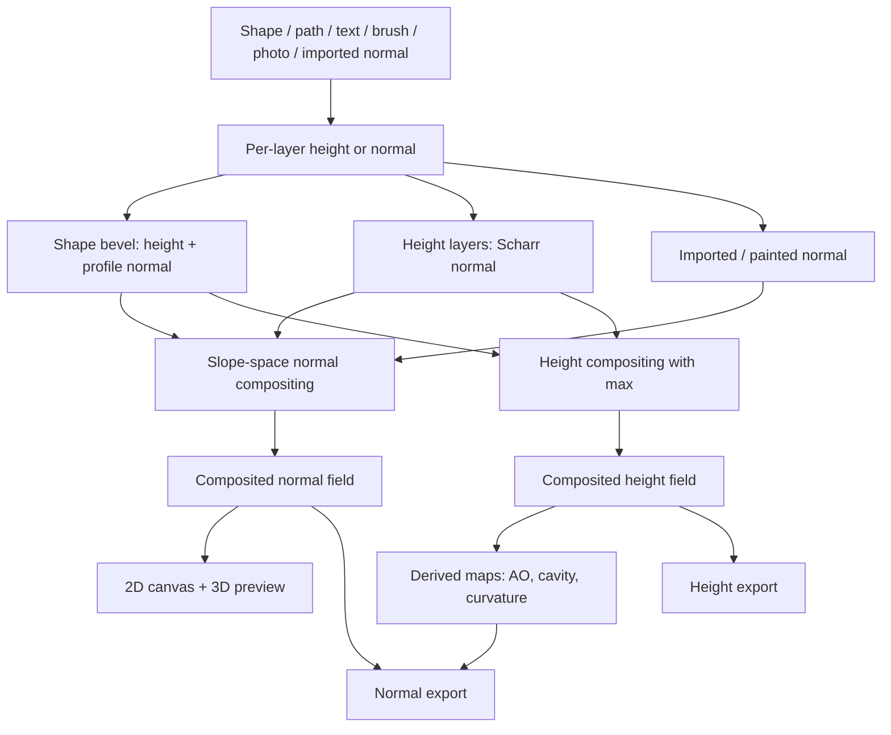
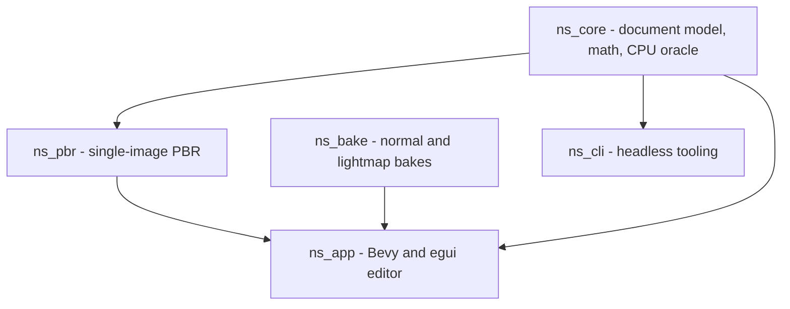
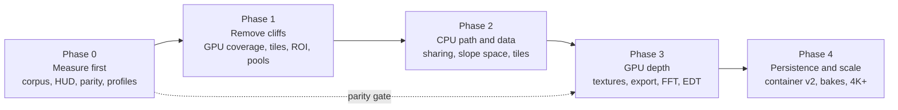
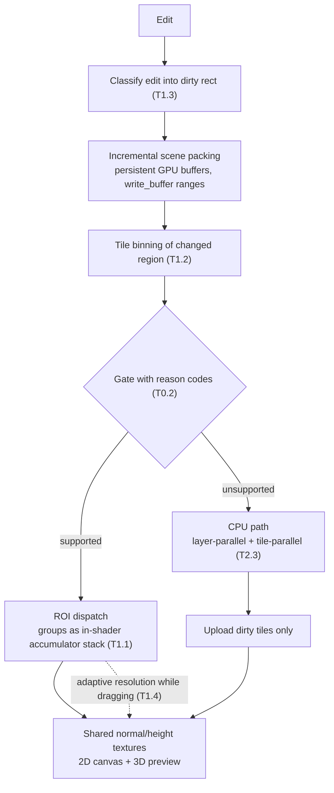

# Software Architecture & Performance Plan

**N-shade (Normal Map Studio)** is a height-first normal-map authoring application. Artists
author *surface* — parametric shapes, vector paths, text, painted or imported height — and the
normal map is a derived output. This document covers four things:

1. how normals are created,
2. how the application is structured,
3. where performance comes from today,
4. **how to make it faster** — a prioritized, measurable engineering roadmap (new in this revision).

> **Source of truth.** Sections 1–3 describe the current working tree: Rust, Bevy 0.19 +
> `bevy_egui`, dense `Grid<f32>` buffers, and a single RON `.nsproj` project file. `README.md`
> §4–5 and some older design notes describe a planned Tauri + TypeScript + tiled-container
> architecture that is **not** implemented. Treat the code as the truth.

> **Revision note (2026-11-01).** Sections 1–2 are unchanged. Section 3 keeps the original
> performance description and adds corrections and a bottleneck model. Sections 4–5 and
> Appendices A–B are new and are written to be worked through in an IDE. In §6, rule 6 is
> refined (GPU export path) and rules 11–17 are new; rules 1–5 and 7–10 are unchanged.
>
> Conventions used in the new sections:
> - **[VERIFY]** — an inference drawn from this document, *not* from reading the source. Confirm
>   it in code before building on it. Appendix A lists every one.
> - **Target** — a proposed number, not a measurement. Validate against a release-build baseline
>   (task T0.1) before committing to it.
> - Impact / Effort / Risk are qualitative (High·Med·Low / S·M·L). No speed-up factors are
>   claimed anywhere in this document, because none have been measured yet.

---

## Contents

- [Performance TL;DR](#performance-tldr)
- [How to use this document](#how-to-use-this-document)
- [How normals are created](#1-how-normals-are-created)
- [Architecture](#2-architecture)
- [Performance today](#3-performance-today)
- [Performance roadmap](#4-performance-roadmap)
  - [Phase 0 — Measure first](#phase-0--measure-first)
  - [Phase 1 — Remove the big cliffs](#phase-1--remove-the-big-cliffs-gpu-coverage-and-scheduling)
  - [Phase 2 — CPU path and data layout](#phase-2--cpu-path-and-data-layout)
  - [Phase 3 — GPU depth](#phase-3--gpu-depth)
  - [Phase 4 — Persistence, bakes, and scale](#phase-4--persistence-bakes-and-scale)
- [Measurement, budgets, and regression protection](#5-measurement-budgets-and-regression-protection)
- [Design rules](#6-design-rules-that-keep-the-system-correct)
- [Source map](#7-source-map)
- [Research notes and sources](#8-research-notes-and-sources)
- [Appendix A — Verify-in-code checklist](#appendix-a--verify-in-code-checklist)
- [Appendix B — Master task checklist](#appendix-b--master-task-checklist)

---

## At a glance

| Area | Current implementation |
|---|---|
| Language / build | Rust 2021, Cargo workspace, 5 crates |
| Editor | Bevy 0.19.1 + `bevy_egui` 0.42.0 (egui 0.36.2), immediate-mode panels |
| CPU engine | `ns_core` — engine-agnostic document model, math, and reference evaluator |
| GPU preview | `ns_app/src/gpu.rs` + `normal_studio.wgsl`, one compute dispatch per generation |
| Internal data | Dense `f32` normal/height grids; canonical OpenGL (+Y) normals |
| Project format | Versioned `.nsproj` archive (`manifest.json` + RON document); legacy plain-RON projects still load |
| Optional pipelines | `ns_bake` normal/lightmap bakes, `ns_pbr` single-image PBR, `ns_cli` headless tooling |
| Correctness rule | The CPU evaluator is the oracle; the GPU path is a fail-closed fast subset |
| Perf status | GPU live path + CPU reference path; unit tests and ignored microbenchmarks only; **no CI perf gate, no parity/golden suite** |

---

## Performance TL;DR

The architecture is already sound: one GPU dispatch, no readback, region-limited CPU evaluation,
revision-keyed caches. The remaining wins come from removing *cliffs* (cases that fall off the
fast path) and from making edits cost proportional to what changed. In priority order:

| # | Change | Why it matters | Impact | Effort | Task |
|---|---|---|---|---|---|
| 1 | Re-baseline in **release**, add instrumentation and a CPU↔GPU parity harness | Existing CPU numbers were taken on debug builds; nothing below is safe without a parity gate | Enabler | S–M | T0.1–T0.5 |
| 2 | Stop whole-stack GPU rejections (vector compounds, groups, smart masks) | One such layer sends the *entire* document to the CPU path (247-layer showcase: 16.5 s on CPU) | **High** | M–L | T1.1 |
| 3 | Tile-binned layer lists + dirty-rect re-dispatch + incremental scene packing | GPU cost today scales with *layers × canvas*, not with *what changed* | **High** | M | T1.2, T1.3 |
| 4 | Thread-pool hygiene and cancellable CPU jobs | rayon's global pool and Bevy's task pools compete; stale jobs run to completion | High | S–M | T1.5 |
| 5 | Structurally shared `Document` (`Arc` grids/layers) and tiled paint storage | Removes the first-edit copy-on-write cost and the worker "detach" copy; makes undo a true delta | High | M | T2.1, T2.7 |
| 6 | CPU path: slope-space accumulators, layer-parallel + tile-parallel compositing, selection-aware cache | The fallback and export path should not recompute 100 layers for one edit | High | M–L | T2.2–T2.4 |
| 7 | GPU export (packed 16-bit / f32 buffer, async readback) | Export currently re-evaluates everything on the CPU | Med–High | M | T3.3 |
| 8 | Container v2: binary zstd blobs + incremental autosave | RON is text; large baked grids dominate save/load | Med | M | T4.1 |

---

## How to use this document

1. Start with **Phase 0**. Every later task assumes the corpus, the parity harness, and the HUD exist.
2. Pick a task. Each one lists *Problem → Approach → Where → Acceptance → Invariants*.
3. Before coding, resolve the task's **[VERIFY]** items (Appendix A) by reading the named files.
4. Implement behind a Cargo feature or a runtime flag so the old path stays selectable until the
   parity tests and benchmarks pass.
5. A task is **done** only when it meets the Definition of Done in §5.4 (benchmarks before/after,
   parity test green, `docs/perf-baseline.md` updated, rules in §6 still hold).
6. Do not batch unrelated performance changes into one commit; the corpus can only attribute a
   win or a regression to a single change if the change is isolated.

---

## 1. How normals are created

The central design decision is **height first**. Most surface detail — bevels, strokes, grooves,
photo import and painted height — is evaluated as a scalar height field, and the tangent-space
normal is recovered from its gradient. This keeps the surface definition consistent, makes
normals regenerable and non-destructive, and lets masks and derived maps share one source.
Imported and painted normal layers are the exception: they supply normals directly.



### 1.1 Conventions

Normals are stored as unit vectors in **canonical OpenGL tangent space**:

- Image space: X right, **Y down** (row order).
- Tangent space: +X right, **+Y up**, +Z out of the surface.
- Encoding: `rgb = n * 0.5 + 0.5`, decoding clamps invalid `nz <= 0` samples.
- DirectX (`Y-`) is a boundary conversion only: flip green at encode/decode; never let
  DirectX data leak into internal buffers.
- Normal and height maps are **linear** data. Never apply sRGB gamma to them.

The rule lives in `crates/ns_core/src/convention.rs`, and the export convention in
`Document::green` is applied only when writing or importing.

### 1.2 Shape → signed distance → bevel → normal

Every shape source — rect, ellipse, polygon, star, Bézier path, or live text — is rasterized
to anti-aliased coverage. The CPU pipeline then works on a signed distance field:

```text
coverage        = rasterize(shape, anti-aliased)
distance        = exact EDT signed distance (Felzenszwalb–Huttenlocher)
softness        = gaussian_blur(distance, softness_px)
t               = clamp(distance / radius_px, 0, 1)
height          = profile(t) * height_px        (invert => (1 - profile(t)) * height_px)
normal          = normalize(-dh/dx, +dh/dy, 1)  (OpenGL, image rows down)
```

Key details in `crates/ns_core/src/sdf.rs` and `crates/ns_core/src/layers.rs`:

- **Exact distance, not a fallback.** `inside_distance` / `outside_distance` use a
  Felzenszwalb–Huttenlocher EDT. `Wrap::Repeat` documents use 3×3 tiling so the distance field
  wraps at the border.
- **The profile is sampled in normalized distance space.** Built-in profiles are:

  | Profile | Height rule |
  |---|---|
  | Round | `sqrt(1 - (1 - t)^2)` |
  | Chamfer | `t * tan(angle)` |
  | Linear | `t` |
  | Convex | `1 - (1 - t)^3` |
  | Concave | `t^3` |
  | Smooth | `t^2 * (3 - 2t)` |
  | Custom | 256-sample monotone-cubic Hermite LUT |

- **The slope includes the height/radius ratio.** `rise = height_px / radius_px`; otherwise a
  bevel normal is independent of the Height control and every shape shades equally deep.
- **The gradient comes from the distance field.** The CPU takes central differences of the
  (optionally smoothed) distance; the GPU uses the analytic outward gradient of the SDF. Both
  feed the same profile-slope formulas.
- **Fill and Stroke are different distance functions.** Fill uses `-d` (inside the shape).
  Stroke uses `stroke_width / 2 - abs(d)`, a band centred on the outline.
- **Anti-aliasing is a slope fade.** `edge_aa_px` ramps the lateral slope from zero at the
  silhouette to full inside, preventing stair-stepping at 1 px radii.
- **Smooth and Softness are deliberately separate.** `softness_px` blurs the distance and
  softens the bevel slope; `smooth_px` blurs the outline and the gradient direction, removing
  faceting/ribbing without changing the profile, width, or silhouette.

**Vector booleans are resolved before beveling.** `VectorOp::{Add, Subtract, Intersect, Xor,
Divide}` combines the visible children's outlines into new regions first; the result is then
beveled once using the bottom operand's style. The crease runs along the boolean boundary
instead of showing two overlapping shape bevels. Knife cuts and lasso trims reuse the same
outline arrangement and become ordinary editable shape layers afterwards.

### 1.3 The GPU does the same math analytically

`crates/ns_app/src/normal_studio.wgsl` evaluates a shape stack in one compute pass:

- A polygon is a union of closed contours. `polygon_sdf` finds the nearest boundary and its
  outward gradient; `compound_sdf` takes the minimum over islands and uses per-contour AABBs
  for branch-and-bound skipping.
- Rounded rectangles and ellipses use analytic SDFs.
- `profile_height` and the lateral gain reproduce the CPU `Profile` and `profile_slope` math.
  All built-in profiles run on the GPU, not just Round/Chamfer.
- `soft_shape_sdf` applies a 5×5 Gaussian when `softness_px` is non-zero.
- Layered normals are combined with the same slope/RNM/replace operators as `ns_core`.
- The shader writes an `rgba8unorm` normal texture and a height texture directly. There is no
  CPU readback; the 3D material and 2D canvas sample the same handles.

Layers the shader cannot evaluate analytically — raster/text shapes, `smooth_px` shapes, custom
or per-edge profiles, holes/open contours/mixed winding, photo, height-paint, imported-normal
and painted-normal layers — are evaluated once on the CPU, cached by layer revision, and
uploaded as precomputed normal+height or mask buffers. The shader composites those pixels with
the analytic layers. Only features that affect the entire stack — vector compounds, boolean
operands, smart masks that read the surface below, non-identity groups, and stacks over the
caps — force the whole document back to the CPU reference path.

### 1.4 Height field → normal

`ns_core::height::height_to_normal` converts a cached height grid to normals with a **Scharr**
kernel:

```text
dx = (3*(h[x+1,y-1] - h[x-1,y-1])
    + 10*(h[x+1,y]   - h[x-1,y])
    +  3*(h[x+1,y+1] - h[x-1,y+1])) / 32
dy = (3*(h[x-1,y+1] - h[x-1,y-1])
    + 10*(h[x,y+1]   - h[x,y-1])
    +  3*(h[x+1,y+1] - h[x+1,y-1])) / 32

n  = normalize(-strength*dx, ±strength*dy, 1)
```

- Scharr is used instead of a 2×2 difference for better rotation invariance.
- `strength` is the slope response; the optional sign selects DirectX green.
- Sampling honors `Wrap::{Clamp, Repeat}` so tileable documents remain seamless.
- Evaluation is per-row parallel (`rayon`), writing an `f32` grid.

This is also the path used by photo-height, painted-height, and any other layer that produces
height rather than a normal.

### 1.5 Normal compositing

All blends operate in **slope space**, not on encoded RGB:

```text
slope(n)   = (n.x / max(n.z, eps), n.y / max(n.z, eps))
from_slope = normalize(slope.x, slope.y, 1)

Derivative: normalize(slope(base) + slope(layer) * opacity)
Replace:    normalize(lerp(base, layer, opacity))
RNM:        normalize(t * dot(t, u) / max(t.z, eps) - u)
            where t = base + (0,0,1), u = detail * (-1,-1,1)
```

- **Derivative** is the default for height-derived layers. Adding slopes is the normal-space
  equivalent of adding height gradients; it is stable and avoids seams between bevels.
- **RNM** is used when a detail normal is laid over a base surface, because it rotates the
  detail into the base tangent frame.
- **Replace** is a normalized vector lerp for imported or painted normal layers.
- **Legacy surface booleans** (`BooleanUnion/Intersect/Difference`) still load from old
  projects; new authoring uses vector compounds instead.
- Opacity scales the slope, not the encoded value, so fading a normal layer flattens it without
  changing direction.
- Masks multiply the layer opacity before the blend. Painted masks, clipping masks, and smart
  slope/curvature masks therefore change coverage without rewriting the stored normal grid.
- Height compositing uses `max()` per pixel so overlapping shapes do not stack into an
  over-deep surface. Shape heights are normalized by `height_scale_px` (default 64).

The same formulas are hand-mirrored in `normal_studio.wgsl`.

### 1.6 Normal → height

The reverse path is an **approximation**, not an inverse. `ns_core::height::normal_to_height`
uses the **Frankot–Chellappa** least-squares integration:

```text
p = -n.x / max(n.z, eps)
q =  n.y / max(n.z, eps)     (image rows increase downward)

H(ω) = (-i·ωx·P - i·ωy·Q) / (ωx² + ωy²)
```

Implementation notes:

- `Wrap::Repeat` is integrated with periodic boundaries.
- `Wrap::Clamp` is mirror-padded, and the mirrored slopes are sign-flipped.
- An optional high-pass factor `ω²/(ω² + ω0²)` suppresses low-frequency drift.
- The result is percentile-normalized (default 0.05%–99.95%) and the mean is discarded.
- CPU: `rustfft`. GPU: five compute passes (`height_prep`, `height_fft`, `height_spectrum`,
  `height_finalize`, `height_normalize`) with a power-of-two padded size up to 2048².
- Documents outside that size automatically use the CPU path. The CLI always uses the CPU path.

### 1.7 Other normal sources

| Source | Technique |
|---|---|
| Photo import | Linear luminance → multi-scale detail (`luminance - blur`) → height → Scharr normal; optional material presets (stone, metal, wood, fabric, concrete) adjust blur radii, detail gain and strength |
| Height painting | Brush stamps raise/lower/smooth/flatten an `f32` height grid; normals derived on demand |
| Imported normal | Decode from PNG/EXR/TGA/etc. with the chosen OpenGL/DirectX convention; stored directly |
| Normal painting | Brush writes tangent-space vectors directly into a `Grid<Vec3>` |
| Mesh bake | High-to-low or bevel bake in `ns_bake` (see below) |

### 1.8 Derived maps

`crates/ns_core/src/derived.rs` produces companion maps from the final height or normal field:

| Map | Algorithm |
|---|---|
| Curvature | Signed Laplacian of height: `(left + right + up + down - 4h) / 4` |
| Cavity | `max(blur(h) - h, 0)` over one or more radii |
| Convexity | `max(h - blur(h), 0)` |
| AO | Horizon-based: N directions × 16 steps, maximum slope, `atan`, averaged visibility |
| Normal curvature | Divergence of the normal XY field; matches the exported normal map including masks |
| Edge wear / edge detect | Smoothstep ramps over curvature normalized to the strongest edge |

Most of these are **height-derived approximations**; normal curvature is measured from the
composited normal field. They are useful for masks, wear, and material generation — not
geometric ground truth.

### 1.9 Mesh normal bakes (`ns_bake`)

- **High-to-low:** a binary BVH over high-poly triangles; two-sided cage rays are cast per
  supersampled texel.
- **Bevel bake:** coplanar triangles are grouped into flat faces; boundary-edge normals blend
  toward adjacent faces so triangulation diagonals do not create false bevels.
- Texels are rasterized in UV space in parallel horizontal bands with `rayon`.
- Output spaces: tangent OpenGL, tangent DirectX, or object space.
- Supersampling is clamped so the working buffer stays ≤ 16.7M texels (4× at 1024², reduced at
  2048², off at 4096²).
- UV-island padding dilates nearest normals into the gutter.
- UDIM tiles are detected on import. A layer carries an optional `tile` tag (`None` = shared);
  `Document::active_tile` drives the CPU/GPU evaluators, and `EvalCache::tile` overrides it for
  per-tile export without mutating the document. Baking and export can process every detected
  tile with `_1001`-suffixed outputs.
- **Lightmap bakes (`lightmap`):** a directional sun plus an optional HDR environment, traced on
  the CPU or a wgpu compute backend with next-event estimation and MIS, then denoised and encoded
  as sRGB PNG or linear EXR. Lighting modes select Full (direct + indirect), Direct, Indirect, or
  Ambient occlusion. `docs/LIGHTMAP_BAKING.md` documents the complete pipeline and maps each
  stage to its source file.

### 1.10 Tiling and edge behavior

- `Wrap::Repeat` is honored by Scharr sampling, Gaussian blurs, the distance transform,
  normal→height FFT, and the GPU shader.
- The CPU distance transform tiles the coverage 3×3 for repeatable documents.
- Edge anti-aliasing fades the normal to flat at the silhouette.
- Bake padding is implemented in `ns_bake`; exported document maps currently have no general
  dilation/jump-flood padding setting.

---

## 2. Architecture

### 2.1 Crate graph



Dependencies point downward only. **Bevy exists only in `ns_app`.** `ns_core` stays
engine-agnostic so it can be tested, run from the CLI, and used as the correctness oracle.
`ns_bake` is intentionally standalone (own mesh type and error type) so it can be used without
the document model.

| Crate | Responsibility |
|---|---|
| `ns_core` | `Document` / layers, paths and booleans, SDF bevels, masks, blending, height↔normal, FFT integration, derived maps, project and image IO |
| `ns_pbr` | Classical single-image PBR with a content-addressed stage graph and a 512 MiB cache |
| `ns_bake` | High-to-low and bevel normal bakes, lightmap path tracing, denoising |
| `ns_cli` | Headless conversion, bevel, derived maps, demo/stress scenes |
| `ns_app` | Editor shell, GPU evaluator, 2D canvas, 3D preview, mesh import, bake/lightmap/PBR panels |

### 2.2 Document model

```rust
pub struct Document {
    pub size: UVec2,            // canvas size in pixels
    pub wrap: Wrap,             // Clamp or Repeat
    pub green: GreenChannel,    // external OpenGL / DirectX convention
    pub height_scale_px: f32,   // 0..1 height -> pixel units (default 64)
    pub layers: Vec<Layer>,     // bottom to top
}
```

Layers form a tree through `LayerKind::Group { children }`, but the UI addresses layers by
**path** (`Vec<usize>` of child indices) and multi-selection as `Vec<Vec<usize>>`. Every layer
also carries a stable `Uuid` for masks, caches, and references.

| `LayerKind` | Produces |
|---|---|
| `Flat` | Flat normal `(0,0,1)` |
| `Fill { height }` | Constant height |
| `Shape(ShapeLayer)` | Bevel height and normal |
| `HeightPaint { height, strength }` | Painted/procedural height → Scharr normal |
| `PhotoHeight(PhotoHeightLayer)` | Multi-scale blurred photo height → normal |
| `ImportedNormal { normal }` | Normal grid |
| `NormalPaint { normal }` | Painted normal grid |
| `Group { children }` | Composited children; may carry a vector boolean operation |

Each layer stores `revision` (parameter edits) and `mask_revision` (mask edits). This split is
the basis of cache invalidation: painting a mask must not throw away the layer's cached normal
or height.

### 2.3 Two evaluators, one document

| Engine | Location | Handles | Role |
|---|---|---|---|
| CPU reference | `ns_core::Document` | Everything | Correctness oracle, export, CLI, unsupported GPU stacks |
| GPU compute | `ns_app/src/gpu.rs` + `normal_studio.wgsl` | Analytic shapes + cached CPU textures | Fast live preview, no readback |

**CPU strategies:**

- **Flat / streaming** (`requires_tree() == false`): traverse root layers bottom-to-top.
  Shape normals and heights are evaluated only inside their padded AABB (`normal_region` /
  `height_region`). Per-layer grids are released after compositing, so working memory is
  constant.
- **Tree** (`requires_tree() == true`): triggered by groups, clipping masks, surface booleans,
  boolean operands, or vector compounds. A `TreeAccum { normal, height, coverage }` is
  maintained per sibling list so smart masks can read the surface composited below a layer.
- **Cached vs streaming:** `estimated_cache_bytes()` = `20 bytes × width × height × visible
  layers`, compared to `DEFAULT_EVAL_CACHE_BUDGET = 256 MiB`. Over budget, evaluation streams
  instead of caching all layers.
- **Region-sized caches:** cached shapes store only their padded bounds, not full-canvas grids.
  `Wrap::Repeat` and `Replace` blends keep full grids because pixels outside the bounds affect
  the result.

### 2.4 GPU scene packing and the capability gate

`build_scene_cached` packs the document into storage buffers:

- `GpuLayer` (88 bytes), `GpuMask` (48 bytes), `GpuHeader`, contour descriptors, polygon
  vertices, precomputed layer pixels, and mask pixels.
- Rust structs and WGSL structs are hand-mirrored; they must change together.
- Layer kinds: `0` flat, `1` polygon, `2` fill, `3` rounded rect, `4` ellipse, `5` texture.
- Blends: `0` derivative, `1` RNM, `2` replace.
- Flags: bit 0 invert, bit 2 stroke, bits 3–5 profile id.

The gate is **fail-closed**. If the shader cannot reproduce a stack feature, the scene is
rejected and the CPU path runs. Current whole-stack rejections include:

- vector compounds or boolean operands,
- smart masks (`mask_settings.needs_base()`) or adjusted clipping masks,
- surface boolean blends,
- non-identity groups (opacity ≠ 1 or blend ≠ Derivative),
- painted masks on groups (the shader masks individual layers, not a finished group),
- a painted mask combined with a clipping source,
- clipping masks on layer kinds other than Shape/Flat/Fill,
- more than 256 layers, 1,048,576 polygon vertices, 16,384 contours, 256 masks, or a texture
  buffer beyond the storage-binding budget,
- GPU height integration on unsupported FFT sizes.

Per-layer fallbacks are narrower: a shape the shader cannot evaluate analytically becomes a
CPU-precomputed texture layer while the rest of the stack stays on the GPU.

**Dispatch model:** the main world rebuilds the scene only on debounce ticks and bumps a
generation counter. The render world uploads buffers and dispatches once for that generation.
There is no per-frame readback, and the result texture is shared by the 3D material and the
egui canvas.

### 2.5 Editor shell and UI

`ns_app` is a Bevy application with an immediate-mode egui UI. Plugin order in `main.rs` is
meaningful:

```text
DefaultPlugins -> EguiPlugin (multipass)
  -> app::NormalStudioPlugin   resources, evaluation loop, egui pass
  -> gpu::NsGpuPlugin          compute pipelines + render-graph node
  -> import::MeshImportPlugin
  -> stats::SystemStatsPlugin
  -> bake::BakePlugin
  -> cage::BakeCagePlugin
  -> lightmap::LightmapPlugin
  -> lightmap_preview::LightmapPreviewPlugin
  -> pbr_ui::PbrPlugin
  -> bridge::BridgePlugin      opt-in loopback preview stream
```

- `EditorState` is the single large UI state resource: selection, tools, undo stacks, export
  options, view state, operation stacks, and transient drag/gesture state.
- Panels implement the `Panel` trait and receive a shared `UiFrame` context. There is no
  inheritance and no hidden global.
- The 2D canvas lives under `ui/canvas/` (`view`, `edit`, `pen`, `nodes`, `lasso`, `ruler`,
  `snap`, `guides`); the Layers dock is under `ui/layers/`.
- The 3D preview uses the same live normal texture as the canvas. Built-in meshes (cube,
  rounded cube, plane, cylinder) get generated tangents; imported glTF/GLB/FBX/OBJ/DAE/USD
  meshes are normalized, centered, and tangent-generated when missing.

### 2.6 Scheduling, jobs, and concurrency

| Job | Executor | Staleness / cancellation |
|---|---|---|
| CPU document evaluation | `AsyncComputeTaskPool` | Result discarded if `eval_serial` changed |
| Normal bake | `AsyncComputeTaskPool` | `Arc<AtomicBool>` cancel, `Arc<AtomicU32>` progress |
| Lightmap bake | `AsyncComputeTaskPool` | Same protocol |
| Single-image PBR | `AsyncComputeTaskPool` | Generation counter, cancel flag, progress callback, content-addressed `StageKey` |
| System stats | Dedicated thread | `RwLock` snapshot polled by the UI |

Evaluation scheduling (`evaluate_when_dirty`) follows these rules:

1. Tick the debounce timer: **25 ms on the GPU path**, **100 ms on the CPU path** (40 ms
   initial).
2. Poll a finished CPU job; upload only if its serial still matches.
3. While editing a mask in a sole 2D view, defer normal/height evaluation; resume when the
   result is visible again.
4. Try to rebuild the GPU scene. On success, cancel the CPU job and mark `using_gpu`.
5. Otherwise spawn a CPU task with a shared document handle and a moved cache.
6. Only compute the height grid when the Height view is visible.

There is **no document-level dirty-rectangle or tile-level evaluation**. Efficiency comes from
per-layer AABBs, shader AABB rejection, per-layer caching, and the streaming fallback.

### 2.7 Undo and caching

Undo is snapshot-based, but snapshots are **shared copy-on-write document handles**, not deep
clones:

- `UndoSnapshot { doc: Arc<Document>, selected, multi_selected, collapsed }`.
- `DocumentRes` holds a `SharedDocument`; the first write through `DerefMut` calls
  `Arc::make_mut`, preserving the pre-edit document and paying the copy only when an edit
  actually happens.
- `UNDO_LIMIT = 24`; total undo + redo memory is capped at **512 MiB**, evicting oldest entries
  first while always keeping the newest step.
- Pointer gestures are coalesced: begin on press, commit on the first edit, finish on release.
  A held arrow-key nudge is one undo entry.

The evaluation cache is validated by **content revisions**, not timestamps:

- `EvalCache` stores per-layer normal/height (`Region` or `Full`), tree results, and compound
  geometry.
- `Layer::content_revision()` is a stable hash of the layer's revision, id, visibility, vector
  op, clipping source, boolean operands, and descendant revisions.
- `mask_revision` is deliberately excluded from `content_revision()`, so brush strokes update
  mask coverage/alpha without invalidating cached normal/height grids.
- The evaluator never mutates revisions; UI code calls `touch()` after parameter edits and
  `touch_mask()` after mask edits.

### 2.8 Persistence and export

- **Project:** a single RON-serialized `Document` in `.nsproj`. Autosave writes ordinary
  `.nsproj` snapshots next to the project (or to the app recovery folder).
- **Preview is not export:** the live GPU textures are `rgba8unorm` previews. `ui::export_project`
  re-evaluates the document on the CPU at canvas resolution, resamples to the requested export
  size, and can write 16-bit data.
- **Outputs:** `normal.png`, `height.png`, `curvature.png`, `edge_wear.png`, `edge_detect.png`,
  `id.png`, and `project.nsproj`; 8/16-bit PNG, chosen OpenGL/DirectX convention.
- **Not implemented:** the planned zip/tiled `.qnd` container and EXR document export. EXR
  exists for lightmaps.

---

## 3. Performance today

This section describes what exists. It keeps the original description (3.1–3.5), adds two
corrections (an accounting inconsistency in 3.3 and a debug-build caveat in 3.4), tags each
deliberate trade-off with the roadmap task that addresses it, and adds a bottleneck model
(3.6). Section 4 is the plan.

### 3.1 Why the GPU path is fast

1. **One compute dispatch per document generation.** All analytic shape work happens in a single
   pass over pixels; the render world uploads and dispatches only when the generation changes.
2. **No CPU readback.** The normal and height textures are storage textures consumed directly by
   the 3D material and the egui canvas.
3. **AABB rejection.** A pixel skips a layer entirely when it lies outside the layer's expanded
   bounds (except `Replace`, which must flatten globally).
4. **Branch-and-bound compounds.** A honeycomb or slot bank with hundreds of contour islands
   skips any island whose AABB is farther than the nearest boundary found so far.
5. **Analytic primitives.** Rects, rounded rects and ellipses avoid polygon-edge loops entirely.
6. **CPU-precomputed only where necessary.** Raster, text, smoothed, custom-profile and
   photo/paint layers are evaluated once on the CPU, cached by revision, and composited on the
   GPU as textures. This keeps the whole stack on the GPU far more often than a strict
   "analytic-only" gate would.
7. **Edit throttling.** The GPU scene rebuilds on a 25 ms debounce, so drags stay live without
   evaluating every frame; the canvas outline remains immediate.

### 3.2 Why the CPU path is acceptable

- **Region-limited shape evaluation:** a shape only visits pixels inside its padded AABB. This
  produced the largest CPU speedup.
- **Per-layer caching:** only layers whose `content_revision` changed are regenerated.
- **Streaming fallback:** when the estimated full cache exceeds 256 MiB, evaluation releases
  each layer after compositing and keeps only the accumulator.
- **Parallelism:** pixel loops use `rayon` (`from_fn_par`, parallel row chunks), and background
  evaluation runs on Bevy's compute pool, never on the UI thread.
- **Demand-driven height:** height is only computed when the Height view is visible.
- **Mask isolation:** `mask_revision` keeps normal/height caches warm during mask painting.
- **Shared document handles:** a CPU job receives an `Arc<Document>`, detaches it into an owned
  document on the worker thread, and releases the handle. The copy happens off the UI thread,
  so the next edit does not trigger a main-thread copy-on-write. Stale results are discarded.

### 3.3 Memory and hard limits

| Limit | Value |
|---|---|
| GPU layers | 256 |
| GPU polygon vertices | 1,048,576 |
| GPU contours | 16,384 |
| GPU masks | 256 |
| GPU precomputed pixel words | 32M − 1 (storage-binding bound) |
| GPU height-integration padded side | 2048 (power of two) |
| CPU evaluation cache budget | 256 MiB |
| Cache estimate | `20 bytes × pixels × visible layers` |
| Undo depth | 24 snapshots |
| Undo + redo memory | 512 MiB |
| Bake resolution | 64–4096 |
| Bake supersample buffer | ≤ 16.7M texels |
| PBR cache | 512 MiB |
| Evaluation debounce | 25 ms GPU / 100 ms CPU |

The document uses **dense grids**, not the tiled decomposition described in the older README
design. A 1024×1024 document with 100 cached layers would need roughly 1.6 GiB, which is why
the 256 MiB streaming path exists.

> **Accounting note.** The table gives `20 bytes × pixels × visible layers`, but 1024² × 100 × 20 B
> is ≈ 1.95 GiB, not ≈ 1.6 GiB. The 1.6 GiB figure corresponds to 16 B/px (12 B normal + 4 B
> height). One of the two is stale; reconcile `estimated_cache_bytes()` with the real layout
> (T2.6, Appendix A13).

### 3.4 Measured results

These are measurements recorded in `docs/perf-baseline.md` and `README.md` §11.6. They are
microbenchmarks and author-reported runs, not a continuous benchmark suite.

> **Caveat.** The CPU streaming figures (70–82 ms / 49–55 ms) and the "about 50× slower first
> implementation" ratio were measured on a **debug** build. Debug Rust is typically many times
> slower than release for numeric loops, so treat these as *relative* evidence about the
> optimization history, not as current absolute performance. Re-baseline in release (T0.1).

**CPU streaming, 1024², 101 visible layers** (Windows, RTX 3070 Ti Laptop, debug build):

| Workload | Result |
|---|---|
| Normal evaluation | 70–82 ms |
| Height evaluation | 49–55 ms |
| First naive implementation | 4,800 ms / 3,260 ms (about 50× slower) |
| GPU shape-stack evaluation | Single dispatch, no readback, 25 ms edit cadence |

**Optimization results** (release build, Intel Core i7-12700H):

| Operation | Before | After |
|---|---:|---:|
| Undo checkpoint / selection click (1024², 8 shapes, 4 masks) | 3.99 ms deep clone | 0.012 µs `Arc` clone |
| Per pointer move during drag (8 × 5,000-node paths) | 0.436 ms geometry clone | 0 ms |
| Layer-row rebuild (256 flat layers) | 67.3 µs/frame | 0.03 µs cache hit |

**Other reported costs:**

- A 247-layer showcase project moved from `CPU · 16,534 ms` to the GPU path and rendered fully
  in a capture taken 2 s after opening.
- A 524,288-triangle GLB imported, tangent-generated and displayed in about 1.3 s (debug build).
- A 1024² bevel bake of a 12-triangle cube took about 0.2–0.3 s (debug build).

The `README.md` also lists target numbers such as 2K height→normal under 30 ms; those are
design targets, not measured guarantees.

### 3.5 Deliberate trade-offs

- **8-bit preview textures.** The GPU path writes `rgba8unorm`, which is sufficient for preview
  but means export must go through the CPU for 16-bit/float precision. *(→ T3.3)*
- **No document-level dirty rectangles.** Local edits still re-evaluate the stack, mitigated by
  region caches and AABBs. Tile binning and half-resolution interaction previews are listed as
  future work. *(→ T1.2, T1.3, T1.4)*
- **No GPU SDF atlas.** Baked shapes cannot stay on the GPU as distance fields; they switch to
  precomputed normal/height textures. *(→ T3.1, T3.6)*
- **No BVH over compound contours.** The current per-contour AABB branch-and-bound is enough for
  honeycombs and slot banks, but not for extremely large compounds. *(→ T3.7)*
- **RON project format.** Human-readable and simple, but large for baked grids; a compact/binary
  representation is future work. *(→ T4.1)*
- **No test CI or golden-image suite.** A tag-triggered release/signing workflow exists, but
  validation is unit tests, ignored perf microbenchmarks, and PowerShell capture scripts under
  `tools/`. *(→ T0.3, T0.4, §5.3)*

### 3.6 Where time and memory go: a bottleneck model

This is a model built from the mechanisms described above and the numbers in §3.4. Every row
marked **[VERIFY]** must be confirmed with the Phase 0 instrumentation before it drives a design
decision.

**GPU cost model (single dispatch):**

```text
T_gpu  ≈  Σ over pixels p  Σ over layers L whose padded AABB contains p   cost(kind(L), p)
```

- Cost is paid per *pixel × overlapping layer*. AABB rejection makes it cheap to *skip* a layer,
  but every pixel still **walks the whole layer list** to discover that. With 247 layers the walk
  itself is non-trivial. → T1.2 (tile binning).
- `soft_shape_sdf` evaluates a 5×5 Gaussian, i.e. **25 SDF evaluations per pixel per softened
  layer**. A few softened layers over a large area can dominate the pass. → T3.2 item 8.
- Each edit re-dispatches the **whole canvas**, however small the change. → T1.3.
- Compound polygons are branch-and-bound per contour; there is no per-tile edge culling, so a
  single path with thousands of edges is O(edges) per pixel inside its AABB. → T3.7.

**CPU cost model (reference path, streaming mode):**

```text
T_cpu  ≈  Σ over visible layers L  [ generate(L over AABB) + blend(L over AABB) ]   (every edit)
```

- In streaming mode (cache over 256 MiB) **nothing is reused**: an edit to one layer recomputes
  *all* layers. The 101-layer 1024² figure (70–82 ms normal) is therefore a per-edit cost.
  → T2.4 (selection-aware cache), T2.6 (partial cache instead of all-or-nothing).
- Generation is parallel *within* a layer (rayon over pixels/rows). For many small shapes the
  scheduling overhead per layer can exceed the work. → T2.3 (layer-parallel generation).
- `Wrap::Repeat` triples both axes for the distance transform (3×3 tiling = 9× the pixels).
  → T2.5.
- Every Derivative blend normalizes and converts normal↔slope per pixel per layer, although
  consecutive Derivative blends are mathematically a sum in slope space. → T2.2.

**Cliffs (cases that fall off a fast path):**

| Cliff | Trigger | Evidence | Fix |
|---|---|---|---|
| Whole-stack CPU fallback | Any vector compound, boolean operand, smart mask, non-identity group, painted group mask, >256 layers, … (§2.4) | 247-layer showcase: `CPU · 16,534 ms` → GPU path, fully rendered ≤ 2 s after open | T1.1 |
| First-edit copy-on-write | First write after an undo checkpoint calls `Arc::make_mut` → deep clone of the document | 3.99 ms for 1024², 8 shapes, 4 masks (the *checkpoint* is free; the *first edit* is not) **[VERIFY]** | T2.1 |
| Worker "detach" copy | CPU job copies the `Arc<Document>` into an owned document on the worker | §3.2 | T2.1 |
| Stale jobs run to completion | A CPU job is discarded only when it *finishes* with an old serial | §2.6 | T1.5 |
| Pool contention | Bevy task pools and rayon's global pool are separate thread pools | See §8 (R5) | T1.5 |
| CPU export | Export re-evaluates on the CPU at canvas size, then resamples | §2.8 | T3.3 |
| Precomputed-layer cap | CPU-precomputed layers share a storage buffer capped at 32M−1 words (≈ 128 MiB) | §3.3 | T3.1 |
| Global height integration | FFT integration is global; any change invalidates the whole height field | §1.6 | T3.5, T1.4 |
| RON size/time | Baked grids serialized as text | §2.8; see §8 (R8) | T4.1 |
| Debug-build numbers | CPU figures were measured on a debug build | §3.4 | T0.1 |

---

## 4. Performance roadmap

### Roadmap overview



**Target end-state of the live path** (what Phases 1–3 build toward):



**Task card format.** Each task states *Impact · Effort · Risk · Depends*, then *Problem*,
*Approach*, *Where*, *Acceptance*, and the *Invariants* (rules from §6) it must not break.

---

### Phase 0 — Measure first

Nothing in Phases 1–4 should merge without these. They are cheap and they stop you from
optimizing the wrong thing.

#### T0.1 Release-build baseline and a fixed scene corpus

**Impact** Enabler · **Effort** S · **Risk** Low · **Depends** —

**Problem.** The CPU streaming numbers in §3.4 (70–82 ms normal / 49–55 ms height) were taken on
a **debug** build, and the "50× slower first implementation" comparison is debug-vs-debug. Debug
Rust is often an order of magnitude slower than release for numeric loops, so those figures
cannot guide optimization. The documented release numbers cover only three small operations.

**Approach.**

1. Create `bench/scenes/` and commit these projects (generate with `ns_cli` demo/stress scenes
   where possible **[VERIFY]**):

   | Scene | Purpose |
   |---|---|
   | `s01_8shapes_4masks_1k` | Undo/selection/drag microbench (already used) |
   | `s02_101layers_1k` | CPU streaming scene (already used) |
   | `s03_247_showcase` | GPU gate + layer-walk cost |
   | `s04_honeycomb_compound` | Hundreds of contour islands, vector compound |
   | `s05_paths_8x5000` | Large-path cost (T3.7) |
   | `s06_photo_paint_2k` | Photo + height-paint + imported normal (CPU-precomputed layers) |
   | `s07_nested_groups` | Non-identity groups, painted group masks |
   | `s08_smart_masks` | Slope/curvature smart masks |
   | `s09_tileable_repeat` | `Wrap::Repeat`, 3×3 EDT tiling |
   | `s10_4k_20layers` | Large-canvas memory and export |

2. For each scene record, in release with the `profiling` profile (T0.5): cold evaluation, warm
   re-evaluation, **re-evaluation after a single-layer parameter edit**, GPU pass ms, peak RSS,
   path taken (GPU/CPU) and gate-rejection reason.
3. Write results to `docs/perf-baseline.md` with: commit hash, date, CPU, GPU, driver, OS, build
   profile. Keep old tables; do not overwrite history.

**Where.** `bench/scenes/`, `docs/perf-baseline.md`, `crates/ns_cli/src/main.rs` (a `bench`
subcommand **[VERIFY]**).

**Acceptance.** Three consecutive runs agree within ±5 % on every row; the doc states hardware
and profile for every number.

#### T0.2 Instrumentation: spans, GPU timings, perf HUD, gate reasons

**Impact** Enabler · **Effort** S–M · **Risk** Low · **Depends** —

**Problem.** The app can tell you *that* it fell back to CPU (the `using_gpu` flag) but not *why*,
and there is no per-stage timing. You cannot rank the cliffs in §3.6 without this.

**Approach.**

1. **Spans.** Add `tracing` spans (`info_span!`/`#[instrument(skip_all)]`) around:
   `eval.cpu.layer{id,kind}`, `edt`, `blur`, `scharr`, `blend`, `tree`, `gpu.scene.build`,
   `gpu.upload`, `gpu.dispatch`, `undo.checkpoint`, `project.save`, `project.load`, `export`.
   Use Bevy's `trace` / `trace_tracy` features in a dev profile only.
2. **GPU timings.** Bevy exposes `RenderDiagnosticsPlugin`, which records elapsed GPU time per
   pass through timestamp queries; per Bevy's own docs timestamp queries are supported on
   Vulkan and DX12 only, other backends report CPU time only. **[VERIFY]** that the plugin is
   present in 0.16.1; if not, request `wgpu::Features::TIMESTAMP_QUERY` and wrap the compute pass
   with `write_timestamp`/`timestamp_writes` yourself. Add one span per compute pass (main
   evaluator, each height-integration pass).
3. **Reason-coded gate.** Replace the boolean "GPU capable" decision with an enum so the HUD and
   the benchmark can report it:

   ```rust
   #[derive(Debug, Clone, Copy, PartialEq, Eq)]
   pub enum GateReject {
       VectorCompound, BooleanOperand, SmartMask, SurfaceBoolean,
       NonIdentityGroup, GroupPaintedMask, MaskWithClipSource, ClipOnUnsupportedKind,
       TooManyLayers, TooManyVertices, TooManyContours, TooManyMasks, PixelBufferOverflow,
       FftSizeUnsupported, TooDeepGroups,
   }
   // build_scene_cached(..) -> Result<GpuScene, Vec<GateReject>>   // collect *all* reasons
   ```

   Collect **all** reasons, not just the first; the ranking of reasons across real projects is
   the input to T1.1's ordering.
4. **Perf HUD** (toggle in the status bar): last / mean / p95 for scene-build ms, upload ms, GPU
   ms, CPU-eval ms; path badge (GPU / CPU + reasons); cache bytes vs budget; undo bytes vs
   budget; frame time.

**Where.** `crates/ns_app/src/gpu.rs`, `app.rs`, `stats.rs`, `ui/` (HUD panel), workspace
`Cargo.toml` features.

**Acceptance.** Opening each corpus scene shows a stable HUD; the 247-layer showcase reports its
gate reasons (or "GPU").

**Invariants.** Rule 2 (the gate stays fail-closed), rule 7 (instrumentation must not block).

#### T0.3 Kernel microbenchmarks

**Impact** Enabler · **Effort** S · **Risk** Low · **Depends** —

**Approach.** Add `crates/ns_core/benches/` using `criterion` (or `divan`). One group per kernel,
reporting throughput in pixels/s, with `black_box` on inputs and fixed seeds:

| Group | Sizes / variants |
|---|---|
| `edt` | 256², 1K², 2K²; `Wrap::Clamp` vs `Repeat`; inside/outside |
| `gaussian` | radius 2, 8, 32 |
| `scharr` | 1K², 2K²; Clamp vs Repeat |
| `blend` | Derivative, RNM, Replace; with/without mask |
| `shape_region` | small AABB (64²) vs large (1K²) |
| `fft` | 512², 1K², 2K² forward + inverse |
| `ao` / `cavity` / `curvature` | 1K² |

For CI, also add `iai-callgrind` (or similar instruction-count benchmarks): wall-clock timings on
shared CI runners are noisy, instruction counts are not (see §5.3).

**Acceptance.** `cargo bench -p ns_core` runs offline and produces a stored baseline.

#### T0.4 CPU↔GPU parity and golden-image harness

**Impact** Enabler (gates every GPU/CPU change) · **Effort** M · **Risk** Low · **Depends** T0.1

**Problem.** Rule 2 says the CPU is the oracle and the GPU must never silently diverge, but
there is no automated check (§3.5: no golden-image suite). Every optimization in Phases 1–3
touches that boundary.

**Approach.**

1. Headless `wgpu` test harness that builds a `GpuScene` for a corpus scene, dispatches the
   evaluator, and reads the result back (readback is fine in tests).
2. Compare to `ns_core` output with these metrics:
   - angular error per pixel between decoded normals (degrees): mean, p99.9, max;
   - fraction of pixels with error > 1°;
   - height: normalized RMSE after the same percentile normalization.
3. **Proposed thresholds (target; tune after the first run):** mean ≤ 0.1°, p99.9 ≤ 1°,
   max ≤ 3°, height NRMSE ≤ 0.5 %. Store thresholds *per scene* in a TOML file so a justified
   loosening is a visible diff.
4. Also keep CPU-only golden PNGs (8-bit is enough) for `ns_core` regression: any change in CPU
   output is a deliberate, reviewed update.
5. In CI, run on a software adapter (wgpu's fallback adapter: lavapipe/Mesa on Linux, WARP on
   Windows) — slow but deterministic enough for tolerance checks. **[VERIFY]** adapter
   availability on your runners. Timing is *never* asserted on software adapters.

   ```rust
   #[test]
   fn parity_s04_honeycomb() {
       let doc = load("bench/scenes/s04_honeycomb_compound.nsproj");
       let cpu = doc.evaluate_normal();                 // oracle
       let gpu = gpu_eval_headless(&doc).expect("GPU-capable");
       let m = angular_error_stats(&cpu, &gpu);
       assert!(m.mean_deg <= T.mean && m.p999_deg <= T.p999 && m.max_deg <= T.max, "{m:?}");
   }
   ```

**Acceptance.** All corpus scenes that are GPU-capable pass; scenes that are not are asserted to
report the expected `GateReject` (so closing a gap in T1.1 *changes a test expectation*, on
purpose).

#### T0.5 Build profiles, allocator, and CPU target

**Impact** Med · **Effort** S · **Risk** Low · **Depends** T0.1 (to measure it)

**Approach.**

1. Make dev builds representative, so you stop tuning against debug numbers:

   ```toml
   [profile.dev]
   opt-level = 1                 # Bevy's recommended dev setting
   [profile.dev.package."*"]
   opt-level = 3                 # dependencies (rayon, rustfft, image, bevy) at full speed
   [profile.dev.package.ns_core]
   opt-level = 3                 # numeric kernels must not be debug-slow
   [profile.release]
   lto = "fat"                   # try "thin" first if link time hurts iteration
   codegen-units = 1
   [profile.profiling]           # use this one for Tracy/perf/flamegraph
   inherits = "release"
   debug = "line-tables-only"
   ```

2. `panic = "abort"` shrinks code and can help slightly, but **do not enable it** until you have
   checked that no worker task relies on `catch_unwind`/unwinding for cleanup **[VERIFY]**.
3. **Do not ship `-C target-cpu=native`** (the binary will crash on older CPUs). Ship the
   baseline target and add runtime dispatch for hot kernels (T2.5), or build a second
   `x86-64-v3` artifact.
4. **Global allocator.** The tool targets Windows (PowerShell capture scripts, laptop GPU).
   The kernels allocate many large and small buffers from multiple threads; try
   `mimalloc` as `#[global_allocator]` and keep it only if the corpus shows a win.
5. Profile-guided optimization (`cargo-pgo`, LLVM PGO) is a final-polish step *after* the
   algorithmic work; its gains depend on the training workload — use the corpus.

**Acceptance.** `docs/perf-baseline.md` records the profile used. Allocator and PGO changes are
adopted only with before/after rows.

---

### Phase 1 — Remove the big cliffs (GPU coverage and scheduling)

#### T1.1 Close the whole-stack GPU rejections

**Impact** **High** · **Effort** M–L (split a–d) · **Risk** Med · **Depends** T0.2, T0.4

**Problem.** Per §2.4, a single vector compound, boolean operand, smart mask, non-identity group
or painted group mask rejects the *entire* document to the CPU path. That is the largest
single performance cliff in the system (see §3.6). Order the sub-tasks by the reason frequency
that T0.2 reports on real projects.

**(a) Vector compounds and boolean operands — resolve on the CPU as geometry, render on the GPU as a polygon.**

- The CPU path already resolves `VectorOp::{Add, Subtract, Intersect, Xor, Divide}` into new
  region outlines *before* beveling, then bevels the result **once** using the bottom operand's
  style (§1.2). That is exactly the same as a single polygon layer whose contours are the
  resolved outline. So: run the outline arrangement on the CPU (it is geometry-sized, not
  pixel-sized), cache it by `content_revision`, and upload the result as an ordinary kind-`1`
  polygon layer carrying the bottom operand's style, mask and blend.
- Resolved booleans routinely contain **holes** (Subtract, Xor). Today "holes/open contours/mixed
  winding" are a per-layer CPU fallback (§1.3). Add an **even-odd/winding sign** to
  `polygon_sdf`/`compound_sdf`: distance is `min` over all edges of all contours (already done);
  the sign comes from the parity (or winding sum) of ray crossings accumulated over the same
  edge loop. This single change also lifts the holes/mixed-winding restriction.
- **Open contours used as strokes** need no sign at all (the band is `stroke_width/2 − |d|`, i.e.
  unsigned distance), so open polylines can be evaluated on the GPU by skipping the crossing
  accumulation.
- Mirror the CPU's behavior for the boolean's *children*: they are consumed by the compound and
  do not render separately. Keep a per-layer `consumed` flag in the packed layer list.
- Subtle point: do **not** replace booleans with SDF `min/max` combinations in the shader. For a
  union, `min(dA, dB)` gives the right *outside* distance but a lower-bound *inside* distance, so
  the bevel would show the two shapes' overlapping creases — exactly what §1.2 says vector
  booleans exist to avoid.

**(b) Non-identity groups — an in-shader accumulator stack.**

The shader is per-pixel and layers are processed bottom-to-top, so a group is just "push a fresh
accumulator, run the children, pop and blend into the parent with the group's opacity/blend/mask".
Flatten the layer tree on the CPU into a linear op stream with `GROUP_BEGIN`/`GROUP_END` markers:

```wgsl
struct Acc { slope: vec2<f32>, height: f32, cover: f32 };   // mirrors CPU TreeAccum {normal,height,coverage}
var<private> st: array<Acc, 4>;                              // nesting bound; deeper => reject with TooDeepGroups
var sp = 0u;
for (var i = t_start; i < t_end; i++) {
    let L = layers[tile_ids[i]];
    switch L.op {
        case OP_GROUP_BEGIN: { sp += 1u; st[sp] = acc_identity(); }
        case OP_GROUP_END:   { let g = st[sp]; sp -= 1u; st[sp] = blend_group(st[sp], g, L, p); } // L holds opacity/blend/mask
        default:             { st[sp] = blend_layer(st[sp], eval_layer(L, p), L, p); }
    }
}
```

  Painted masks on groups (a current rejection) fall out for free: the mask is sampled at
  `GROUP_END`. Clipping masks on kinds other than Shape/Flat/Fill are handled the same way, by
  carrying `cover` in the accumulator. If the compiler spills `st[]` to local memory because of
  dynamic indexing, unroll to four named accumulators and select with `if`; measure both.
  The semantic reference is the CPU `TreeAccum`; the parity harness (T0.4) must include nested
  groups, group opacity, group blend modes and clipped children.

**(c) Smart masks.**

- Slope-based smart masks only need the *local* accumulated normal, so they run in-shader at the
  mask's position in the stack.
- Curvature/cavity-style smart masks need **neighbouring** pixels of the surface below. Split the
  dispatch at such a layer ("segmented dispatch"): pass A evaluates everything below into a
  temporary `rgba16float` (or `rgba32float`) storage texture, pass B continues from it and may
  sample neighbours. Ping-pong between two temporaries if there are several.
- Legacy surface booleans (`BooleanUnion/Intersect/Difference`) stay CPU-only; they are
  load-compatibility features (§1.5).

**(d) Raise the caps.** With tile binning (T1.2) the per-pixel loop no longer scales with the
global layer count, so the 256-layer / 256-mask caps become pure buffer-size limits and can be
raised (storage buffers) — keep the gate for genuine binding limits.

**Where.** `crates/ns_app/src/gpu.rs` (packing, gate), `normal_studio.wgsl`,
`crates/ns_core/src/path.rs` (expose resolved outline as geometry), `layers.rs` (`TreeAccum`
semantics), `blend.rs`.

**Acceptance.** `s03`, `s04`, `s07`, `s08` run on the GPU path with parity within T0.4
thresholds; the HUD's reject list for those scenes is empty; the CPU path remains selectable by
a debug toggle.

**Invariants.** Rule 2 (oracle), rule 4 (normalize after every blend), rule 8 (Rust/WGSL layouts
change together).

#### T1.2 Tile-binned per-tile layer lists

**Impact** **High** · **Effort** M · **Risk** Low · **Depends** T0.2, T0.4

**Problem.** Every pixel walks the entire layer list and rejects by AABB (§3.1 item 3). Cost is
O(pixels × layers) even where almost nothing overlaps.

**Approach.** The technique is standard in GPU 2D renderers: Vello's `binning` stage and the
OneDraw renderer both divide the canvas into 16×16 tiles and give each tile an ordered list of the
draw commands that touch it, with a hierarchical level when lists get long.

1. On the CPU, after packing layers: for each layer in z-order compute its padded AABB
   (including softness/smooth/edge-AA halo), convert to a tile range, and append the layer index
   to each covered tile's list. Iterating layers in z-order keeps every list **ordered** with no
   sort.
2. Upload three buffers: `tile_offset[tile]`, `tile_count[tile]`, `tile_layer_ids[]`. At 2048² with
   16×16 tiles that is 16,384 tiles.
3. Shader: `tile = pixel / 16`; loop only over that tile's list (replaces the global loop).
4. `Replace` blends flatten globally, so a `Replace` layer's AABB is the whole canvas and lands in
   every tile (cost O(tiles), fine).
5. **Occlusion start index** (optional): if a layer is `Replace`, opacity 1, unmasked, and
   provably covers the whole tile (conservatively: full-canvas flat/fill, or a rect/rounded rect
   that contains the tile), record that layer as the tile's `start` and skip everything below it.
6. **Incremental re-binning**: with T1.3, only tiles inside the dirty rect are rebuilt.
7. If CPU binning ever shows up in the profile, move it to the GPU using the *predicate +
   exclusive scan* pattern (a per-command visibility predicate, a prefix sum, then an ordered
   scatter), which preserves command order despite parallel execution — the OneDraw write-up
   describes exactly this.

**Where.** `gpu.rs` (new `bin_layers()`), `normal_studio.wgsl` (tile loop), new
`GpuTileHeader` fields mirrored in WGSL.

**Acceptance.** `s03` GPU pass time drops measurably (report % change from the T0.1 baseline);
parity unchanged; scene-build time for a one-layer edit stays flat as total layers grow (check
with a 64 → 1024 layer synthetic scene).

#### T1.3 Dirty-rect (ROI) re-evaluation and incremental scene packing

**Impact** **High** · **Effort** M · **Risk** Med · **Depends** T1.2, T0.4

**Problem.** §2.6 states there is no document-level dirty rectangle: every edit re-packs the
whole scene and re-dispatches the whole canvas. Image editors solved this long ago; GEGL gives
every operation a *region-of-interest / affected-region* function and propagates dirty rectangles
through the graph so only the changed area is recomputed.

**Approach.**

1. **Classify each edit into a dirty region** (and be conservative — when unsure, dirty = full):

   | Edit | Dirty region |
   |---|---|
   | Layer parameter change | old padded AABB ∪ new padded AABB |
   | Move / transform | old ∪ new |
   | Visibility, opacity, blend, mask param | AABB of the layer (mask bounds if smaller) |
   | Reorder | AABB of the moved layer |
   | Add / delete layer | AABB of that layer |
   | `Replace` blend involved | **full canvas** |
   | Smart mask that reads neighbours | region + halo radius |
   | `size`, `wrap`, `green`, `height_scale_px` | full |
   | `Wrap::Repeat` shape crossing the border | full (first version); later split into ≤ 4 rects |

2. Accumulate a union rect per debounce tick (`DirtyRegion { rect: Option<URect> }`).
3. **Dispatch only the ROI:** `dispatch_workgroups(ceil(w/WG_X), ceil(h/WG_Y), 1)` plus a uniform
   `roi_origin`. The persistent output texture keeps all other pixels. Because the shader is a
   pure per-pixel function of the packed scene, this is exact for analytic layers.
4. **Incremental packing.** Keep persistent GPU buffers and a slot allocator for `GpuLayer`,
   polygon vertices and contours; on an edit rewrite only the changed slots with
   `queue.write_buffer(offset, bytes)`. Keep a per-layer `packed_revision` so unchanged layers are
   not re-encoded. **[VERIFY]** what `build_scene_cached` already caches; extend rather than
   replace it.
5. **Height** is different: the FFT integration is global (§1.6), so a local edit invalidates the
   whole height field. Keep it demand-driven (only when the Height view is visible) and, while
   dragging, integrate at reduced resolution (T1.4).
6. **CPU path:** feed the same dirty rect to the region-limited evaluator (§2.3) and the
   selection-aware cache (T2.4) so a fallback edit also touches only the ROI.
7. Always allow a **forced full re-evaluation** (debug key/command) and run the parity test with
   randomized edit sequences: apply N random edits incrementally, then compare to a from-scratch
   evaluation. They must match exactly.

**Where.** `app.rs` (`evaluate_when_dirty`, edit classification), `gpu.rs`, the render-world
dispatch node, `normal_studio.wgsl` (`roi_origin`).

**Acceptance.** Dragging a small shape in a 2K, 100-layer scene: GPU time scales with the shape's
bounding box (plot GPU ms vs ROI area — roughly linear); randomized incremental-vs-full test is
bit-identical.

**Invariants.** Rule 5 (cache by content revision — include every output-affecting field when
computing the dirty rect), rule 2.

#### T1.4 Interaction scheduling and adaptive resolution

**Impact** Med–High · **Effort** M · **Risk** Med · **Depends** T0.2, T1.3

**Problem.** Evaluation is gated by fixed trailing debounces (25 ms GPU / 100 ms CPU; §2.6). A
trailing debounce adds its full delay to every interaction and does nothing about cost.

**Approach.**

1. **Leading-edge + in-flight coalescing.** Evaluate on the first dirty frame immediately; while a
   job is in flight, accumulate further edits and start the next job when it completes. For the
   GPU path with incremental packing this can run every frame; keep a floor (e.g., 8 ms) only if
   scene-build time warrants it. **[VERIFY]** current timer semantics in `evaluate_when_dirty`.
2. **Adaptive resolution while dragging.** Maintain an EMA of GPU ms (T0.2). If it exceeds the
   budget (target 8 ms), evaluate at `eval_scale ∈ {1, ½, ¼}` and let the material's sampler
   upscale; on interaction end (or after ~150 ms idle) re-evaluate at full resolution.
   For consistency with the CPU oracle, **every pixel-unit length must scale by the same factor**
   (`radius_px`, `height_px`, stroke width, softness, `height_scale_px`, edge-AA ramp). Slopes
   are ratios of such lengths and so are unchanged. Add `EvalScale` as an explicit parameter and
   cover it in the parity test.
3. **CPU fallback while dragging:** same idea — evaluate at ½ scale, then refine.
4. **Cooperative cancellation** (shared with T1.5): a new edit supersedes an in-flight CPU job.
5. **Height view:** while dragging, integrate at reduced resolution; refine on release.

**Acceptance.** With the GPU path, drag latency ≤ 1 frame of work at target resolutions; adaptive
resolution engages only when the budget is exceeded (visible in the HUD); the final image after
release is identical to a from-scratch full-resolution evaluation.

#### T1.5 Thread-pool hygiene and cancellable CPU jobs

**Impact** High · **Effort** S–M · **Risk** Low · **Depends** T0.2

**Problem.** §3.2 says pixel loops use `rayon` and background evaluation runs on Bevy's compute
pool. These are two independent thread pools, and `rayon`'s global pool is also what Bevy uses
for its own parallel iterators. Long CPU-bound work submitted to Bevy's async executor without
yield points occupies its threads, and heavy rayon work on the global pool can starve Bevy jobs
— a Bevy project hit exactly this (large shape discretization froze rendering) and fixed it with
a private rayon pool plus a channel awaited from the async task (see §8, R5). Separately, a
superseded CPU job currently runs to completion and is merely *discarded* (§2.6).

**Approach.**

1. Build one dedicated pool and run all `ns_core` parallel work inside it:

   ```rust
   static EVAL_POOL: OnceLock<rayon::ThreadPool> = OnceLock::new();
   pub fn eval_pool() -> &'static rayon::ThreadPool {
       EVAL_POOL.get_or_init(|| {
           let n = std::thread::available_parallelism().map(|n| n.get()).unwrap_or(4)
                       .saturating_sub(2).max(1);          // leave cores for UI + render + Bevy pools
           rayon::ThreadPoolBuilder::new().num_threads(n)
               .thread_name(|i| format!("ns-eval-{i}")).build().expect("eval pool")
       })
   }
   // job: eval_pool().install(|| doc.evaluate(..))   // from a plain thread / spawned task
   ```

   Submit from the app with a channel (`std::sync::mpsc`/`crossbeam`) and await the receiver in an
   `AsyncComputeTaskPool` task, so Bevy's executor thread never blocks.
2. Audit for stray `par_iter()` / `from_fn_par` calls reachable from Bevy *systems* (they would
   use the global pool) **[VERIFY]**; route them through `eval_pool().install(..)` or make them
   sequential.
3. **Cooperative cancellation.** Pass a `CancelToken { serial: Arc<AtomicU64>, mine: u64 }` into
   `evaluate`; kernels check `token.is_cancelled()` once per row band (cost is negligible) and
   return `Err(Cancelled)`. Wire it to the existing `eval_serial`.
4. Optionally lower the OS priority of `ns-eval-*` threads so the UI thread always wins.
5. Consider capping Bevy's pools (`TaskPoolOptions`) if Tracy shows oversubscription.

**Acceptance.** Under a 100 % CPU evaluation, UI frame time p95 stays within the 16.6 ms budget
(Tracy frame view); a superseded job stops within one row band; no new `unsafe`.

**Invariants.** Rule 7 (never block the UI thread).

#### T1.6 Idle behavior and UI-side efficiency

**Impact** Med · **Effort** S · **Risk** Low · **Depends** —

**Approach.**

1. **Reactive rendering.** Set `WinitSettings::desktop_app()` so the app renders only on input,
   timers, or explicit repaint requests; request repaint while jobs run or animations play.
   Idle CPU/GPU use should drop to ~0. **[VERIFY]** current setting.
2. **Change detection.** `EditorState` is one large resource; any `ResMut<EditorState>` marks it
   changed, which defeats `resource_changed` run conditions. Split by access pattern (selection,
   tools, view state, export options, undo stacks, transient gesture state) or use
   `bypass_change_detection()` / `Mut::set_if_neq` where a write is not a semantic change.
3. **Layers dock.** The row *model* is cached (0.03 µs hit) but 256 rows still lay out and paint
   every frame; use `egui::ScrollArea::show_rows` to virtualize.
4. **Allocation discipline in UI code:** reuse `String`/`Vec` buffers across frames; avoid
   `format!` in per-frame paths; stable `Id` salts.
5. **Texture uploads only on generation change** (already true for the GPU path — assert it with
   a counter in the HUD).
6. **egui multipass.** `EguiPlugin` is configured multipass; confirm each extra pass is needed
   **[VERIFY]**.

**Acceptance.** Idle: no frames rendered with no input (verify in Tracy); layers panel cost is
flat at 1,024 layers.

---

### Phase 2 — CPU path and data layout

The CPU path is the correctness oracle, the export path, and the fallback for anything the GPU
gate rejects. It does not need to match the GPU's live speed, but it should not recompute the
world for every edit.

#### T2.1 Structurally shared `Document`

**Impact** High · **Effort** M · **Risk** Med · **Depends** T0.1

**Problem.** Undo snapshots are `Arc<Document>`, so *taking* a checkpoint is free (0.012 µs), but
the first write afterwards runs `Arc::make_mut`, which deep-clones the document: 3.99 ms for a
1024² document with 8 shapes and 4 masks in the recorded benchmark **[VERIFY]**. Likewise the CPU
job "detaches" the shared handle into an owned document on the worker thread (§3.2): a second
full copy. Both costs grow with painted/imported grid sizes.

**Approach.** Make the heavy payloads individually shared so cloning a `Document` copies only
small structs and bumps reference counts:

```rust
pub struct Document {
    pub size: UVec2, pub wrap: Wrap, pub green: GreenChannel, pub height_scale_px: f32,
    pub layers: Vec<Arc<Layer>>,          // or im::Vector<Arc<Layer>> for O(log n) structural edits
}
pub enum LayerKind {
    HeightPaint { height: Arc<Grid<f32>>, strength: f32 },
    ImportedNormal { normal: Arc<Grid<Vec3>> },
    NormalPaint { normal: Arc<Grid<Vec3>> },
    Shape(ShapeLayer /* geometry: Arc<[PathNode]> / Arc<Contours> */),
    /* ... */
}
// edit one layer:   let l = Arc::make_mut(&mut doc.layers[i]);  (clones just that Layer struct)
// edit paint data:  let g = Arc::make_mut(&mut height);          (clones the grid only if shared)
```

- `serde` supports `Arc<T>` behind its `rc` feature (it serializes the contents); `.nsproj`
  compatibility is preserved.
- `Arc::ptr_eq` is a free fast path for cache validation (same pointer ⇒ unchanged), a useful
  complement to `content_revision()`.
- The worker "detach" step disappears: the job receives a cheap clone and never needs an owned
  deep copy.
- Combine with T2.7 so that painting a stroke copies *tiles*, not whole grids.
- Report undo/redo memory by **unique allocation** (pointer-deduplicated), otherwise the 512 MiB
  cap is wildly pessimistic once snapshots share data.

**Where.** `crates/ns_core/src/layers.rs` (`Document`, `LayerKind`), `app.rs` (`SharedDocument`,
`UndoSnapshot`), `path.rs` (geometry types).

**Acceptance.** First edit after a checkpoint ≤ 0.05 ms for non-paint edits (re-measure
`s01`); undo memory reported by unique bytes; `.nsproj` round-trips byte-identically in a
load → save test.

**Invariants.** Rule 9 (old projects load), rule 5 (revisions bump on parameter edits —
`Arc::make_mut` must be followed by `touch()` as before).

#### T2.2 Slope-space accumulators, fused kernels, and a buffer pool

**Impact** High · **Effort** M · **Risk** Low–Med · **Depends** T0.3, T0.4

**Problem.** §1.5 defines all blends in slope space, yet the CPU path stores and passes
`Vec3` normals and (per the formulas) converts normal → slope → normal around every blend. For
a run of Derivative layers that is wasted work *and* wasted memory.

**Observation (exact, not approximate).**
`from_slope(s) = normalize(sx, sy, 1)` and `slope(n) = (nx/nz, ny/nz)`, so
`slope(from_slope(s)) = s`. Therefore for consecutive Derivative blends

```text
s_out = s_base + Σ_i  opacity_i · mask_i · s_i          // no per-layer normalize, no divisions
```

and a single `normalize(sx, sy, 1)` at the end gives the identical result as the layer-by-layer
form (up to the `nz` clamp already applied when decoding).

**Approach.**

1. **Accumulator = two slope planes + one height plane** (struct-of-arrays), not `Vec3`.
   Convert to a unit normal only when a layer needs one (RNM, Replace) and for final output; keep a
   "currently in slope form / normal form" flag per accumulator so conversions happen only at
   RNM/Replace boundaries.
2. **Cache slopes, not normals:** 8 B/px (slope) + 4 B/px (height) = 12 B/px instead of 16–20 B/px
   (see §3.3's note), a 25–40 % memory reduction and less bandwidth.
3. **Fuse generation and blend:** a shape's region evaluation writes straight into the
   accumulator window (no intermediate per-layer grid) wherever the layer is not itself cached.
4. **Scratch-buffer pool.** Allocate large scratch (`Vec<f32>` for distance, blur temps) from a
   pool keyed by length, reuse per worker via `for_each_init`/`thread_local!`, and avoid zeroing
   buffers that are fully overwritten (`Vec::with_capacity` + write-all, or `MaybeUninit`
   behind a small, tested helper). Large zero-fills are visible at 1K²+.
5. Optional, flag-gated: store *cached* layer slopes as `f16` (half the cache) if the parity
   harness shows no visible banding. Never store export-bound data below f32.

**Where.** `layers.rs` (evaluator, `EvalCache`), `blend.rs`, `sdf.rs`, `height.rs`.

**Acceptance.** CPU golden images unchanged (bit-exact for Derivative-only scenes, ≤ 1 LSB at
16-bit for mixed); `estimated_cache_bytes()` updated to the new bytes/px; `s02` re-evaluation
time reported before/after.

**Invariants.** Rule 4 (normalize after every blend *that produces a normal*; a slope-form
accumulator is by definition not a normal until converted), rule 3.

#### T2.3 Two-stage CPU evaluation: layer-parallel generation + tile-parallel compositing

**Impact** High · **Effort** M–L · **Risk** Med · **Depends** T1.5, T2.2

**Problem.** Parallelism today is *inside* each layer (pixel/row chunks). With ~100 small shapes
the fork/join overhead per layer, the barrier after every layer, and the cache-cold accumulator
traffic dominate; the accumulator is streamed through memory once per layer.

**Approach.**

- **Stage A (generate):** take a batch of `B ≈ 2 × threads` visible layers whose caches are stale
  and generate their region grids in parallel, **one task per layer** (single-threaded inside a
  layer unless the AABB is large, e.g. `> 64k` pixels, to avoid nested-parallel overhead).
- **Stage B (composite):** partition the canvas (or the ROI) into 128×128 tiles; `par_iter` the
  tiles; each tile composites every layer of the batch that overlaps it, **in z-order**, into a
  tile-local accumulator (≈ 192 KiB at 12 B/px — fits L2), then writes it out once.
- Drop the batch's grids (streaming) or keep them under the cache budget (T2.6); memory is
  bounded by `B × region size`.
- Tree mode (groups/clipping) composites per sibling list with the same two stages.

**Where.** `layers.rs` (flat/streaming and tree evaluators).

**Acceptance.** `s02` scales near-linearly with cores in release (plot 1…N threads);
output identical to the old evaluator (golden test).

#### T2.4 Selection-aware incremental recomposite ("sandwich cache")

**Impact** High (for CPU fallback and Height view) · **Effort** M · **Risk** Med · **Depends** T2.2, T2.3, T1.3

**Problem.** In streaming mode one edit recomputes all layers (§3.6). Users almost always edit
one layer at a time.

**Approach.**

1. Keep `below[k]`: the accumulator after all layers *below* the selected layer `k`, plus a cheap
   hash of layers `0..k` revisions to know when it is stale. An edit to layer `k` (or above)
   recomputes layer `k` and recomposites layers `> k` over the dirty rect only.
2. **Derivative runs are linear.** A maximal run of Derivative layers whose masks do not read the
   surface below contributes a *sum*; update the cached sum with `acc += new − old` instead of
   recompositing the run. Bound floating-point drift by re-summing from scratch every ~64
   incremental edits and on idle.
3. **Height uses `max()`**, which is associative and commutative: keep `prefix_max` and
   `suffix_max` around the selected layer, so the result is `max(prefix, layer, suffix)`.
4. Memory cost: one extra accumulator (12 B/px) for `below`, one for the suffix if used.
5. Invalidate conservatively (rule 5): any change to a layer *below* `k`, any `Replace` blend,
   or any smart mask that reads the base drops the sandwich and falls back to a full pass.

**Acceptance.** `s02` single-layer edit cost ≈ cost of one layer + recomposite of layers above
(report with the selection at the top, middle, and bottom of the stack); randomized
incremental-vs-full equality test (see T1.3 step 7).

#### T2.5 Kernel-level optimizations in `ns_core`

**Impact** Med–High · **Effort** M · **Risk** Low · **Depends** T0.3

Work one row at a time, benchmark each in isolation (T0.3), keep only what wins.

| Kernel | Technique |
|---|---|
| **Distance transform** (Felzenszwalb–Huttenlocher) | The algorithm is exact and linear-time via two separable 1-D passes (rows, then columns). Parallelize rows with `par_chunks_mut`; for the column pass do a **blocked transpose** (32×32 tiles), run the row routine, transpose back — strided column access is the usual bottleneck. Keep the lower-envelope arrays (`v`, `z`) per worker in the scratch pool. |
| **EDT, `Wrap::Repeat`** | The 3×3 tiling does 9× the work. Replace it with **pad-and-wrap**: copy coverage into a buffer padded by the bevel radius `R` using modular indexing, run the EDT on `(w+2R)×(h+2R)`. Distances beyond `R` are irrelevant because `t = clamp(d/R, 0, 1)`. |
| **EDT, large shapes / small bevels** | Interiors beyond `R` are flat (`t = 1`). If profiling shows large fills dominate, evaluate an *analytic polygon distance within an edge band* (cost ∝ perimeter × R, not area). Profile first; this duplicates the GPU's approach and must stay inside parity tolerance. |
| **Gaussian blur** | Keep it separable. Vertical pass: process 8–16 columns per iteration (SIMD-friendly, cache-friendly). For large radii use **three successive box blurs** (running-sum, O(1) per pixel) or a recursive IIR approximation instead of a long kernel; keep the exact kernel for small radii. Clamp denormal tails to zero. |
| **Scharr** | Sliding 3-row window; separate interior and border loops so the interior has no clamp/wrap branches (this is what lets LLVM vectorize it); fuse with the slope accumulate (T2.2). |
| **Blend** | Slope-space add (T2.2); use `1.0 / x.sqrt()` form for the final normalize; no `atan`/`pow` in per-pixel paths. |
| **AO (horizon)** | N directions × 16 steps per pixel is the most expensive derived map. Options: compute at ½ resolution with a depth/height-aware upsample; cache by height revision; move to GPU (T3.4). |
| **FFT (CPU)** | Reuse `rustfft` plans (`FftPlanner` cached per size), allocate scratch once, use `realfft` for real inputs, and pack `p + i·q` into one complex transform (see T3.5). |

**SIMD strategy** (as of 2026 surveys, see §8 R6):

1. Write loops so LLVM auto-vectorizes them: slices, `chunks_exact(8)`, no bounds checks or early
   `continue` in the hot body, separate interior/border handling. Check the assembly
   (`cargo asm`, Compiler Explorer) rather than assuming.
2. Add runtime CPU-feature dispatch for hot kernels with the `multiversion` crate (AVX2/AVX-512/
   NEON clones selected at run time) instead of `target-cpu=native`.
3. Only for proven hotspots, use explicit SIMD on **stable** Rust: `wide` (concrete 4/8-lane
   types, no multiversioning), `pulp`/`macerator` (runtime dispatch, generic), or `fearless_simd`.
   `std::simd` remains nightly-only; do not adopt it unless you are willing to pin a nightly.
4. Keep a scalar reference implementation of every explicit-SIMD kernel and test them against
   each other.

**Acceptance.** Per-kernel criterion results before/after in `docs/perf-baseline.md`; golden
images unchanged.

#### T2.6 Replace all-or-nothing caching with a budgeted partial cache

**Impact** Med · **Effort** M · **Risk** Low · **Depends** T2.2, T2.3

**Problem.** `estimated_cache_bytes() > 256 MiB` flips the *entire* evaluator to streaming (§2.3),
so a 101-layer 1K² document loses all reuse even though most layers could fit.

**Approach.**

1. **Fix the accounting first.** §3.3 gives `20 bytes × pixels × layers` but states that
   1024² × 100 layers "needs roughly 1.6 GiB"; 1024² × 100 × 20 B is ≈ 1.95 GiB, while ≈ 1.6 GiB
   corresponds to 16 B/px. Reconcile `estimated_cache_bytes()` with the real per-layer layout
   (and update it again after T2.2).
2. Replace the switch with an **LRU/cost-aware budget**: always cache layers near the selection and
   recently edited layers; prefer caching *expensive* layers (photo, raster/text, smoothed,
   custom-profile, CPU-precomputed) over cheap analytic ones; stream the rest. Region-sized
   entries (already supported) make this cheap to account.
3. **Scale the budget to the machine.** The system-stats thread already polls memory; use
   e.g. `min(25 % of RAM, 2 GiB)` as the default, user-overridable.
4. Keep the correctness rule: cache validity is by `content_revision` only.

**Acceptance.** HUD shows cached vs streamed layer counts; `s02` re-evaluation improves smoothly
as the budget grows (no cliff at 256 MiB).

#### T2.7 Tiled storage for painted and imported grids; delta undo

**Impact** Med–High (paint-heavy workflows) · **Effort** M–L · **Risk** Med · **Depends** T2.1

**Problem.** Brush dabs mutate dense grids; undo snapshots and CPU jobs must copy or share whole
grids; the GPU upload path wants "what changed".

**Approach.** Introduce `TiledGrid<T, const N: usize = 64>` **only for paint/imported data**
(not for the whole document — the planned tiled container in the README is a much larger change):

```rust
pub struct TiledGrid<T> { size: UVec2, tiles: Vec<Option<Arc<Tile<T>>>> /* None = constant/empty */ }
// brush dab:  for each touched tile -> Arc::make_mut(tile) -> write -> push tile id to dirty list
// undo snapshot: clone of `tiles` (pointer copies) => automatically a per-tile delta
```

- The **dirty tile list** is the dirty rect for T1.3, the upload set for T3.1, and the sparse
  write set for T4.1.
- Constant/empty tiles (`None`) cost nothing in memory, in snapshots, or in the file.
- Memory accounting (T2.1) counts unique tiles.

**Acceptance.** A brush stroke on a 4K height layer costs O(dab), independent of canvas size;
undo of a stroke restores only the touched tiles; `Grid<T>` call sites use a shared trait so
non-painted layers are untouched.

---

### Phase 3 — GPU depth

#### T3.1 Move precomputed layers from a row-major buffer to textures / an atlas

**Impact** Med–High · **Effort** M · **Risk** Med · **Depends** T1.3, T2.7

**Problem.** CPU-precomputed layers (raster/text, `smooth_px`, photo, paint, imported/painted
normals) are uploaded as "pixel words" in one storage buffer capped at 32M−1 words (≈ 128 MiB,
the default storage-binding limit). A row-major buffer also loses 2-D cache locality, and masks
are stored at full precision.

**Approach.**

1. Store them in **textures**: no binding-size cap, hardware-swizzled 2-D cache layout, and
   native format conversion on load/store. Masks → `r8unorm` (4× smaller than f32);
   height → `r16float` or `r32float`; slope → `rg16float` or `rg32float`. These are *sampled*
   (`textureLoad`) textures filled with `queue.write_texture`, so any sampled format works. If a
   pass must *write* a texture as storage, only some formats are guaranteed: baseline WebGPU
   storage includes `rgba16float`, `r32float`, `rg32float` and `rgba32float` (write-only).
   `r16float`/`rg16float` as storage, `*16unorm`/`*16snorm` (needs `TEXTURE_FORMAT_16BIT_NORM`)
   and read-write storage access (gated by `TEXTURE_ADAPTER_SPECIFIC_FORMAT_FEATURES` in wgpu's
   documentation; native only) depend on adapter features — query `TextureFormatFeatures` at
   startup instead of assuming.
2. A single `texture_2d_array` is limited by `maxTextureArrayLayers` (256 by default) and a
   `binding_array` of textures is a native-only feature. For portability, use an **atlas with a
   page table**: fixed 128²–256² pages in one large texture, plus a small storage buffer mapping
   `(layer, page) → atlas slot`. Pages map one-to-one onto the `TiledGrid` tiles (T2.7), and only
   dirty pages are re-uploaded.
3. Remove the 32M-word cap from the gate (`PixelBufferOverflow`).

**Acceptance.** `s06`/`s10` no longer hit the cap; VRAM for mask-heavy scenes drops (report);
parity unchanged within thresholds (note the lower precision of 8-bit masks in the threshold
file).

#### T3.2 Shader micro-optimizations

**Impact** Med · **Effort** S–M each · **Risk** Low–Med · **Depends** T0.2, T0.4

Make one change at a time and keep it only if the GPU timing improves by more than the noise
(~3 %) on at least two vendors.

1. **Precompute per-layer constants on the CPU:** `1/radius`, `rise = height/radius`, profile
   coefficients, rotation sin/cos, expanded AABB. Remove per-pixel divisions, `sqrt`, and trig of
   layer constants.
2. **Layer-table layout.** Pad `GpuLayer` from 88 B to **96 B** (six `vec4`s). In the `uniform`
   address space WGSL requires array element strides to be multiples of 16, so 88 B is illegal
   there; 96 B is also friendlier to 16-byte loads. Then compare `var<uniform>` (256 × 96 B =
   24 KiB, under the 64 KiB default limit) against `var<storage, read>`. The layer index is
   uniform across a tile, which is the case uniform/constant caches handle best — but modern
   compilers often scalarize storage loads too, so measure. Update Rust and WGSL structs
   together (rule 8).
3. **Early outs before math:** AABB (exists) → `opacity·mask == 0` → coverage/band test
   (`|d| > w/2 + aa` for strokes) → only then profile and gradient.
4. **Profiles.** The custom profile already uses a 256-sample LUT; if the other profiles show up
   in the profile, evaluate them from the LUT/polynomials instead of `sqrt`/`pow` chains. Do not
   change the look (rule 1/2).
5. **Workgroup size sweep:** 8×8, 16×8, 16×16, 32×4 on NVIDIA, AMD, Intel, Apple. Make it a WGSL
   `override` constant (set through the pipeline's compilation constants) so the best value can
   be chosen per vendor at pipeline creation without duplicating the shader.
6. **Register pressure / occupancy.** The evaluator is a big uber-kernel; check the occupancy
   report (vendor tools, or Tracy GPU zones) and consider splitting rarely used paths (compound,
   stroke) behind `if` blocks that the compiler can place out of the hot loop, or into separate
   pipelines selected per tile (tile lists make this natural).
7. **Divergence.** Within a *Derivative-only run* the order of layers does not change the result
   (the sum is commutative, T2.4); sort such runs by layer kind when packing to reduce divergence.
8. **Softness cost.** `soft_shape_sdf` samples a 5×5 Gaussian = 25 SDF evaluations per pixel per
   softened layer. Options, in order of fidelity: (i) bake the softened SDF once per parameter
   change into a region texture (a one-dispatch GPU pre-pass, then 1 fetch per pixel — trades VRAM
   for ALU); (ii) 3×3 or 9-tap approximation behind a tolerance in the parity file; (iii) leave as
   is if the profile says it's irrelevant.
9. **Subgroup operations** (`wgpu::Features::SUBGROUP` where available) can speed up the
   min-reduction across compound islands within a wave, but are an optional vendor-dependent
   extra — try last.

#### T3.3 GPU export path with async readback

**Impact** Med–High · **Effort** M · **Risk** Med · **Depends** T0.4, T3.1

**Problem.** `export_project` re-evaluates the whole document on the CPU at canvas resolution and
then resamples to the export size (§2.8), because the live textures are 8-bit.

**Approach.**

1. Reuse the evaluator with an `EXPORT` variant that writes into a **storage buffer** (not a
   texture) so format restrictions do not apply: either `array<vec4<f32>>`, or RGBA packed as two
   16-bit unorm pairs in `array<u32>`.
2. **Precision warning:** do **not** use `rgba16float` for 16-bit PNG export. A half float has a
   10-bit mantissa; in `[0.5, 1)` its spacing is ≈ 4.9×10⁻⁴, about 32 steps of a 16-bit LSB
   (1.5×10⁻⁵). Pack to 16-bit unorm (or keep f32) in the shader.
3. **Tile the export** (e.g., 1024² chunks) so peak memory stays bounded at 8K and above; read
   back each chunk through a `MAP_READ` staging buffer with `map_async`, polled from the render
   world, double/triple-buffered so the GPU keeps working while the CPU encodes.
4. **Encode in parallel**: the output set (`normal.png`, `height.png`, `curvature.png`, …) is
   independent per file — encode them concurrently on the eval pool; use a fast deflate level.
5. **Resolution semantics (decision needed).** Rendering analytic layers *natively* at export
   resolution (all pixel-unit lengths scaled by `export/canvas`, as in T1.4) is sharper than
   evaluate-then-resample and changes pixel output. Make it an opt-in "render at export
   resolution" option, default off, so existing exports stay reproducible. CPU-precomputed layers
   are still resampled until T3.6 lands.
6. Keep the CPU export as the default until the parity thresholds (tighter for export than for
   preview — propose ≤ 2/255 at 8-bit and ≤ 0.05° mean angular error) pass on the whole corpus;
   stacks the gate rejects always export on the CPU.

**Acceptance.** 4K, 20-layer 16-bit export time (report CPU vs GPU); parity; no UI hitching during
export (Tracy).

**Invariants.** Rule 6 (export is not preview): the GPU export is a *second* evaluation at
export quality, validated against the CPU oracle — not a readback of the preview texture.

#### T3.4 GPU derived maps and a shared-memory blur

**Impact** Med · **Effort** M · **Risk** Low · **Depends** T3.1

**Approach.**

- A reusable **separable blur compute kernel** with workgroup shared memory: each workgroup loads
  a tile plus halo into `var<workgroup>`, issues `workgroupBarrier()`, and convolves from shared
  memory (global memory is read once per tile). This is the canonical pattern; shared memory is
  small (commonly ~16–48 KiB), so size tiles accordingly. For large radii, a box-blur
  formulation with prefix sums keeps cost independent of radius.
- Build `curvature`, `cavity`, `convexity`, `edge detect`, and a **GTAO/HBAO-style horizon pass**
  for AO on top of it, with the same formulas as `derived.rs` (parity-tested).
- Outputs as `r32float` (a baseline storage format) or packed into the channels of an `rgba16float`. These also feed neighbour-reading smart masks
  (T1.1c) without a CPU round trip.
- Debounce and demand-drive them: only compute the maps whose view/mask is visible.

**Acceptance.** AO/curvature maps update interactively at 2K; parity thresholds for derived maps
added to the threshold file.

#### T3.5 Faster height integration (FFT)

**Impact** Med · **Effort** M–L · **Risk** Med · **Depends** T0.2

**Problem.** Height integration is five compute passes with power-of-two padding up to 2048²,
and the whole height field is recomputed for any change (§1.6).

**Approach.** **[VERIFY]** how `height_fft` dispatches today (one dispatch per butterfly stage vs
batched) before choosing.

1. **Pack two real transforms into one complex one.** `p` and `q` are real. Compute
   `Z = FFT(p + i·q)` and recover `P(k) = (Z(k) + conj(Z(−k)))/2`,
   `Q(k) = (Z(k) − conj(Z(−k)))/(2i)`. This halves the forward-transform work.
2. **Stockham autosort, radix-4 (+ one radix-2 stage when `log₂N` is odd).** It needs no
   bit-reversal pass and no inter-stage hazards; a radix-4 formulation halves the number of
   passes relative to radix-2 (the open-source `wgsl-fft` crate demonstrates this on wgpu).
3. **Keep a whole row in shared memory** when it fits: 2048 complex `f32` = 16 KiB, which is
   exactly the default `maxComputeWorkgroupStorageSize`; request a larger limit on adapters that
   offer it (common on desktop GPUs) and fall back to a split transform otherwise. One dispatch
   per axis then replaces `log N` dispatches.
4. **Avoid 4× padding for `Wrap::Clamp`.** Mirror padding doubles each side. A DCT-based Poisson
   solver has reflective boundaries built in and needs no padding (research item; the result is
   mathematically equivalent to the mirror-padded Frankot–Chellappa solution).
5. **Percentile normalization on the GPU** with a 1,024-bin histogram (workgroup-local atomics
   merged into a global histogram) rather than a sort/readback **[VERIFY]**.
6. Reduce cost during interaction by integrating at ½ resolution (T1.4), and keep it
   demand-driven (exists).

**Acceptance.** Height-view update time at 1K²/2K² (report); output within the height NRMSE
threshold of the CPU `rustfft` path.

#### T3.6 Bring raster/text/`smooth_px`/custom-profile layers into the live GPU path

**Impact** Med · **Effort** L · **Risk** Med · **Depends** T3.1, T3.4

**Problem.** These layers are evaluated on the CPU once per revision and uploaded (§1.3). That is
fine when static, but editing them (typing text, dragging a smoothing slider, editing a custom
profile) re-runs the CPU pipeline each tick.

**Approach.**

- **GPU distance transform.** Options: **Jump Flooding** (log₂N full-image passes, simple, but
  *approximate* — it will not match the CPU's exact EDT, so use only if parity tolerance allows);
  the **Parallel Banding Algorithm** (exact EDT on the GPU, work-optimal, high parallelism); or
  a **separable Felzenszwalb–Huttenlocher** compute implementation (one thread per row, then per
  column via a shared-memory transpose; exact, parallelism limited to W or H threads, which is
  enough for 1–4K). Prefer an exact method (rule 2).
- **Text:** keep glyph rasterization (coverage) on the CPU — it is small — upload the coverage
  tile, run the GPU EDT. A fully analytic route (evaluate Bézier coverage and distance in the
  shader with per-band curve lists, as in Slug) is a larger project; do it only if text edit
  latency matters.
- **Custom profiles:** upload the 256-sample LUT as a small buffer; evaluate analytically on the GPU
  (likely the cheapest win in this task). Per-edge profiles need a per-edge profile index in the
  edge buffer **[VERIFY]**.
- **`smooth_px`:** a separable Gaussian over the SDF/gradient direction using T3.4's blur.
- Prioritize by the reject/fallback frequency measured in T0.2.

**Acceptance.** Typing in a text layer and dragging `smooth_px` stay interactive at 2K; parity
within thresholds.

#### T3.7 Per-tile edge binning for very large paths and compounds

**Impact** Low–Med (only if profiled) · **Effort** L · **Risk** Med · **Depends** T1.2

**Problem.** `compound_sdf` prunes whole contours by AABB but a single contour with thousands of
edges is still O(edges) per pixel inside its AABB (§3.5: no BVH).

**Approach.** Do this only if `s05`/`s04` profiles show `polygon_sdf` dominating.

- Bin each edge into every 16×16 tile within distance `R` (the bevel radius plus halo) of the
  tile — i.e., the same binning idea as T1.2, one level down. This is the principle behind
  Lengyel's Slug "bands" (each band stores only the curves that cross it) and Vello's binning.
- For the **sign**, store per tile the polygon's winding number at the tile's origin (computed on
  the CPU by ray casting); inside the tile, count crossings only of the edges that overlap the
  tile (which are in the list because they are within `R`, or are added explicitly if they cross
  the tile without being near it). Tiles with no edge within `R` need only the stored sign.
- Alternative for many *islands*: a small BVH over contour AABBs, uploaded as a flat array, with
  the existing branch-and-bound as the traversal.

**Acceptance.** `s05`/`s04` GPU time vs edge count is flat-ish rather than linear.

---

### Phase 4 — Persistence, bakes, and scale

#### T4.1 Project container v2: binary blobs, compression, incremental autosave

**Impact** Med · **Effort** M · **Risk** Med · **Depends** T2.1, T2.7

**Problem.** The `.nsproj` is one RON text file. RON is the slowest option in the common Rust
serialization benchmark (the benchmark's generic datasets show it roughly an order of magnitude or
more slower than binary formats to serialize/deserialize and ~2× larger — directional only; your
data is mostly large `f32` arrays, where text is worse still). Autosave writes full snapshots
(§2.8), so cost scales with every baked grid on every save.

**Approach.**

1. **Container.** A single `.nsproj` that is a ZIP (or a simple custom container) holding:

   ```text
   manifest.json            # format_version, blob table {id, kind, dtype, dims, codec, hash}
   document.ron             # layer tree + parameters (small, human-diffable, as today)
   blobs/<blake3>.bin.zst   # height/normal/mask/paint-tile data
   thumb.png
   ```

2. **Blobs.** Raw little-endian `f32`/`u16` planes with a **byte-shuffle** (group byte *k* of every
   float together) before `zstd` — this typically compresses float data much better. Use zstd
   level ~3 for explicit saves and `lz4_flex` for autosave (speed over size). Paint data written
   per *tile* (T2.7), skipping empty tiles.
3. **Content-addressed** blobs (`blake3` of the raw bytes): autosave writes only blobs it has not
   written before, so autosave cost tracks *what changed*.
4. **Autosave off the UI thread** from a cheap `Arc<Document>` clone (T2.1); write to a temp file
   and rename atomically.
5. **Compatibility.** Detect legacy pure-RON `.nsproj` by magic bytes and load it; add a
   `format_version` and `Document::migrate(from)`; keep "Save as legacy RON" for a few releases.
   New fields use serde defaults (rule 9).
6. Parallel blob decode on load (eval pool); optionally lazy-load blobs of hidden layers.
7. Avoid `rkyv`-style zero-copy unless you want memory-mapped instant open; it adds alignment
   and schema-evolution constraints that conflict with rule 9.

**Acceptance.** Round-trip identity on the corpus; report open/save/autosave times and file sizes
for `s06` and `s10` against the RON baseline; legacy files still open.

#### T4.2 Bake and lightmap performance (`ns_bake`)

**Impact** Med · **Effort** M–L · **Risk** Low–Med · **Depends** T0.1

**[VERIFY]** each current behavior before changing it.

1. **BVH quality and build.** Use a **binned SAH** builder, built in parallel (`rayon::join` on
   subtrees); consider a **4-wide BVH** with SIMD box tests and front-to-back child ordering.
   Evaluate existing crates (`bvh`, `parry3d`) before writing more traversal code.
2. **Triangle test:** precompute edge vectors per triangle in the leaves; use a watertight or
   Möller–Trumbore test with early outs.
3. **Scheduling:** bake in 32×32 UV tiles via rayon work-stealing (coherent rays share cache),
   check the cancel flag per tile, report progress per tile.
4. **Adaptive supersampling:** take one sample per texel; add samples only where the triangle id,
   normal gradient or cage distance changes (edges). Cuts the 4× default cost on smooth regions.
5. **Dilation/padding:** jump-flooding dilation (CPU or GPU) instead of iterative nearest-fill.
6. **Lightmap path tracing:** progressive accumulation with a live preview, next-event estimation
   and Russian roulette, tile-based work, and a denoise step that runs only on the final
   accumulation.
7. **Research item:** `wgpu` has experimental ray-query support on some backends; evaluate its
   maturity and platform coverage before committing — it could move bakes to the GPU, but do not
   plan on it until a prototype reproduces the CPU bake within tolerance.

**Acceptance.** Bake times (1K/2K, 12-triangle bevel cube and 524k-triangle mesh) in release,
before/after; output within tolerance of the current bake.

#### T4.3 Large canvases (≥ 4K): a staged strategy

**Impact** Situational · **Effort** S → L · **Risk** Varies · **Depends** T1.2, T2.3

**Problem.** Dense grids scale as W×H: one 4096² `f32` plane is 64 MiB; a 12 B/px accumulator is
192 MiB; 100 cached layers are not feasible (§3.3).

**Approach (do the cheaper step first; stop when the budget is met):**

1. **Keep large documents on the GPU path** (T1.1, T1.2, T3.1): analytic layers cost no CPU grids.
2. **Band-streaming CPU path:** composite per horizontal tile band straight into the output,
   never allocating a full-canvas accumulator (T2.3 already tiles the work).
3. **Quantify demand before the big change.** A tiled/virtual-texture document (the README's
   planned direction) is a re-architecture. Build it only if real projects need > 8K or very
   large painted layers.

#### T4.4 Engine and dependency upgrade evaluation

**Impact** Unknown · **Effort** M–L · **Risk** Med · **Depends** T0.1–T0.4

The project is on Bevy 0.16.1 / `bevy_egui` 0.34.1. Newer Bevy releases exist (0.18 shipped in
early 2026). An upgrade is **not** a performance lever by itself for a compute-shader evaluator;
it brings newer `wgpu`, bug fixes and diagnostics, and every Bevy release has had breaking API
changes with `bevy_egui` having to move in lockstep. Do it on a branch, after the corpus and
parity harness exist, so any change in GPU time or behavior is attributable. Check the release
notes for changes to render-graph nodes, `PipelineCache`, extraction, and `RenderDiagnostics`
that touch `gpu.rs`.

#### T4.5 Startup and pipeline creation

**Impact** Low · **Effort** S · **Risk** Low · **Depends** T0.2

- Create the evaluator's compute pipelines at startup (Bevy's `PipelineCache` compiles
  asynchronously) so the first edit does not pay for it; measure first-edit latency.
- Prefer WGSL `override` constants to shader-def permutations so the number of pipeline variants
  stays small.
- `wgpu`'s persistent `PipelineCache` currently works on Vulkan only, and most desktop drivers
  keep their own caches, so it matters mainly on Android/Linux-Mesa — skip it unless startup
  profiling shows shader compilation above ~100 ms.
- Decode PNG/EXR imports in parallel; re-measure the 524k-triangle GLB import in release and
  parallelize tangent generation if it still dominates.

---

## 5. Measurement, budgets, and regression protection

### 5.1 Benchmark protocol

- **Release builds only** (the `profiling` profile for traces). Record commit, CPU, GPU, driver,
  OS, power mode (plugged in, high-performance), and thermal state.
- Fixed corpus (T0.1). **Warm up** (discard the first N runs), then report **median, p95, and
  min** of at least 20 iterations for micro-benchmarks and 5 for scene benchmarks.
- Separate **cold** (first evaluation, shader/pipeline creation, cache fill) from **warm**
  (steady-state) from **incremental** (one-layer edit) numbers.
- GPU time comes from timestamp queries, not wall-clock around `submit`.
- One change per measurement. Keep a table row per change in `docs/perf-baseline.md`.

### 5.2 Proposed budgets (targets — validate against the T0.1 baseline first)

| Interaction | Scene class | Target |
|---|---|---|
| Drag / slider edit, GPU path | 2K², ~100 layers | GPU pass ≤ 8 ms; edit-to-photon ≤ 2 frames |
| Same, any path, while interacting | 4K², ~20 layers | adaptive resolution keeps ≥ 30 fps |
| One-layer edit, CPU fallback | 1K², ~100 layers | ≤ 30 ms (after T2.3/T2.4; stretch ≤ 10 ms with selection near the top) |
| Brush dab (mask or height) | 4K² | ≤ 4 ms incl. upload, independent of canvas size |
| Undo / redo step | any | ≤ 5 ms, no UI hitch |
| First edit after checkpoint | any | ≤ 0.05 ms (non-paint) |
| Height-view update after drag ends | 2K² | ≤ 30 ms |
| 16-bit export | 4K², ~20 layers | ≤ 2 s on the GPU export path |
| Autosave | 2K², several baked grids | non-blocking; ≤ 250 ms background |
| Project open | 2K², several baked grids | ≤ 1 s |
| Idle (no input, no jobs) | any | 0 rendered frames |

### 5.3 Regression protection in CI

1. `cargo test` on every PR (existing unit tests + new parity/golden tests, T0.4).
2. **Instruction-count benchmarks** (`iai-callgrind`-style) for `ns_core` kernels: deterministic on
   shared runners; fail the PR on a > 10 % regression.
3. **Wall-clock `criterion` benchmarks** on a self-hosted runner (or scheduled nightly) with
   stored baselines; compare with `critcmp` or a hosted tracker; warn, do not fail.
4. **GPU timing** only on a self-hosted GPU machine; software adapters validate *correctness*
   only, never time.
5. Publish `docs/perf-baseline.md` updates as part of the PR that changes performance.
6. The existing tag-triggered release/signing workflow is unchanged.

### 5.4 Definition of Done for a performance task

- [ ] Hypothesis stated and tied to a measured number from the HUD/benchmarks.
- [ ] Release-build before/after rows added to `docs/perf-baseline.md`.
- [ ] Parity test (T0.4) green for every affected corpus scene; thresholds changed only with a
      written justification.
- [ ] Randomized incremental-vs-full test green (for caching/ROI tasks).
- [ ] No new UI-thread blocking (Tracy frame view), no new per-frame allocations in hot paths.
- [ ] Rust/WGSL struct layouts changed together; size/alignment asserted in a test (rule 8).
- [ ] Old `.nsproj` files still load (rule 9).
- [ ] Rules in §6 re-read; any rule the change touches is still true.

### 5.5 Anti-patterns to avoid

- **Optimizing debug builds** or comparing a debug number to a release number.
- **`-C target-cpu=native` in shipped binaries.**
- **Caching without a revision key** (time-based or "dirty flag" caches) — see rule 5.
- **SDF `min/max` as a substitute for vector booleans** (T1.1a) — changes the bevel look.
- **Letting the GPU path silently approximate** a feature (rule 2) — fail closed, with a reason code.
- **Lowering precision of export-bound data** (half floats cannot feed a 16-bit PNG).
- **Calling `par_iter()` from a Bevy system** (global pool) or blocking `AsyncComputeTaskPool`
  with long CPU work.
- **Merging Smooth and Softness** to "simplify" the shader (rule 10).
- **Batching several perf changes per commit.**
- **Speculative architecture** (tiled documents, custom allocators, ray-query bakes) before the
  corpus shows the need.

---

## 6. Design rules that keep the system correct

1. **Height first.** A shape's height and normal come from the same distance field, and the
   height output is composited separately with `max()`. Default normal layers blend in slope
   space; detail/imported normal layers use RNM or Replace. Keep the height and normal views
   consistent rather than treating one as a post-process of the other.
2. **The CPU evaluator is the oracle.** The GPU path is a fast subset. If the shader cannot
   reproduce a feature, the gate must reject it or the layer must be CPU-precomputed; never let
   the preview silently diverge.
3. **Internal normals are canonical OpenGL (+Y).** Flip green only at the import/export
   boundary. Normal data is linear, never sRGB.
4. **Normalize after every blend and derivation.** Clamp `nz` away from zero when decoding.
5. **Cache by content revision, not time.** Parameter edits bump `revision`; mask edits bump
   only `mask_revision`. Include every output-affecting field in `content_revision()`.
6. **Export is not preview.** Re-evaluate for export instead of reading back the preview
   texture — on the CPU by default, especially for 16-bit output and non-GPU-capable stacks.
   *(Refined in this revision: a dedicated GPU export pass is acceptable only after it meets
   the export parity thresholds, T3.3.)*
7. **Never block the UI thread.** Evaluation, bakes, and PBR run on background tasks with
   serial/generation checks and cancellation.
8. **Mirror Rust and WGSL layouts.** `GpuLayer`, `GpuMask`, `GpuHeader`, and the shader structs
   must change together, including size and alignment.
9. **Keep old projects loadable.** `.nsproj` is a serialized `Document`; add fields with serde
   defaults and do not reinterpret existing ones without a migration.
10. **Separate Smooth from Softness.** They solve different artifacts; merging them changes the
    look of existing projects.
11. **Measure before and after, in release, on the corpus.** A performance claim without a row in
    `docs/perf-baseline.md` is a guess.
12. **Every fast path has a parity test and a reason code.** The GPU path must be tested against
    the CPU oracle with stated tolerances (T0.4); when the gate rejects a stack it reports *why*.
13. **Dirty regions are conservative.** When an edit's effect region is uncertain, treat it as the
    full canvas. Include every output-affecting field (halos for softness/smooth/AA, wrap
    crossings, `Replace` blends, neighbour-reading masks) when computing a dirty rect.
14. **One pool for evaluation, and every long job is cancellable.** No `par_iter()` from Bevy
    systems, no long CPU work on Bevy's async executor, kernels poll a cancel token.
15. **f32 is the internal type.** Lower precision (f16, 8-bit) is allowed only in *caches and
    previews*, behind a parity threshold, and never in export-bound data.
16. **No per-frame allocation in hot paths** (UI, scene packing, dispatch, brush dabs). Reuse
    buffers; allocate large scratch from a pool.
17. **Share, don't copy.** Heavy payloads (grids, geometry) live behind `Arc` (or tiles behind
    `Arc`); mutate through `Arc::make_mut`; account memory by unique allocation.

---

## 7. Source map

| Topic | File |
|---|---|
| Project format, document, layers, evaluation, cache | `crates/ns_core/src/layers.rs` |
| Shape rasterization, paths, vector booleans, strokes | `crates/ns_core/src/path.rs` |
| Bevel profiles, EDT distance, shape→height/normal | `crates/ns_core/src/sdf.rs` |
| Slope/RNM/Replace blends and boolean modes | `crates/ns_core/src/blend.rs` |
| Scharr height→normal, Frankot–Chellappa normal→height | `crates/ns_core/src/height.rs` |
| AO, cavity, convexity, curvature, edge wear | `crates/ns_core/src/derived.rs` |
| Masks and procedural generators | `crates/ns_core/src/mask.rs` |
| OpenGL/DirectX encode and decode | `crates/ns_core/src/convention.rs` |
| GPU scene packing and capability gate | `crates/ns_app/src/gpu.rs` |
| GPU shape/bevel/normal shader | `crates/ns_app/src/normal_studio.wgsl` |
| GPU height integration passes | `crates/ns_app/src/height_*.wgsl` |
| Evaluation scheduling, editor state, undo | `crates/ns_app/src/app.rs` |
| UI panels and 2D canvas | `crates/ns_app/src/ui/` |
| 3D preview and material | `crates/ns_app/src/preview.rs` |
| Mesh import | `crates/ns_app/src/import.rs`, `crates/ns_app/src/mesh_io.rs` |
| Normal/lightmap bakes | `crates/ns_bake/src/` |
| Single-image PBR | `crates/ns_pbr/src/` |
| Headless conversions | `crates/ns_cli/src/main.rs` |
| Performance measurements | `docs/perf-baseline.md`, `README.md` §11.6 |
| Full static breakdown | `APP_Structure.md` |
| Architectural invariants and change contract | `Claude_readme.md` |

**Planned additions from §4** (names are suggestions):

| Task | New / changed file |
|---|---|
| T0.1 | `bench/scenes/*.nsproj`, `docs/perf-baseline.md` (extended) |
| T0.2 | `ns_app/src/perf_hud.rs`, `GateReject` in `gpu.rs` |
| T0.3 | `crates/ns_core/benches/*.rs` |
| T0.4 | `crates/ns_app/tests/parity.rs`, `bench/parity_thresholds.toml`, `bench/golden/` |
| T1.1 | `gpu.rs` (group op stream, resolved-contour upload), `normal_studio.wgsl` (accumulator stack, even-odd sign) |
| T1.2 / T1.3 | `gpu.rs` (`bin_layers`, `DirtyRegion`, slot allocator), `normal_studio.wgsl` (tile loop, `roi_origin`) |
| T1.5 | `crates/ns_core/src/pool.rs` (`eval_pool`, `CancelToken`) |
| T2.1 / T2.7 | `layers.rs` (`Arc` payloads), `crates/ns_core/src/tiled_grid.rs` |
| T2.2 / T2.3 / T2.4 | `layers.rs`, `blend.rs`, `crates/ns_core/src/scratch.rs` |
| T3.1 / T3.3 / T3.4 | `ns_app/src/gpu_atlas.rs`, `ns_app/src/export_gpu.rs`, `ns_app/src/derived_*.wgsl` |
| T4.1 | `crates/ns_core/src/container.rs` |

---

## 8. Research notes and sources

What was researched, what it supports, and how confident to be. Product-specific facts (Bevy,
wgpu) change quickly; re-check versions before relying on them.

| ID | Finding | Used in | Source |
|---|---|---|---|
| R1 | **Tile binning** is the standard way to scale 2-D GPU renderers: split the canvas into 16×16 tiles and build ordered per-tile command lists; add a hierarchical level when lists get long; preserve order on the GPU with a visibility predicate + exclusive scan. | T1.2, T3.7 | Vello `binning` shader (Linebender); OneDraw write-up: <https://dev.to/geolm/onedraw-a-gpu-driven-2d-renderer-151c>; Raph Levien, "Faster, easier 2D vector rendering" (RustWeek 2025): <https://docs.google.com/presentation/d/1f_vKBJMaD68ifBO2j83lBly9Zdk-2bsvj_DIHXxvcuk/htmlpresent> |
| R2 | **Dirty-region / region-of-interest propagation**: operations declare their affected region; only dirty rectangles are recomputed and cached tiles are validated incrementally. | T1.3, T2.4 | GEGL (GIMP) processing graph, e.g. <https://gitlab.gnome.org/GNOME/gegl/blob/5f34521cb3b137d9f06adfc277789900e7399a2f/operations/core/shift.c> |
| R3 | **Exact EDT is separable** (Felzenszwalb–Huttenlocher, linear time, rows then columns). On GPUs: the **Parallel Banding Algorithm** computes the *exact* EDT with work-optimal parallelism; **Jump Flooding** takes log₂N full-image passes but is *approximate*. | T2.5, T3.6 | Felzenszwalb & Huttenlocher, *Theory of Computing* 8(19), 2012; Cao et al., PBA: <https://www.comp.nus.edu.sg/~tants/pba_files/pba.pdf>; JFA overview: <https://blog.demofox.org/2016/02/29/fast-voronoi-diagrams-and-distance-dield-textures-on-the-gpu-with-the-jump-flooding-algorithm/> |
| R4 | **GPU curve/outline rendering** reduces per-pixel work by storing only the curves that cross a band/tile; winding-number sign. | T1.1a, T3.7 | Lengyel, "GPU Font Rendering: Current State of the Art": <https://terathon.com/font_rendering_sota_lengyel.pdf> |
| R5 | **Bevy + rayon pool contention.** Bevy uses rayon's global pool for parallel iterators; long CPU-bound tasks on the async executor with no `.await` block it; a private rayon pool + channel awaited from the async task fixed freezes in at least one project. Bevy's `AsyncComputeTaskPool` is documented for CPU-intensive work spanning frames. | T1.5 | <https://zff.dev/GrandChaman/fsolid/pulls/232>; <https://docs.rs/bevy_internal/latest/bevy_internal/tasks/struct.AsyncComputeTaskPool.html> |
| R6 | **SIMD in Rust (2026 surveys).** Auto-vectorization is unreliable in general; `std::simd` is still nightly-only; stable options are `wide` (no multiversioning), `pulp`/`macerator` (runtime dispatch), `fearless_simd`; `multiversion` pairs with auto-vectorization. | T2.5 | <https://sesamedisk.com/rust-simd-support-2026/>; <https://pythonspeed.com/articles/simd-stable-rust> |
| R7 | **Release profile and PGO.** `lto`, `codegen-units = 1`, optional `panic = "abort"`, `target-cpu`, and PGO are the standard levers; SoA layouts help vectorization. | T0.5, T2.2 | Common Rust performance guidance (e.g. <https://dev.to/aaravjoshi/10-proven-techniques-to-maximize-rust-performance-without-sacrificing-safety-53e8>) |
| R8 | **Serialization.** In the community benchmark, RON serializes/deserializes roughly 10–30× slower than binary formats and produces ~2× larger output on its generic datasets; zstd helps all formats. Directional only for this project's data. | T4.1 | <https://github.com/djkoloski/rust_serialization_benchmark> |
| R9 | **GPU FFT.** Stockham autosort radix-4/2 removes bit-reversal and halves the pass count versus radix-2; single-dispatch variants exist for sizes that fit workgroup memory. | T3.5 | `wgsl-fft` crate: <https://docs.rs/crate/wgsl-fft/latest/source/README.md> |
| R10 | **Compute-shader fundamentals.** Workgroup shared memory is the key to most non-trivial compute kernels; subgroup operations can be much cheaper than shared memory; the application chooses workgroup size, the driver chooses subgroup size; async compute uses multiple queues. | T3.2, T3.4 | <https://github.com/googlefonts/compute-shader-101/blob/main/docs/glossary.md> |
| R11 | **wgpu texture/feature facts.** Read-write storage textures need `TEXTURE_ADAPTER_SPECIFIC_FORMAT_FEATURES` (native only); 16-bit normalized formats need `TEXTURE_FORMAT_16BIT_NORM`; `binding_array` of textures is a native-only feature; f32 filterable/blendable are separate features. | T3.1, T3.3 | <https://docs.rs/wgpu-types/latest/wgpu_types/struct.FeaturesWGPU.html>; <https://docs.rs/wgpu-types/latest/wgpu_types/struct.FeaturesWebGPU.html> |
| R12 | **GPU timing in Bevy.** `RenderDiagnosticsPlugin` records CPU/GPU time per pass; timestamp queries are supported on Vulkan and DX12 only (per the Bevy 0.18 docs — verify for 0.16.1). Tracy GPU zones are available behind a feature. | T0.2 | <https://docs.rs/bevy_render/0.18.1/src/bevy_render/diagnostic/mod.rs.html> |
| R13 | **wgpu `PipelineCache`** is Vulkan-only, most desktop drivers keep their own caches, so app-level caching helps mainly on Android. | T4.5 | <https://wgpu.rs/doc/src/wgpu/api/pipeline_cache.rs.html> |

**Derived from first principles (no external source; verified by hand in this document):**

- Slope-space equivalence: `slope(from_slope(s)) = s`, so consecutive Derivative blends are a sum
  (T2.2, T2.4).
- Half-float spacing near 1.0 is ≈ 4.9×10⁻⁴ vs a 16-bit LSB ≈ 1.5×10⁻⁵ (T3.3).
- Real-signal packing: `Z = FFT(p + i·q)` ⇒ `P = (Z(k)+conj Z(−k))/2`, `Q = (Z(k)−conj Z(−k))/(2i)` (T3.5).
- Union `min(dA, dB)` is exact outside but a lower bound inside, so it cannot reproduce a resolved
  boolean's single bevel (T1.1a).
- Cache arithmetic: 1024² × 100 × 20 B ≈ 1.95 GiB; × 16 B ≈ 1.56 GiB (§3.3 note, T2.6).

**Low-confidence / not adopted:** claims in a few web articles about Bevy 0.18 GPU skeletal
animation and specific wgpu versions did not match primary sources and were ignored.

---

## Appendix A — Verify-in-code checklist

Everything below is an assumption made from this document. Resolve each before building on it.

| # | Question | Where to look | Affects |
|---|---|---|---|
| A1 | Which `Grid`/layer fields are already `Arc`-shared? What exactly does `Arc::make_mut` clone on the first write? | `layers.rs`, `app.rs` (`SharedDocument`) | T2.1 |
| A2 | What does `build_scene_cached` actually cache, and per what key? | `gpu.rs` | T1.3 |
| A3 | Exact semantics of the debounce timers (leading vs trailing, reset on edit?) | `app.rs` `evaluate_when_dirty` | T1.4 |
| A4 | Are there `par_iter`/`from_fn_par` calls reachable from Bevy systems (global rayon pool)? | grep `rayon`, `from_fn_par` | T1.5 |
| A5 | Is `RenderDiagnosticsPlugin` available in Bevy 0.16.1, and does the target GPU backend support timestamps? | Bevy 0.16.1 docs, adapter features | T0.2 |
| A6 | Does the outline arrangement in `path.rs` expose resolved contours (with holes and winding) as reusable geometry? | `path.rs` | T1.1a |
| A7 | How do per-edge and custom profiles reach the shader today? (Per-edge profile index in the edge buffer?) | `gpu.rs`, `sdf.rs` | T3.6 |
| A8 | How does `height_fft` dispatch (per stage vs batched)? How is the percentile normalization done? | `height_*.wgsl`, `gpu.rs` | T3.5 |
| A9 | Is the Felzenszwalb EDT parallelized, and how is the column pass strided? | `sdf.rs` | T2.5 |
| A10 | Does any worker rely on `catch_unwind`/unwinding (blocks `panic = "abort"`)? | whole workspace | T0.5 |
| A11 | Does `ns_cli` have (or can it host) a `bench` subcommand and the stress/demo scene generators? | `ns_cli/src/main.rs` | T0.1 |
| A12 | Current `WinitSettings` and egui repaint behavior; is multipass needed? | `main.rs`, `app.rs` | T1.6 |
| A13 | Real per-layer cache bytes (12 B normal + 4 B height + ?) vs the `20 bytes` constant | `layers.rs` `estimated_cache_bytes` | T2.6 |
| A14 | CI runner availability of a software GPU adapter (lavapipe / WARP) | CI config | T0.4 |
| A15 | Does the CPU path implement any of the dirty-rect or region-slicing logic mentioned in T1.3/T2.4 already (e.g. `normal_region`/`height_region` reuse across edits)? | `layers.rs` | T1.3, T2.4 |
| A16 | Are boolean *child* layers marked consumed on the CPU path, and how is that represented? | `layers.rs`, `path.rs` | T1.1a |

---

## Appendix B — Master task checklist

Copy into your issue tracker. Order within a phase is the suggested order.

**Phase 0 — Measure first**
- [ ] T0.1 Release baseline + scene corpus (`bench/scenes`, `docs/perf-baseline.md`)
- [ ] T0.2 Spans, GPU timestamps, perf HUD, reason-coded `GateReject`
- [ ] T0.3 `criterion` + instruction-count microbenchmarks for `ns_core` kernels
- [ ] T0.4 CPU↔GPU parity + CPU golden-image harness, per-scene thresholds
- [ ] T0.5 Dev/release/profiling profiles, allocator trial, `target-cpu` policy

**Phase 1 — Remove the big cliffs**
- [ ] T1.1a Vector compounds/booleans: CPU-resolved contours → GPU polygon (+ even-odd sign, open strokes)
- [ ] T1.1b Non-identity groups: in-shader accumulator stack (+ painted group masks, clip kinds)
- [ ] T1.1c Smart masks: in-shader slope masks; segmented dispatch for neighbour-reading masks
- [ ] T1.1d Raise layer/mask caps after tiling
- [ ] T1.2 Tile-binned per-tile layer lists (+ occlusion start index)
- [ ] T1.3 Dirty-rect ROI dispatch + incremental scene packing (+ randomized incremental-vs-full test)
- [ ] T1.4 Leading-edge scheduling, adaptive resolution, cancellation hooks
- [ ] T1.5 Dedicated eval pool + cooperative cancellation
- [ ] T1.6 Reactive rendering, `EditorState` split, virtualized layers panel

**Phase 2 — CPU path and data layout**
- [ ] T2.1 `Arc`-shared `Document` (layers, grids, geometry); unique-byte memory accounting
- [ ] T2.2 Slope-space accumulators, fused kernels, scratch-buffer pool
- [ ] T2.3 Layer-parallel generation + tile-parallel compositing
- [ ] T2.4 Selection-aware sandwich cache (+ Derivative-run linearity, height prefix/suffix max)
- [ ] T2.5 Kernel optimizations (EDT, blur, Scharr, AO, FFT) + SIMD dispatch strategy
- [ ] T2.6 Budgeted partial cache; reconcile bytes/pixel
- [ ] T2.7 `TiledGrid` for paint/imported data; delta undo

**Phase 3 — GPU depth**
- [ ] T3.1 Precomputed layers → textures / paged atlas (remove 32M-word cap)
- [ ] T3.2 Shader micro-optimizations (constants, 96 B layout, early outs, workgroup sweep, softness)
- [ ] T3.3 GPU export (packed 16-bit/f32 buffer), tiled, async readback
- [ ] T3.4 Shared-memory blur + GPU derived maps (curvature, cavity, AO)
- [ ] T3.5 FFT: packed p+q, radix-4 Stockham, shared-memory rows, DCT research
- [ ] T3.6 GPU EDT and live raster/text/`smooth_px`/custom-profile layers
- [ ] T3.7 Per-tile edge binning (only if profiled)

**Phase 4 — Persistence, bakes, scale**
- [ ] T4.1 Container v2 (zip + zstd blobs + manifest), incremental autosave, legacy loader
- [ ] T4.2 Bake/lightmap performance (BVH, tiles, adaptive supersampling, progressive)
- [ ] T4.3 Large-canvas strategy (GPU-first, band-streaming CPU; tiled documents only if needed)
- [ ] T4.4 Bevy/wgpu upgrade evaluation on a branch
- [ ] T4.5 Pipeline prewarm, `override` constants, parallel import decode

